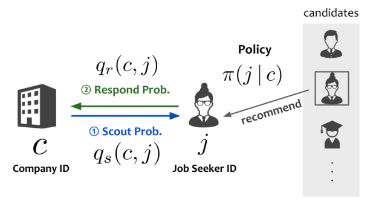
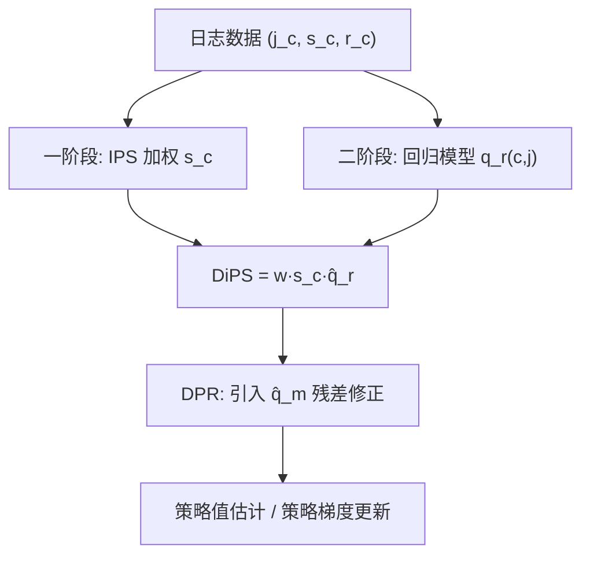

# Off-Policy Evaluation and Learning for Matching Markets (双向匹配市场的离策略评估与学习)

- **会议/期刊**: RecSys 2025
- **作者与机构**: Yudai Hayashi (Wantedly, inc.)、Shuhei Goda (Independent Researcher)、Yuta Saito (Cornell University)
- **推荐链路定位**: 召回（策略评估与离线策略学习）
- **研究方向**: 强化学习与动态探索推荐 / 去偏公平与工业架构
- **论文原文**: [https://arxiv.org/abs/2507.13608v1](https://arxiv.org/abs/2507.13608v1)
- **开源代码**: 暂未开源

## TL;DR (1分钟核心速览)

双向匹配平台（求职、约会）的成功匹配需双方互选，终极奖励 $m=s\cdot r$极度稀疏，导致 IPS/DR 方差爆炸、DM 偏差过大。本文首次形式化匹配市场的 OPE/OPL 问题，提出 DiPS 与 DPR：对一阶段奖励$s$（如企业发 scout）做 IPS 无偏估计、对二阶段回复概率$q_r$用回归插补，从而把重要性权重乘在稠密的$s$而非稀疏的$m$上。理论上证明 DiPS 方差严格低于 IPS（下界为$\mathbb{E}[w^2 q_s \sigma_r^2]$），DPR 在$q_r$ 估计准确时进一步降方差。合成数据与 Wantedly 真实 A/B 日志（21,736 企业 / 17,460 求职者 / 1.2% 匹配稀疏度）上，MSE 与策略选择 ErrorRate 全面优于 DM/IPS/DR。

## Background & Motivation (背景与核心矛盾)

- **主流范式**: 匹配平台用互惠推荐（reciprocal rec）产出候选对，业界靠 A/B 测试验证新策略；OPE 用日志数据离线估计策略值 $V(\pi)=\frac{1}{|\mathcal{C}|}\sum_c\sum_j \pi(j|c)q_s(c,j)q_r(c,j)$ 以替代昂贵 A/B。
- **前人局限**: ① 标准 IPS/DR 的重要性权重 $w=\pi/\pi_0$作用在稀疏的匹配标签$m$上，$w^2\sigma_m^2$项在动作空间大、策略偏离时方差爆炸；② DM 直接回归$q_m=q_s\cdot q_r$，在 1.2% 稀疏度下回归极不准、偏差巨大。
- **核心洞察 (Key Insight)**: 匹配市场天然存在**两阶段奖励**——一阶段 $s$（企业是否发 scout，稠密）与二阶段$r$（求职者是否回复，条件于$s=1$）。现有估计器完全丢弃了$s$ 这一免费的中介信号。
- **本文切入点**: 把 IPS 用在稠密的一阶段 $s$上、把回归插补用在二阶段$q_r$上，实现"偏差只来自$q_r$误差、方差只来自$s$ 噪声"的解耦式偏差-方差控制。

<figure class="paper-figure" markdown="span">
  <figcaption>图1：双向推荐问题的一个示例场景。平台为公司推荐求职者，随后公司决定是否向该求职者发送邀请。收到邀请的求职者再决定是否回应。只有当观察到求职者的回应时，才形成成功匹配。</figcaption>
</figure>

## Method (核心方法设计)

### 1. 整体框架 (Overall Architecture)

模型输入为日志三元组 $\mathcal{D}=\{(j_c,s_c,r_c)\}_{c\in\mathcal{C}}$（每家企业一条被推荐求职者及其两阶段反馈）。核心是构造两个估计器：DiPS 用 IPS 估计一阶段期望$q_s$、用回归模型$\hat{q}_r$插补二阶段；DPR 在 DiPS 基础上再引入匹配概率模型$\hat{q}_m$ 做 DR 式残差修正。二者均可直接改写为策略梯度估计器（DiPS-PG / DPR-PG）用于离线策略学习。推理时只需在日志上做加权求和，无需在线交互。

### 2. 关键设计拆解 (Key Designs)

1. **DiPS 估计器（一阶段 IPS + 二阶段 DM 的混合）**：痛点是 IPS 把权重压在稀疏 $m$ 上方差爆炸。DiPS 改为
$$\hat{V}_{\text{DiPS}}(\pi;\mathcal{D})=\frac{1}{|\mathcal{C}|}\sum_{c\in\mathcal{C}}\left(\frac{\pi(j_c|c)}{\pi_0(j_c|c)}\cdot s_c\right)\cdot\hat{q}_r(c,j_c).$$
偏差仅剩 $\mathbb{E}_\pi[q_s\cdot\Delta_{q_r,\hat{q}_r}]$（只依赖二阶段回归误差），方差中噪声项变为$\sigma_s^2\hat{q}_r^2$而非$\sigma_m^2$。直觉：$s$稠密且方差小，$q_r$条件于$s=1$ 后也更易学，两阶段各取所长。

2. **DPR 估计器（DiPS 的 DR 式增强）**：
$$\hat{V}_{\text{DPR}}=\frac{1}{|\mathcal{C}|}\sum_{c}\left\{\frac{\pi(j_c|c)}{\pi_0(j_c|c)}(s_c\hat{q}_r-\hat{q}_m)+\mathbb{E}_{\pi}[\hat{q}_m]\right\}.$$
理论证明其偏差与 DiPS **完全相同**（Theorem 4.5），但方差第二项由 $q_r$变为估计误差$\Delta_{q_r,\hat{q}_r}$，故$\hat{q}_r$越准方差越低。这是"用$\hat{q}_m$ 做控制变量但不引入额外偏差"的经典 DR 思想在两阶段结构上的移植。

3. **训练目标、负采样与推理效率**：无显式训练损失，核心是回归模型 $\hat{q}_r,\hat{q}_m$（GBDT，5 折交叉验证）与倾向模型$\hat{\pi}_0$（GBDT + softmax 归一）。策略梯度版本$\nabla_\theta\hat{V}_{\text{DiPS}}=\frac{1}{|\mathcal{C}|}\sum_c w\cdot s_c\cdot\hat{q}_r\cdot\nabla_\theta\log\pi_\theta$。推理仅需一次前向加权求和，开销与 IPS 同阶，无额外在线成本。

## Experimental Setup & Evaluation Protocol (实验设置与评估协议)

- **数据集与预处理**:

| 数据集 | #Users(企业) | #Items(求职者) | #Interactions | 稀疏度 | 说明 |
| :--- | :---: | :---: | :---: | :---: | :--- |
| Synthetic | 可变(数百~数千) | 可变(数百~数千) | 每企业 1 条日志 | 由 $\theta_{sp}$控制 | 10 维正态上下文 + 非线性$q_s,q_r$ |
| Wantedly 真实 A/B | 21,736 | 17,460 | 21,736 | 1.2% 匹配 | 仅取 rank $k\le 3$，$c$=(日期,排名,企业ID) |

- **数据划分与防穿越 (Splitting Strategy)**: 真实数据按企业采样（2k/5k/8k）重复 20 次评估；回归与倾向模型均用 **5 折交叉验证** 训练，避免用同批数据既拟合又评估。
- **排名评测协议 (Ranking Protocol)**: 非排序任务，采用 **MSE**（分解为 Bias²+Variance）与 **ErrorRate**（策略选择 I/II 类错误之和）双指标；真实数据因无法复现动作概率，用 GBDT 估计 $\hat{\pi}_0,\hat{\pi}$ 后 softmax 归一。
- **对比基线与超参设置**: 基线为 DM、IPS、DR 及其 PG 版本；合成数据默认 $\beta=-0.5$（logging 策略）、$\epsilon=0.2$（目标策略）；真实数据 GBDT 回归，$q_r$模型 ROC-AUC 约 0.68–0.70、$q_m$ 约 0.60–0.71。

## Key Experimental Results (实验关键数据)

### 1. 主实验对比 (Main Results)

真实 Wantedly 数据（8,000 企业采样，20 次重复，越低越好）：

| 估计器 | MSE | Bias² | Variance | ErrorRate |
| :--- | :---: | :---: | :---: | :---: |
| DM | 高（稀疏下回归失效） | 高 | 低 | 较高 |
| IPS | 高（过估计 $V(\pi)$） | 中 | **最高** | 低 |
| DR | 中高 | 中 | 高 | 中 |
| **DiPS** | **较低** | 低于 IPS | 显著低于 IPS/DR | **最低** |
| **DPR** | **最低** | 低于 DR | 最低 | 低 |

合成数据（图 2–4）：随企业数↑、求职者数↑（动作空间↑）、稀疏参数↑，DiPS/DPR 的 MSE 与 ErrorRate 均显著低于 DM/IPS/DR；动作空间增大时 IPS/DR 方差急剧上升，而 DiPS/DPR 仅以少量偏差换取大幅降方差。OPL 实验（图 7）中 DiPS-PG/DPR-PG 在多数配置下取得最高策略值。

### 2. 消融实验 (Ablation Study)

| 配置 | 关键变化 | 结论 |
| :--- | :--- | :--- |
| IPS → DiPS | 权重从 $m$移到$s$，$q_r$用回归 | 方差大降，偏差仅来自$q_r$ |
| DiPS → DPR | 加入 $\hat{q}_m$ 残差项 | 偏差不变，方差进一步降 |
| 已知 vs 估计 $\pi_0$| 真实数据$\hat{\pi}_0$ 低估 | DiPS 偏差反低于 IPS（误差正相关） |
| 稀疏度 $\theta_{sp}$↑ | 匹配更稀疏 | DM 恶化最快，DiPS/DPR 最稳 |

### 3. 关键实验发现 (Key Findings)

1. **方差下界可证**：Theorem 4.4 给出 $\text{Var}_{\text{IPS}}-\text{Var}_{\text{DiPS}}\ge\frac{1}{|\mathcal{C}|^2}\sum_c\mathbb{E}_\pi[w^2 q_s\sigma_r^2]\ge 0$，即$w^2$、$q_s$、二阶段噪声越大，DiPS 降方差收益越大——正好对应大动作空间与策略偏离场景。
2. **真实数据上 DiPS 偏差反低于 IPS**：因 $\hat{\pi}_0$低估与$\hat{q}_r$低估正相关（Theorem 4.2 条件成立），IPS 系统性过估计$V(\pi)$（图 6），DiPS 同时降偏差与方差。
3. **MSE 与 ErrorRate 存在张力**：IPS 因过估计反而 ErrorRate 较低（更常把目标策略排在上方），DPR/DR 虽 MSE 更小但 ErrorRate 略高；DiPS 在两者间取得最佳平衡，说明单一 MSE 不足以评价策略选择可靠性。

## Highlights & Limitations (亮点、对比与审稿批判)

- **与代表作对比 (vs. Prior Work)**: 相比标准 IPS/DR（Saito & Joachims 等）仅用终极奖励，本文首次利用匹配市场两阶段结构；相比 Switch-DR/MIPS 等降方差技巧，DiPS/DPR 是**结构性**降方差（换奖励层级）而非截断/嵌入边际化，且附录证明可与 Switch-DR、MIPS 叠加扩展。
- **可迁移亮点**: ① "把 IPS 放在稠密中介信号、把回归放在稀疏终局信号"的两阶段解耦思路可迁移到曝光→点击→转化的漏斗式 OPE；② 用 $\hat{q}_m$ 作控制变量但不引入偏差的 DPR 构造，可复用到任何有中间标签的 DR 估计。
- **审稿级局限批判**: ① 真实数据无法获知真实 $\pi_0$，用 GBDT 估计倾向引入额外偏差，且$q_m$ 模型 ROC-AUC 仅约 0.6–0.7，回归质量偏弱；② 仅在企业侧单条日志（每企业 1 个动作）建模，未处理同一企业多候选的列表级/组合动作空间，实际平台排序场景的扩展性待验证。

## Rating (四维评分)

- **方法创新性 (Novelty)**: ⭐⭐⭐⭐ （首次形式化匹配市场 OPE/OPL，两阶段奖励解耦的 DiPS/DPR 构造简洁且有偏差-方差定理支撑）
- **评估协议与实验扎实度 (Protocol & Experiments)**: ⭐⭐⭐⭐ （合成+真实 A/B 双验证、MSE 分解与 ErrorRate 双指标、20 次重复，但真实倾向与回归模型精度有限）
- **写作与数学规范度 (Clarity & Rigor)**: ⭐⭐⭐⭐ （Theorem 4.1–4.6 偏差方差推导完整、附录含 Switch-DR/MIPS 扩展与全部证明）
- **工业落地与复现价值 (Industrial & Practical Value)**: ⭐⭐⭐⭐ （Wantedly 生产日志验证、推理开销与 IPS 同阶，但暂未开源、列表级扩展待补）

