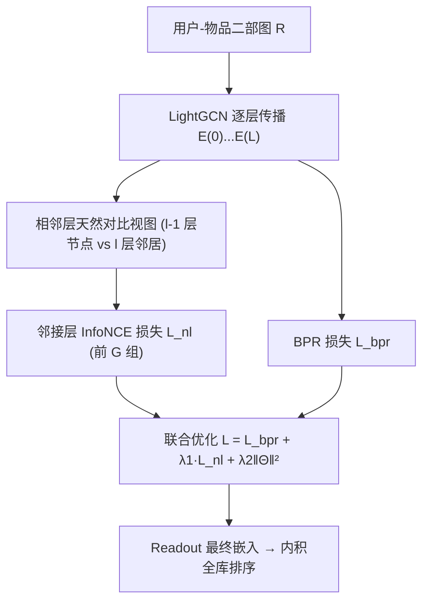
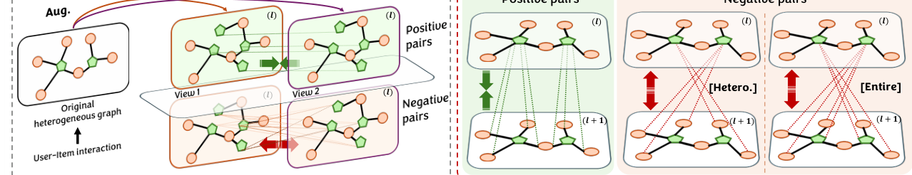

# NLGCL: Naturally Existing Neighbor Layers Graph Contrastive Learning for Recommendation (天然存在的邻接层图对比学习推荐)

- **会议/期刊**: RecSys 2025 (Spotlight Oral)
- **作者与机构**: Jinfeng Xu, Zheyu Chen, Shuo Yang, Jinze Li, Hewei Wang, Wei Wang, Xiping Hu, Edith Ngai (香港大学 / 香港理工大学 / CMU / 深圳北理莫斯科大学 / 北京理工大学)
- **推荐链路定位**: 召回 (图协同过滤表征学习)
- **研究方向**: 自监督对比学习与交互去噪 / 图神经网络推荐
- **论文原文**: [https://arxiv.org/abs/2507.07522v1](https://arxiv.org/abs/2507.07522v1)
- **开源代码**: [https://github.com/Jinfeng-Xu/NLGCL](https://github.com/Jinfeng-Xu/NLGCL)

## TL;DR (1分钟核心速览)

现有图对比学习 (GCL) 靠节点/边丢弃或噪声注入构造对比视图，既引入语义无关噪声、又把语义相似节点粗暴推远，还要额外构图与存储。NLGCL 提出：GCN 相邻层之间的异构节点（第 $l-1$层用户 vs 第$l$ 层其邻居物品）本身就是天然正样本对，无需任何增广即可做 InfoNCE。在 4 个公开数据集、`Full-Ranking` 全库排序协议下，NDCG@10 相对最强基线提升 2.52%–12.41%，且总训练时间最短（Yelp 49 分钟 vs SimGCL 4 小时 14 分）。

## Background & Motivation (背景与核心矛盾)

- **主流范式**: LightGCN 类图协同过滤 + GCL（SGL 随机丢边、SimGCL 卷积加噪、LightGCL 用 SVD 造视图、NCL 用 EM 聚类），通过最大化两视图互信息缓解数据稀疏。
- **前人局限 (P1 语义错杀)**: 传统 CL 只把"同节点在另一视图的副本"当唯一正样本，其余全部当负样本，导致语义相似节点被无理推远，破坏协同信号。
- **前人局限 (P2 噪声与开销)**: 图增广丢边使嵌入密度分布变差，表征加噪使分布不平滑；且每 epoch 需重复构图/重复卷积，时间与存储开销随视图数线性膨胀。
- **核心洞察 (Key Insight)**: 由 GCN 消息传递式 $e^{(l)}_{\tilde{i}}=\sum_{\bar{u}\in\mathcal{N}_{\tilde{i}}} e^{(l-1)}_{\bar{u}}/\sqrt{|\mathcal{N}_{\tilde{i}}||\mathcal{N}_{\bar{u}}|}$可知，第$l$层邻居物品的表示本就由第$l-1$ 层该用户及其相似用户的表示加权聚合而成——**相邻层异构节点天然共享语义**，无需增广即可构成对比视图。
- **本文切入点**: 直接把"节点 vs 下一层邻居"作为多正样本对，把"节点 vs 下一层非邻居"作为负样本，用零增广换取语义保真与效率。

## Method (核心方法设计)

### 1. 整体框架 (Overall Architecture)

以 LightGCN 为编码器，前向传播得到各层嵌入 $E^{(0)},\dots,E^{(L)}$；随后在相邻层之间构造两组天然对比视图（异构 scope：第$l-1$层用户 ↔ 第$l$层物品；第$l-1$层物品 ↔ 第$l$层用户），对前$G$组视图计算邻接层对比损失$\mathcal{L}_{nl}$，与 BPR 损失联合优化；推理时仅用 Readout 后的最终嵌入做内积全库排序，对比分支完全离线丢弃，**推理零额外开销**。

<figure class="paper-figure" markdown="span">
  <figcaption>图1：对比学习概述。左：传统对比学习范式；右：我们的NLGCL。</figcaption>
</figure>

### 2. 关键设计拆解 (Key Designs)

1. **天然邻接层对比视图（免增广的核心算子）**：痛点是不增广就没有"第二视图"。本文定义异构 scope 下用户侧损失（物品侧对称）：
$$\mathcal{L}^{u}_{nl}=-\frac{1}{G|\mathcal{U}|}\sum_{g=0}^{G-1}\sum_{u\in\mathcal{U}}\frac{1}{|\mathcal{N}_u|}\log\frac{\sum_{i^+\in\mathcal{N}_u}\exp(e^{(g)\top}_{u}e^{(g+1)}_{i^+}/\tau)}{\sum_{\hat{i}\in\mathcal{I}}\exp(e^{(g)\top}_{u}e^{(g+1)}_{\hat{i}}/\tau)}$$
   与以往"单正样本"不同，这里**每个节点拥有 $|\mathcal{N}_u|$个正样本**，正样本内部的"噪声"恰好来自语义相似邻居，起到补偿 P1 的作用；分母仍覆盖全物品集，保证均匀性正则。直觉：第$l$ 层邻居表示已含该用户自身信息，拉近即等价于在无增广条件下做自蒸馏。

2. **异构 vs 全体两种 scope 与"前 $G$层最优"定理**：全体 scope 把第$l$层所有用户也纳入负样本（分母为$\mathcal{V}=\mathcal{I}\cup\mathcal{U}$），负样本更广但引入用户-物品语义鸿沟噪声。作者进一步证明（Theorem 1）：相邻层互信息$I(E^{(l-1)};E^{(l)})\propto\lambda^{2l}_{\max}$随层数指数衰减（低通滤波使熵单调下降），故**取最靠前的$G$组视图信噪比最高**，这为"只用前$G$ 层"提供了谱域理论依据，而非拍脑袋。

3. **训练目标、负采样与推理效率**：总损失 $\mathcal{L}=\mathcal{L}_{bpr}+\lambda_1\mathcal{L}_{nl}+\lambda_2\|\Theta\|_2^2$，负样本为 **in-batch 全库负采样（免显式负采样构造）**。复杂度上编码器与 LightGCN 同为$O(2|\mathcal{E}|Ld)$，仅 CL 损失多出$O(2GMdB)$；由于省去增广图构建与存储，实测每 epoch 时间与收敛轮数双降。

## Experimental Setup & Evaluation Protocol (实验设置与评估协议)

- **数据集与预处理**:

| 数据集 | #Users | #Items | #Interactions | 稀疏度 | 场景说明 |
| :--- | :---: | :---: | :---: | :---: | :--- |
| Yelp | 45,477 | 30,708 | 1,777,765 | 99.873% | 本地生活商户 (15-core) |
| Pinterest | 55,188 | 9,912 | 1,445,622 | 99.736% | 图文社交 (5-core) |
| QB-Video | 30,324 | 25,731 | 1,581,136 | 99.797% | 短视频 (5-core) |
| Alibaba | 300,001 | 81,615 | 1,607,813 | 99.993% | 电商超稀疏 (15-core) |

- **数据划分与防穿越**: 用户级 `比例划分` 8:1:1（train/valid/test），非时间戳切分。
- **排名评测协议**: 无偏 `Full-Ranking`（对全部未交互物品排序），指标 Recall@{10,20,50} 与 NDCG@{10,20,50}；训练采用 pair-wise 随机负采样（每正样本配 1 负）。
- **对比基线与超参**: 基线含 CF 类（MF-BPR、NGCF、LightGCN、IMP-GCN、LayerGCN）与 CL 类（SGL、NCL、SimGCL、LightGCL、DCCF、BIGCF）；嵌入维度 $d=64$，batch=4096，$\lambda_2=10^{-4}$，$\lambda_1\in\{10^{-6},10^{-5},10^{-4}\}$，$\tau\in\{0.1,\dots,0.4\}$，$L\in\{1..4\}$，$G\le L$；显著性$p<0.01$。

## Key Experimental Results (实验关键数据)

### 1. 主实验对比 (Main Results)

| 数据集 / 指标 | LightGCN | SGL | NCL | SimGCL | LightGCL | DCCF | BIGCF | **NLGCL** | Improv. |
| :--- | :---: | :---: | :---: | :---: | :---: | :---: | :---: | :---: | :---: |
| Yelp N@10 | 0.0520 | 0.0601 | 0.0673 | 0.0682 | 0.0551 | 0.0596 | 0.0630 | **0.0713** | +4.55% |
| Yelp R@50 | 0.2016 | 0.2100 | 0.2127 | 0.2130 | 0.2008 | 0.2107 | 0.2119 | **0.2327** | +9.25% |
| Pinterest N@10 | 0.0635 | 0.0701 | 0.0666 | 0.0705 | 0.0534 | 0.0661 | 0.0680 | **0.0760** | +7.80% |
| Pinterest R@10 | 0.1000 | 0.1080 | 0.1033 | 0.1051 | 0.0881 | 0.1040 | 0.1040 | **0.1148** | +6.30% |
| QB-Video N@10 | 0.0900 | 0.0932 | 0.0964 | 0.0945 | 0.0921 | 0.0951 | 0.0928 | **0.0996** | +3.32% |
| QB-Video R@50 | 0.3251 | 0.3342 | 0.3414 | 0.3356 | 0.3258 | 0.3281 | 0.3423 | **0.3501** | +2.28% |
| Alibaba N@10 | 0.0246 | 0.0248 | 0.0259 | 0.0262 | 0.0239 | 0.0257 | 0.0266 | **0.0299** | +12.41% |
| Alibaba N@50 | 0.0396 | 0.0396 | 0.0409 | 0.0397 | 0.0410 | 0.0404 | 0.0415 | **0.0450** | +8.43% |

效率对比（Yelp）：NLGCL-H 每 epoch 46.93s、63 轮收敛、总时 **49 分钟**；SimGCL 98.33s×155 轮=4h14m，DCCF 2h20m，BIGCF 2h22m——NLGCL 在效果与总耗时上同时最优。

### 2. 消融实验 (Ablation Study)

| 变体 | Yelp N@10 | Pinterest N@10 | QB-Video N@10 | Alibaba N@10 | 说明 |
| :--- | :---: | :---: | :---: | :---: | :--- |
| NLGCL-H (异构, $G{=}2$) | **0.0713** | **0.0760** | **0.0996** | **0.0299** | 完整模型 |
| NLGCL-E (全体, $G{=}2$) | 0.0689 | 0.0729 | 0.0969 | 0.0279 | 负样本扩到全节点，掉点 |
| NLGCL-H, $G{=}1$ | 0.0679 | 0.0737 | 0.0965 | 0.0274 | 单组视图已超所有基线 |
| NLGCL-H, $L{=}4$ | 0.0677 | 0.0731 | 0.0969 | 0.0275 | 层数过深，互信息衰减 |

### 3. 关键实验发现 (Key Findings)

1. **异构 scope 全面优于全体 scope**：NLGCL-E 在四个数据集上均掉点（Yelp N@10 0.0689 vs 0.0713），印证用户-物品间存在语义鸿沟，把跨类型节点当负样本会加剧语义噪声；同时 NLGCL-E 的 CL 损失复杂度翻倍（$O(4GMdB)$），效果与效率双输。
2. **$G=1$即已超越全部 SOTA**：Yelp 上$G{=}1$的 0.0679 已高于最强基线 SimGCL 的 0.0682 附近水平（Pinterest 0.0737 > 0.0705），说明收益主要来自"天然视图"这一范式本身，而非多组视图堆叠；$G=2$为最优折中，$G$ 增大后收益饱和而耗时线性上升。
3. **超稀疏场景收益最大**：Alibaba 稀疏度 99.993%，NLGCL 的 NDCG@10 相对提升达 12.41%（0.0299 vs BIGCF 0.0266），验证"多正样本 + 语义相关噪声"在交互极少时对表征对齐的补偿作用最强；t-SNE/KDE 可视化也显示其嵌入角度分布最均匀，缓解流行度偏置。

## Highlights & Limitations (亮点、对比与审稿批判)

- **与代表作对比**: 相比 SGL/SimGCL 的"随机扰动造视图"，NLGCL 完全不做增广，从源头消除语义无关噪声；相比 NCL 的 EM 聚类伪正样本，NLGCL 的正样本由图的真实邻接结构直接给出，无需额外聚类超参与迭代；相比 LightGCL 的 SVD 全局视图，NLGCL 零分解开销且保留局部高阶语义。
- **可迁移亮点**: (1) "相邻层即对比视图"可无缝套到任何多层 GNN 主干（如 NGCF、GCNII）上，只需替换 CL 损失；(2) 用互信息随层指数衰减的谱分析来选"前 $G$ 层"，可作为其他多层自监督模型选择监督层的通用准则。
- **审稿级局限批判**: (1) 正样本数等于节点度数，高度数节点（热门物品）的 InfoNCE 分母/分子计算与梯度方差显著增大，论文未讨论度数分桶下的稳定性与去偏；(2) 仅在 LightGCN + 二部图、四个静态数据集上验证，未涉及序列/多模态/动态图，也未给出线上 A/B 或工业级延迟数据，"效率优势"仍停留在单机 epoch 级测量。

## Rating (四维评分)

- **方法创新性 (Novelty)**: ⭐⭐⭐⭐ （"免增广、用邻接层天然异构视图"视角简洁且反直觉，配 Theorem 1 的互信息指数衰减谱证明，理论支撑到位）
- **评估协议与实验扎实度 (Protocol & Experiments)**: ⭐⭐⭐⭐ （4 数据集 + Full-Ranking + 11 个基线 + $p<0.01$ 显著性 + 效率与可视化分析齐全，唯缺度数分桶与线上验证）
- **写作与数学规范度 (Clarity & Rigor)**: ⭐⭐⭐⭐ （P1/P2 问题定义清晰，异构/全体 scope 的正负样本表一目了然，复杂度表完整；Theorem 1 证明中高斯假设略强）
- **工业落地与复现价值 (Industrial & Practical Value)**: ⭐⭐⭐⭐⭐ （代码开源、推理零额外开销、总训练时间最短且 $G$ 可调以适配算力，工程落地门槛极低）

