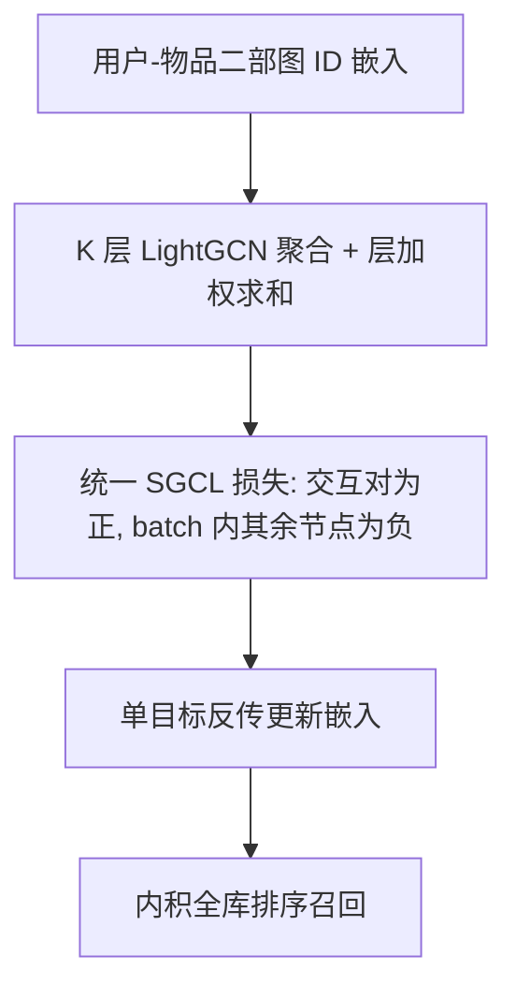
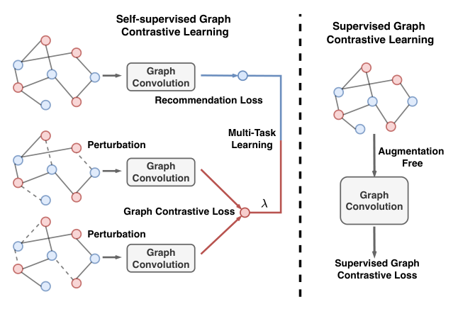

# SGCL: Unifying Self-Supervised and Supervised Learning for Graph Recommendation (统一自监督与监督学习的图推荐框架)

- **会议/期刊**: RecSys 2025 (Prague)
- **作者与机构**: Weizhi Zhang, Liangwei Yang, Zihe Song, Henrry Peng Zou, Ke Xu, Yuanjie Zhu, Philip S. Yu (University of Illinois Chicago / Salesforce AI Research)
- **推荐链路定位**: 召回（图协同过滤表征学习）
- **研究方向**: 自监督对比学习与交互去噪 / 图神经网络推荐
- **论文原文**: [https://arxiv.org/abs/2507.13336v1](https://arxiv.org/abs/2507.13336v1)
- **开源代码**: [https://github.com/DavidZWZ/SGCL](https://github.com/DavidZWZ/SGCL)

## TL;DR (1分钟核心速览)

现有图对比推荐（SGL/SimGCL/NCL/LightGCL）普遍采用「BPR 监督损失 + InfoNCE 自监督损失」的多任务解耦范式，导致需额外图卷积、需调权重 $\lambda$、且两损失梯度方向冲突。SGCL 把二者合并为**单一监督图对比损失**：以真实交互对$(u_i,v_j)$ 为正样本，batch 内其余用户/物品表征为负样本，一次前向、无图增广、无负采样。在 Beauty / Toys-and-Games 的 8:1:1 划分下，Recall@20 相对最强基线 SimGCL 提升约 4.8% / 13.3%，单 epoch 训练时间从 6.11s 降至 2.08s。

## Background & Motivation (背景与核心矛盾)

- **主流范式**: 图对比推荐以 LightGCN 式轻量图卷积为编码器，联合优化 $\mathcal{L}_{sslrec}=\mathcal{L}_{rec}+\lambda\mathcal{L}_{gcl}$，其中$\mathcal{L}_{rec}$为 BPR、$\mathcal{L}_{gcl}$ 为基于图增广/扰动双视图的 InfoNCE。
- **前人局限一（算力冗余）**: 为构造两个视图，SGL 需对邻接矩阵做两次边丢弃并额外跑一遍图卷积，邻接归一化与卷积开销约为单塔方法的 3 倍；SimGCL 虽免构图增广，但仍保留双损失与 $\lambda$ 调参。
- **前人局限二（梯度冲突）**: 两个损失共享同一套参数却优化不同目标，梯度方向不一致，多任务训练不稳定，且 $\lambda$ 对数据集高度敏感，需逐数据集网格搜索。
- **核心洞察 (Key Insight)**: 自监督对比的本质是「拉近同一节点不同视图、推远不同节点」，而监督推荐的本质是「拉近真实交互的用户-物品对、推远未交互对」——二者在**样本构造层面可以同构**，无需拆成两个任务。
- **本文切入点**: 直接把真实交互对当作正样本、batch 内其他节点当作负样本，用一个对比损失同时承担推荐监督与结构自监督，从根上消除多任务与增广。

## Method (核心方法设计)

### 1. 整体框架 (Overall Architecture)

输入为用户-物品二部图的 ID 嵌入，经 $K$层 LightGCN 式对称归一化聚合得到逐层表征并按等权$\alpha_k=1/(K+1)$求和，得到最终$\boldsymbol{u}_i,\boldsymbol{v}_j$；随后**只计算一个 SGCL 损失**并反传，无增广分支、无 BPR 分支、无负采样器。推理阶段直接以内积$\boldsymbol{u}_i^\top\boldsymbol{v}_j$ 全库排序。整个流程相比 SGL 省去一次图增广构图与一次额外图卷积，相比 LightGCN 省去 BPR 的负采样与成对打分。

<figure class="paper-figure" markdown="span">
  <figcaption>图 1：左图展示了传统 SSL RecSys 的流程，包括图增强、三轮图卷积以及由 𝜆 控制的两种不同损失优化。右图描绘了我们的 SGCL 框架，由单个图编码器和统一的 SGCL 损失组成。</figcaption>
</figure>

### 2. 关键设计拆解 (Key Designs)

1. **统一监督图对比损失 (SGCL Loss)**：痛点在于 InfoNCE 无法直接吃交互标签、必须外挂 BPR。SGCL 将 batch $\mathcal{B}$内每个交互对$(i,j)$视为正对，分子为$\exp(\boldsymbol{u}_i^\top\boldsymbol{v}_j/\tau)$，分母同时枚举 batch 内其他用户$\boldsymbol{u}_{i'}$与其他物品$\boldsymbol{v}_{j'}$：

$$\mathcal{L}_{sgcl}=\sum_{(i,j)\in\mathcal{B}}-\log\frac{\exp(\boldsymbol{u}_i^\top\boldsymbol{v}_j/\tau)}{\sum_{(i',j')\in\mathcal{B}}\left[\exp(\boldsymbol{u}_i^\top\boldsymbol{u}_{i'}/\tau)+\exp(\boldsymbol{v}_j^\top\boldsymbol{v}_{j'}/\tau)\right]}$$

   直觉：分子项即 BPR 的正样本对齐，分母项即 InfoNCE 的跨节点排斥，一个 softmax 同时完成「监督对齐 + 结构去噪」，且负样本全部来自 in-batch，天然免采样。

2. **免增广单塔架构 (Augmentation-Free Single Encoder)**：SGL 需两次随机边丢弃生成双视图，SGCL 直接复用同一份图卷积输出作为对比表征，因为正样本已由真实交互提供，不再需要「同一节点的两个扰动视图」。这使邻接归一化从 $O((2+4p)|E|)$降为$O(2|E|)$，图卷积从$O((2+4p)|E|Kd)$降为$O(2|E|Kd)$，并彻底删除$\lambda$ 超参。

3. **训练目标与推理效率**：总损失即 $\mathcal{L}_{sgcl}$单目标，负采样策略为 **in-batch 免采样**（batch size$B=1024$，温度$\tau=0.2$）。复杂度上，采样项$O(BN_v)$与 BPR 项$O(2Bd)$被完全消除，GCL 项由 SGL 的$O(2Bd+2B^2d)$降为$O(Bd+2B^2d)$；实测 Beauty 单 epoch 2.08s（SGL 6.11s），总训练 2.15m（SGL 6.42m）。

## Experimental Setup & Evaluation Protocol (实验设置与评估协议)

- **数据集与预处理**: 两个 Amazon 子集，均做 `5-core` 过滤：

| 数据集 | #Users | #Items | #Interactions | 稀疏度/密度 | 特征/场景说明 |
| :--- | :---: | :---: | :---: | :---: | :--- |
| Beauty | 22,363 | 12,101 | 198,502 | 99.93% 稀疏 | 美妆品类，仅 ID 特征 |
| Toys-and-Games | 19,412 | 11,924 | 167,597 | 99.93% 稀疏 | 玩具品类，仅 ID 特征 |

- **数据划分与防穿越 (Splitting Strategy)**: 采用 `比例划分` 8:1:1（train/valid/test），非 Leave-One-Out，验证集用于早停与超参选择。
- **排名评测协议 (Ranking Protocol)**: 原文未显式声明候选集构造，按基线惯例为 `Full-Ranking (全库未交互排序)`，指标 Recall@{20,50} 与 NDCG@{20,50}。
- **对比基线与超参设置**: 8 个基线覆盖三类——MF 类（BiasMF、NeuMF）、图模型（NGCF、LightGCN）、自监督图方法（NCL、SGL、LightGCL、SimGCL）；统一 $B=1024$、$d=64$，SGCL 取$\tau=0.2$；基线均逐数据集调参，未报告显著性检验。

## Key Experimental Results (实验关键数据)

### 1. 主实验对比 (Main Results)

| Method | Beauty R@20 | Beauty N@20 | Beauty R@50 | Beauty N@50 | Toys R@20 | Toys N@20 | Toys R@50 | Toys N@50 |
| :--- | :---: | :---: | :---: | :---: | :---: | :---: | :---: | :---: |
| BiasMF | 0.1152 | 0.0544 | 0.1754 | 0.0668 | 0.0981 | 0.0479 | 0.1624 | 0.0625 |
| NGCF | 0.1126 | 0.0517 | 0.1699 | 0.0625 | 0.0944 | 0.0429 | 0.1532 | 0.0561 |
| LightGCN | 0.1224 | 0.0583 | 0.1903 | 0.0718 | 0.1159 | 0.0565 | 0.1759 | 0.0680 |
| NCL | 0.1264 | 0.0613 | 0.1948 | 0.0721 | 0.1170 | 0.0566 | 0.1782 | 0.0686 |
| SGL | 0.1335 | 0.0634 | 0.2048 | 0.0780 | 0.1248 | 0.0595 | 0.1869 | 0.0720 |
| LightGCL | 0.1278 | 0.0596 | 0.1905 | 0.0697 | 0.1177 | 0.0549 | 0.1772 | 0.0647 |
| SimGCL | 0.1345 | 0.0640 | 0.2058 | 0.0799 | 0.1162 | 0.0593 | 0.1738 | 0.0713 |
| **SGCL** | **0.1410** | **0.0677** | **0.2105** | **0.0807** | **0.1317** | **0.0626** | **0.1965** | **0.0774** |
| Improv.% (vs 最强基线) | +4.83% | +5.78% | +2.28% | +1.00% | +5.53% | +5.21% | +5.14% | +7.50% |

### 2. 消融与效率实验 (Ablation & Efficiency)

原文未提供逐组件消融表，但给出等价性质的效率对照（Beauty / Toys）：

| 配置 | Beauty 时间/Epoch | Beauty #Epoch | Beauty 总时长 | Toys 时间/Epoch | Toys #Epoch | Toys 总时长 |
| :--- | :---: | :---: | :---: | :---: | :---: | :---: |
| LightGCN（无对比） | 2.82s | 153 | 7.19m | 1.53s | 173 | 4.41m |
| SGL（双塔+双损失） | 6.11s | 63 | 6.42m | 6.24s | 75 | 7.80m |
| **SGCL（单塔+单损失）** | **2.08s** | **62** | **2.15m** | **1.63s** | **35** | **0.95m** |

### 3. 关键实验发现 (Key Findings)

1. **统一损失带来的增益在稀疏品类上更显著**：Toys 上 Recall@50 相对 SimGCL 提升 13.1%（0.1738→0.1965），而 Beauty 上仅 2.3%，说明当交互更稀疏、噪声对比信号更不可靠时，用真实交互替代扰动视图作正样本的去噪价值更大。
2. **效率提升来自「省一次卷积 + 省采样」而非「省 epoch」**：SGCL 的 epoch 数（62/35）与 SGL（63/75）同量级甚至更少，但单 epoch 时间仅为 SGL 的 1/3（2.08s vs 6.11s），总时长降至 1/3（2.15m vs 6.42m），印证复杂度分析中 $4p|E|Kd$与$BN_v$ 两项被消除。
3. **收敛速度显著加快**：前 30 epoch 内 SGCL 的 NDCG@20 已进入高位平台，而 LightGCN 与 SGL 仍远离收敛点，说明单目标优化消除了梯度冲突，使训练轨迹更直。

## Highlights & Limitations (亮点、对比与审稿批判)

- **与代表作对比 (vs. Prior Work)**: 与 SGL 的本质区别是「正样本来源」——SGL 靠随机边丢弃造双视图，SGCL 直接用交互对，因而免去增广与第二座编码器；与 SimGCL 的区别是「任务数」——SimGCL 仍需 BPR+InfoNCE 双损失与 $\lambda$ 调参，SGCL 坍缩为单损失；与 LightGCN 的区别是「监督信号密度」——SGCL 在无额外开销下引入了 batch 级跨节点排斥。
- **可迁移亮点**: (1) 把「监督正对 + in-batch 负样本」写进同一个 softmax，可作为任何双塔召回模型替换 BPR 的即插即用损失；(2) 用「正样本是否可由标签直接提供」来判断是否真的需要数据增广，这一判据可迁移到序列/多模态对比推荐。
- **审稿级局限批判**: (1) 论文仅 5 页且未提供逐组件消融与 $\tau$敏感度分析，也未做显著性检验，$+1.00\%$ 这类小幅提升（Beauty N@50）说服力偏弱；(2) in-batch 负样本分布受 batch 组成影响，存在热门物品被过度排斥的流行度偏置风险，且未与 sampled 负采样协议做公平对照；此外 arXiv 注明与 arXiv:2404.15954 存在大量文本重叠，需关注自我重复问题。

## Rating (四维评分)

- **方法创新性 (Novelty)**: ⭐⭐⭐⭐ （统一损失的构造简洁且动机清晰，但本质是 BPR 与 InfoNCE 的 softmax 合并，理论新意中等，胜在工程洞察准确）
- **评估协议与实验扎实度 (Protocol & Experiments)**: ⭐⭐⭐ （仅两个同源 Amazon 数据集、缺消融与显著性检验、候选集协议未明示，效率实验较完整）
- **写作与数学规范度 (Clarity & Rigor)**: ⭐⭐⭐⭐ （公式紧凑、复杂度逐项拆解到位，但符号与基线描述略简，5 页篇幅限制了推导展开）
- **工业落地与复现价值 (Industrial & Practical Value)**: ⭐⭐⭐⭐⭐ （代码开源、单塔单损失、训练时长降至 1/3、无 $\lambda$ 调参，对大规模图召回落地极友好）

