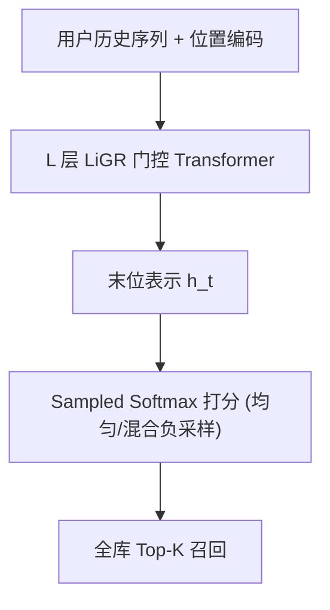

# eSASRec: Enhancing Transformer-based Recommendations in a Modular Fashion (以模块化方式增强 Transformer 推荐)

- **会议/期刊**: ACM RecSys 2025
- **作者与机构**: Daria Tikhonovich, Nikita Zelinskiy, Mayya Spirina, Sergei Kuliev (MTS); Aleksandr V. Petrov (Independent); Andrei Semenov (Yandex); Andrey V. Savchenko (Sber AI Lab)
- **推荐链路定位**: 召回（Next-Item 序列召回）
- **研究方向**: 序列与会话推荐 / 工业级评测基准与去偏
- **论文原文**: [https://arxiv.org/abs/2508.06450v1](https://arxiv.org/abs/2508.06450v1)
- **开源代码**: [https://github.com/blondered/transformer_benchmark](https://github.com/blondered/transformer_benchmark)

## TL;DR (1分钟核心速览)

本文针对"Transformer 序列推荐的各类模块化增强（训练目标、层结构、损失、负采样）从未被系统性叠加评测"这一空白，将 SASRec/BERT4Rec 拆解为可互换模块逐一组合，发现 **SASRec 的 Shifted Sequence 目标 + LiGR 门控 Transformer 层 + Sampled Softmax 损失** 的组合最强，命名为 eSASRec。在 Amazon 学术基准上 NDCG@10 较 ActionPiece 提升 23%（0.0523 vs 0.0424）；在全局时间切分 + Coverage 的"生产级"评测下，eSASRec 与 HSTU、FuXi-$\alpha$ 同处 NDCG–Coverage 帕累托前沿，且无需时间戳等额外特征。

## Background & Motivation (背景与核心矛盾)

- **主流范式**: SASRec（因果自注意力 + BCE + 1 负样本）与 BERT4Rec（双向 + MLM）是序列推荐的标准基线，后续工作不断提出更好的损失（gBCE、SS）、训练目标（All Action/DenseAA）、层结构（LiGR、HSTU）与负采样策略。
- **前人局限**: 其一，这些增强的**可加性从未被系统基准化**，研究者各自默认标准配置，导致"超越 SASRec"的 SOTA 声明常被高估；其二，主流学术评测沿用 **Leave-One-Out 划分**，存在时间穿越（测试交互可能早于训练交互），且只报精度、忽视覆盖率等 BAc 指标。
- **核心洞察 (Key Insight)**: 作者在 Amazon Beauty 上的初步研究发现，仅给 SASRec 叠加 SS 损失与 LiGR 层，就能在文献同口径下超过 TIGER、ActionPiece、DuoRec 等一众新模型（NDCG@10 0.0523 vs 0.0424），说明**大量"新架构"的增益其实来自被忽视的模块化工程细节**。
- **本文切入点**: 以模块化视角做受控消融，并在时间切分 + 精度/覆盖率双指标的真实评测下，筛出一个"简单但极强"的基线组合。

## Method (核心方法设计)

### 1. 整体框架 (Overall Architecture)

模型输入为用户历史交互序列，经 Embedding 与位置编码后送入 $L$ 层 LiGR 门控 Transformer 块，取末位表示与物品嵌入做内积打分；训练采用 SASRec 的 Shifted Sequence 目标（对每个位置预测下一物品），损失为 Sampled Softmax，负样本默认从全库均匀采样 256 个，可选混入 in-batch 负样本（Mixed Negative, MN）。推理时对全库物品打分取 Top-K。整个流程与 SASRec 完全一致，仅替换层结构与损失两个"插槽"，因此可直接嵌入现有召回管线。

### 2. 关键设计拆解 (Key Designs)

1. **LiGR 门控 Transformer 层（替换 Post-LN 层）**：原始 SASRec 的 Post-LN 残差在深层/短序列数据上易训练不稳、表征塌缩。LiGR 改为 Pre-Norm，并对每个子层输出施加线性投影 + Sigmoid 门控：
$$h_{j+1}=h_j+F(h_j)\times\sigma(h_j W),$$
其中 $F$ 为多头注意力或前馈层（前馈内部用 SwiGLU）。门控让模型按输入自适应缩放子层贡献，等价于给残差流加了一个数据相关的"软开关"，在 Kion、BeerAdvocate 这类短序列/隐式反馈数据上显著缓解过拟合并提升覆盖率。

2. **Sampled Softmax 损失（替换 BCE + 1 负样本）**：SASRec 原版 BCE 仅用 1 个负样本，梯度信号噪声大。SS 对每个正样本采 $N=256$ 个负样本做 softmax 归一化：
$$\mathcal{L}=-\log\frac{\exp(s^{+})}{\exp(s^{+})+\sum_{k=1}^{N}\exp(s^{-}_{k})},$$
负样本更多、归一化更充分，使打分分布更平滑，从而在精度与覆盖率上同时优于 BCE；相比 gBCE 它被 HSTU/FuXi 等工业模型广泛采用，帕累托一致性更好。

3. **混合负采样（可选增强）与训练开销**：MN 按比例 $\rho$ 混入 in-batch 负样本（实验取 0.6），可调地牺牲部分 NDCG 换取大幅 Coverage 提升（Kion 上 Cov@10 达 0.4049）；可叠加 LogQ 校正缓解流行度偏差。总损失即上述 SS，训练负采样为 Uniform / Mixed / In-Batch 三档可切换，推理仅需一次前向 + 全库内积，开销与 SASRec 同阶。

## Experimental Setup & Evaluation Protocol (实验设置与评估协议)

- **数据集与预处理**: 用户 2-core、物品 5-core 过滤：

| 数据集 | #Users | #Items | #Interactions | 平均序列长 | 特征/场景说明 |
| :--- | :---: | :---: | :---: | :---: | :--- |
| ML-20M | 138,493 | 26,744 | 20,000,263 | 144.4 | 显式评分，学术通用 |
| Kion | 606,743 | 10,266 | 5,109,907 | 8.4 | 隐式反馈，短序列 |
| BeerAdvocate | 22,679 | 22,264 | 1,498,969 | 66.1 | 长序列评论数据 |

- **数据划分与防穿越 (Splitting Strategy)**: 主实验用**全局时间戳切分**——选 14/30/60 天窗口（约覆盖 5% 交互）作测试集，之前全部作训练，并过滤测试中训练未见用户/物品；验证集从训练集内用 LOO 生成（作者发现验证也用时间切分会因丢弃交互过多而损害最终性能）。
- **排名评测协议 (Ranking Protocol)**: 无偏 **Full-Ranking**（全库未交互物品排序），报告 NDCG@10 与 Coverage@10，并以 NDCG–Coverage 帕累托最优性（Par）作为综合判据；因指标相互制衡，未做显式显著性检验。
- **对比基线与超参设置**: 基线含 Popular-7-days、Vanilla SASRec (BCE, 1 neg)、SASRec+SS、工业模型 HSTU 与 FuXi-$\alpha$；嵌入维度统一 256，负样本数 256，batch 128，Adam lr=1e-3，LiGR 前馈扩展倍数 4。

## Key Experimental Results (实验关键数据)

### 1. 主实验对比 (Main Results)

| 模型 | ML-20M N@10 | ML-20M Cov@10 | Kion N@10 | Kion Cov@10 | BeerAdv. N@10 | BeerAdv. Cov@10 |
| :--- | :---: | :---: | :---: | :---: | :---: | :---: |
| Popular-7-days | 0.1671 | 0.0061 | 0.1420 | 0.0035 | 0.0575 | 0.0013 |
| Vanilla SASRec (BCE) | 0.1192 | 0.0829 | 0.1389 | 0.1130 | 0.0222 | 0.0078 |
| SASRec+SS | 0.1527 | 0.0913 | 0.1497 | 0.0785 | 0.0381 | 0.0079 |
| HSTU | **0.1872** | 0.0535 | **0.1694** | 0.2110 | 0.0473 | **0.1942** |
| FuXi-$\alpha$ | **0.1883** | 0.0513 | 0.1647 | 0.2319 | 0.0472 | 0.1904 |
| **eSASRec** | 0.1563 | 0.0889 | 0.1657 | **0.3003** | **0.0650** | 0.0771 |
| SASRec+LiGR+gBCE-0.75 | 0.1479 | **0.1049** | 0.1685 | 0.2381 | 0.0629 | 0.0737 |
| eSASRec+MN-0.6 | 0.1248 | 0.1076 | 0.1475 | **0.4049** | 0.0606 | 0.0746 |

（eSASRec 相对 SASRec+SS：Kion NDCG@10 +9%、Coverage +280%；BeerAdvocate NDCG@10 +70%。）

### 2. 消融实验 (Ablation Study)

| 配置 | ML-20M N@10 | Kion N@10 | Kion Cov@10 | BeerAdv. N@10 |
| :--- | :---: | :---: | :---: | :---: |
| SASRec+SS（无 LiGR） | 0.1527 | 0.1497 | 0.0785 | 0.0381 |
| + LiGR（=eSASRec） | 0.1563 | 0.1657 | 0.3003 | 0.0650 |
| + gBCE-0.75 替代 SS | 0.1479 | 0.1685 | 0.2381 | 0.0629 |
| DenseAA 替代 Shifted Seq | 0.1668 | 0.1638 | 0.1906 | 0.0635 |
| AllAction-Causal | 0.1481 | 0.1536 | 0.1473 | 0.0300 |
| NextAction-Causal | 0.1373 | 0.1636 | 0.1431 | 0.0423 |
| BERT4Rec+LiGR+SS | 0.1364 | 0.1598 | 0.1324 | 0.0561 |

### 3. 关键实验发现 (Key Findings)

1. **LiGR 层是覆盖率的最大贡献者**：仅替换层结构（SASRec+SS → eSASRec），Kion 上 Coverage@10 从 0.0785 跃升至 0.3003（+280%），NDCG 同时 +9%，说明门控残差在短序列隐式数据上同时改善精度与多样性，而非单纯精度–覆盖权衡。
2. **训练目标改动几乎无增益**：DenseAA 仅在 ML-20M 上略优（0.1668 vs 0.1563），AllAction/NextAction/BERT4Rec-MLM 在多数数据集跌出帕累托前沿，证明 SASRec 的 Shifted Sequence 目标本身已足够强，此前"新目标带来 SOTA"的说法被高估。
3. **学术基准与生产级评测结论不一致**：Amazon 学术口径下 eSASRec 超 ActionPiece 23%，但在时间切分 + Coverage 的真实设定下，eSASRec 的 NDCG 明显低于 HSTU/FuXi-$\alpha$（ML-20M 0.1563 vs 0.1872），仅靠覆盖率优势留在帕累托前沿——直接质疑了 LOO 学术榜单的可靠性。

## Highlights & Limitations (亮点、对比与审稿批判)

- **与代表作对比 (vs. Prior Work)**: 相比 HSTU/FuXi-$\alpha$ 依赖时间戳、层次转导单元等复杂结构与额外特征，eSASRec 仅改两个"插槽"即达到同级帕累托表现；相比 gSASRec（gBCE 路线），本文证明 SS 在帕累托一致性上更稳；相比 PinnerFormer 的 DenseAA 目标，本文在公开数据上未能复现其增益。
- **可迁移亮点**: ①"模块化受控消融 + 帕累托前沿"的评测范式可直接迁移到任何召回模型选型；②LiGR 门控残差是低成本、即插即用的层替换技巧，适合已有 SASRec 管线的工业系统。
- **审稿级局限批判**: ①未做显著性检验，且部分结论（如 MN 比例、LogQ）仅在仓库中给出，正文证据偏薄；②仅用 Coverage 一个 BAc 指标，缺 Diversity/Novelty/Serendipity；③LiGR 在 ML-20M 上几乎无增益，其收益高度依赖短序列数据分布，泛化性存疑。

## Rating (四维评分)

- **方法创新性 (Novelty)**: ⭐⭐⭐ （组合本身非新发明，价值在于系统性基准化与"简单强基线"的实证结论）
- **评估协议与实验扎实度 (Protocol & Experiments)**: ⭐⭐⭐⭐ （时间切分 + Full-Ranking + 帕累托分析扎实，但缺显著性检验与多 BAc 指标）
- **写作与数学规范度 (Clarity & Rigor)**: ⭐⭐⭐⭐ （模块划分清晰、公式精简，LiGR 实现细节需回引原文稍显不足）
- **工业落地与复现价值 (Industrial & Practical Value)**: ⭐⭐⭐⭐⭐ （代码/数据/切分全开源，改动极小、无需额外特征，可直接嵌入现有召回管线）

