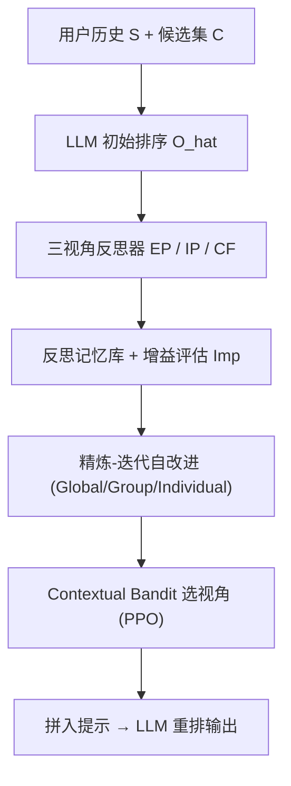
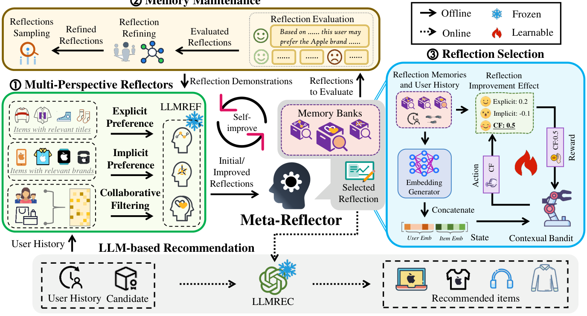

# MoRE: A Mixture of Reflectors Framework for Large Language Model-Based Sequential Recommendation (面向大语言模型序列推荐的混合反思器框架)

- **会议/期刊**: RecSys 2025 (Spotlight Oral)
- **作者与机构**: Weicong Qin, Yi Xu, Weijie Yu (通讯), Chenglei Shen, Xiao Zhang, Jun Xu (中国人民大学高瓴人工智能学院)；Ming He, Jianping Fan (联想研究院 AI Lab)；Weijie Yu 同时隶属对外经济贸易大学
- **推荐链路定位**: 重排（LLM 对候选列表做排序式推荐）
- **研究方向**: 序列与会话推荐 / 大语言模型推荐
- **论文原文**: [https://arxiv.org/abs/2409.06377v2](https://arxiv.org/abs/2409.06377v2)
- **开源代码**: [https://github.com/E-qin/MoRE-Rec](https://github.com/E-qin/MoRE-Rec)

## TL;DR (1分钟核心速览)

现有基于反思 (reflection) 的 LLM 序列推荐把用户历史压成单一文本提示，既无法解耦「显式商品标题」与「隐式品牌忠诚」两类信号，又完全丢弃跨用户协同过滤 (CF) 信息，且反思池静态固定、无法随偏好漂移更新。MoRE 提出三个视角感知的离线反思器（显式偏好 EP / 隐式偏好 IP / 协同过滤 CF），配合元反思器以「反思增益」为度量做精炼-迭代自改进，并用 Contextual Bandit (PPO) 在线为每个用户动态挑选最合适的反思视角。在 Amazon 三子集、Leave-One-Out + 50 候选排序协议下，MoRE 相对最强基线 Re2LLM 的 NDCG@10 在 Arts/Games/Instruments 分别提升 4.39%/10.13%/5.76%，且训练开销为所有 LLM 基线中最低。

## Background & Motivation (背景与核心矛盾)

- **主流范式**: LLM4Rec 分两支——Prompt 类（LLM4RS、LLMRank）靠人工固定提示做 in-context 推理；微调类（TALLRec、LC-Rec、LLaRA、BinLLM）注入领域数据对齐。反思类（Re2LLM）则在离线让 LLM 对比「预测列表 vs 真实交互」生成经验提示，在线复用。
- **前人局限一（显式/隐式混淆）**: 反思仅基于商品标题等表层语义，无法刻画「买了多款电子产品后又买 T 恤，真实驱动是 Apple 品牌忠诚」这类隐式属性序列模式，偏好漂移时失效。
- **前人局限二（CF 信号缺失）**: 反思完全在单用户序列内闭环，无法利用「相似用户共同偏好」的跨用户信号；而微调类方法虽注入 CF，却把 CF 嵌入硬塞进词表，LLM 无法"读懂"。
- **前人局限三（反思更新僵化）**: Re2LLM 维护固定反思池，不评估反思是否真的有用，也不随用户演化做个性化维护。
- **核心洞察 (Key Insight)**: 反思本身是"可评估的资产"——把「有/无该反思时 LLM 排序指标的差值」定义为反思增益 $Imp$，即可把反思质量变成可度量、可筛选、可迭代优化的监督信号；而三视角反思存在冲突（拼接反而掉点），说明"选哪个视角"本身是需在线学习的决策问题。
- **本文切入点**: 离线多视角生成 + 增益驱动自改进 + 在线 Bandit 视角选择，三段式解耦三个挑战。

## Method (核心方法设计)

### 1. 整体框架 (Overall Architecture)

MoRE 分离线与在线两段。离线阶段：对每个用户 $u$在时刻$t$，先用冻结 LLM 基于历史$S_u^{t-1}$与候选集$C_u^t$产出排序$\hat{O}_u^t$，再让三个反思器分别以标题描述、属性子序列（品牌/功能）、CF 打分三种表征重写同一段历史，各自生成反思$Ref_{EP,u}, Ref_{IP,u}, Ref_{CF,u}$存入三条记忆库；元反思器用验证集上的反思增益$Imp$过滤低质反思，并以增益为采样概率把优质反思作为 in-context 示范回灌给反思器迭代自改进。在线阶段：元反思器把「选哪条记忆库的反思」建模为 3 臂 Contextual Bandit，用 PPO 训练 Actor-Critic 依用户/物品 CF 嵌入选臂，取该库中$Imp$ 最高的反思拼入推荐提示完成排序。

<figure class="paper-figure" markdown="span">
  <figcaption>图3：MoRE框架整体架构。MoRE结合多视角反思器离线生成反思①，元反思器自我改进这些反思②并学习选择最合适的反思③。在线推荐时④，元反思器为当前用户选择合适的反思。</figcaption>
</figure>

### 2. 关键设计拆解 (Key Designs)

1. **三视角反思器（EP / IP / CF）**：痛点是单提示把表层语义与深层模式混为一谈。做法是同一份 $(S_u^{t-1}, C_u^t, \hat{O}_u^t, v_u^t)$用三套提示模板分别序列化：EP 用标题+描述文本，IP 用品牌/风格/功能等属性子序列，CF 用预训练 DMF 模型给出的评分序列$Rep_{M_u}(\cdot)$。核心是把"CF 知识"翻译成 LLM 可直接比较的标量分数而非嵌入向量，绕开词表扩展与对齐训练：
$$Ref_{i,u} = \mathrm{LLM_{REF}}\big(P_i(u, S_u^{t-1}, C_u^t, \hat{O}_u^t, v_u^t)\big),\quad i \in \{EP, IP, CF\}$$
直觉：LLM 擅长读文本与做数值比较，把协同信号降维成"评分趋势"最契合其能力边界。

2. **增益驱动的精炼-迭代自改进**：痛点是 LLM 生成的反思未必有用，固定池无法甄别。定义反思增益为有/无反思时验证集指标的差值，超过阈值 $h=0.1$ 才视为有效：
$$Imp = \mathrm{Metric}(\hat{O}_u^{REF}) - \mathrm{Metric}(\hat{O}_u^{REC})$$
随后按 Global（全体共享）/ Group（K-means++ 聚 20 簇共享）/ Individual（逐用户）三级粒度贪心筛选，并以 $Imp$ 为采样概率抽取优质反思作为示范，让反思器在下一轮 in-context 生成更优反思。直觉：把"反思质量"变成可回传的奖励信号，等价于对提示做离线策略迭代，且全程无需更新 LLM 参数。

3. **在线视角选择的 Contextual Bandit 与训练目标**：痛点是三视角拼接会互相冲突（消融中 $Ref_{all}$反而最差）。将状态定义为 CF 嵌入拼接$\boldsymbol{z}=[\boldsymbol{e}_u, \boldsymbol{e}_v]$，动作为 3 维 one-hot 选库，奖励直接复用已算好的$Imp$（无需在线调 LLM），用 PPO 的 clip 目标训练：
$$\mathcal{L} = \min\Big(\tfrac{\pi_\theta}{\pi_{old}}A(\boldsymbol{z},\boldsymbol{a}),\ \mathrm{clip}(\tfrac{\pi_\theta}{\pi_{old}}, 1-\delta, 1+\delta)A(\boldsymbol{z},\boldsymbol{a})\Big)$$
其中 $A(\boldsymbol{z},\boldsymbol{a}) = \mathbb{E}(R(\boldsymbol{z},\boldsymbol{a})) - V_\psi(\boldsymbol{z})$。训练用$\epsilon$-greedy ($\epsilon=0.1$) 探索 + replay buffer；推理时取 Actor 置信度最高的臂及该库$Imp$最高的反思。动作空间仅$|\mathcal{A}|=3$，是训练开销远低于 Re2LLM（$|\mathcal{A}|=20$）的直接原因。

## Experimental Setup & Evaluation Protocol (实验设置与评估协议)

- **数据集与预处理**: Amazon 2018 三子集，沿用 LC-Rec 的预处理与过滤口径：

| 数据集 | #Users | #Items | Avg. len | 稀疏度 | 特征/场景说明 |
| :--- | :---: | :---: | :---: | :---: | :--- |
| Arts | 55,970 | 22,612 | 8.80 | 99.96% | Arts, Crafts and Sewing，含标题与品牌属性 |
| Games | 55,145 | 17,287 | 9.01 | 99.95% | Video Games |
| Instruments | 27,404 | 10,450 | 8.41 | 99.92% | Musical Instruments |

- **数据划分与防穿越 (Splitting Strategy)**: `Leave-One-Out`——每用户序列最后一项作测试、倒数第二项作验证、其余训练；并剔除超长序列用户后随机采样 1,000 名用户（物品全集不变）以控制 LLM 调用成本。
- **排名评测协议 (Ranking Protocol)**: `Sampled Ranking`，每用户 1 个正样本 + 随机采样 49 个负样本构成 $|C_u|=50$候选集，所有方法共享同一候选集；指标为 HR@{1,5,10} 与 NDCG@{5,10}，要求输出 top-10 排序（仅能输出 top-1 的基线单独在表 3 比较）。显著性用双侧配对 t 检验 + Bonferroni 校正，$p<0.05$。
- **对比基线与超参设置**: 传统模型 Caser/GRU4Rec/SASRec/BERT4Rec/FDSA；免训练 LLM 方法 LLM4RS/LLMRank(CoT)；需训练 LLM 方法 LC-Rec/TALLRec/BinLLM/Re2LLM/LLaRA/A-LLMREC。统一骨干 LLaMa-3-8B-Instruct，CF 打分由 DMF（$d=64$）提供，聚类数 20，阈值$h=0.1$，4×A800-80GB。

## Key Experimental Results (实验关键数据)

### 1. 主实验对比 (Main Results)

| 方法 | Arts HR@10 | Arts N@10 | Games HR@10 | Games N@10 | Instr. HR@10 | Instr. N@10 |
| :--- | :---: | :---: | :---: | :---: | :---: | :---: |
| SASRec | 0.4280 | 0.3016 | 0.4348 | 0.2369 | 0.3701 | 0.2809 |
| LLMRank(CoT) | 0.4061 | 0.2828 | 0.4496 | 0.2925 | 0.3709 | 0.2461 |
| LC-Rec | 0.4309 | 0.3181 | 0.4646 | 0.3593 | 0.3920 | 0.2691 |
| Re2LLM | 0.4938 | 0.3757 | 0.5198 | 0.3559 | 0.4424 | 0.3074 |
| **MoRE** | **0.5043** | **0.3922** | **0.5731** | **0.3957** | **0.4674** | **0.3251** |
| Improv.% | +2.13% | +4.39% | +10.25% | +10.13% | +5.65% | +5.76% |

表 3（仅 top-1 基线，HR@1）：TALLRec 0.2559/0.1975/0.1588，BinLLM 0.2401/0.2347/0.1875，LLaRA 0.2803/0.2263/0.1763，A-LLMREC 0.2193/0.2342/0.1897，**MoRE 0.2898/0.2569/0.2163**——即便对手只被要求输出 top-1（任务更易），MoRE 仍全面胜出。

### 2. 消融实验 (Ablation Study)

Amazon Arts 上的视角与选择策略消融：

| 变体 | HR@1 | HR@10 | N@10 |
| :--- | :---: | :---: | :---: |
| **MoRE (Bandit 选视角)** | **0.2898** | **0.5043** | **0.3922** |
| - Random 选视角 | 0.2736 | 0.4881 | 0.3701 |
| - Greedy 选视角 | 0.2812 | 0.4957 | 0.3786 |
| - 仅 $Ref_{EP}$ | 0.2850 | 0.5033 | 0.3881 |
| - 仅 $Ref_{IP}$ | 0.2850 | 0.4881 | 0.3788 |
| - 仅 $Ref_{CF}$ | 0.2850 | 0.4871 | 0.3788 |
| - $Ref_{EP}+Ref_{IP}$ | 0.2583 | 0.4700 | 0.3651 |
| - $Ref_{EP}+Ref_{CF}$ | 0.2707 | 0.4623 | 0.3533 |
| - $Ref_{IP}+Ref_{CF}$ | 0.2402 | 0.4156 | 0.3217 |
| - $Ref_{all}$（三视角拼接） | 0.2393 | 0.4271 | 0.3268 |

### 3. 关键实验发现 (Key Findings)

1. **"多视角拼接"是负收益，选择才是正解**：三视角全拼接 $Ref_{all}$ 的 NDCG@10 仅 0.3268，比单视角 EP（0.3881）低 15.8%，甚至低于 Random 选择；说明三视角反思在语义上互相冲突，必须做 per-user 动态选择而非简单叠加，这是本文最反直觉的定量证据。
2. **Bandit 选择显著优于贪心与随机**：MoRE 的 NDCG@10 (0.3922) 比 Greedy (0.3786) 高 3.6%、比 Random (0.3701) 高 6.0%，证明"验证集上最优"的静态贪心无法适配偏好漂移，需依赖状态（用户/物品 CF 嵌入）做条件化决策。
3. **迭代与细粒度精炼共同抬升反思质量**：图 4 显示随迭代轮次增加 NDCG@10 单调上升，且 Individual/Group 级精炼始终优于 Global 级（Arts 上差距最明显），说明全局共享反思会引入他人噪声；同时表 5 显示 MoRE 训练时间约 3.98h、峰值显存仅 2.77GB，远低于微调类（A-LLMREC 达 217GB 显存、57h），验证"反思替代微调"的效率优势。

## Highlights & Limitations (亮点、对比与审稿批判)

- **与代表作对比 (vs. Prior Work)**: 相比 Re2LLM，本文把"单一静态反思池"升级为"三视角 + 增益评估 + Bandit 动态选择"，且动作空间从 20 缩到 3，性能与效率双赢；相比 LC-Rec/LLaRA 等微调类方法，本文完全不更新 LLM 参数，把 CF 知识以"可读分数"而非"新词表 token"注入，规避了预训练-推荐目标间的对齐鸿沟；相比 LLM4RS/LLMRank 的固定提示，反思可离线迭代自改进，具备"从反馈中学习"的闭环。
- **可迁移亮点**: (1) 用"有/无某提示时的指标差值"作为提示质量的通用打分器，可迁移到任意 LLM 提示工程场景做自动提示筛选；(2) 把多源异构上下文（文本/属性/协同）拆成独立记忆库 + Bandit 选源，可复用到多场景推荐与多模态融合的"选路"问题。
- **审稿级局限批判**: (1) 评估仅在 1,000 采样用户、50 候选的 Sampled Ranking 下进行，未做 Full-Ranking 全库排序，且候选集规模远小于真实工业场景，绝对增益可能被高估；(2) 反思生成与迭代依赖大量离线 LLM 调用，虽不占训练显存，但推理期 token 成本与延迟未量化；此外阈值 $h$、聚类数 20、CF 模型选型（DMF,$d=64$）等超参敏感性未做系统分析，跨域泛化性存疑。

## Rating (四维评分)

- **方法创新性 (Novelty)**: ⭐⭐⭐⭐ （首次把"反思"从单池静态升级为多视角可评估资产，并用 Bandit 解决视角冲突，思路清晰但各组件均为已有技术的巧妙组合）
- **评估协议与实验扎实度 (Protocol & Experiments)**: ⭐⭐⭐ （三数据集 + 10 次重复 + 显著性检验 + 完整消融与成本对比较扎实，但 Sampled Ranking 与 1,000 用户采样削弱了结论强度）
- **写作与数学规范度 (Clarity & Rigor)**: ⭐⭐⭐⭐ （三挑战-三创新的叙事对齐良好，公式简洁；但 PPO 部分推导较略，状态/奖励设计缺少理论分析）
- **工业落地与复现价值 (Industrial & Practical Value)**: ⭐⭐⭐⭐ （代码开源，训练仅需 2.77GB 显存、约 4 小时，远优于微调方案；但离线反思的 LLM 调用成本与在线延迟仍需工业侧进一步核算）

