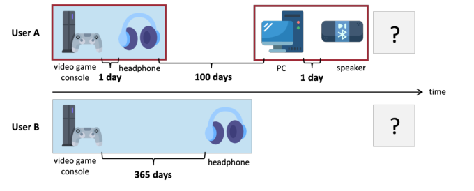
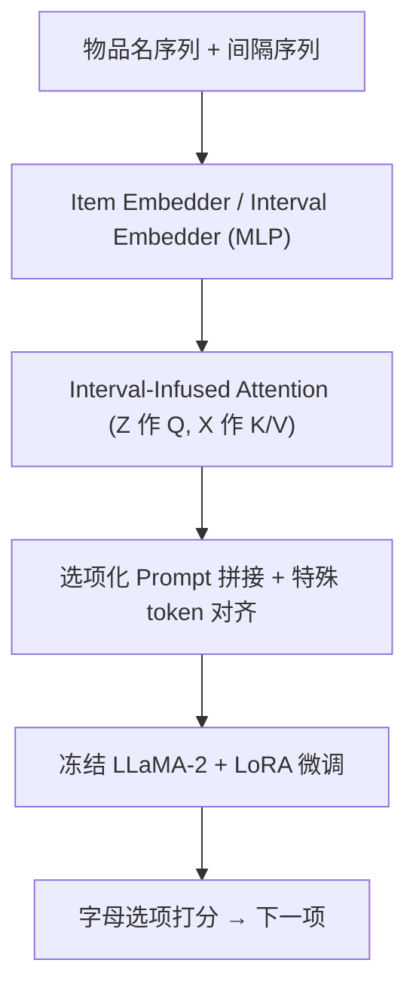
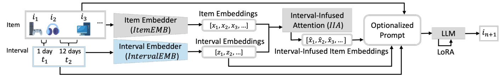

# Not Just What, But When: Integrating Irregular Intervals to LLM for Sequential Recommendation (不只是“买了什么”，还有“隔了多久”：将不规则间隔注入 LLM 的序列推荐)

- **会议/期刊**: RecSys 2025 (Short Paper)
- **作者与机构**: Wei-Wei Du, Takuma Udagawa, Kei Tateno (Sony Group Corporation)
- **推荐链路定位**: 精排 / 端到端生成式（LLM 指令微调式下一项预测）
- **研究方向**: 序列与会话推荐 / 大语言模型推荐
- **论文原文**: [https://arxiv.org/abs/2507.23209v1](https://arxiv.org/abs/2507.23209v1)
- **开源代码**: [https://github.com/sony/ds-research-code](https://github.com/sony/ds-research-code)

## TL;DR (1分钟核心速览)

现有 LLM 序列推荐把物品名当纯文本序列，**完全丢弃了相邻购买之间的时间间隔**，而间隔恰恰是区分“同一物品序列、不同用户画像”的关键维度。本文提出 IntervalLLM：用 MLP 将不规则间隔编码为向量，再以 **Interval-Infused Attention (IIA)** 让间隔向量作 Query、物品向量作 Key/Value，显式学习“间隔对物品重要性的调制”，最后经 LoRA 微调 LLaMA-2 (7B) 并以选项化提示做候选打分。在 3 个 Amazon 5-core 数据集、Leave-One-Out + 20 候选采样协议下，HR@1 平均提升 4.4%（Video Games 61.7% vs. 次优 56.3%），并首次提出“间隔冷启动”评测视角。

## Background & Motivation (背景与核心矛盾)

- **主流范式**: 序列推荐主流分两支——传统 ID 序列模型（GRU4Rec/SASRec）与 LLM 微调式推荐（LLaRA 等把物品名转 token 做生成）；前者中 TiSASRec 已引入时间间隔，后者则几乎只吃物品文本。
- **前人局限**: (1) LLM-based 方法（LLaRA、LLaMA+Interval 式朴素拼接）把时间信息当**静态文本或直接相加**，无法表达“间隔长短如何改变某件物品对下一次决策的权重”；(2) 冷启动研究只从 user/item 两个维度切分，**忽略了“交互间隔很长”这一类用户**——他们偏好漂移最剧烈，却从未被单独评估。
- **核心洞察 (Key Insight)**: 图 1 中两位用户物品序列完全相同，仅间隔不同，其下一次购买意图就应不同；间隔是**独立于 user/item 的第三维用户画像信号**，且 LLM 的语义先验恰好能与之互补。
- **本文切入点**: 不做“间隔文本化”这种弱注入，而是把间隔做成**注意力中的 Query 侧**，让模型自己学“多长的间隔该压低/抬高哪件历史物品”。

<figure class="paper-figure" markdown="span">
  <figcaption>图1：两个用户的购买历史示例。</figcaption>
</figure>

## Method (核心方法设计)

### 1. 整体框架 (Overall Architecture)

输入为用户物品名序列 $[i_1,\dots,i_n]$与间隔序列$[t_1,\dots,t_{n-1}]$（$t_k$为$i_k$与$i_{k+1}$的时间差）。物品经 LLM 的 tokenizer+embedding 得$x_k$，间隔经 MLP 得$z_{k-1}$（首位置补零向量对齐长度）。IIA 模块以$Z$为 Query、$X$为 Key/Value 产出 interval-infused 物品表示$\hat{x}_k$，与间隔嵌入一同按特殊 token（`[ITEM]`/`[INTERVAL]`）位置拼回 LLM 首层输出，再送入冻结的 LLaMA-2 主干，仅 LoRA 与三个新模块可训练，最终在 20 个字母选项上做 next-token 分类。

<figure class="paper-figure" markdown="span">
  <figcaption>图2：所提出的IntervalLLM。除LoRA中的参数外，所有LLM参数均被冻结。</figcaption>
</figure>

### 2. 关键设计拆解 (Key Designs)

1. **Interval-Infused Attention (IIA)**：直接相加间隔嵌入会让间隔信息被物品语义淹没。本文改为跨模态注意力，让间隔主导 Query：
$$Q_z=ZW_{Q_z},\ K_x=XW_{K_x},\ V_x=XW_{V_x},\quad \mathrm{IIA}(X,Z)=\mathrm{softmax}\!\left(\frac{Q_zK_x^{\top}}{\sqrt{d_q}}+M\right)V_x$$
其中 $M$为因果掩码。物理直觉：注意力权重$\mathrm{softmax}(\cdot)$直接刻画“第$k$个间隔对第$j$件物品的调制强度”，长间隔自然压低远期物品权重，等价于一个**可学习的时间衰减核**，但比手工指数衰减更灵活。多头（$h=2$）后经$W_O$聚合得$[\hat{x}_1,\dots,\hat{x}_n]$。

2. **间隔嵌入的尺度感知 (Interval Embedder)**：时间戳文本化（如 "2023-05-01"）会让 LLM 陷入日期语义而非“间隔长短”，消融中直接掉 1.8 个点（56.0%→54.2%）。改用 MLP 编码标量间隔 $z_{k-1}=\mathrm{IntervalEMB}(t_{k-1})$，把连续尺度压到与$d_{llm}=4096$ 对齐的隐空间，使模型能感知“3 天 vs 300 天”的量级差异而非绝对日期。

3. **选项化提示与训练目标**：生成式评估中物品名可能是整句、易拼写错误导致“命中但无效”，LLaRA 在 CDs/Books 上有效率不足 100%（表中带 `*`）。本文给每个候选加字母前缀（A/B/…/T），把推荐转为**20 分类**，有效率恒为 100%。损失为标准的下一 token 负对数似然：
$$\mathcal{L}=-\log P_\theta(i_{n+1}\mid (i_{1..n},t_{1..n-1}))$$
训练用 20 个随机采样候选（Sampled Ranking，非全库），无额外负采样策略；推理时同样只对这 20 个候选打分，开销与 LLaRA 同级。

## Experimental Setup & Evaluation Protocol (实验设置与评估协议)

- **数据集与预处理**（Amazon Reviews，5-core 过滤，即用户与物品均至少 5 次交互）：

| 数据集 | #Users | #Items | #Interactions | 密度 (交互/用户) | 场景说明 |
| :--- | :---: | :---: | :---: | :---: | :--- |
| Video Games | 94,762 | 25,612 | 814,586 | 8.59 | 游戏，物品名短 |
| CDs and Vinyl | 123,876 | 89,370 | 1,552,764 | 12.53 | 音乐，物品名中等 |
| Books | 776,370 | 495,063 | 9,488,297 | 12.22 | 图书，物品名语义丰富 |

- **数据划分与防穿越**: `Leave-One-Out`——每用户最后一项作测试、倒数第二项作验证、其余训练，严格按时间序，无未来信息泄漏。
- **排名评测协议**: `Sampled Ranking`，每用户从物品池随机采 20 个候选（含正样本），指标为 **Hit Rate@1**；同时报告有效率（valid ratio），本文因选项化提示恒为 100%。
- **对比基线与超参**: 四组基线——传统（GRU4Rec、SASRec）、传统+间隔（TiSASRec）、LLM-based（LLaMA-2 7B 直接提示、LLaRA）、LLM+间隔朴素版（LLaMA + Interval，间隔写入 prompt）。所有 LLM 方法训练 ≤5 epoch、batch 64、20 候选；$d_{llm}=4096$、$d_q=256$、$h=2$。

## Key Experimental Results (实验关键数据)

### 1. 主实验对比 (Main Results)

Hit Rate@1 (↑)，`*` 表示存在无效预测：

| 类别 | 方法 | Video Games | CDs and Vinyl | Books |
| :--- | :--- | :---: | :---: | :---: |
| 传统 | GRU4Rec | 49.0% | 46.5% | 35.7% |
| 传统 | SASRec | 50.8% | 50.9% | 38.0% |
| 传统+间隔 | TiSASRec | 52.9% | 54.1% | 58.6% |
| LLM | LLaMA | 56.0% | 45.2%* | 60.2% |
| LLM | LLaRA | 50.5% | 49.6%* | 60.0%* |
| LLM+间隔 | LLaMA + Interval | 56.3% | 48.7% | 61.1% |
| **本文** | **IntervalLLM** | **61.7%** | **55.4%** | **61.9%** |
| | Improv. vs 次优 | +9.6% | +2.4% | +1.3% |

### 2. 消融实验 (Ablation Study)

Video Games 数据集，HR@1：

| LLaMA | 间隔文本(△) | IntervalEMB | IIA | HR@1 |
| :---: | :---: | :---: | :---: | :---: |
| ✓ | ✗ | ✗ | ✗ | 56.0% |
| ✓ | ✓ | ✗ | ✗ | 54.2% |
| ✓ | ✗ | ✓ | ✗ | 56.3% |
| ✓ | ✗ | ✓ | ✓(无 IIA，仅拼接) | 56.8% |
| ✓ | ✗ | ✓ | ✓ | **61.7%** |

### 3. 关键实验发现 (Key Findings)

1. **IIA 是绝对主力，间隔嵌入只是“入场券”**：仅加 IntervalEMB 只涨 0.3 点（56.0→56.3），再叠加 IIA 才跃升到 61.7%（+4.9 点），说明间隔的价值不在“有没有”，而在“如何与物品交互”；而把时间戳写成文本反而掉 1.8 点，证明 LLM 对日期字符串的语义先验是干扰项。
2. **间隔冷启动是全场最痛的短板，也是本文收益最大的地方**：Video Games 上所有方法在 interval 视角的 Warm→Cold 跌幅最大（GRU4Rec −20.8%、LLaRA −28.0%），远超 user 视角（−1.0%~−4.9%）；IntervalLLM 把该跌幅压到 −9.9%，且在 interval 冷启动组上取得 59.1% 的绝对最优（次优 LLaMA+Interval 仅 53.3%）。
3. **冷启动三维度全面领先，且 user 视角出现“冷优于热”**：IntervalLLM 在 user 视角 Cold 61.8% 反超 Warm 61.6%（Diff. +0.3%），item 视角 Cold 59.5% 亦为全场最高，说明间隔信号对稀疏用户/长尾物品具有额外补偿作用，而非仅对高频用户有效。

## Highlights & Limitations (亮点、对比与审稿批判)

- **与代表作对比 (vs. Prior Work)**: 与 **TiSASRec** 的本质区别在于 TiSASRec 用 ID 嵌入 + 手工时间核建模，本文把间隔交给 LLM 语义空间并由注意力端到端学习；与 **LLaRA** 的区别在于 LLaRA 完全无时间维度且生成式评估存在无效输出，本文用选项化提示把有效率拉到 100%；与 **LLaMA + Interval** 的区别在于后者只是把间隔写进 prompt 文本，属“弱注入”，IIA 才是“强交互”。
- **可迁移亮点**: (1) “间隔作 Query、内容作 Key/Value”的跨模态注意力范式可平移到任意“标量上下文 + 语义序列”场景（如价格、停留时长、地理距离）；(2) 选项化提示把开放式生成转为闭集分类，是解决 LLM 推荐评估歧义的通用低成本技巧。
- **审稿级局限批判**: (1) 仅 20 候选的 Sampled Ranking 且候选随机采样，未做 Full-Ranking，HR@1 的绝对数值对负样本难度高度敏感，与全库排序结论可能不一致；(2) 短论文体量下仅用 LLaMA-2 7B 单一骨干、$h=2$ 单组超参，未报告方差或显著性检验，且 IIA 引入的额外注意力层在长序列上的推理开销未量化。

## Rating (四维评分)

- **方法创新性 (Novelty)**: ⭐⭐⭐⭐ （首次把不规则间隔以 Query 侧注意力注入 LLM 序列推荐，“间隔冷启动”视角有独立价值，但 IIA 结构本身属跨模态注意力的直接移植）
- **评估协议与实验扎实度 (Protocol & Experiments)**: ⭐⭐⭐ （三数据集 + 四组基线 + 消融 + 三维冷启动分析较完整，但仅 20 候选采样排序、无全库排序与显著性检验，结论稳健性打折）
- **写作与数学规范度 (Clarity & Rigor)**: ⭐⭐⭐⭐ （公式简洁、符号与图 3 提示模板对应清晰，短论文篇幅下动机—方法—验证闭环完整，复杂度分析略缺）
- **工业落地与复现价值 (Industrial & Practical Value)**: ⭐⭐⭐⭐ （代码已开源，LoRA 微调 + 冻结主干成本可控，选项化提示可直接用于线上粗排候选打分，但 7B 模型在线延迟仍是落地门槛）

