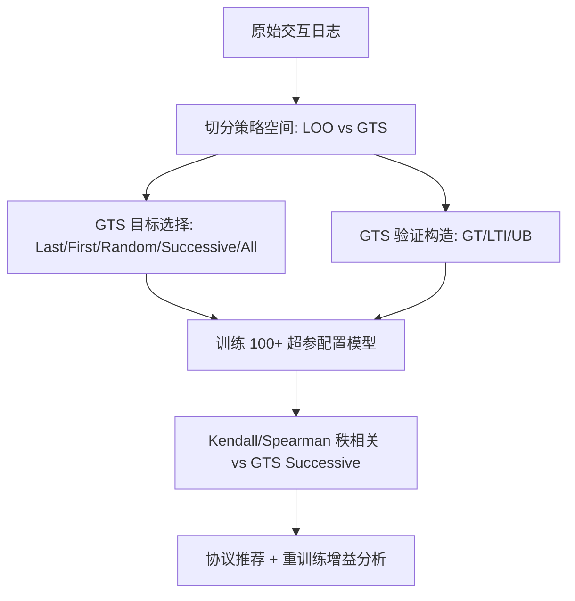
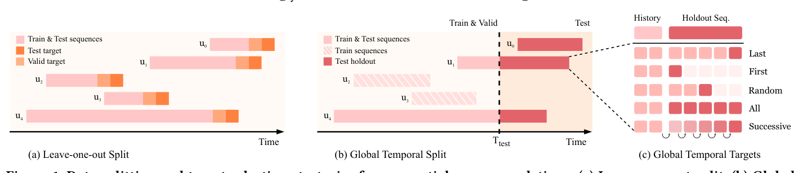

# Time to Split: Exploring Data Splitting Strategies for Offline Evaluation of Sequential Recommenders (是时候切分了：序列推荐离线评估的数据切分策略探索)

- **会议/期刊**: ACM RecSys 2025
- **作者与机构**: Danil Gusak, Anna Volodkevich, Anton Klenitskiy, Alexey Vasilev, Evgeny Frolov (AIRI / Skoltech / Sber AI Lab / HSE University)
- **推荐链路定位**: 离线评估协议（服务于召回/精排全链路的 Next-Item Prediction 评测）
- **研究方向**: 序列与会话推荐 / 去偏与工业评测基准
- **论文原文**: [https://arxiv.org/abs/2507.16289v1](https://arxiv.org/abs/2507.16289v1)
- **开源代码**: [https://github.com/monkey0head/time-to-split](https://github.com/monkey0head/time-to-split)

## TL;DR (1分钟核心速览)

序列推荐（SRS）离线评测长期被 `Leave-One-Out (LOO)` 主导，但它允许训练集与测试期时间重叠，造成**时序泄漏**与**不切实际的长测试窗口**，且与真实"未来一段时间内做 next-item 预测"的线上场景错位。本文系统形式化了 `Global Temporal Split (GTS)` 在 NIP 任务下的**目标选择**（Last / First / Random / Successive / All）与**验证集构造**（GT / LTI / UB）变体，在 8 个数据集、3 个主流模型（SASRec+/BERT4Rec/GRU4Rec，共 100+ 超参配置）上以 Kendall/Spearman 排序相关性为标尺，证明 LOO 与最贴近生产的 `GTS Successive` 平均 Kendall 仅 0.71，而 `GTS Random` 达 0.91、`GTS Last` 达 0.83，并给出可直接落地的评测协议建议。

## Background & Motivation (背景与核心矛盾)

- **主流范式**: 2022–2024 年 RecSys/SIGIR/CIKM 的 75 篇 SRS 离线评测论文中，**77.3% 使用 LOO**，仅 16% 用 GTS，而真正把 GTS 与 NIP 目标对齐的只有 **6.7%**；主流框架（RecBole、Cornac、Elliot 等）普遍缺少 "GTS + NIP" 的原生支持（仅 RecPack 支持）。
- **前人局限**: ① LOO 只保留每个用户最后两个交互，**不保全局时间线**，未来交互可泄漏进训练集，且测试目标横跨整个数据集生命周期（ML-20M 上测试期长达 7385 天），统计显著性虽高但场景失真；② 直接照搬经典 top-K 的 80/10/10 时间切分，**未定义 holdout 序列的目标物品如何选取**，与 NIP 任务不匹配。
- **核心洞察 (Key Insight)**: 切分策略不仅改变指标绝对值，更会**改变模型排序**——例如 SASRec+ 在 ML-1M 的 `Successive` 目标下排第一，在 `All` 目标下跌至末位；因此"用哪个切分"直接决定学术结论与上线决策。
- **本文切入点**: 以最贴近生产的 `GTS Successive` 为参照基准，用排序相关系数量化各切分/目标/验证方案与它的**一致性**，从而给出可复现的协议推荐。

## Method (核心方法设计)

### 1. 整体框架 (Overall Architecture)

本文不提出新模型，而是构建一套**切分策略的形式化空间 + 一致性评估方法论**：先定义切分的两条硬性属性（保全局时间线、对齐 NIP），再枚举 GTS 的 5 种目标选择与 3 种验证构造，随后对每个 (切分, 目标, 验证) 组合训练 100+ 超参配置的模型，用 Kendall/Spearman 秩相关衡量其与参照方案 `GTS Successive` 的排序一致性，最后用重训练实验检验验证集选模的可靠性。

<figure class="paper-figure" markdown="span">
  <figcaption>图1：序列推荐的数据划分与目标选择策略。(a) 留一法划分。(b) 全局时间划分：时间点 𝑇test 之后的所有交互均放入留出集，这些留出序列的目标按 (c) 选择。(c) 每个留出序列的目标物品选择选项（适用于测试序列和验证序列）。</figcaption>
</figure>

### 2. 关键设计拆解 (Key Designs)

1. **GTS 目标选择算子（把"切分"补全为"切分+目标"）**：痛点在于 GTS 只给出时间截断点 $T_{\text{test}}$，却未定义 holdout 序列的监督信号。本文形式化 5 种目标：`Last`（holdout 末项）、`First`（holdout 首项）、`Random`（holdout 内随机采样）、`Successive`（holdout 每项各作一次目标，输入历史随之前滚）、`All`（holdout 全部项作为一个 ground-truth 集合）。其中 `Successive` 对含$n$个 holdout 交互的用户产生$n$ 次评估并按用户预平均，最贴近"截断点后一段时间内持续预测"的线上形态；`All` 则因把多物品当单一相关性集合而偏离 NIP 目标。

2. **验证集构造与"验证-测试一致性"度量**：GTS 下验证集有三种构造——`GT`（在 $T_{\text{val}}<T_{\text{test}}$处再切一刀，严格无泄漏）、`LTI`（每用户$T_{\text{test}}$前最后一项作验证目标，覆盖全用户但验证期极长）、`UB`（随机抽 1024 个用户整段历史作验证，保留训练用户完整序列）。本文用验证指标与测试指标的秩相关$\tau(\text{Valid},\text{Test})$ 来量化"选模可靠性"，而非仅看验证集绝对分数。

3. **训练目标、负采样与推理效率**：三个基线均采用**全库 softmax 交叉熵**（full CE over catalog，即免负采样、全库归一化），SASRec+/BERT4Rec 隐层 32–256、1–3 层、1–4 头，GRU4Rec 隐层 16–512、1–4 层，dropout 0.1–0.5，batch 256，最大序列长 128，Adam lr=$10^{-3}$，早停 patience 10/20。推理侧的关键开销来自 `Successive`：holdout 平均长度在 Zvuk/ML-20M 上超过 100，推理计算随 holdout 长度线性增长，这正是 `Last`/`Random` 作为廉价替代的动机。

## Experimental Setup & Evaluation Protocol (实验设置与评估协议)

- **数据集与预处理**: 统一 `5-core` 过滤、去除用户历史中连续重复物品、评论/评分一律视为隐式反馈；YooChoose 采样 200 万用户、Zvuk 采样 2 万用户以控制算力。

| 数据集 | #Users | #Items | #Interactions | 密度 (%) | 时间跨度(天) |
| :--- | :---: | :---: | :---: | :---: | :---: |
| Beauty | 22,363 | 12,101 | 198,502 | 0.07 | 4,424 |
| BeerAdv | 14,635 | 22,074 | 1,475,412 | 0.46 | 5,620 |
| Diginetica | 61,279 | 25,593 | 485,903 | 0.03 | 152 |
| ML-1M | 6,040 | 3,416 | 999,611 | 4.84 | 1,038 |
| ML-20M | 138,493 | 18,345 | 19,984,024 | 0.79 | 7,385 |
| Sports | 35,598 | 18,357 | 296,337 | 0.05 | 4,521 |
| YooChoose | 335,203 | 20,758 | 2,792,229 | 0.04 | 181 |
| Zvuk | 19,267 | 150,206 | 8,087,953 | 0.28 | 91 |

- **数据划分与防穿越 (Splitting Strategy)**: 对比 `LOO`（留最后一项测试、倒数第二项验证）与 `GTS`（主实验取交互量 $q_{0.9}$分位作$T_{\text{test}}$，另扫$q\in\{0.8,0.9,0.95,0.975\}$）；GTS 下测试目标取 Last/First/Random/Successive/All，验证取 GT/LTI/UB。**GTS 严格保证$T_{\text{test}}$ 之后交互不进入训练**，从机制上消除时序泄漏。
- **排名评测协议 (Ranking Protocol)**: 采用**无偏 Full-Ranking**（全库未交互物品排序），指标为 NDCG@K、MRR@K、HR@K，$K\in\{5,10,20,50,100\}$；统一施加 `filter seen`（剔除已交互物品），但 Zvuk/YooChoose/Diginetica 因天然含重复交互而不施加。
- **对比基线与超参设置**: SASRec+（全 CE 版 PyTorch 实现）、BERT4Rec（mask 概率 0.2）、GRU4Rec（全 CE），另在排序分析中引入非神经基线 SeqKNN；SASRec+/BERT4Rec 各 108 组配置、GRU4Rec 104 组，共 300+ 评估点以保证秩相关统计稳健。

## Key Experimental Results (实验关键数据)

### 1. 主实验对比 (Main Results)

核心结果是**各切分/目标与参照方案 `GTS Successive` 的排序一致性**（8 数据集平均，越高越可信）：

| 测试切分/目标 | Kendall HR@10 | Kendall NDCG@10 | Spearman NDCG@10 | 测试用户占比 | 测试期占比 |
| :--- | :---: | :---: | :---: | :---: | :---: |
| **GTS Random** | **0.91** | **0.91** | **0.98** | 10%–44% | 2%–15% |
| GTS Last | 0.83 | 0.83 | 0.94 | 10%–44% | 2%–15% |
| LOO | 0.71 | 0.71 | 0.87 | 100% | 68%–100% |
| GTS First | 0.70 | 0.62 | 0.72 | 10%–44% | 2%–15% |
| GTS All | 0.57 | 0.43 | 0.53 | 10%–44% | 2%–15% |

验证集选模可靠性（测试目标为 `GTS Successive` 时，验证-测试 NDCG@10 秩相关）：

| 验证构造 | Kendall NDCG@10 | Spearman NDCG@10 | 备注 |
| :--- | :---: | :---: | :---: |
| **GT Successive** | **0.83** | **0.95** | 与测试完全同构，最优 |
| GT Last | 0.82 | 0.95 | 几乎无损，计算更省 |
| LTI | 0.82 | 0.95 | 略逊，验证期失真 |
| UB | 0.80 | 0.94 | 需额外控制用户数 |
| GT First | 0.59 | 0.75 | 不推荐 |
| GT All | 0.44 | 0.56 | 任务错配 |

### 2. 消融实验 (Ablation Study)

以"移除/替换某一协议组件"视角做紧凑消融（8 数据集平均 Kendall NDCG@10，参照 `GTS Successive`）：

| 配置变体 | Kendall | Δ vs 最优 | 结论 |
| :--- | :---: | :---: | :--- |
| GTS Random（完整） | **0.91** | — | 一致性最高但非确定 |
| w/o Random → Last | 0.83 | −0.08 | 确定性替代，代价可接受 |
| w/o Random → LOO | 0.71 | −0.20 | 时序泄漏显著拉低一致性 |
| w/o Successive 参照 → All | 0.43 | −0.48 | 任务错配最严重 |
| w/o GT 验证 → LTI | 0.82 | −0.01 | 验证期过长但影响小 |
| w/o GT 验证 → UB | 0.80 | −0.03 | 需控用户数 |

重训练增益（SASRec+ 最优配置，NDCG@10）：

| 数据集 | 切分/目标 | 验证 | 测试(未重训) | 测试(重训) | Δ |
| :--- | :--- | :---: | :---: | :---: | :---: |
| Beauty | GT/Sucv. | 0.044 | 0.022 | 0.040 | **+81.8%** |
| Diginetica | GT/Sucv. | 0.154 | 0.149 | 0.160 | +7.38% |
| Beauty | UB/Last | 0.074 | 0.036 | 0.037 | +2.78% |
| Diginetica | LTI/Last | 0.187 | 0.135 | 0.126 | **−6.67%** |
| Diginetica | LOO/Last | 0.179 | 0.181 | 0.157 | **−13.3%** |

### 3. 关键实验发现 (Key Findings)

1. **LOO 的"高显著性"是假象**：LOO 覆盖 100% 用户、测试期占数据集生命周期 68%–100%（ML-20M 达 7385 天），统计检验虽更易显著，但与生产形态的排序一致性仅 0.71，且在 Diginetica 上重训练后指标反降 13.3%，说明其选出的"最优模型"并不可靠。
2. **`First` 目标被会话边界污染**：`First` 目标与前一交互的中位时间间隔远大于全量数据分布（如 Beauty 上 8,640,000 秒 vs 全量 345,600 秒），因为全局截断点常落在用户不活跃期，使首个 holdout 项成为新会话起点，导致其 Kendall 仅 0.62，应明确弃用。
3. **`Random`/`Last` 是 `Successive` 的高性价比替代**：二者一致性分别达 0.91/0.83，而 `Successive` 在 Zvuk、ML-20M 上 holdout 平均长度超 100，推理开销线性膨胀；实践中推荐 `Last`（确定性、可复现）为主、`Random`（多 seed 平均）为辅，`Successive` 仅用于离线深度分析。

## Highlights & Limitations (亮点、对比与审稿批判)

- **与代表作对比 (vs. Prior Work)**: 相比 Ji et al. / Sun 等仅从"数据泄漏"角度批判 LOO 的定性工作，本文首次把 GTS 在 NIP 下**补全为"切分+目标+验证"三元组**并给出定量秩相关证据；相比 Meng et al. 对经典 top-K 切分的相关性分析，本文聚焦序列模型与 NIP 任务，且引入 `Successive` 这一最贴近生产的参照基准；相比 Dacrema 等对算法可复现性的批判，本文把矛头指向**评测协议本身**。
- **可迁移亮点**: ① "以最贴近生产的方案为参照、用 Kendall/Spearman 量化协议一致性"这一方法论可直接迁移到 CTR 预估、生成式推荐的离线评测审计；② `Successive` 的按用户预平均策略可避免活跃用户主导指标分布，值得在长序列场景推广。
- **审稿级局限批判**: ① 仅覆盖 3 个神经基线（SASRec+/BERT4Rec/GRU4Rec），未纳入 S³-Rec、CL4SRec 等自监督模型与 LLM4Rec，结论对新一代架构的外推性存疑；② GTS 的 $q$ 分位需按数据集手工调参以平衡"用户数-测试期-训练量"，论文未给出自动化选取准则，且 `Random` 目标的非确定性在小数据集上可能引入额外方差。

## Rating (四维评分)

- **方法创新性 (Novelty)**: ⭐⭐⭐ （非新模型类工作，但把 GTS 在 NIP 下形式化为"切分+目标+验证"三元组并引入一致性度量，问题定义本身有开创性）
- **评估协议与实验扎实度 (Protocol & Experiments)**: ⭐⭐⭐⭐⭐ （8 数据集 × 300+ 超参配置 × 全库排序 × 双秩相关系数 + 重训练验证，协议审计的教科书级扎实度）
- **写作与数学规范度 (Clarity & Rigor)**: ⭐⭐⭐⭐ （切分变体定义清晰、图表自洽，但部分符号如 $T_{\text{val}}$/$T_{\text{test}}$ 的选取准则散落各处，需读者自行拼合）
- **工业落地与复现价值 (Industrial & Practical Value)**: ⭐⭐⭐⭐⭐ （开源完整切分代码，直接给出"用 GTS+Last/Random、配 GT 验证、上线前重训练"的可执行建议，对工业评测流水线立即可用）

