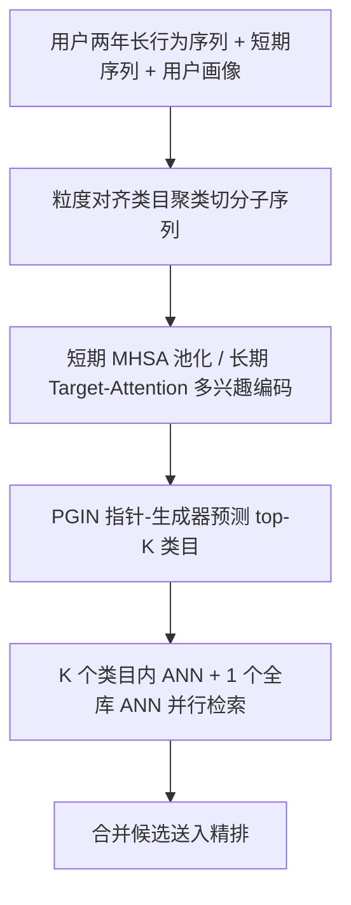
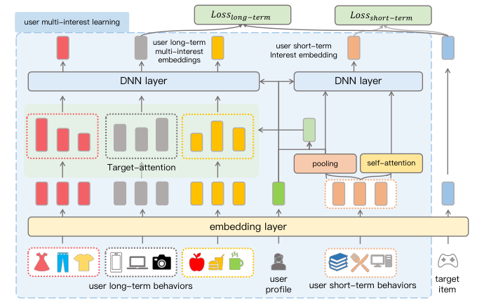

# User Long-Term Multi-Interest Retrieval Model for Recommendation (面向推荐的长周期多兴趣召回模型)

- **会议/期刊**: RecSys 2025
- **作者与机构**: Yue Meng, Cheng Guo, Xiaohui Hu, Honghu Deng, Yi Cao, Tong Liu, Bo Zheng（阿里巴巴淘天集团、清华大学）
- **推荐链路定位**: 召回（多路召回中的独立长序列通道）
- **研究方向**: 序列与会话推荐 / 协同过滤与双塔召回
- **论文原文**: [https://arxiv.org/abs/2507.10097v1](https://arxiv.org/abs/2507.10097v1)
- **开源代码**: 暂未开源

## TL;DR (1分钟核心速览)

精排侧已能消费千级超长行为序列，但召回侧受限于千万级候选池的严格延迟预算，且缺乏 target-aware 交互与层级化简手段，序列长度长期停留在百级，造成召回-精排兴趣空间割裂。ULIM 用「类别感知分层双兴趣学习」把长序列切成类别子序列做多兴趣建模，再用「指针生成式类别→物品级联检索」先预测 top-$K$ 类别、再在类别内并行 ANN 检索。淘宝工业数据上 Full-Ranking 的 HR@2000 从 15.15% 提升至 16.55%（相对 +9.2%），线上点击 +5.54%、订单 +11.01%、GMV +4.03%。

## Background & Motivation (背景与核心矛盾)

- **主流范式**: 召回侧以 Youtube DNN、MIND 为代表，用百级行为序列 + 单/多兴趣向量做内积 ANN 检索；精排侧 SIM、ETA 等已通过两阶段检索把序列拉到千级。
- **前人局限**: 其一，召回需扫描千万级候选，千级序列的注意力计算与在线 RT 不可承受；其二，召回架构本质是 next-item 预测，缺少 target-aware 交互，无法像精排那样借助「类别」做层级化简。
- **核心洞察 (Key Insight)**: 用户长序列在类目维度高度聚集，按类目切分后单条子序列长度降为 $O(L/N)$，既保留长周期信息又让计算可控；同时单兴趣内积召回会因不同类目物品的梯度方向冲突而损害表征质量。
- **本文切入点**: 把「类目」同时当作训练时的负采样空间约束与在线时的检索空间约束，使召回与精排共享同一特征粒度，实现离线训练与在线服务的一致性。

## Method (核心方法设计)

### 1. 整体框架 (Overall Architecture)

模型由双序列编码器与物品塔构成：短期编码器对最近至多 100 条行为做 MHSA + 平均池化得到短期兴趣 $\mathbf{v}^{(s)}_u$；长期编码器先按粒度对齐的类目聚类把两年长序列切成多条类目子序列，再以短期池化结果为 query 做 Target-Attention，得到$K$条长期多兴趣向量$\mathbf{v}^{(l)}_u$。在线服务时 PGIN 先预测 top-$K$兴趣类目，随后$K+1$ 个兴趣向量并行发起 ANN 检索：长期向量仅在本类目候选内检索，短期向量在全库检索，最后合并送入精排。

<figure class="paper-figure" markdown="span">
  <figcaption>图1：类别感知的分层双兴趣学习框架</figcaption>
</figure>

### 2. 关键设计拆解 (Key Designs)

1. **类别感知分层双兴趣学习（训练目标重定义）**：常规召回在全库上做 sampled softmax，长序列信息被海量类目稀释且易出现类别泄漏导致的虚高指标。ULIM 改为在每个兴趣簇内预测点击概率——正样本严格属于对应子序列类目，负样本全部从同类目子空间采样，并按类目预分组 batch、批内共享负样本。损失为双路加权：$\mathcal{L}=\alpha\mathcal{L}_l+\beta\mathcal{L}_s$，其中$\mathcal{L}_l,\mathcal{L}_s$ 分别为长期/短期兴趣的 sampled softmax。直觉上，这既阻断了跨类目平凡判别，又让每个兴趣向量只对本类目负责，缓解单兴趣内积的梯度冲突。
2. **指针生成式兴趣网络 PGIN（在线类目预测）**：纯生成式 MLP 对长尾类目覆盖不足，纯指针式又无法泛化到未见类目。PGIN 将类目预测建模为多分类：Pointer-Net 对去重后的长短期类目历史做 Target-Attention 并反向投影到全类目空间得 $y_{\text{poi}}$，Generator-Net 对原始行为序列做 MHSA 池化后经 MLP 输出$y_{\text{gen}}$，再用学习门控融合$\hat{y}=P_{\text{poi}}y_{\text{poi}}+(1-P_{\text{poi}})y_{\text{gen}}$，以真实类目标签的交叉熵训练。指针负责精确复现历史高频类目，生成器负责泛化，二者互补。
3. **训练目标、负采样与推理效率**：负采样采用类目内批共享负样本（非全库 uniform），天然构成难负例；推理时长期兴趣只在对应类目候选子集内检索，候选池被压缩约 $N$倍，$K+1$ 路 ANN 并行，整体系统 RT 仅增加约 15ms。

## Experimental Setup & Evaluation Protocol (实验设置与评估协议)

- **数据集与预处理**: 淘宝工业数据集，日级正样本数千万，ULIM 使用两年用户历史行为；基线经数据迁移与多目标优化适配。

| 数据集 | #Users | #Items | #Interactions | 稀疏度/密度 | 特征/场景说明 |
| :--- | :---: | :---: | :---: | :---: | :--- |
| Taobao（淘特/淘宝秒杀） | 未披露 | 千万级候选 | 日级数千万正样本 | 极稀疏 | 长周期行为 + 类目体系 + 用户画像 |

- **数据划分与防穿越 (Splitting Strategy)**: 工业日志按时间自然切分（训练用历史、评估用后续点击），未采用 Leave-One-Out；论文未给出显式时间窗细节。
- **排名评测协议 (Ranking Protocol)**: 采用 HR@K 评估，K 取 500/1000/2000，属全库候选下的命中率统计（工业全量候选检索场景），非小规模采样排序。
- **对比基线与超参设置**: 基线为 Youtube DNN Variant 与 MIND Variant（后者已作为线上召回通道部署）；Embedding 维度、召回条数、优化器均保持一致以保证公平；未报告显著性检验。

## Key Experimental Results (实验关键数据)

### 1. 主实验对比 (Main Results)

| 方法 | HR@500 | HR@1000 | HR@2000 |
| :--- | :---: | :---: | :---: |
| Youtube DNN Variant | 4.95% | 9.53% | 14.93% |
| MIND Variant | 5.03% | 9.66% | 15.15% |
| **ULIM** | **6.02%** | **10.76%** | **16.55%** |
| Improv. (vs. 最优基线) | +19.7% | +11.4% | +9.2% |

线上 A/B（淘宝秒杀，三周）：点击 +5.54%、订单 +11.01%、GMV +4.03%，系统整体 RT 增加约 15ms。

### 2. 消融实验 (Ablation Study)

| 变体 | HR@500 | HR@1000 | HR@2000 |
| :--- | :---: | :---: | :---: |
| ULIM-half-sequence（长序列长度减半） | 4.75% | 8.03% | 13.36% |
| ULIM-self-attention（Target-Attention 换为 Self-Attention） | 5.39% | 9.70% | 15.22% |
| **ULIM** | **6.02%** | **10.76%** | **16.55%** |

### 3. 关键实验发现 (Key Findings)

1. 序列长度是核心增益来源：长序列减半后 HR@2000 从 16.55% 跌至 13.36%（-3.19pt），跌幅甚至超过换掉 Target-Attention 的 1.33pt，说明「能吃到千级行为」本身比编码器结构更关键。
2. 跨序列交互不可替代：将长期编码的 Target-Attention 替换为 Self-Attention 后 HR@500 下降 0.63pt，证明以短期兴趣为 query 的 target-aware 交互是长短期兴趣对齐的必要条件，而非可省的常规注意力层。
3. 类目数 $K$呈边际递减：$K$ 从 1 增至 13 时 HR@2000 由 6.10% 单调升至 16.55%，但后段增益趋缓且 RT 线性增长，实际取值需在收益与延迟间折中，体现级联检索的工程可调性。

## Highlights & Limitations (亮点、对比与审稿批判)

- **与代表作对比 (vs. Prior Work)**: 相比 Youtube DNN 的单兴趣全库内积，ULIM 用类目子空间把负采样与检索都约束到同分布，避免梯度冲突；相比 MIND 的胶囊动态路由聚类，ULIM 的类目划分来自业务类目体系而非隐式聚类，天然与精排特征粒度对齐，且支持千级序列；相比 SIM/ETA 等精排长序列方案，本文首次把「两阶段层级检索」思想下沉到召回侧。
- **可迁移亮点**: ①「训练负采样空间 = 在线检索空间」的一致性约束，可直接迁移到任何级联召回架构以避免离线-在线分布漂移；②指针-生成器门控融合用于类目/意图预测，兼顾高频复现与长尾泛化。
- **审稿级局限批判**: 其一，实验仅在淘宝单一工业数据集，且基线为内部适配变体，缺少公开数据集与开源复现，结论泛化性存疑；其二，$K$ 与序列长度直接决定 RT，论文未给出延迟-效果的定量帕累托曲线，也未报告显著性检验，工业收益的可归因性偏弱。

## Rating (四维评分)

- **方法创新性 (Novelty)**: ⭐⭐⭐⭐ （类目分层 + 训练目标重定义 + 指针生成级联检索的组合在召回侧较新颖，但各组件单独看均有先例）
- **评估协议与实验扎实度 (Protocol & Experiments)**: ⭐⭐⭐ （有完整离线 HR 与三周线上 A/B，但仅单数据集、无公开基准与显著性检验）
- **写作与数学规范度 (Clarity & Rigor)**: ⭐⭐⭐⭐ （4 页短文结构清晰、公式简洁，但部分符号与聚类细节略欠展开）
- **工业落地与复现价值 (Industrial & Practical Value)**: ⭐⭐⭐⭐ （已在淘宝秒杀上线并带来显著 GMV 增益、RT 仅 +15ms，但未开源、复现门槛高）

