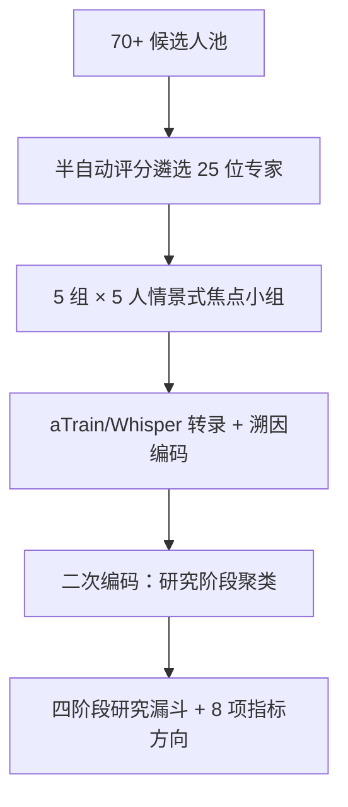

# A Multistakeholder Approach to Value-Driven Co-Design of Recommender System Evaluation Metrics in Digital Archives (数字档案馆推荐系统评估指标的多利益相关者价值驱动协同设计)

- **会议/期刊**: RecSys 2025 (19th ACM Conference on Recommender Systems)
- **作者与机构**: Florian Atzenhofer-Baumgartner (Graz University of Technology), Georg Vogeler (University of Graz), Dominik Kowald (Know Center Research GmbH / TU Graz)
- **推荐链路定位**: 评测体系设计（贯穿召回—交互—整合—影响全链路，非单一环节）
- **研究方向**: 社交与群组推荐 / 去偏公平与工业架构
- **论文原文**: [https://arxiv.org/abs/2507.03556v2](https://arxiv.org/abs/2507.03556v2)
- **开源代码**: [https://github.com/atzenhofer/multistakeholder-archives-recsys](https://github.com/atzenhofer/multistakeholder-archives-recsys)（含匿名化访谈指南、知情同意书与转录材料）

## TL;DR (1分钟核心速览)

商业推荐系统以点击/互动指标为圭臬，但数字档案馆（如 Monasterium.net，68.5 万份中世纪契据）的价值产生于长期学术工作流而非即时消费，单一互动指标无法刻画档案学家、平台方、研究者、出版商等五类利益相关者的冲突诉求。本文开展首个文化遗产领域多利益相关者焦点小组研究（5 组 × 5 人，从 70 余名候选人中遴选 25 位专家），采用溯因编码提炼出"发现—交互—整合—影响"四阶段研究漏斗，并为每阶段提出 2 个定制化指标方向（如研究路径质量、元数据加权相关性、跨利益相关者价值对齐）。本文属定性评估框架研究，不含定量基准实验，其贡献在于为"价值经持续参与而非即时消费涌现"的领域提供可迁移的评估设计蓝图。

## Background & Motivation (背景与核心矛盾)

- **主流范式**: 商业平台与多数 RecSys 研究以互动指标（CTR、停留时长、转化率）为核心，近年多利益相关者框架（Burke et al.、Smith et al. 的提供方公平性）开始挑战单目标优化。
- **前人局限**: 其一，文化遗产领域长期缺席多利益相关者视角，既有工作仅识别了利益相关者张力（作者前作 [2]），未完成"价值→指标"的操作化落地；其二，Stray et al. 梳理的 36 项人类价值多数缺乏成熟测量方法，Deldjoo et al. 亦指出公平性概念间存在张力、指标选择困难。
- **核心洞察 (Key Insight)**: 档案领域的推荐价值并非即时消费产生，而是经由"解读—综合—再语境化"的迭代学术工作流逐步涌现；利益相关者的关切天然沿研究进程呈阶段性分布，可据此结构化评估空间。
- **本文切入点**: 用参与式焦点小组把抽象价值直接"翻译"为分阶段指标方向，绕开"先定指标再找价值"的传统路径。

## Method (核心方法设计)

### 1. 整体框架 (Overall Architecture)

研究采用价值敏感设计（Value-Sensitive Design）的参与式路线：先从 70 余名候选人中以半自动评分遴选 25 位覆盖上游（档案员/策展人/馆员）、提供方（管理者/专家/研究者）、系统方（开发者/主管/专家）、消费者（研究者/教育者/学生）、下游（出版/编辑/技术）五类的专家，保证角色多样性与性别平衡；2025 年 3 月开展 5 场 60 分钟情景式讨论（含挑衅性陈述以激发价值立场分歧），经 aTrain/Whisper 转录后采用溯因编码（演绎的价值类别 + 归纳的新兴模式）分析；二次编码发现"研究阶段"反复出现，遂将叙事综合为四阶段研究漏斗，并形式化为评估指标矩阵。

### 2. 关键设计拆解 (Key Designs)

1. **四阶段研究漏斗（Research Funnel）**：痛点在于传统评估假设"一次交互即价值"，而学术工作流是跨会话递进的。作者将利益相关者叙事综合为发现（Discovery）、交互（Interaction）、整合（Integration）、影响（Impact）四个顺序阶段，对应信息寻求行为的渐进卷入；其有效性直觉是：同一指标在不同阶段语义不同（如流行度对新用户有益、对资深学者则被强烈排斥），分阶段才能让冲突价值各得其所。
2. **八项指标方向（每阶段 2 项）**：发现阶段提出**研究路径质量**（评估推荐序列的主题连贯性与信息递进，扩展会话级指标）与**馆藏代表性**（度量推荐在来源档案馆、时间段、文献类型上的分布，对抗历史数字化优先级造成的结构性偏差，区别于算法流行度偏差）；交互阶段提出**上下文适配性**（对演变中的研究语境与专业度的响应）与**控制有效性**（过滤/细化/拒绝机制对质量与系统学习的长期影响）；整合阶段提出**元数据加权相关性**（按馆藏元数据完整度调整 precision/recall，缓解"文档记录越全越被推荐"的算法偏差）与**文档关系洞察**（衡量对比较分析与学术综合的支撑）；影响阶段提出**研究整合度**（推荐项被引用、教学材料、策展收藏采纳的比例）与**跨利益相关者价值对齐**（基于价值权重的多目标满意度均衡度量）。
3. **实施路径与权衡显式化**：作者强调指标落地需配套意图感知的多兴趣画像、可调参数与上下文解释以保障用户能动性；多目标优化与可配置仪表盘使"馆藏代表性 vs 高质量凸显""学术准确性 vs 大众可及性""系统学习 vs 用户控制""聚焦检索 vs 意外发现"等张力变为可测量、可协商的显式权衡，而非隐式偏向某一方。

## Experimental Setup & Evaluation Protocol (实验设置与评估协议)

- **研究设计**: 定性研究，非定量基准评测。5 个焦点小组 × 5 人 = 25 位专家（表 1 列出各组角色），全部与 Monasterium.net 有实际关联，部分代表其核心合作机构以保证结论可外推。
- **数据采集与伦理**: 会前书面知情同意，遵循机构与 ACM 伦理规范；60 分钟录音经 aTrain/Whisper 转录；匿名化访谈指南、同意书与材料全部开源以保障可复现性。
- **分析协议**: 溯因编码（abductive coding），演绎类别来自既有价值文献，归纳类别来自转录中新涌现模式；二次编码专门考察价值与研究阶段的关联。
- **评估对象**: 产出为概念性指标方向矩阵（原文表 2），作者明确声明这些指标尚待实现与用户研究验证其与实际利益相关者满意度的相关性。

## Key Experimental Results (实验关键数据)

### 1. 主实验对比 (Main Results)

本文无定量主实验表。核心"结果"为定性发现矩阵，整理如下（对应原文表 2 与 4.1–4.2 节）：

| 研究阶段 | 指标方向 | 回应的价值冲突 | 关联的既有工作 |
| :--- | :--- | :--- | :--- |
| 发现 | 研究路径质量 | 聚焦检索 vs 意外发现 | 会话级/序列推荐指标 |
| 发现 | 馆藏代表性 | 馆藏平等 vs 高质量凸显；历史数字化偏差 | Item coverage、流行度去偏 |
| 交互 | 上下文适配性 | 专业深度 vs 大众可及 | 意图感知/上下文感知 RS |
| 交互 | 控制有效性 | 系统学习 vs 用户控制 | 解释与可控性研究 |
| 整合 | 元数据加权相关性 | 元数据质量不均导致的算法偏差 | 图/知识增强推荐 |
| 整合 | 文档关系洞察 | 单文档相关性 vs 学术综合需求 | 知识图谱推荐 |
| 影响 | 研究整合度 | 即时互动 vs 长期学术产出 | 纵向评估 |
| 影响 | 跨利益相关者价值对齐 | 五类利益相关者优先级冲突 | 多目标优化 |

### 2. 消融实验 (Ablation Study)

不适用（定性研究无组件消融）。可视为"敏感性分析"的是跨组价值立场对照：

| 争议议题 | 立场 A（代表引述） | 立场 B（代表引述） |
| :--- | :--- | :--- |
| 流行度 | 新用户可先从流行度入手（S3） | "契据流不流行与我何干"（D3）；150 年无人问津本身即研究价值信号（D2） |
| 简化界面 | 简化初始界面不牺牲准确性（U3） | 平台宗旨是学术用途，简化有损学术价值（U4） |
| 控制方式 | 系统隐式学习值得投入（C1） | 系统方偏好显式可配置的多模式界面（S 组） |
| 聚焦 vs 探索 | 只要特定契据，不要无关"有趣"项（C2） | 需要被持续挑战以免走错方向（C3） |

### 3. 关键实验发现 (Key Findings)

1. **流行度指标在学术场景被跨组一致否决**：下游与提供方受访者明确拒绝 trending 逻辑，且指出稀疏专藏上流行度指标本身失效——这直接支撑了"馆藏代表性"取代流行度作为发现阶段核心度量的设计。
2. **结构性偏差的根源被定位在数据层而非仅算法层**：受访者（C5、P1）指出 Monasterium.net 的元数据存在结构性偏倚，会"延续 19 世纪学者的兴趣"，故整合阶段必须引入元数据加权相关性，把数据质量异质性纳入相关性定义。
3. **价值冲突呈系统性分组模式**：消费者组强调相关性与能动性、系统组强调可配置控制、上游组强调馆藏平等开放、下游组强调学术可信度——说明单一聚合指标必然掩盖组间分歧，跨利益相关者价值对齐需以加权多目标形式显式建模。

## Highlights & Limitations (亮点、对比与审稿批判)

- **与代表作对比 (vs. Prior Work)**: 相较 Burke et al. 的通用多利益相关者框架与 Smith et al. 的提供方公平性指标，本文首次把框架落到文化遗产这一非商业垂直域并完成"价值→阶段→指标"的操作化；相较作者前作 [2] 仅识别张力，本文补上了评估 setup 这一缺失环节；相较 Zangerle & Bauer 的 FEVR 通用评估设计空间，本文提供了领域约束下的具体指标方向。
- **可迁移亮点**: 其一，"研究漏斗"式分阶段指标组织法可直接迁移到学术出版、招聘、新闻等长周期价值域；其二，元数据加权相关性思路可推广为"按数据可信度/完整度重加权相关性"的通用去偏技巧。
- **审稿级局限批判**: 其一，样本偏向领域专家，非专家用户与第三方利益相关者代表性不足，且参与者多重角色身份使组别归因困难；其二，全部指标方向均停留在概念层，未实现、未做用户研究验证其与真实满意度的相关性，纵向数据采集成本亦未评估；其三，25 人定性样本的结论外推性与跨平台泛化性缺乏实证支撑。

## Rating (四维评分)

- **方法创新性 (Novelty)**: ⭐⭐⭐⭐ （首个文化遗产多利益相关者焦点小组 + 四阶段研究漏斗，价值到指标的操作化路径新颖，但属框架性贡献而非算法创新）
- **评估协议与实验扎实度 (Protocol & Experiments)**: ⭐⭐⭐ （定性编码流程严谨、材料开源可复现，但无定量验证、无指标实现与用户研究，样本规模与代表性受限）
- **写作与数学规范度 (Clarity & Rigor)**: ⭐⭐⭐⭐ （阶段—指标—价值映射表清晰，引述与论点对应紧密；无数学公式，属定性研究正常形态）
- **工业落地与复现价值 (Industrial & Practical Value)**: ⭐⭐⭐ （开源访谈材料复现价值高，指标方向对文化机构有直接指导意义，但落地需大量纵向数据工程，短期难以部署）

