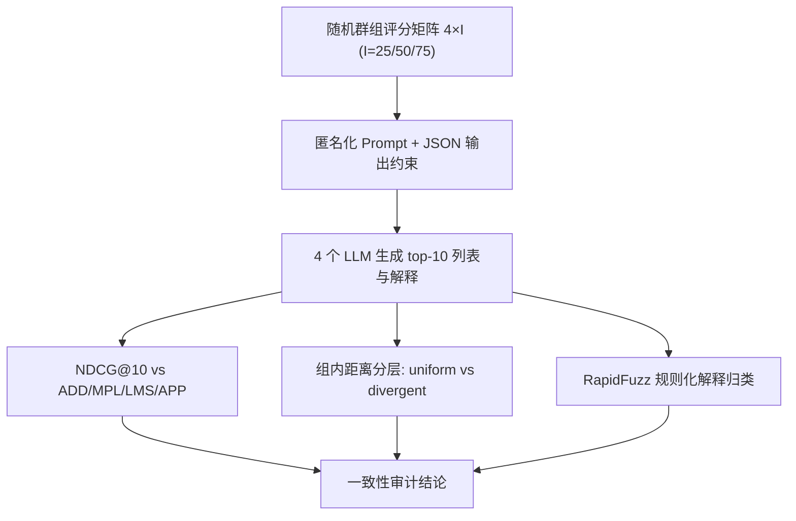
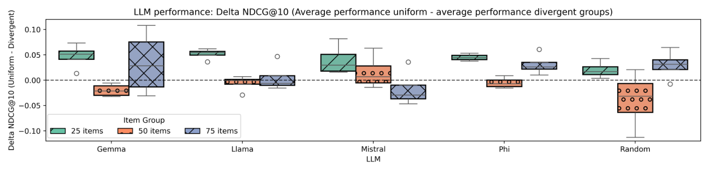

# Consistent Explainers or Unreliable Narrators? Understanding LLM-generated Group Recommendations (一致的推荐解释者，还是不可靠的叙述者？理解 LLM 生成的群组推荐)

- **会议/期刊**: RecSys 2025 (Short Paper)
- **作者与机构**: Cedric Waterschoot, Nava Tintarev, Francesco Barile (Maastricht University)
- **推荐链路定位**: 重排 / 端到端生成式（LLM 直接产出 top-10 群组列表 + 自然语言解释）
- **研究方向**: 社交与群组推荐 / 对话推荐与智能体仿真（解释生成）
- **论文原文**: [https://arxiv.org/abs/2507.13705v1](https://arxiv.org/abs/2507.13705v1)
- **开源代码**: [https://github.com/Cwaterschoot/GRS-LLM-expl-unreliable](https://github.com/Cwaterschoot/GRS-LLM-expl-unreliable)

## TL;DR (1分钟核心速览)

本文不做新模型，而是做**审计**：把 4 个开源 LLM（Llama3.1-8B、Mistral-NeMo-12B、Gemma3-12B、Phi4-14B）当作群组推荐器，喂入 4 用户 × {25,50,75} 物品的匿名评分矩阵，令其直接输出 top-10 列表与解释，再用 ADD/MPL/LMS/APP 四种社会选择聚合策略作**多基线**计算 NDCG@10。结论：三个模型高度贴近 ADD（25 物品时 NDCG@10 达 0.89–0.92），Gemma3 反而最贴 MPL（0.95）；但解释普遍声称"取平均"，并大量夹带未定义的"流行度"、用户/物品相似度与多样性等额外准则，且这些额外准则随物品数增长而增多——即 LLM 是"看似一致、实则不可靠的叙述者"。

## Background & Motivation (背景与核心矛盾)

- **主流范式**: GRS 长期以社会选择理论下的聚合策略（ADD 求和、MPL 取最高分、LMS 取最低分中最高、APP 阈值投票）作为可解释的群组决策与评测 ground truth；近期工作直接把 LLM 同时当决策者与解释生成器。
- **前人局限**: 其一，已有 LLM4GRS 评测通常只对**单一**聚合基线，无法判断 LLM 究竟"像哪种"策略，也无法解释模型间差异；其二，LLM 输出的解释是否真的对应其决策过程，从未被系统核验，透明性主张缺乏证据。
- **核心洞察 (Key Insight)**: 若 LLM 真在做"求和/平均"，则其推荐应与 ADD 高度重合；若解释与推荐的一致性断裂，则 LLM 作为 GRS 决策者的可解释性承诺不成立。此外，群组结构（偏好一致 vs. 分歧）与候选物品规模可能改变 LLM 的行为模式。
- **本文切入点**: 用**多策略基线 + 组结构分层 + 解释规则化归类**三件套，对 LLM 群组推荐做一次可复现的行为学解剖。

## Method (核心方法设计)

### 1. 整体框架 (Overall Architecture)

流程为纯黑盒探测：先随机生成匿名群组场景矩阵 $M\in[0,100]^{4\times I}$（$I\in\{25,50,75\}$，每种规模 500 个场景，共 1500 个），用户与物品均匿名化为 `User x`/`Item x` 且不含领域线索（无电影名/餐厅名），以避免世界知识污染；随后用固定模板 prompt 要求模型仅返回含 `recommendation`（top-10）与 `explanation` 两键的 JSON；最后分别计算与四种聚合策略的 NDCG@10、按组内欧氏距离划分 uniform/divergent 组做$\Delta$NDCG@10 对比、并用模糊字符串匹配对解释做多标签归类。

### 2. 关键设计拆解 (Key Designs)

1. **多策略基线一致性度量（替代单基线评测）**：痛点在于单基线无法定位 LLM 的"策略身份"。本文对每个 LLM 分别计算与四种策略的 NDCG@10，取最高者作为其"最像的策略"，从而把"LLM 好不好"转化为"LLM 像谁"。直觉上，NDCG@10 对 top-10 集合重合度敏感，能有效区分 ADD（求和）与 LMS（最小满意度）这类排序差异明显的策略。
2. **组结构分层与 $\Delta$NDCG@10**：对每个组构造用户两两欧氏距离矩阵$D_g$，取均值归一化得组内距离$d_g$；以$\mu_{d}-\sigma_{d}$与$\mu_{d}+\sigma_{d}$为双阈值，低于下界记为 uniform（242 组）、高于上界记为 divergent（236 组），中间组丢弃。核心统计量为$\Delta\text{NDCG@10}=\text{NDCG}_{\text{uniform}}-\text{NDCG}_{\text{divergent}}$，正值表示一致组更易被 LLM 复现。该设计把"群组异质性"从定性描述变成可检验的分桶变量。
3. **解释的规则化多标签归类（含否定与数值抽取）**：因解释文本高度模板化，作者用 RapidFuzz + Levenshtein 距离（阈值 0.85）匹配关键词，并加入否定检测（区分"did not average"）与数值抽取（对齐"ratings above [value]"类阈值表述），允许一条解释多标签；人工标注 100 条校验得 Cohen's $\kappa=0.76$，属实质性一致。相比嵌入相似度分类，该方案牺牲泛化换取可解释与可控。

## Experimental Setup & Evaluation Protocol (实验设置与评估协议)

- **数据集与预处理**: 本文**不使用真实交互数据**，全部为合成场景（这是核心局限，作者亦自认）。统计如下：

| 数据集 | #Users | #Items | #Interactions | 稀疏度/密度 | 特征/场景说明 |
| :--- | :---: | :---: | :---: | :---: | :--- |
| Synthetic-25 | 4/组 | 25 | 100/组 | 100%（全观测） | 500 组，评分 0–100 整数 |
| Synthetic-50 | 4/组 | 50 | 200/组 | 100% | 500 组 |
| Synthetic-75 | 4/组 | 75 | 300/组 | 100% | 500 组 |

- **数据划分与防穿越 (Splitting Strategy)**: 无训练/测试划分（零样本 prompting，无微调），因此不存在穿越问题；但同样意味着无法评估模型对未见偏好的泛化。
- **排名评测协议 (Ranking Protocol)**: 采用 **Full-Ranking 式全候选排序**（每个场景的全部 $I$ 个物品均为候选，模型直接给 top-10），无负采样；指标为 NDCG@10，基线为随机 top-10（NDCG@10 约 0.40–0.67）。
- **对比基线与超参设置**: 基线为 ADD / MPL / LMS / APP 四种聚合策略 + Random；模型经 Ollama 本地部署（8B–14B 量化版），Langchain 0.3.2 调用，温度等采样参数未在正文报告（复现需查仓库）；未做显著性检验，仅在组结构分析中做探索性统计（作者明言未发现显著差异）。

## Key Experimental Results (实验关键数据)

### 1. 主实验对比 (Main Results)

下表摘取原文 Table 1 的 NDCG@10（每格为 LLM 推荐与对应策略 ground truth 的重合度，加粗为该列最优）：

| Model | ADD-25 | ADD-75 | MPL-25 | MPL-75 | LMS-25 | LMS-75 | APP-25 | APP-75 |
| :--- | :---: | :---: | :---: | :---: | :---: | :---: | :---: | :---: |
| Llama3.1-8B | 0.92 | 0.77 | 0.88 | 0.69 | 0.82 | 0.67 | 0.86 | 0.69 |
| Mistral-NeMo-12B | 0.89 | 0.74 | 0.86 | 0.66 | 0.82 | 0.65 | 0.84 | 0.69 |
| Gemma3-12B | 0.91 | 0.72 | **0.95** | **0.72** | 0.77 | 0.58 | 0.88 | 0.64 |
| Phi4-14B | 0.91 | **0.81** | 0.91 | 0.78 | 0.79 | **0.69** | 0.86 | **0.72** |
| Random | 0.67 | 0.41 | 0.66 | 0.42 | 0.67 | 0.43 | 0.67 | 0.40 |

### 2. 消融实验 (Ablation Study)

本文为行为审计研究，无组件消融；其"消融"等价物是**物品规模与组结构的受控变化**，摘录解释标签占比（原文 Table 2，%）：

| 变量 | Avg.(平均) | Sim.(相似度) | Div.(多样性) | Undef.pop(未定义流行度) |
| :--- | :---: | :---: | :---: | :---: |
| Llama 25→75 物品 | 21.4 → 73.8 | 26.2 → 74.8 | 14.8 → 5.6 | 76.2 → 23.0 |
| Mistral 25→75 物品 | 67.4 → 78.4 | 1.4 → 0.8 | 11.2 → 63.8 | 24.6 → 21.6 |
| Gemma 25→75 物品 | 74.2 → 79.2 | 4.8 → 1.2 | 26.8 → 26.0 | 23.8 → 18.0 |
| Phi 25→75 物品 | 97.2 → 94.4 | 0.2 → 0.8 | 28.0 → 46.2 | 2.2 → 6.4 |

### 3. 关键实验发现 (Key Findings)

1. **"像 ADD"是模型共性，但 Gemma3 是例外**：Llama/Mistral/Phi 在 25 物品时对 ADD 的 NDCG@10 为 0.89–0.92，显著高于 LMS（0.77–0.82）；而 Gemma3 对 MPL 达 0.95、对 LMS 仅 0.77，说明**单基线评测会误判模型能力**——若只对 LMS 评测，Gemma3 会被判为最差模型。
2. **规模效应反转模型排名**：物品数从 25 增至 75 时全体 NDCG@10 下滑（如 Llama-ADD 0.92→0.77），但 Phi4 在 75 物品下于四种策略全部最优（ADD 0.81、APP 0.72），而在 25 物品下无一项最优——候选集规模是隐藏的调节变量，评测必须跨规模。
3. **解释与决策的断裂随规模加剧**：Llama 的"平均"标签从 21.4% 升至 73.8%、"相似度"从 26.2% 升至 74.8%，Mistral 的"多样性"从 11.2% 升至 63.8%，而 Phi 始终 94%+ 声称平均；同时 Llama 的"未定义流行度"从 76.2% 降至 23.0%。即 LLM 在更大候选集上**偷偷混入多准则**，这正好解释了其与纯 ADD 的重合度下降——不是能力退化，而是策略漂移。

<figure class="paper-figure" markdown="span">
  <figcaption>图1：均匀组与分歧组的平均 Δ𝑁𝐷𝐶𝐺@10 分数（每个 LLM 四个值，每种策略一个）。按组场景中的项目数（25、50 或 75 项）拆分。正的 Δ𝑁𝐷𝐶𝐺@10 表示均匀组相比分歧组表现更好。0 表示表现相同。</figcaption>
</figure>

## Highlights & Limitations (亮点、对比与审稿批判)

- **与代表作对比 (vs. Prior Work)**: 相较 Barile et al. 仅用单一聚合策略作 GRS 基线、以及既有 LLM4GRS 工作只报告"LLM 推荐质量"，本文首次把 LLM 输出**投影到四种社会选择策略构成的行为空间**中定位；与 Waterschoot et al. 的组生成方法相比，本文改为对已生成组计算组内距离再分层，避免了生成阶段的偏置注入。
- **可迁移亮点**: (1) "多策略基线 + 最像策略"这一诊断范式可直接迁移到 LLM 列表重排、对话推荐等任何"黑盒输出需归因"的场景；(2) 带否定检测与数值抽取的模糊匹配解释归类流程，是低成本、高可解释的 LLM 解释审计工具，$\kappa=0.76$ 已够用。
- **审稿级局限批判**: 其一，**全合成、全观测评分矩阵**且无领域线索，与真实 GRS 的稀疏、缺失、语义化场景差距大，结论外推性存疑；其二，仅 4 个 8B–14B 量化开源模型、单一 prompt 模板、未报告采样温度与多次运行方差，也未做显著性检验，"模型间差异"可能部分来自解码随机性；其三，解释归类依赖预设关键词表，对未预见的新表述（如"平衡各方满意度"）会漏标。

## Rating (四维评分)

- **方法创新性 (Novelty)**: ⭐⭐⭐ （无新模型，但"多策略行为定位 + 解释一致性审计"的问题设定在 GRS 中确属首次，属诊断型贡献）
- **评估协议与实验扎实度 (Protocol & Experiments)**: ⭐⭐⭐ （1500 场景 × 4 模型 × 4 策略的网格较完整、含随机基线与人工校验，但全合成数据、无显著性检验、单 prompt 是硬伤）
- **写作与数学规范度 (Clarity & Rigor)**: ⭐⭐⭐⭐ （RQ 与实验一一对应，$\Delta$NDCG@10 与双阈值分层定义清晰，表格信息密度高；公式层面本身较浅）
- **工业落地与复现价值 (Industrial & Practical Value)**: ⭐⭐⭐⭐ （代码与 prompt 全开源、Ollama 本地可跑、成本极低；对任何想把 LLM 塞进群组决策链路的团队都是一份"先做审计再上线"的警示清单）

