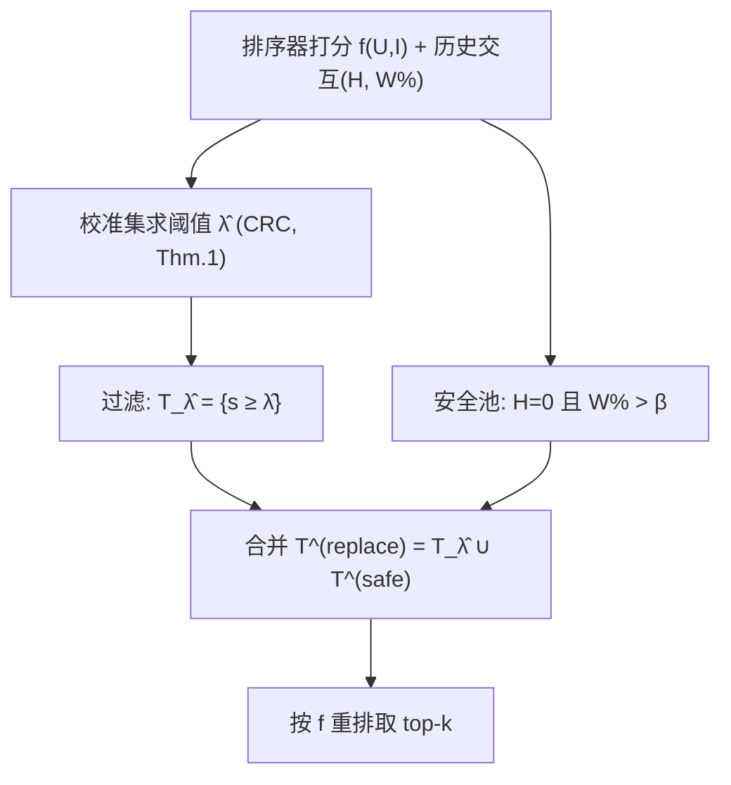
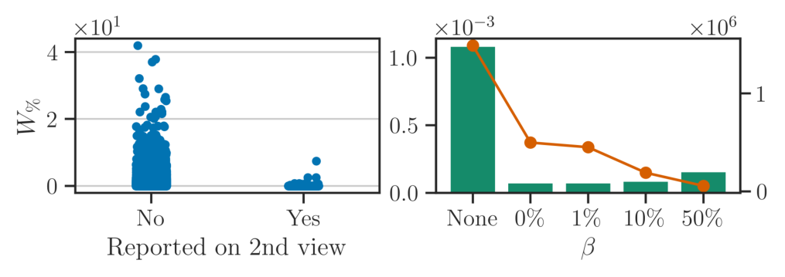

# You Don't Bring Me Flowers: Mitigating Unwanted Recommendations Through Conformal Risk Control (你不送我花：用保形风险控制抑制不想要推荐)

- **会议/期刊**: RecSys 2025（第19届 ACM 推荐系统会议）
- **作者与机构**: Giovanni De Toni, Bruno Lepri（FBK）；Erasmo Purificato, Emilia Gomez, Cristian Consonni（欧盟委员会 JRC）；Andrea Passerini（特伦托大学）
- **推荐链路定位**: 重排（后处理，模型无关，无需重训）
- **研究方向**: 社交与群组推荐 / 去偏公平与可信推荐
- **论文原文**: [https://arxiv.org/abs/2507.16829v1](https://arxiv.org/abs/2507.16829v1)
- **开源代码**: [https://github.com/geektoni/mitigating-harm-recsys](https://github.com/geektoni/mitigating-harm-recsys)

## TL;DR (1分钟核心速览)

平台“不感兴趣/举报”按钮反馈极稀疏（KuaiRand 中 60% 用户每千条仅举报 ≤1 条）、响应迟缓，且现有保形预测方法只做“删除”会导致推荐集缩水、nDCG 崩塌。本文提出模型无关、分布无关的后处理管线：用保形风险控制（CRC）在留出校准集上求全局阈值 $\hat{\lambda}$，把低于阈值的候选**替换**为用户已看过且未举报、观看时长超过$\beta$的“安全重复内容”，从而在期望意义上可证明地把不想要内容比例$\le \alpha$。在 KuaiRand（5657 用户 / 11.8 万视频 / 300 万交互）上，替换策略在 α=50% 时仍保持远高于纯删除的 nDCG@20，且经验风险始终落在目标对角线之下。

## Background & Motivation (背景与核心矛盾)

- **主流范式**: 工业界靠“不感兴趣”按钮、内容审核、公平性约束与多样性促进来压制有害推荐，多为启发式或需重训排序器。
- **前人局限**: ① 反馈工具可见性低、响应慢，用户被迫发展“民间理论”去揣测算法；② 已有保形推荐工作（如控制 nDCG、FDR）只做阈值**删除**，一旦要求严格风控就必须清空候选池（本文 Proposition 2 给出反例：4 个物品中仅 1 个高分有害，任何 $\lambda$要么留下有害项要么$T_\lambda=\varnothing$），推荐位被“浪费”。
- **核心洞察 (Key Insight)**: KuaiRand 实证发现三条关键现象——(a) 被举报视频与未举报视频的观看时长 $W\%$分布几乎重合，**参与度与有害性不相关**，最大化观看时长不等于更安全；(b) 重复消费普遍存在（平均 2.6% 观看为重复），且二次观看时长显著更长（$2.71\text{s}\to10.48\text{s}$）；(c) 首次未举报、且首次观看时长$W\%>\beta$的视频，二次被举报概率$P(H=1\mid H_{1st}=0, W\%>\beta)\approx 0$（图2右）。
- **本文切入点**: 既然“看过且看得久且没举报”的视频几乎必然安全，就用它们填补被风控剔除的推荐位，把“删除”升级为“替换”，在保住 $k$ 个推荐位的同时维持 CRC 的单调性前提。

## Method (核心方法设计)

### 1. 整体框架 (Overall Architecture)

输入为任意预训练排序器 $f(U,I)$的打分与用户历史交互（含二元举报标签$H$与观看时长$W\%$）。离线阶段在校准集上按 Theorem 1 求满足风险上界$\alpha$的全局阈值$\hat{\lambda}$并缓存；在线阶段对候选池做一次扫描，剔除$s(U,I)<\hat{\lambda}$的高危项，同时从“用户已看过、$H=0$、$W\%>\beta$”的安全池$\mathcal{T}^{(safe)}$中取替补并入候选，最后按原排序器取 top-$k$。全流程无需重训、无分布假设，复杂度由排序步主导为$O(|\mathcal{I}|\log|\mathcal{I}|)$。

<figure class="paper-figure" markdown="span">
  <figcaption>图2：快手数据中性质1的有效性。（左）基于首次观看时长W%的第二次观看被举报视频的频率。（右）不同β下的经验概率P(H = 1 | H1st = 0, W% &gt; β)（绿色）以及按观看时长阈值过滤后的剩余重复视频总数（橙色）。</figcaption>
</figure>

### 2. 关键设计拆解 (Key Designs)

1. **保形风险控制阈值（把“举报比例”变成可证明上界）**：风险定义为推荐集内被举报项占比 $R_H(S_\lambda(U,k))=\frac{|\{i\in S_\lambda(U,k):H(U,i)=1\}|}{|S_\lambda(U,k)|}$。由于$R_H$随$\lambda$单调不增，取校准集经验风险$\hat{R}(\lambda)=\frac{1}{n}\sum_j R_H(S_\lambda(u_j,k))$，令
$$\hat{\lambda}=\inf\Big\{\lambda:\ \tfrac{n}{n+1}\hat{R}(\lambda)+\tfrac{1}{n+1}\le\alpha\Big\},$$
则 $\mathbb{E}[R(S_{\hat{\lambda}}(U,k))]\le\alpha$。直觉：$+\frac{1}{n+1}$ 的有限样本修正把校准集上的“刚好达标”抬成对未见用户的保守保证，且与排序器结构完全解耦。

2. **安全替换集与 Property 1（解决 Proposition 2 的候选池枯竭）**：定义 $\mathcal{T}^{(safe)}=\{i'\in\mathcal{I}_U: H(U,i')=0 \wedge W\%(U,i')>\beta\}$，合并池$\mathcal{T}^{(replace)}_\lambda=\mathcal{T}_\lambda\cup\mathcal{T}^{(safe)}$。只要 Property 1 成立（存在$\beta$使$P(H=1\mid H_{1st}=0, C>\beta)=0$），则$\lambda<\lambda'\Rightarrow R_H(\mathcal{T}^{(replace)}_{\lambda'})\le R_H(\mathcal{T}^{(replace)}_{\lambda})$，单调性得以保留，且总能凑满$k$ 个位置。物理直觉：把“删除”造成的信息真空用**已被验证安全的高黏性重复内容**填补，风险不升、效用少降。

3. **训练目标、负采样与推理效率**：本文无新训练损失（后处理范式），排序器沿用 LightGCL/GFormer/SiReN/SIGFormer 原论文设置，重排阶段用简单 NCF 预测 $W\%$。无负采样环节；推理仅需一次阈值缓存查表 + 一次池扫描 + 一次排序，兼容 ANN 索引与缓存，阈值应随新交互周期性重校准。

## Experimental Setup & Evaluation Protocol (实验设置与评估协议)

- **数据集与预处理**: KuaiRand（快手，2022-04-08 至 05-08 采样 27000 用户、约 3200 万观看）。剔除广告与零时长视频，仅保留至少给过一次负反馈的用户（约 29%），再筛“至少被某用户看过两次”的视频，最终：

| 数据集 | #Users | #Items | #Interactions | 稀疏度/密度 | 特征/场景说明 |
| :--- | :---: | :---: | :---: | :---: | :--- |
| KuaiRand (本文子集) | 5,657 | 117,695 | >3,000,000 | 密度约 $4.5\times10^{-3}$ | 短视频；含举报/不推荐二元负反馈、观看时长、重复观看记录 |

- **数据划分与防穿越 (Splitting Strategy)**: 先按“是否重复交互”切分两个子集；单次交互子集采用 `10-core` 过滤后按 70%/15%/15% 随机划分为训练/验证/测试，**验证集同时充当校准集**求 $\hat{\lambda}$；重复交互子集中剔除所有出现在测试集的视频，确保替换池只含训练/验证期已见内容，杜绝穿越。
- **排名评测协议 (Ranking Protocol)**: 采用 `Full-Ranking` 风格的全候选池打分（候选为过滤后物品池，非 1:1 负采样），报告 Recall@20、nDCG@20 与经验风险 $R_H$，$k=20$，结果取 10 次运行均值与标准差。
- **对比基线与超参设置**: 打分函数覆盖无符号图模型 LightGCL、GFormer 与符号感知模型 SiReN、SIGFormer；策略对比 `Remove`（经典 CRC 删除）vs. `Replace`（本文）；$\beta\in\{0\%,50\%,100\%,\text{None}\}$ 做消融；嵌入维度与超参沿用各基线原文。

## Key Experimental Results (实验关键数据)

### 1. 主实验对比 (Main Results)

以 LightGCL 为打分函数、$k=20$、$\beta=0\%$ 的代表性结果（数值为图3趋势的定性归纳，原文以曲线呈现）：

| 策略 / 打分器 | 目标 α=25% 时经验风险 | nDCG@20 (α=25%) | nDCG@20 (α=100%) | 推荐集大小 $\lvert S_\lambda(U)\rvert$ |
| :--- | :---: | :---: | :---: | :---: |
| LightGCL + Remove | ≤25%（常过删） | 明显下降 | 接近 0 | 急剧缩水 |
| LightGCL + **Replace (Ours)** | **≤25%** | **保持较高** | **仍 >0** | **接近 20** |
| GFormer + Replace | ≤25% | 较高 | 下降较缓 | 接近 20 |
| SiReN + Replace | ≤25% | 较低 | 下降快 | 替换量偏大 |
| SIGFormer + Replace | ≤25% | 较低 | 下降快 | 替换量偏大 |

所有策略的经验风险点均落在对角线**之下**（图3c），即实际减害 ≥ 用户请求的 α，验证 Theorem 1 的有效性。

### 2. 消融实验 (Ablation Study)

LightGCL、$k=20$，考察替换池过滤阈值$\beta$（图5）：

| 替换池过滤 | 风险控制是否成立 | nDCG@20 | 重复项数量 | 推荐集大小 |
| :--- | :---: | :---: | :---: | :---: |
| None（不过滤） | **失效**（部分点越对角线） | 最高 | 最多 | 最大 |
| $W\%>0\%$ | 成立 | 较高 | 较多 | 较大 |
| $W\%>50\%$ | 成立 | 中 | 中 | 中 |
| $W\%>100\%$ | 成立 | 较低 | 少 | 趋近 Remove |

用户分桶消融（图6）：低举报用户（$H_X<0.1$）在低 α 下经验减害幅度**大于**高举报用户，而 nDCG 两组基本持平。

### 3. 关键实验发现 (Key Findings)

1. **替换优于删除的收益是结构性的**：α=100% 时纯删除策略推荐集被清空、nDCG 归零，而替换策略仍能返回接近 $k=20$ 的列表并保有非零 nDCG，直接印证 Proposition 2 所刻画的“删除必然浪费推荐位”。
2. **$\beta$是安全性与列表规模的调节旋钮**：不过滤（None）时因校准-测试分布漂移导致风险保证失效；一旦$W\%>0\%$即恢复保证，但$\beta$ 越严格安全池越小、行为越退化为 Remove——存在“保证强度 vs. 候选池规模”的显式权衡。
3. **全局阈值对用户群体不公平**：高举报用户主导校准，使 $\hat{\lambda}$ 偏保守，低举报用户本可用更少替换达到同等保证；这提示应按用户分组校准（group-balanced conformal）而非单一全局阈值。
4. **符号感知模型反而不划算**：SiReN/SIGFormer 因负反馈极稀疏（>95% 用户举报率 <1%）学不好负图嵌入，不确定性更高，同等风险下需替换更多物品；LightGCL/GFormer 替换量最小，成为最佳打分函数。

## Highlights & Limitations (亮点、对比与审稿批判)

- **与代表作对比 (vs. Prior Work)**: 相比 Angelopoulos 等将 CRC 用于推荐的“纯阈值删除”，本文用 Property 1 支撑的替换集恢复了单调性并解决候选池枯竭；相比文献[18]需从反馈中学习定制策略、文献[44]只给群体级保证，本文提供**物品级、模型无关、免重训**的期望风险上界；相比内容审核/公平约束类方法，本文给出有限样本可证明保证而非启发式压制。
- **可迁移亮点**: ① “校准集求全局阈值 + 缓存查表”的后处理范式可零成本挂载到任何已上线排序器；② 用“高黏性历史正反馈内容”作为安全替补池的思路，可迁移到广告负反馈控制、冷启动兜底与重复消费推荐。
- **审稿级局限批判**: ① 仅 KuaiRand 单一数据集（因其是唯一提供细粒度举报+时长的公开数据），外部效度存疑，Property 1 的普适性未验证；② 全局阈值忽略用户异质性且假设偏好静态，风险函数不计位置权重；③ 替换策略可能加剧内容同质化与回音室效应，且重复项复用原始观看时长、未重新打分，可能低估二次曝光兴趣。

## Rating (四维评分)

- **方法创新性 (Novelty)**: ⭐⭐⭐⭐ （把 CRC 从“删除”推进到“安全替换”，并用 Property 1 + Proposition 3 补上单调性证明，理论闭环完整但组件本身较成熟）
- **评估协议与实验扎实度 (Protocol & Experiments)**: ⭐⭐⭐ （防穿越切分与校准/测试分离严谨、10 次运行带方差，但仅单数据集、主结果以曲线呈现缺精确数值表、无显著性检验）
- **写作与数学规范度 (Clarity & Rigor)**: ⭐⭐⭐⭐ （Theorem 1/Proposition 2/3 层层递进，反例构造清晰，复杂度分析到位；风险函数忽略位置权重略有简化）
- **工业落地与复现价值 (Industrial & Practical Value)**: ⭐⭐⭐⭐⭐ （模型无关、免重训、$O(|\mathcal{I}|\log|\mathcal{I}|)$ 且阈值可缓存，代码已开源，可直接作为重排层风控插件部署）

