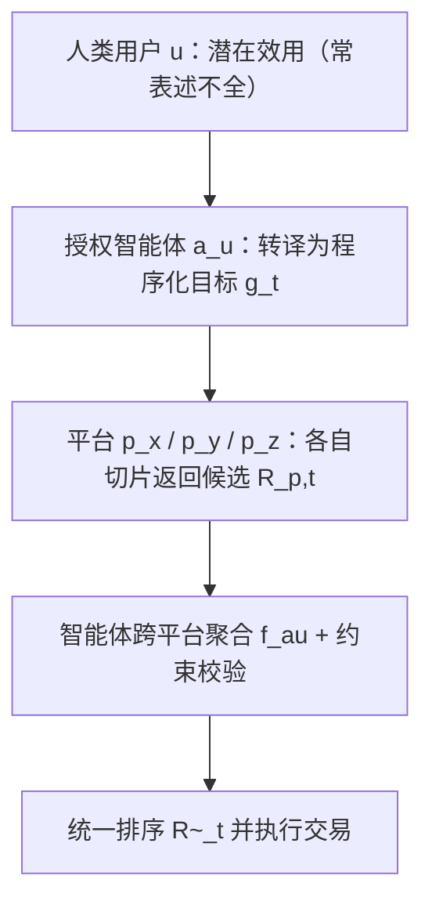
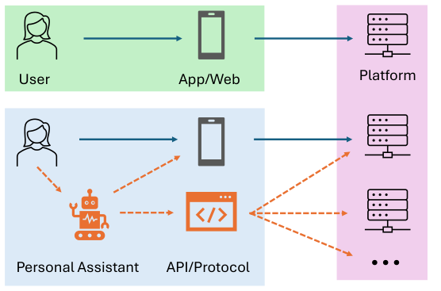

# A Position Paper on Recommender Systems in the Era of Autonomous Agents (自主智能体时代的推荐系统立场论文)

- **会议/期刊**: ACM RecSys 2026 (Main Track, Position Paper)
- **作者与机构**: Aixin Sun (南洋理工大学 NTU)
- **推荐链路定位**: 端到端（系统级范式重构，覆盖召回/排序/评估全链路）
- **研究方向**: 对话推荐与智能体仿真 / 大语言模型推荐
- **论文原文**: [https://arxiv.org/abs/2607.24822v1](https://arxiv.org/abs/2607.24822v1)
- **开源代码**: 暂未开源

## TL;DR (1分钟核心速览)

本文是一篇立场论文，指出推荐系统的"消费者"正从纯人类变为"人类 + 授权智能体"的混合体。作者将智能体定义为**用户侧、独立于平台**的个人助理（区别于平台内置的 agentic RecSys），形式化了人-智能体-平台的三方交互与各自冲突的目标函数，并批判性回顾了人本推荐在"无系统思维、静态数据、数据集-任务错配、评估效度危机"四方面的历史盲点，进而提出从"偏好建模"转向"任务执行"、从离线指标转向协议级交互评估、从单平台检索转向跨平台代理、从任务委托转向偏好诱导四大研究方向。本文无实验，属概念框架型 position paper。

## Background & Motivation (背景与核心矛盾)

- **主流范式**: 数十年来 RecSys 默认终端用户是人类，通过 GUI 直接与单一平台交互，优化点击/转化/时长等代理指标。
- **范式转移**: ChatGPT Agent Mode、Claude Cowork 等个人助理已可代表用户执行"目标驱动"的采购任务，且能通过 GUI 或 API 同时查询、比较、聚合**多个平台**的推荐结果（图1 下半部分）。
- **前人局限一（视角错位）**: 现有 "agentic RecSys" 文献把 LLM Agent 部署在**平台内部**增强推荐；本文关注的是**客户端**、仅代表用户利益的独立代理，二者目的根本不同、互补而非竞争。
- **前人局限二（历史盲点）**: 作者批判人本推荐四大积弊——(i) 把推荐当纯 ML 矩阵补全而非 socio-technical 系统，复杂神经模型常打不过调好的启发式基线；(ii) 依赖 MovieLens/Amazon 等静态过时快照，形成"刷榜幻觉"；(iii) 数据集-任务错配（用点击流评估交易型任务，且数据只记录 *what* 不记录 *why*，即隐目标 $g_t$）；(iv) 评估效度危机，Recall@K/NDCG 与线上 A/B 弱相关甚至负相关，且普遍存在时间穿越泄漏。
- **核心洞察 (Key Insight)**: 智能体作为跨平台历史聚合器，比任何单一平台都更了解用户全局状态；平台只看到自己那一片"切片"，信息优势发生反转。
- **本文切入点**: 用带显式目标 $g_t$ 的任务定义替换隐式行为推断，重构三方博弈下的优化逻辑与评估协议。

## Method (核心方法设计)

### 1. 整体框架 (Overall Architecture)

本文不提出模型，而是提出**问题形式化框架**。核心是把传统推荐任务（式1）升级为含智能体的交易型推荐任务（式2），并叠加智能体侧跨平台聚合（式3）。整体逻辑：人类给出（可能模糊的）潜在效用 → 智能体将其转译为程序化约束目标 $g_t$ → 各平台基于自身切片返回候选 → 智能体跨平台聚合、校验约束、重排 → 执行交易。三方目标函数天然冲突：人类最大化潜在效用、智能体优化效用的程序化代理、平台最大化转化与营收。

<figure class="paper-figure" markdown="span">
  <figcaption>图1：RecSys 交互的演变：传统的直接参与（上）与新兴的混合生态系统（下），在混合生态系统中用户将任务委托给自主智能体，智能体通过 GUI 或 API 与多个平台交互。</figcaption>
</figure>

### 2. 关键设计拆解 (Key Designs)

1. **含智能体的交易型推荐任务定义（式2）**：传统式1 $\langle u,t,(U\times I)_{\le t},s(I_{\le t})\rangle\to R_{u,t}$ 无法表达"谁在请求"与"显式目标"。本文引入请求实体 $e\in\{u,a_u\}$ 与目标 $g_t$，并让系统利用用户与智能体的**联合历史** $((U\cup A)\times I)_{\le t}$：
$$\langle e,t,g_t,((U\cup A)\times I)_{\le t},s(I_{\le t},g_t)\rangle\to R_{e,t}$$
直觉：当 $e=a_u$ 时 $g_t$ 是程序化约束（如"续航≥16h 且价格<$1000"），平台输出须从"视觉说服型版式"转为"高密度、可验证的数据结构"。

2. **跨平台代理聚合（式3）**：单平台只有碎片化视图，智能体可聚合多平台候选：
$$\tilde{R}_t=f_{a_u}\big(\{R_{p,t}\}_{p\in\mathcal{P}},\,g_t,\,h^{\text{cross}}_t\big)$$
其中 $h^{\text{cross}}_t$ 是仅客户端可见的跨平台行为证据。这是全新研究面：如何检测并纠正平台侧偏差、如何为 $h^{\text{cross}}_t$ 加权、如何设计抗博弈的机器可读协议。

3. **三方交互前沿（Tripartite Dynamics）**：Human-to-Platform 仍是传统优化域（利用认知偏差、视觉层级、人为稀缺）；Agent-to-Platform 中视觉说服失效，平台会试图从 $g_t$ **反推**用户全局状态以夺回信息优势，并存在针对智能体校验的元数据操纵风险；Human-to-Agent 是全新域，核心是**目标错配**——用户给出模糊 $g_t$ 时智能体会过度优化代理指标（如只买最便宜的"高评分"机器），忽略未言明的审美/重量/品牌偏好。

## Experimental Setup & Evaluation Protocol (实验设置与评估协议)

- **本文性质**: Position paper，**无数据集、无实验、无基线对比**。其"评估协议"贡献在于**批判与倡议**，而非实证。
- **对现有评估的批判**: 指出 Recall@K/NDCG 在静态历史日志上与线上 A/B 及真实满意度弱/负相关；忽略时间戳 $t$ 导致数据泄漏；模拟对话数据集（众包角色扮演、算法用户模拟器）假设"完全理性、偏好静态、表达清晰"的用户，与真实用户（改主意、反馈模糊、中途放弃）严重脱节。
- **倡议的新评估范式**: (i) 以**约束可满足性** $s(I_{\le t},g_t)$ 与端到端任务完成度替代 item-level 预测精度；(ii) 支持多轮迭代查询；(iii) 能检测对抗性元数据操纵；(iv) 构建"带 ground-truth 效用函数的智能体向模拟平台发结构化查询"的 benchmark 环境，须包含部分规格、任务中途约束修订、跨平台套利等真实 agentic 行为。

## Key Experimental Results (实验关键数据)

### 1. 主实验对比 (Main Results)

本文为立场论文，**不含任何主实验表格与数值结果**，故无 SOTA 对比可列。其"证据"为对既有文献的定性引用与逻辑论证（如引用"复杂神经架构常不敌调优的传统/启发式基线"、"离线指标与线上弱相关"等既有结论）。

### 2. 消融实验 (Ablation Study)

不适用（无模型、无组件可消融）。

### 3. 关键实验发现 (Key Findings)

作为 position paper，其"发现"为概念性论断，归纳三条：
1. **信息优势反转**：智能体聚合跨平台历史 $h^{\text{cross}}_t$ 后，比任何单平台更懂用户，平台被迫从 $g_t$ 反推用户状态，重塑了平台-用户权力结构。
2. **任务类型决定可委托性**：内容型推荐（娱乐/资讯消费）本质是人类体验、不可委托，仍将直接服务人类；交易型推荐（价值在结果而非过程）才适合委托给智能体——这是全文讨论的边界条件。
3. **历史盲点会被继承**：若把"刷静态榜、指标错配、模拟理想用户"的旧习惯带入 agentic 时代，将放大而非解决评估效度危机；故须以"显式、可验证、基于约束的任务执行"为共同主线重构。

## Highlights, Limitations & Rating (亮点、对比与审稿评价)

- **与代表作对比 (vs. Prior Work)**: 与主流 "agentic RecSys"（LLM Agent 内嵌平台做推荐，如平台侧 Agent 增强）本质区别在于**代理归属与利益立场**——本文智能体在客户端、仅代表用户、可跨平台套利；与 Conversational RecSys 的区别在于目标不是"推荐一个物品"，而是"把采购任务规格化到任何合格智能体都能正确执行"。
- **可迁移亮点**: (i) 用"请求实体 $e$ + 显式目标 $g_t$ + 联合历史"三元组改造任务定义，可直接用于设计 agent-native 推荐 API 的输入契约；(ii) "约束可满足性 + 端到端任务完成度"的评估思路，可迁移到任何需要可验证输出的推荐场景（如比价、行程规划）。
- **审稿级局限批判**: (i) 全文无实证、无原型、无 benchmark 落地，四大方向均停留在"提出好问题"层面，可操作性弱；(ii) 强假设"每用户至多授权一个跨全平台智能体"，且将内容型/交易型的二分边界处理得较粗，现实中大量混合意图场景（如种草后购买）难以归类；(iii) 隐私、同意与跨平台数据治理被作者明确"超出范围"，但这恰是该生态能否成立的前提，回避了最硬的约束。
- **四维评分**: 创新性 ⭐⭐⭐⭐ | 实验扎实度 ⭐⭐ | 方法清晰度 ⭐⭐⭐⭐ | 落地价值 ⭐⭐⭐⭐

