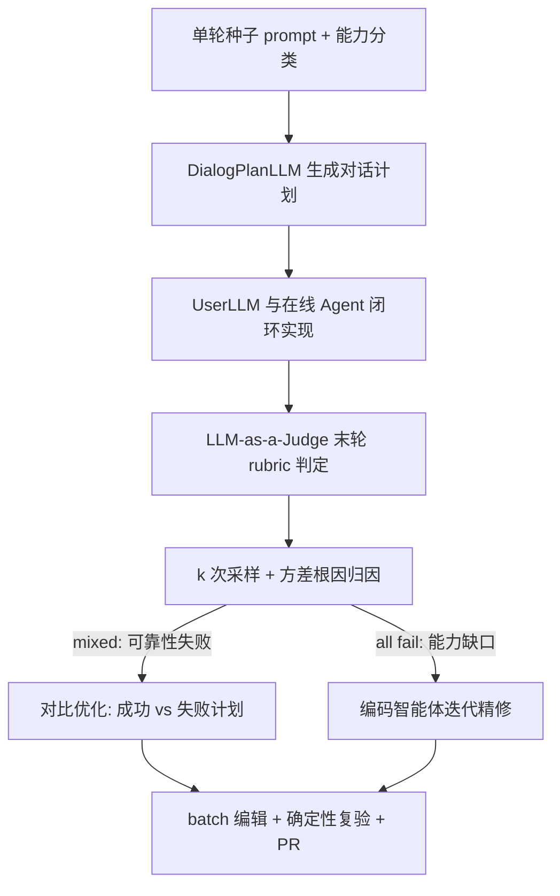
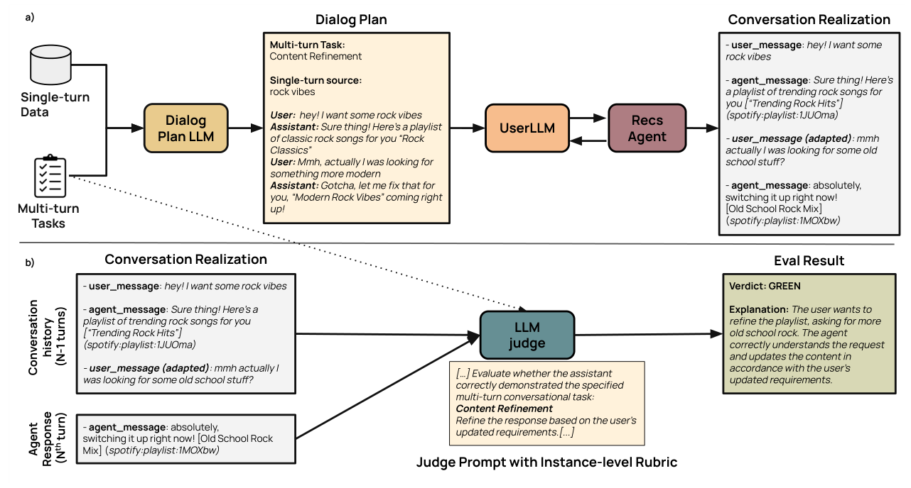

# Bootstrapping Conversational Recommendation Agents At Spotify: Synthetic Data Generation and Self-Improvement Loops (Spotify 对话推荐智能体的冷启动：合成数据生成与自改进循环)

- **会议/期刊**: RecSys 2026
- **作者与机构**: Enrico Palumbo, Alexandre Tamborrino, Mounia Lalmas, José Luis Redondo García 等，Spotify 多国团队
- **推荐链路定位**: 端到端生成式（LLM Agent 规划 + 工具调用）
- **研究方向**: 对话推荐与智能体仿真 / 大语言模型推荐
- **论文原文**: [https://arxiv.org/abs/2609.30297v1](https://arxiv.org/abs/2609.30297v1)
- **开源代码**: [https://github.com/karpathy/autoresearch](https://github.com/karpathy/autoresearch)（仅自改进框架参考实现，Spotify 生产管线未开源）

## TL;DR (1分钟核心速览)

对话推荐智能体的核心痛点是**冷启动下既无多轮真实对话数据、又难以诊断随机规划失败**。本文提出「对话计划→UserLLM 闭环实现→实例级 rubric 评判」的多轮合成数据管线，配合基于 `pass@k` 与 `pass_k` 方差归因的自改进循环（对比优化 + 编码智能体迭代精修），在高度人工调优的 prompt 之上再提升 **+8%** `pass@1`（$p=0.01$），合成数据四维人工评分均 >90%；Spotify 线上 A/B（约 1500 万用户）带来 **+14% 收听、+5% 周活、-5% 跳过率**。

## Background & Motivation (背景与核心矛盾)

- **主流范式**: 对话推荐已从「规则管线（查询理解→检索→对话管理）」转向 LLM 端到端范式，分两支——生成式检索（直接生成 item ID）与 **Agentic 范式**（LLM 规划并调用生产级检索/排序工具）。本文属后者。
- **前人局限**: ① 冷启动期无大规模多轮真实流量，单轮评测无法暴露「多轮才出现」的失败（如用户改需求后不刷新结果）；② Agent 规划具随机性，同一 query 有时成功有时失败，人工看 trace 调 prompt 无法规模化，且噪声（工具超时、judge 抖动）会诱发错误更新。
- **核心洞察 (Key Insight)**: 失败并非同质——`pass@k` 与 `pass_k` 之间存在高达 **32%（k=5）** 的鸿沟，说明存在两类失败：**可靠性失败**（正确计划在分布内但采样不稳）与**能力缺口**（分布内根本不存在正确计划），二者需不同疗法。
- **本文切入点**: 用「计划与执行解耦」的合成数据把评测前置，再用方差归因把噪声与真信号分离，只对规划类失败做对比优化、对全失败做编码智能体精修。

## Method (核心方法设计)

### 1. 整体框架 (Overall Architecture)

系统分两条腿：**数据侧**从真实单轮 prompt 与合成 prompt 构成种子集 $\mathcal{S}=\mathcal{S}_{real}\cup\mathcal{S}_{synth}$，由 DialogPlanLLM 依五项能力分类（Content Refinement / Instruction Retention / Anaphora Resolution / Intent Shift / Separate Input）生成抽象对话计划，再由 UserLLM 与**在线 Agent 闭环交互**实现为真实对话（保留工具返回的 playlist URI 等结构化输出），最后 LLM-as-a-Judge 仅对末轮按实例级 rubric 打 GREEN/RED。**优化侧**对约 1000 条样本以 batch=8 采样多条计划，做根因归因后分流至对比优化或编码智能体精修，改动经$\tau=0$ 确定性复验后提交 PR 人工审核。

<figure class="paper-figure" markdown="span">
  <figcaption>图2：多轮合成数据生成流程。a) 我们将单轮提示泛化为多轮合成用户-智能体对话。b) 随后通过以实例级评分标准进行评判的LLM-as-a-judge对对话进行评估。</figcaption>
</figure>

### 2. 关键设计拆解 (Key Designs)

1. **计划-实现解耦的合成数据管线（Plan-then-Realize）**：直接让用户模拟器自由 rollout 会产生不可复用、依赖 Agent 版本的对话。本文先固定「应达成什么」的抽象计划 $d=\{(u_1,a_1),\dots,(u_{n},a_n)\}$，长度$n\sim\mathcal{U}\{2,\dots,n_{max}\}$作软约束；实现阶段首轮$u_1$原样送入 Agent 得到含结构化输出的$\hat{a}_1$，后续轮由 UserLLM 在「计划$d$+ 已观测历史 + 参考轮$u_k$」条件下生成$\hat{u}_k$，仅在计划与 Agent 实际回复冲突时做**最小改写**（如 Agent 已给现代摇滚则改问「更老派一点」）。直觉：既保证目标能力被真实触发，又让对话扎根于 Agent 真实行为而非幻觉计划。

2. **方差归因驱动的双模自改进（Variance-Attributed Self-Improvement）**：对同一 query 以 $\tau\in[0.7,1.0]$采样$k$个计划$\pi_i\sim p_\theta(\cdot\mid q,\mathcal{P})$，得$\mathcal{D}^+,\mathcal{D}^-$。若 mixed，先用 trace 解析 + LLM 语义判断把方差归入六类根因（`planning_tools` / `planning_args` / `action` / `tool_failure` / `tool_variance` / `judge_variance`），**仅前三类**进入对比优化，由编码智能体提炼成功计划的工具选择/顺序/参数构造模式，产出增量$e^*$使$\mathcal{P}'=\mathcal{P}\cup\{e^*\}$；若 all fail（`pass@k`$=0$），则交由编码智能体读全量 trace 与 prompt 工件，提出最小修改（补工具用例、扩工具描述、加路由指令）。直觉：把「采样能救的」与「采样救不了的」分开，避免被基础设施噪声带偏。

3. **批式编辑与防过拟合目标**：编码智能体在随机 mini-batch $Q=\{q_1,\dots,q_m\}$上产出**单一**更新，求解$\Delta\mathcal{P}^*=\arg\min_{\Delta\mathcal{P}}\frac{1}{m}\sum_{j=1}^{m}\mathcal{L}(q_j,\mathcal{P}+\Delta\mathcal{P})$，其中$\mathcal{L}$为 judge 损失。批式迫使智能体找共性结构原因而非对单 query 过拟合；更新后以$\tau=0$ 确定性复验，成功才 commit，最终开 PR 人工把关。训练侧无梯度、无负采样，全部开销在 LLM 采样与 judge 调用上。

## Experimental Setup & Evaluation Protocol (实验设置与评估协议)

- **数据集与预处理**: 自改进数据集约 1000 条，混合单轮与多轮；多轮数据由种子 prompt 继承 train/val/test 划分，**在种子层面防泄漏**。人工质检抽样 100 条按能力分层，5 名标注者四维二值评判。

| 数据集 | #Users | #Items | #Interactions | 稀疏度/密度 | 特征/场景说明 |
| :--- | :---: | :---: | :---: | :---: | :--- |
| Spotify 合成多轮集 | — | — | ~1,000 对话 | — | 5 类多轮能力，长度 2–7 轮 |
| 人工质检抽样 | 5 标注者 | — | 100 对话 | — | 按能力分层，四维二值 |
| 线上 A/B | ~15M | 全曲库 | 两周多市场 | — | 多设备，对比仅支持 session refinement 的旧体验 |

- **数据划分与防穿越 (Splitting Strategy)**: 种子级继承划分（seed-level split），合成对话沿用其种子 prompt 的 split，杜绝同源泄漏。
- **排名评测协议 (Ranking Protocol)**: 非传统 Full-Ranking，而是 **LLM-as-a-Judge 末轮二值判定**（GREEN/RED），指标为 `pass@1`（GREEN 率，$n=10$ 次平均）与 `pass@k`/`pass_k`（无偏估计，参照 [6,23]）；judge 与 Agent 使用**不同模型**以规避同模型偏好，另维护约 150 条 golden 样例持续监控对齐。
- **对比基线与超参设置**: 基线为「高度人工调优的 prompt」与 ACE 式上下文工程；采样温度 $\tau\in[0.7,1.0]$，batch size$m=8$，显著性用 pairwise sign test（$p=0.01$）。

## Key Experimental Results (实验关键数据)

### 1. 主实验对比 (Main Results)

| 方法 | `pass@1` 相对变化 | 说明 |
| :--- | :---: | :--- |
| 人工精调 prompt（基线） | 0.0 | 已高度优化 |
| + 自改进循环（本文） | **+8.0%** | $p=0.01$，pairwise sign test |
| ACE 式上下文工程（对比） | 提升较小且易受噪声干扰 | 无方差根因归因，易产生伪更新 |

线上 A/B（约 1500 万用户，两周）：

| 指标 | 相对旧体验（仅 session refinement） |
| :--- | :---: |
| 用户收听时长 | **+14%** |
| 周活跃用户 (WAU) | **+5%** |
| 跳过率 (Skip Rate) | **-5%** |

### 2. 消融实验 (Ablation Study)

| 配置 | 关键结果 | 结论 |
| :--- | :---: | :--- |
| 完整管线（对比优化 + 迭代精修） | `pass@1` +8% | 最优 |
| w/o 方差根因归因（直接全量修） | 伪更新增多、信噪比下降 | 归因是防噪关键 |
| w/o 对比优化（仅编码智能体精修） | 可靠性失败修复不足 | 两类失败需分流 |
| w/o 计划-实现解耦（直接 rollout） | 对话不可复用、能力覆盖不可控 | 解耦保证可控性 |
| 合成数据人工质检 Q1–Q4 | 98.0 / 93.0 / 94.1 / 97.0% | 四维均 >90% |

### 3. 关键实验发现 (Key Findings)

1. **能力难度分层显著**：以最易的 Intent Shift 为基准，Anaphora Resolution 低 9.2pp、Separate Input 低 13.6pp、Content Refinement 低 18.2pp、Instruction Retention 低 **28.8pp**——需要在演化约束下操作列表的任务对前沿模型仍最难。
2. **长度衰减拐点在 4 轮**：相对 2 轮对话，3/4 轮仅 -1.1/-0.4pp，5 轮起骤降至 -3.2pp，7 轮达 **-11.9pp**，与 LLM 长上下文「迷失」现象一致，指向上下文压缩（保留已推荐 item、压缩泛化措辞）为关键后续方向。
3. **自改进产出的是可解释的规划修复**：如「多轮中『给我更多艺人』应扩展现有 playlist 而非返回艺人列表」「hardcore 需依上下文消歧为 hardcore punk 而非电子」「Year in review 属日历年查询需带 start/end time」——说明 +8% 来自真实工具调用逻辑修正而非评测过拟合。

## Highlights & Limitations (亮点、对比与审稿批判)

- **与代表作对比 (vs. Prior Work)**: 相比 TextGrad/GEPA/ACE 等纯 prompt 优化，本文不提出新优化器，而是引入**方差根因归因**作为信噪比闸门，并把优化对象从 prompt 扩到工具描述（harness 级）；相比 τ-bench 等通用 agent 基准，本文 taxonomy 面向音乐推荐产品意图（refinement、intent shift），且直接对接生产 Agent。
- **可迁移亮点**: ① 「计划-实现解耦」可复用于任何缺多轮数据的 agent 冷启动评测；② `pass@k` vs `pass_k` 鸿沟作为「可靠性 vs 能力」二分诊断器，成本极低、普适性强。
- **审稿级局限批判**: ① 评测完全依赖 LLM-as-a-Judge 二值判定，虽人工对齐 97%，但缺少与传统 ranking 指标（NDCG/Recall）的桥接，推荐质量本身未被直接度量；② 自改进每轮需 $k$ 次采样 + judge + 编码智能体推理，成本与延迟未量化，且依赖前沿闭源模型，复现门槛高；③ 线上 A/B 为整体体验对比，无法拆分合成数据与自改进各自的独立贡献。

## Rating (四维评分)

- **方法创新性 (Novelty)**: ⭐⭐⭐⭐ （计划-实现解耦与方差归因双模分流思路新颖，但本质是工程化组合而非理论突破）
- **评估协议与实验扎实度 (Protocol & Experiments)**: ⭐⭐⭐⭐ （合成数据四维人工质检 + golden 集监控 + 1500 万用户线上 A/B 相当扎实，缺传统 ranking 指标与组件级线上拆分）
- **写作与数学规范度 (Clarity & Rigor)**: ⭐⭐⭐⭐ （管线与根因分类表述清晰，公式简洁；`pass@k` 估计细节与成本分析略薄）
- **工业落地与复现价值 (Industrial & Practical Value)**: ⭐⭐⭐⭐⭐ （已在 Spotify 生产上线并驱动核心指标，冷启动方法论对工业团队直接可用；代码仅部分开源）
