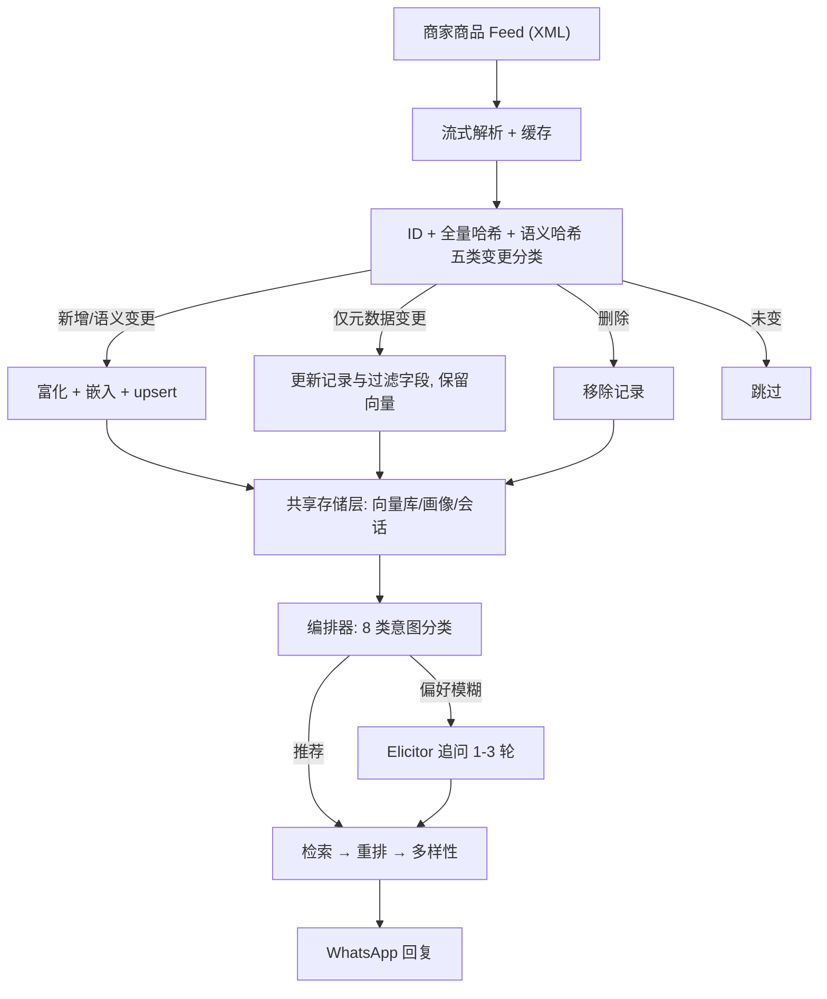
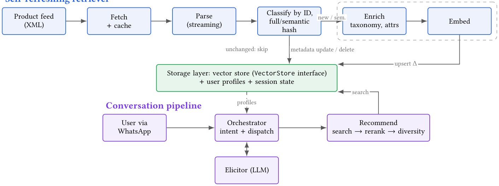

# Conversational Recommendation over Live E-Commerce Catalogues with Self-Refreshing Retrieval (面向实时电商商品库的自刷新检索对话推荐)

- **会议/期刊**: ACM RecSys 2026 (Demo Track, 3 页)
- **作者与机构**: Ante Kapetanović, Tomislav Ðuričić, Dionizije Fa, Andro Merćep, Emanuel Lacić（Infobip，克罗地亚）
- **推荐链路定位**: 召回（语义检索）+ 轻量重排 + 多样性选择，端到端对话式购物助手
- **研究方向**: 对话推荐与智能体仿真 / 冷启动与长尾推荐（商品库动态增删）
- **论文原文**: [https://arxiv.org/abs/2608.27006v1](https://arxiv.org/abs/2608.27006v1)
- **开源代码**: [https://github.com/infobip/infobip-agentic-crs](https://github.com/infobip/infobip-agentic-crs)

## TL;DR (1分钟核心速览)

现有 LLM 对话推荐系统几乎都在**静态预索引**的商品集合上评测，而真实电商商品库持续增删、改价、补货：全量重建索引浪费算力，放任索引漂移又会推荐下架/缺货商品。本文提出**自刷新检索器（Self-Refreshing Retriever）**，用稳定商品 ID + 全量哈希 + 语义哈希把每次同步的条目划分为新增/语义变更/仅元数据变更/删除/未变五类，只对增量做富化与嵌入；对话层采用"编排器即控制器"模式，LLM 仅负责意图分类与偏好追问，检索、重排、多样性选择均为确定性函数。在 500 条匿名商品库上，空同步仅耗全量重建（2.914 s）的 **1.8%**，单条新增/语义变更约 **11%–12.3%**。注意：本文评估的是**同步工程开销而非排序质量**。

## Background & Motivation (背景与核心矛盾)

- **主流范式**: LLM 时代的 CRS 走检索增强路线——把商品语料嵌入向量库，对话中做语义召回，再由 LLM 组织回复或调用工具（agentic 编排）。
- **前人局限**: ① 基准数据集（如 ReDial/INSPIRED 类固定集合）假设商品库不变，与生产环境"商品库是活对象"的事实脱节；② 每次变更全量重建索引代价随目录规模线性增长，而让索引漂移则会推荐已下架、已改价或停售商品，直接损伤信任。
- **核心洞察 (Key Insight)**: 商品库的变更绝大多数是**局部**的——价格/库存变动甚至不需要重新嵌入，只有名称、描述、品牌、类目这类**语义字段**变化才需要重算向量。因此"变更分类"比"更快地重建"更根本。
- **本文切入点**: 把**目录新鲜度（catalogue freshness）**当作使 CRS 可上线的核心工程问题，用双哈希差分把同步成本压到与变更子集成正比，且与向量库、模型供应商、消息渠道全部解耦。

## Method (核心方法设计)

### 1. 整体框架 (Overall Architecture)

引擎由三个子系统构成：**目录流水线**（拉取商家 feed → 解析 → 分类 → 富化 → 嵌入 → 写入）、**对话流水线**（编排器做意图分类并分派给追问子代理或推荐路径）、**共享存储层**（向量库 + 用户画像 + 会话状态，前者写、后者读）。两条流水线通过存储层解耦，可独立调度；所有生成/嵌入/重排调用走统一代理，模型选择是配置而非代码。推荐路径为 `语义检索 → 元数据过滤 → 可选非生成式重排 → 贪心多样性选择`，LLM 不参与打分。

<figure class="paper-figure" markdown="span">
  <figcaption>图2：引擎架构。上部：自刷新检索器将商家商品源转换为向量索引。它获取并解析商品源，然后根据每个条目的稳定 ID 及其完整内容哈希和语义内容哈希进行分类。新增和语义变化的条目会被丰富、嵌入并更新插入。仅元数据变化的条目更新存储记录但保留其向量。删除的条目被移除，未变化的条目被跳过。下部：对话流水线通过 WhatsApp 为购物者提供服务。编排器对意图进行分类，并分派给引导器或推荐 pa</figcaption>
</figure>

### 2. 关键设计拆解 (Key Designs)

1. **双哈希五类变更分类（核心增量）**：痛点在于"稳定 ID 能定位条目，却无法回答自然语言查询；而全量哈希只能告诉你'变了'，不能告诉你'是否需要重嵌入'"。本文引入两级哈希：全量哈希覆盖 feed 全部字段以检测任意变动，语义哈希仅覆盖 `name / description / brand / category` 四个字段以判定是否触发重嵌入。由此得到互斥五类：

$$\text{cls}(i)=\begin{cases}\text{New} & \text{id}_i \notin \mathcal{I}_{\text{idx}}\\ \text{SemChange} & h^{\text{sem}}_i \neq h^{\text{sem}}_{\text{idx}(i)}\\ \text{MetaOnly} & h^{\text{full}}_i \neq h^{\text{full}}_{\text{idx}(i)} \wedge h^{\text{sem}}_i = h^{\text{sem}}_{\text{idx}(i)}\\ \text{Deleted} & \text{id}_i \in \mathcal{I}_{\text{idx}} \wedge \text{id}_i \notin \mathcal{I}_{\text{feed}}\\ \text{Unchanged} & \text{otherwise}\end{cases}$$

物理直觉：改价/补货只影响过滤与展示，不影响语义可检索性，保留旧向量即可；只有语义字段变化才使旧向量失效。这一分类把"嵌入调用次数"从 $O(|\mathcal{C}|)$ 降到 $O(|\Delta_{\text{sem}}|)$。

2. **编排器即控制器（Orchestrator-as-Controller）**：痛点在于让 LLM 端到端生成推荐既贵又不可控。本文把 LLM 的职责压缩到两处——8 类意图分类与偏好追问（Elicitor 在偏好模糊时提 1–3 个澄清问题），检索、重排、多样性全部是确定性函数。收益是成本可预测、行为可审计；代价是推荐质量上限受限于检索器与重排器而非 LLM 推理能力。

3. **同步安全性与推理开销**：写入顺序为"先准备富化与嵌入 → 再 upsert 与元数据更新 → 最后删除"，避免中间态暴露；拒绝解析失败、非法/重复 ID、索引版本不兼容，并**拒绝空或不完整快照**以防误判为全量删除。写入非事务性，生产环境需截断检测、暂存/回滚与异常增量监控。推理侧每次推荐仅一次嵌入 + 一次向量检索 + 可选一次重排调用。

## Experimental Setup & Evaluation Protocol (实验设置与评估协议)

- **数据集与预处理**: 单一匿名商家商品库，500 条记录，Google Merchant Center Atom feed 格式；解析时剥离 HTML、归一化价格、可用性转布尔。

| 数据集 | #Users | #Items | #Interactions | 稀疏度/密度 | 特征/场景说明 |
| :--- | :---: | :---: | :---: | :---: | :--- |
| 匿名商家目录（案例研究） | — | 500 | — | — | 电商 feed，含价格/库存/类目/品牌字段；无用户交互日志 |

- **数据划分与防穿越 (Splitting Strategy)**: **不适用**。本文为系统演示论文，无训练/测试划分，评估对象是同步操作的耗时与操作计数，而非排序指标。
- **排名评测协议 (Ranking Protocol)**: **无排序评测**。作者在结论中明确"评估覆盖同步而非排序质量"，离线相关性研究与在线用户研究列为未来工作。这是本文最需注意的评估边界。
- **对比基线与超参设置**: 唯一对照是**全量重建（full rebuild, 2.914 s）**；每种变更场景取 3 或 5 次运行的中位数。向量库为 ChromaDB（经可替换 `VectorStore` 接口），嵌入/重排模型未披露具体型号与维度。

## Key Experimental Results (实验关键数据)

### 1. 主实验对比 (Main Results)

原文仅有一张表（Table 1），报告五类变更场景下的同步耗时与相对全量重建的占比：

| 变更场景 | 富化 E | 嵌入 Emb | 元数据更新 M | 删除 D | 耗时 (s) | 占全量 (%) |
| :--- | :---: | :---: | :---: | :---: | :---: | :---: |
| 无变更 (None) | ✗ | ✗ | ✗ | ✗ | **0.053** | **1.8** |
| 新增商品 (Add) | ✓ | ✓ | ✗ | ✗ | 0.321 | 11.0 |
| 改价/库存 (Price/stock) | ✗ | ✗ | ✓ | ✗ | 0.072 | 2.5 |
| 改描述/类目 (Desc/category) | ✓ | ✓ | ✗ | ✗ | 0.357 | 12.3 |
| 删除商品 (Delete) | ✗ | ✗ | ✗ | ✓ | 0.062 | 2.1 |
| *全量重建（基线）* | — | — | — | — | *2.914* | *100* |

### 2. 消融实验 (Ablation Study)

本文**未设消融实验**。可视为"隐式消融"的是五类变更场景本身——它们分别验证了各条处理分支（富化、嵌入、元数据更新、删除）是否被正确触发，作者称"所有 ID、哈希、feed 字段与嵌入调用检查均通过"。

### 3. 关键实验发现 (Key Findings)

1. **空同步成本近乎为零**：无变更时 0.053 s，仅为全量重建的 1.8%，说明差分比对本身（哈希计算 + 集合比较）在 500 条规模下可忽略，增量架构的固定开销极低。
2. **元数据变更与语义变更的成本差达 5 倍**：改价/库存 0.072 s（2.5%）vs. 改描述/类目 0.357 s（12.3%），差值几乎全部来自富化与嵌入调用——这直接量化了"语义哈希"这一设计的价值：把高频的改价/补货挡在嵌入之外。
3. **删除比新增更便宜**：删除 0.062 s（2.1%）远低于新增 0.321 s（11.0%），因为删除无需富化与嵌入，仅需索引移除，验证了写入顺序设计（先 upsert 后删除）不会引入额外开销。

## Highlights, Limitations & Rating (亮点、对比与审稿评价)

- **与代表作对比 (vs. Prior Work)**: 与检索增强型 CRS（如 LLM-REDIAL、KBRD 类）相比，本文不改进对话理解或推荐相关性，而是解决它们共同回避的**索引新鲜度**问题；与 agentic CRS（工具调用式编排）相比，本文刻意**收窄** LLM 权限，只保留意图分类与追问，换取成本可控与行为可审计；与"适配刷新索引的 LLM 推荐器"这类模型侧工作互补——后者改模型，本文改数据管道。
- **可迁移亮点**: ① **语义哈希 vs. 全量哈希的两级差分**可直接迁移到任何"向量索引 + 高频元数据变动"的场景（短视频库、本地生活 POI 库、招聘岗位库），把嵌入成本与语义变更量而非库规模挂钩；② **拒绝空/不完整快照**这一防御性设计，是所有做增量删除同步的系统都应照抄的工程细节。
- **审稿级局限批判**: ① **评估严重不足**——仅 500 条记录、单一商家、无排序指标、无用户研究、无与全量重建之外的任何基线对比，且作者自承"不主张千万级规模"，因此"增量同步更快"这一结论的普适性未被验证（哈希比对在百万级目录下的开销、向量库 upsert 的批量效率均未测）；② **非事务性写入是生产隐患**，作者虽列出截断检测与回滚需求但未实现，且五类分类在 feed 出现 ID 复用或语义哈希碰撞时的行为未讨论；③ 作为 3 页 Demo 论文，方法新颖度有限（差分同步是经典工程模式），贡献主要在系统集成与真实渠道落地。
- **四维评分**: 创新性 ⭐⭐⭐ | 实验扎实度 ⭐⭐ | 方法清晰度 ⭐⭐⭐⭐⭐ | 落地价值 ⭐⭐⭐⭐

