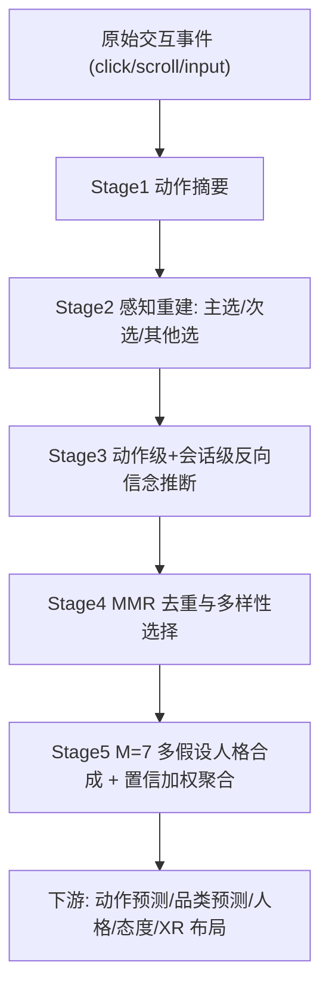

# Inverse Theory of Mind Modeling for Content Recommendation: From Web Browsing to Dynamic Intelligent Interfaces (逆向心智理论建模：从网页浏览到动态智能界面)

- **会议/期刊**: RecSys 2026 (20th ACM Conference on Recommender Systems)
- **作者与机构**: Mengyu Chen, Feiyu Lu, Chun-Fu (Richard) Chen, Lucas Vinh Tran, Jay Katukuri（JPMorganChase 全球技术应用研究与消费银行部）
- **推荐链路定位**: 端到端生成式（用户建模层，服务于生成式 UI / XR 布局决策）
- **研究方向**: 对话推荐与智能体仿真 / 大语言模型推荐
- **论文原文**: [https://arxiv.org/abs/2608.11354v2](https://arxiv.org/abs/2608.11354v2)
- **开源代码**: 暂未开源

## TL;DR (1分钟核心速览)

现有推荐把点击当作偏好的可靠代理，但交互常只是探索与比较；而人格画像方法又依赖昂贵的访谈问卷。本文提出 **Inverse Theory of Mind (IToM)** 流水线：从原始事件重建"用户当时看到了哪些备选项"的决策情境，用 LLM 做反事实反向推理生成有据可依的自然语言信念，再经多假设溯因合成结构化人格画像。在 OPeRA（46 用户）上，推断画像在下一动作预测上相对真实画像提升 **+50.6%**（Opus 4.6，25.69% vs. 17.06%），大五人格 MAE 降至 **0.762**（优于总体均值先验 0.836），购物态度对齐达 **76.6%**。

## Background & Motivation (背景与核心矛盾)

- **主流范式**: 协同过滤、序列模型、语义 ID 生成式检索乃至 LLM 推荐，均从单一行为类型（点击/购买/评分）的统计规律中学习，预测同类型的下一个行为。
- **前人局限**: 其一，这类方法**受限于作用域（scope-bound）**——只能预测同类行为，无法迁移到"用户的人生目标、生活方式、对新界面模态的适配"等任务；其二，人格画像方法虽提供更丰富的用户模型，却依赖访谈、人口学问卷或人工撰写模板，**昂贵、侵入且难以规模化**。
- **核心洞察 (Key Insight)**: 缺失的公共环节是**行为背后的理由 (rationale)**。认知科学中的心智理论 (ToM) 天然具备三个适配性质：情境依赖性（选择只在"未选项"对照下才有意义）、语义结构化（信念/欲望/意图是可组合、可审计的语义原语）、模态无关性（描述"为什么"而非界面特定模式，故可跨模态迁移）。
- **本文切入点**: 将 ToM **逆向**使用——从观测动作反推生成该动作的信念（溯因推理 to the best explanation），把信念作为中间表征，再从信念合成人格，从而仅凭行为轨迹获得画像级理解。

## Method (核心方法设计)

### 1. 整体框架 (Overall Architecture)

输入是用户 $u$的会话轨迹$T_u=\{S_1,\dots,S_K\}$，每个动作$a_i=(\tau_i,\text{target}_i,\text{ctx}_i,t_i)$含动作类型、目标元素、上下文元数据与时间戳。流水线分五阶段：**Summarize**（原始事件转自然语言句，简单动作规则化、复杂动作 LLM 化）→ **Perceive**（结合页面 HTML 重建三层决策情境）→ **Infer**（动作级 + 会话级反向信念推断）→ **Optimize**（MMR 去冗余选紧凑信念集）→ **Synthesize**（多假设溯因合成人格）。最终人格$\Pi_u$作为自然语言上下文，下游任务退化为条件推断$\hat{y}=\arg\max_y P(y\mid q,\Pi_u)$，无需按任务重训。由于对自然语言信念空间做精确后验不可行，作者采用**摊销近似推断**：预训练 LLM 已内化人类信念先验，在结构化提示下充当近似推断引擎。

### 2. 关键设计拆解 (Key Designs)

1. **感知重建与三层选项分级（Percept Reconstruction）**：痛点在于原始日志只记录"选了什么"，不记录"当时还能选什么"，而选择只有在对照未选项时才有信息量。作者用 LLM 读入动作摘要 + 压缩 HTML + 页面元数据，输出结构化 percept：**主选**（构成考虑集）、**次选**（更广选项空间）、**其他选**（提供"未 pursue"的对比）。这一分级是后续反事实推理的物理基础——它把"点击"从孤立事件变成"在可见备选集上的偏好显影"。

2. **多假设溯因人格合成（Multi-Hypothesis Synthesis）**：核心痛点是"行为→人格"映射**欠定 (under-determined)**，同一浏览模式可由不同人格产生，单解释会退化为刻板印象先验。作者生成 $M=7$ 个互异人格假设，每个假设给出画像、仅含直接证据的购物画像、逐特质证据置信度（强/中/弱），再按置信加权聚合：

$$\hat{s}_d=\frac{\sum_{h=1}^{M}w_h\cdot s_{h,d}+\pi_d\cdot\alpha_d}{\sum_{h=1}^{M}w_h+\alpha_d}$$

其中 $\pi_d$为已发表总体先验，$\alpha_d$ 随平均证据置信度**反比**缩放。直觉是：证据强时先验消失、假设说话；证据弱时预测回退到总体均值，形成对抗"人格偏见"的**下限保证**。

3. **信念优化与忠实性约束（MMR + Grounding）**：候选信念高达 337–3,167 条且大量重复。先用稠密文本编码做近重复坍缩（余弦 $>\theta_{\text{dedup}}=0.85$，优先保留会话级），质量分$q(b)$取**离嵌入质心的离群距离**（罕见独特信念高分、常见购物套话低分），再用 MMR 迭代选至多$K=50$ 条：

$$\text{MMR}(b)=\lambda\cdot q(b)+(1-\lambda)\left(1-\max_{b'\in S}\cos(b,b')\right)$$

取 $\lambda=0.3$使多样性权重占 70%。忠实性靠构造约束：每条信念必须锚定在重建 percept 上、必须同时引用被选项与被拒备选，并经$M$个假设聚合稀释单点编造。训练侧无梯度更新，全部为提示工程；推理侧人格构建一次性完成（均值 6.3 会话、约 275 动作、约 622 次 LLM 调用、约 1450 万输入 token），摊销约 **$79/用户**（Opus 4.6），之后跨任务复用、无逐查询重推断。

## Experimental Setup & Evaluation Protocol (实验设置与评估协议)

- **数据集与预处理**: 唯一同时满足"细粒度交互轨迹 + 页面级决策上下文 + 定性真值"三重要求的公开数据是 OPeRA（Amazon 购物会话 + 人格测评 + 购物态度问卷 + 访谈转录）。MIND/KuaiRec 有日志无心理真值，PANDORA 有特质标签无原子行为轨迹，均不适用。

| 数据集 | #Users | #Items | #Interactions | 稀疏度/密度 | 特征/场景说明 |
| :--- | :---: | :---: | :---: | :---: | :--- |
| OPeRA (RQ1 动作预测) | 15 | — | 985 实例 / 90 会话 | — | 原子浏览器事件 + HTML 快照 |
| OPeRA (RQ2 品类预测) | 27 | 11 品类 | 70/30 会话留出 | — | 留出会话搜索词与商品交互 |
| OPeRA (RQ3/RQ4) | 46 | — | 均值 6.3 会话/人 | — | 大五 1–5 分 + 12 条 Likert 态度题 |

- **数据划分与防穿越 (Splitting Strategy)**: RQ1 沿用 OPeRA 的会话前缀预测下一动作；RQ2 采用 **70/30 会话留出**（人格仅由 70% 会话构建，30% 作真值），属严格防穿越设计；RQ3/RQ4 为全量画像对问卷真值的离线对齐。
- **排名评测协议 (Ranking Protocol)**: 非传统 Full-Ranking 或 Sampled Ranking，而是**生成式条件推断**——RQ1 用动作精确匹配准确率与动作类型/点击类型加权 F1；RQ2 用 Mac-P/R/F1、NDCG@5、Hit@3；RQ3 用 MAE 与 Pearson $r$（含 bootstrap 95% CI）；RQ4 用归一化 Likert 准确率$\text{acc}_i=1-|y_i-\hat{y}_i|/4$。
- **对比基线与超参设置**: 骨干为 Claude Opus 4.6（RQ1 另测 Sonnet 3.7 以复现原文），嵌入用 Amazon Titan Embed v2（1024 维），$M=7$、温度 0.85、$K=50$、$\lambda=0.3$。基线含启发式（Popularity / User History / Recency-Weighted）、LLM 基线（Zero-shot、Structured Summary、CoT）与人格推断基线（Random Uniform、Scale Midpoint、Population Norms、GT Mean oracle、Direct Inference、Questionnaire）。神经序列模型因需 item-ID 序列与更大用户量而架构上不适用，被明确排除。

## Key Experimental Results (实验关键数据)

### 1. 主实验对比 (Main Results)

**表 1：下一动作预测（15 用户 / 90 会话 / N=985，Opus 4.6）**

| Persona 条件 | Act. Gen.↑ | AT Wt-F1↑ | Click Wt-F1↑ | SO Acc↑ | SO Wt-F1↑ |
| :--- | :---: | :---: | :---: | :---: | :---: |
| No persona | 19.09 | 80.21 | 47.05 | 64.44 | 61.87 |
| GT persona | 17.06 | 78.20 | 43.16 | 65.56 | 62.80 |
| **Multi-hyp (ours)** | **25.69** | **83.90** | **49.78** | **68.89** | **68.35** |
| Improv. vs GT | **+50.6%** | +7.3% | +15.3% | +5.1% | +8.8% |

**表 2：留出会话品类预测（N=27）**

| 方法 | Mac-P↑ | Mac-R↑ | Mac-F1↑ | NDCG@5↑ | Hit@3↑ |
| :--- | :---: | :---: | :---: | :---: | :---: |
| Popularity | .266 | **1.00** | .409 | .581 | 88.9 |
| User History | .425 | .689 | .504 | .615 | 85.2 |
| Zero-shot LLM | **.559** | .500 | .498 | .522 | 88.9 |
| Structured Summary | .533 | .689 | .562 | .636 | 88.9 |
| CoT Prompting | .501 | .730 | **.567** | .658 | 88.9 |
| **Multi-hyp (ours)** | .499 | **.764** | **.567** | **.701** | **100** |

**表 3：大五人格 MAE（N=46）**

| 方法 | Avg MAE↓ |
| :--- | :---: |
| Random Uniform (1–5) | 1.495 |
| Scale Midpoint (恒预测 3.0) | 1.022 |
| Direct Inference / Questionnaire | 0.945 |
| Population Norms | 0.836 |
| **Multi-Hypothesis (M=7)** | **0.762** |
| GT Mean (oracle) | 0.662 |

### 2. 消融实验 (Ablation Study)

**表 4：推断方式消融（N=46，全部使用同一批人格画像）**

| 方法 | Avg MAE↓ | Avg $r$↑ |
| :--- | :---: | :---: |
| Questionnaire（角色扮演逐题作答） | 0.945 | −0.103 |
| Direct Inference（单画像直接估分） | 0.945 | −0.008 |
| **Ours: Multi-Hyp. (M=7)** | **0.762** | **+0.103** |

### 3. 关键实验发现 (Key Findings)

1. **多假设把"系统性错误"翻转为"方向正确"**：单解释基线的平均 Pearson 相关为负（−0.103 / −0.008），即预测与真实人格**反相关**，MAE 0.945 甚至劣于"人人预测总体均值"的 0.836；多假设聚合把相关翻正至 +0.103 并将 MAE 压到 0.762。作者将此命名为 **persona bias**——LLM 把模糊行为证据映射到刻板人格（如把每个谨慎购物者读成焦虑内向者），而置信加权回退先验提供了下限保证。
2. **信念锚定比抽象特质摘要更适合步级预测**：GT 画像是访谈+人口学+测评汇编的抽象特质总结，反而在动作生成上（17.06%）低于无画像基线（19.09%），复现了 OPeRA 原文"画像引入噪声"的观察；而基于具体决策片段的信念画像同时提升生成（25.69%）与分类指标，说明**表征格式（episode 式 vs. 特质式）**本身是增益来源之一。
3. **人格是"软先验"而非行为直预测器**：购物态度对齐达 76.6%（12 题中 10 题优于单解释消融，部分题如"购买前大量研究"超 0.85），说明画像擅长解释**广义态度倾向**；但 Emotional Stability 被系统性误读、各特质预测方差被压缩，表明流水线捕捉总体倾向强于个体极端值，人格更适合锚定态度推断而非直接预测具体动作。

## Highlights & Limitations (亮点、对比与审稿批判)

- **与代表作对比 (vs. Prior Work)**: 相较 PEARL / UserLLM / Christakopoulou 等的 LLM 兴趣画像，本文不检索或聚类既有文本，而是**从行为反推信念**这一中间表征；相较 IRL / mental reward model（Zhao et al., Wang et al.），本文输出的是可读、可审计的自然语言信念而非数值奖励空间；相较 BDI 主动式 AR 助手（Li et al.），其 BDI 状态是手工设计，本文则从数据推断。与 OPeRA 原文相比，本文首次让**推断画像替代真实画像**并通过多假设修正其噪声问题。
- **可迁移亮点**: ①"三层选项分级 + 必须引用被选项与被拒备选"的 grounding 约束，可直接移植到任何 LLM 用户画像/解释生成任务以抑制幻觉；②"证据弱则回退总体先验"的自适应加权，是低成本对抗 LLM 刻板偏见的通用配方。
- **审稿级局限批判**: ①**成本与延迟**：单用户约 622 次 LLM 调用、1450 万输入 token、约 $79，且 Stage 2 独占 96% 输入 token（未做同页批处理与跨用户模板缓存），冷启动场景下难以实时化；②**评估规模与效度**：仅 46 用户、单一 Amazon 购物域，RQ3 逐特质检验功效不足（Extraversion$p=0.060$），且 +50.6% 的提升可能部分源于提示格式与动作预测任务的对齐，作者自认缺少格式受控对照；VisionOS 案例仅为示意性原型，无任务完成率/主观偏好的受控实验。

## Rating (四维评分)

- **方法创新性 (Novelty)**: ⭐⭐⭐⭐ （把 ToM 逆向化为"行为→信念→人格"两级溯因，并以多假设聚合修正 LLM 刻板偏见，范式新颖；但各阶段均为提示工程组合，缺少理论保证）
- **评估协议与实验扎实度 (Protocol & Experiments)**: ⭐⭐⭐ （70/30 会话留出防穿越、四任务互补、含 oracle 与 bootstrap CI 值得肯定；但 N=46、单域、无显著性检验、XR 案例无受控实验，统计功效偏弱）
- **写作与数学规范度 (Clarity & Rigor)**: ⭐⭐⭐⭐ （式 1–5 目标与近似策略交代清楚，明确区分"概念目标"与"摊销近似"，并主动披露 persona bias 与格式混淆；但核心算子多为提示流程，公式更多是形式化包装）
- **工业落地与复现价值 (Industrial & Practical Value)**: ⭐⭐⭐ （人格一次构建跨任务复用、自然语言产物可直接驱动生成式 UI/XR，工程思路可落地；但 $79/用户成本、无开源代码、Stage 2 token 开销未优化，短期难规模化）
