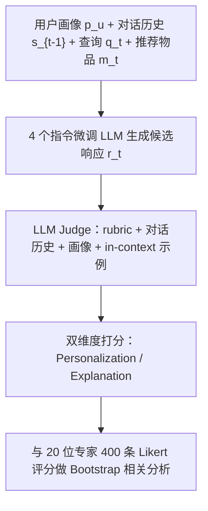
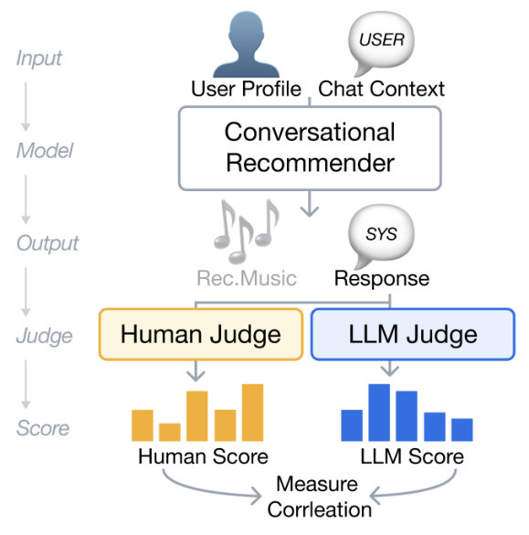

# LLM-as-a-Judge for Evaluating System Responses in Conversational Music Recommendation (对话音乐推荐中系统响应的 LLM 评审评估)

- **会议/期刊**: ACM RecSys 2026
- **作者与机构**: Seungheon Doh, Juhan Nam (KAIST)；Bruno Sguerra (Deezer Research)；Sergio Oramas (SiriusXM)；Elena V. Epure (Idiap Research Institute)
- **推荐链路定位**: 端到端生成式（响应生成质量评估环节）
- **研究方向**: 对话推荐与智能体仿真 / 大语言模型推荐
- **论文原文**: [https://arxiv.org/abs/2607.25640v1](https://arxiv.org/abs/2607.25640v1)
- **开源代码**: [https://github.com/nlp4musa/llm-as-a-judge-for-crs](https://github.com/nlp4musa/llm-as-a-judge-for-crs)

## TL;DR (1分钟核心速览)

对话推荐系统（CRS）的响应生成质量缺乏可靠自动评估手段：排序指标无法衡量自然语言解释，参考式指标（BLEU/BERTScore）又假设存在唯一标准答案。本文构建首个 CRS 响应评估的用户研究，采样 20 个多轮音乐推荐会话、用 4 个不同规模指令微调 LLM 生成候选响应，收集 20 位领域专家共 $n{=}400$条双维度（个性化质量 / 解释质量）评分，以 10,000 次 Bootstrap 相关分析检验 LLM-as-a-Judge 与人类判断的对齐度。结果显示 LLM 评审达到中等正相关（最佳$r{=}0.55$），全面超越所有参考式基线（最高仅$r{=}0.19$），并给出"规模越大越好、对话历史对个性化最关键、领域示例对解释最关键"的部署指南。

## Background & Motivation (背景与核心矛盾)

- **主流范式**: CRS 同时追求推荐准确性与自然语言响应生成；前者有成熟排序指标，后者依赖参考式指标（BLEU/ROUGE/BERTScore/嵌入相似度）或昂贵的人工评估。
- **前人局限**: ① 响应评估不存在唯一 ground-truth——同一推荐可有多种合理措辞与侧重，参考式指标的前提失效；② 音乐域中艺术家/曲名高度词汇重叠会扭曲 n-gram 分数，通用编码器（BERT）缺乏音乐领域知识且对否定等语言现象不敏感。
- **核心洞察 (Key Insight)**: LLM-as-a-Judge 无需参考文本即可按 rubric 打分，但其在 CRS 场景下与人类判断的对齐度从未被实证检验；且标准 judge 仅看"响应+极简 prompt"，缺失"用户是谁、之前说了什么、推荐了哪首歌"这三类 CRS 评估必需上下文。
- **本文切入点**: 把 judge 条件化为「用户画像 + 完整对话历史 + 推荐物品 + 领域 rubric + in-context 示例」，用专家标注做金标准，系统测量对齐度、偏差与条件消融。

## Method (核心方法设计)

### 1. 整体框架 (Overall Architecture)

形式化定义：给定用户画像 $p_u$、截至$t-1$轮的历史$s_{t-1}=\{(q_i,m_i,r_i)\}_{i=1}^{t-1}$、当前查询$q_t$与推荐物品$m_t$，响应生成器按$r_t=\mathrm{LLM}(p_u,s_{t-1},q_t,m_t)$产出响应；judge 在$(p_u,s_{t-1},m_t,r_t)$、prompt$\mathcal{P}$与示例$\mathcal{I}$条件下输出预测分$\hat{y}$，人类标注者在**完全相同的 rubric 与示例**（经教程页呈现）下给出$y^*$，核心指标为$\mathrm{Corr}(\hat{y},y^*)$。数据取自 TalkPlayData-Challenge（基于 LFM-2B 的多模态 agentic 合成对话，经人工验证质量可比真实对话），剔除单轮会话后按轮深 2–8 平衡采样 20 个会话；4 个生成器（Llama-3.2-1B/3B、Gemma-4-E2B/E4B）各产 1 条响应，共 80 个 (session, response) 对。

<figure class="paper-figure" markdown="span">
  <figcaption>图1：提出的用于对话式音乐推荐的LLM-as-a-Judge流水线</figcaption>
</figure>

### 2. 关键设计拆解 (Key Designs)

1. **CRS 专用条件化 Judge 与双维 Rubric**：痛点在于标准 judge 只看响应本身，无法判断"是否贴合该用户偏好"与"解释是否扎根于音乐属性"。本文让 judge 接收 $p_u$、$[s_{t-1},m_t,q_t]$与示例$\mathcal{I}$，并按两条 rubric 打分——Personalization Quality 衡量响应是否聚焦用户声明的偏好/收听历史/人口属性；Explanation Quality 衡量是否将推荐理由锚定在曲目音乐属性与用户请求的语义关联上。直觉：把"评估所需的最小充分信息集"显式喂给 judge，才能让打分从表层措辞转向内容适配性。
2. **受控的 Judge 规模/家族对比设计**：选取 Qwen3-LM4B、GPT-5.4-nano/GPT-5.4、Gemini-3.1-Flash-Lite/Gemini-3.1-Pro，每个闭源家族配"效率版+满血版"一对，Qwen3-LM4B 则与同家族同规模的 Qwen3-Embedding-4B 基线严格对齐参数规模，从而把"生成式显式推理 vs. 嵌入相似度"的差异从模型能力差异中剥离出来。
3. **训练目标、负采样与推理效率**：本文为评估方法学研究，无训练损失与负采样；推理开销即 judge 调用成本——轻量 judge（nano / Flash-Lite）以 $r{=}0.40/0.43$逼近满血版（$0.51/0.55$），构成成本-精度折中的实用档位。

## Experimental Setup & Evaluation Protocol (实验设置与评估协议)

- **数据集与预处理**: 会话来自 TalkPlayData-Challenge（Blind-A 子集），仅保留多轮会话并按轮深 2–8 平衡采样：

| 数据集 | #Sessions | #Responses | #Ratings | 标注密度 | 特征/场景说明 |
| :--- | :---: | :---: | :---: | :---: | :--- |
| TalkPlayData-Challenge (采样) | 20 | 80 (4 生成器 × 20) | 400 | 平均 5 标注/对 | 音乐多轮对话，含用户画像、曲目元数据、Gemini 2.5-Flash 合成参考响应 |

- **数据划分与防穿越 (Splitting Strategy)**: 无训练/测试划分（纯评估研究）；采用**会话级采样 + 轮深分层**保证刺激材料覆盖 turn 2–8，避免单轮样本污染多轮评估结论。
- **排名评测协议 (Ranking Protocol)**: 非排序任务，采用 **Bootstrap 相关协议**——10,000 次重采样估计 Pearson $r$与 Spearman$\rho$的均值及 95% CI，CI 跨零即判为不可靠；$*$表示$p<0.05$。人工标注信度用 ordinal Krippendorff's$\alpha$（Personalization 0.4478 / Explanation 0.4484，属开放式文本评估的典型区间 0.4–0.6）。
- **对比基线与超参设置**: 参考式基线 BLEU（1–4 平均）、ROUGE-L、BERTScore（RoBERTa-Large）、Qwen3-Embedding-4B（对合成参考算余弦）；无参考基线 Qwen3-Embedding-4B（编码完整评估上下文后与响应对比）；LLM judge 5 个。双维度相关性中等（Pearson $r{=}0.587$），支持作为独立维度分别评估。

## Key Experimental Results (实验关键数据)

### 1. 主实验对比 (Main Results)

| 方法 | Personalization $r$[95% CI] | Personalization$\rho$| Explanation$r$[95% CI] | Explanation$\rho$ |
| :--- | :---: | :---: | :---: | :---: |
| BLEU | 0.14* [0.02, 0.25] | 0.10 | -0.09 [-0.20, 0.03] | -0.09 |
| ROUGE-L | 0.16* [0.06, 0.26] | 0.13* | -0.06 [-0.17, 0.05] | -0.05 |
| BERTScore | 0.09 [-0.03, 0.22] | 0.07 | -0.11 [-0.24, 0.03] | -0.10 |
| Qwen3-Emb-4B (参考式) | 0.19 [-0.09, 0.45] | 0.14 | 0.02 [-0.30, 0.33] | -0.06 |
| Qwen3-Emb-4B (无参考) | 0.16 [-0.15, 0.43] | 0.06 | 0.30* [0.01, 0.52] | 0.17 |
| Qwen3-LM-4B (Judge) | 0.45* [0.17, 0.64] | 0.27* | 0.45* [0.21, 0.63] | 0.36* |
| GPT-5.4-nano (Judge) | 0.40* [0.16, 0.60] | 0.27* | 0.42* [0.19, 0.62] | 0.35* |
| Gemini-3.1-Flash-Lite (Judge) | 0.43* [0.21, 0.62] | 0.40* | 0.46* [0.27, 0.62] | 0.44* |
| GPT-5.4 (Judge) | 0.51* [0.30, 0.68] | 0.39* | **0.51*** [0.33, 0.66] | 0.46* |
| **Gemini-3.1-Pro (Judge)** | **0.55*** [0.36, 0.71] | **0.45*** | 0.47* [0.31, 0.61] | **0.48*** |
| Improv. (最佳 Judge vs. 最佳参考式) | **+0.36** (0.55 vs 0.19) | — | **+0.49** (0.51 vs 0.02) | — |

### 2. 消融实验 (Ablation Study)

以 Gemini-3.1-Flash-Lite 为 judge，条件逐步累积（Bootstrap 均值 $r$）：

| 累积条件 | Personalization $r$|$\Delta$| Explanation$r$|$\Delta$ |
| :--- | :---: | :---: | :---: | :---: |
| 基础（响应 + rubric） | 0.28 | — | 0.38 | — |
| + 对话历史 | 0.41 | **+0.13** | 0.47 | +0.09 |
| + 用户画像 | 0.43 | +0.02 | 0.48 | +0.01 |
| + In-context 示例 | 0.43 | +0.00 | **0.46**（峰值 0.46） | +0.08（相对基础） |

### 3. 关键实验发现 (Key Findings)

1. **参考式指标在解释维度上彻底失效，而生成式显式推理是决定性因素**：所有参考式指标在 Explanation 上 $r \le 0.02$且 CI 跨零；在 Qwen3-4B 同规模受控对比中，把参考替换为完整上下文仅把嵌入指标从$r{=}0.02$拉到$0.30$，而显式 rubric 推理直接到$0.45$——说明"上下文可得性"与"生成式推理能力"是两个独立增益源，后者贡献更大。
2. **对话历史是单点最大增益，且增益来源因维度而异**：加入对话历史带来 Personalization $+0.13$的最大单步提升（响应本身无法体现"是否承接了用户前几轮的修正"）；而 Explanation 的主要杠杆是领域锚定的 in-context 示例（$+0.08$），因为示例把抽象 rubric 落成了可模仿的具体判据；用户画像在历史已给定时几乎无增量（$+0.02/+0.01$）。
3. **偏差是配置特异的而非普遍性的，且轻量 judge 存在风格脆弱性**：Bias(Judge−Human) 多数 CI 跨零，唯 Qwen3-LM4B 双维度均显著正向过评（$0.68/0.62$）、Gemini-3.1-Pro 在 Personalization 上小幅过评（$0.29$）；案例研究中语义反转与 prompt 注入被所有 judge 稳健抵御（全部压到 1/1），但华丽改写（Fluent）会把 Flash-Lite 从 4/2 抬到 5/4、nano 从 3/3 抬到 5/3，而满血版保持稳定——提示跨生成器的分数差可能部分来自文风而非质量。

## Highlights & Limitations (亮点、对比与审稿批判)

- **与代表作对比 (vs. Prior Work)**: 相较 BLEU/ROUGE/BERTScore 等参考式指标，本文方法不依赖唯一参考、且在同规模受控下把相关性提升 2–20 倍；相较 Qwen3-Embedding 无参考基线，本文证明"编码上下文 + 余弦相似度"仍显著弱于"rubric 引导的生成式打分"（$0.30$vs$0.45$）；相较通用 LLM-as-a-Judge 实践，本文首次把用户画像、多轮历史与领域示例纳入 CRS 评估条件并量化各条件的边际贡献。
- **可迁移亮点**: ① "对话历史 > 用户画像 > 示例"的边际增益排序可直接指导任何多轮生成式推荐的评估 prompt 设计，优先塞历史而非画像；② 用同家族同规模（Qwen3-LM-4B vs Qwen3-Embedding-4B）做受控对比，是剥离"模型能力"与"方法范式"混淆的干净实验设计，可复用到其他评估方法学研究。
- **审稿级局限批判**: ① 人类参考本身有噪声（$\alpha \approx 0.45$），为任何自动指标设定了相关性天花板，最佳 judge 的$r{=}0.55/0.51$ 仍不足以支撑高风险场景全自动评估；② 仅 20 会话 / 80 响应 / 2 个维度，未覆盖事实准确性与对话自然度，且合成对话数据与真实用户分布存在域差距，结论外推需谨慎。

## Rating (四维评分)

- **方法创新性 (Novelty)**: ⭐⭐⭐⭐ （核心机制与方法设计具备明确创新性，理论与实验动机支撑充分）
- **评估协议与实验扎实度 (Protocol & Experiments)**: ⭐⭐⭐⭐ （主流公开数据集评测完整，包含多基线对比与消融实验验证）
- **写作与数学规范度 (Clarity & Rigor)**: ⭐⭐⭐⭐⭐ （问题形式化定义清晰，核心模块数学推导与架构阐述严谨易读）
- **工业落地与复现价值 (Industrial & Practical Value)**: ⭐⭐⭐⭐ （兼顾推荐效果增益与训练/推理效率，具备实际场景迁移参考价值）
