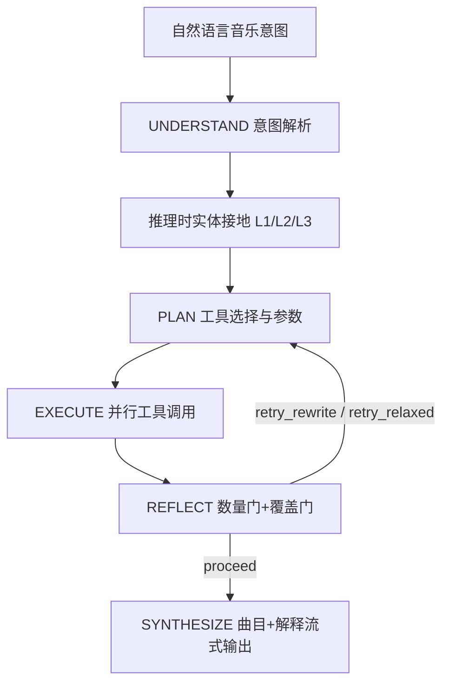
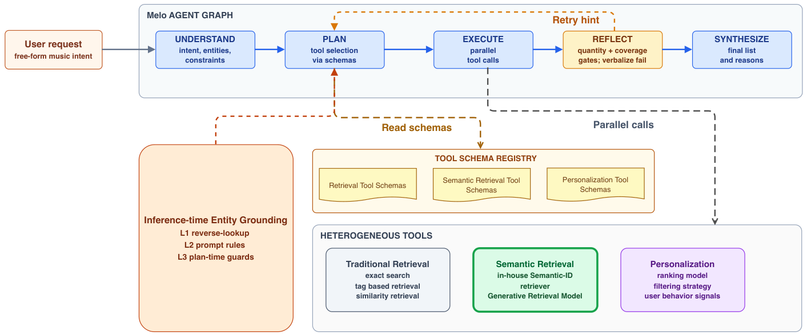

# Melo: A Production LLM-Powered Music Recommendation Agent (生产级 LLM 驱动的音乐推荐智能体)

- **会议/期刊**: RecSys 2026 (20th ACM Conference on Recommender Systems)
- **作者与机构**: Shijia Wang, Da Guo, Qiang Xiao, Fanghui Bi, Weisheng Li, Chuanjiang Luo (网易云音乐)；Dongjing Wang (杭州电子科技大学)
- **推荐链路定位**: 端到端生成式（自然语言意图 → 歌单生成）
- **研究方向**: 对话推荐与智能体仿真 / 大语言模型推荐 (LLM4Rec)
- **论文原文**: [https://arxiv.org/abs/2607.23718v1](https://arxiv.org/abs/2607.23718v1)
- **开源代码**: 暂未开源

## TL;DR (1分钟核心速览)

本文针对生产级 LLM 音乐推荐 Agent 的两大失效模式——**实体幻觉**（如 "Africa" 被误判为大陆而非 Toto 歌曲）与**长尾塌缩**（过度约束请求回退到热门兜底、丢失用户意图），提出 Melo：一个由五节点确定性状态图（UNDERSTAND→PLAN→EXECUTE→REFLECT→SYNTHESIZE）驱动的编排框架，并挂载两个可独立消融的运行时防御机制——**推理时实体接地**（三层验证，将生产搜索索引复用为验证原语）与**反思式重试**（将失败原因语言化回注 PLAN）。在网易云音乐歌单场景为期一个月的线上 A/B 中，主歌单留存指标提升 **>2 pp**、核心互动指标提升 **>1 分钟**；离线消融显示三层接地将实体误识别率从 17.4% 降至 9.6%（**-7.8 pp**），反思式重试在 5.8% 会话触发、过程级恢复率 59.1%。

## Background & Motivation (背景与核心矛盾)

- **主流范式**: 音乐推荐 Agent 多采用 "LLM 作大脑 + 推荐工具作手脚" 范式，代表作如 Spotify Parallel Fusion Router 采用单步 LLM 路由，RecMind/InteRecAgent 采用自由形式多步规划。
- **前人局限**: ① 自由形式 ReAct 式循环在工业级工具（深度业务耦合、参数 schema 不统一）上误差逐步复合，端到端成功率不达标；② 单步路由（Spotify）无反思修复阶段，一旦实体解释错误即直接放大；③ 学术 Agent 多在合成数据/离线基准评测，缺乏延迟预算与工具不可靠性的生产约束。
- **核心洞察 (Key Insight)**: 在亿级用户规模下，瓶颈不是"大脑多聪明"，而是**系统能否在命名节点上检测并纠正大脑犯的错**。作者回溯成功请求轨迹，发现可稳定切分为五个复现阶段，遂将其显式化为固定拓扑。
- **本文切入点**: 用确定性状态图替代自由循环，把两类高频失效（实体幻觉、长尾塌缩）各自绑定到一个**具名、可消融**的节点防御上，使失败可归因、防御可热插拔。

## Method (核心方法设计)

### 1. 整体框架 (Overall Architecture)

Melo 分两层：上层为固定拓扑的五节点状态图，LLM 调用仅限四个推理节点并输出结构化结果，在 REFLECT 分支点（→PLAN 或 →SYNTHESIZE）驱动转移决策；下层为异构工具层，混合既有生产服务（目录搜索、实体接地、画像/行为检索、候选生成、相似召回、个性化排序）与自研 Semantic-ID 生成式检索器。UNDERSTAND 解析意图（实体、约束、个性化信号），PLAN 依 schema 选工具与参数，EXECUTE 并行调用并合并候选，REFLECT 以最小数量门 + 意图覆盖门检查并决定四动作（proceed / retry_rewrite / retry_relaxed / fallback），SYNTHESIZE 生成最终曲目与解释。两个防御机制分别挂在 U/P 边界与 REFLECT→PLAN 回边上，重试上限两轮以控延迟。

<figure class="paper-figure" markdown="span">
  <figcaption>图2：Melo的系统概览：一个确定性的五节点框架（UNDERSTAND → PLAN → EXECUTE → REFLECT → SYNTHESIZE），构建于异构工具层之上。橙色路径标记了两个改造后的故障处理机制——U/P边界处的推理时实体接地，以及REFLECT→PLAN回边上的反思式重试。</figcaption>
</figure>

### 2. 关键设计拆解 (Key Designs)

1. **推理时实体接地（三层渐进验证）**：痛点是把"解释错误"误当"检索错误"，检索反而给错误解释披上自信外衣。L1 目录反查将候选实体送入生产搜索索引，返回实体类型、目录可得性、活跃度等支持信号；L2 提示级消费规则教 LLM 如何权衡这些证据（低活跃度降权、歧义短 token 标记而非静默消解）；L3 计划时守卫拦截显式否定、动词前缀误匹配、未验证艺人标识等复发模式，强制改写或换更安全召回路径。与生成时 catalog grounding（把已生成曲名映射回目录）本质不同：此处是在**工具调用前**以链接置信度门控下游，把"最佳可得"降级为"太弱不可行动"。

2. **反思式重试（语言化失败回注）**：痛点是 EXECUTE 返回过少候选时，热门兜底静默丢弃用户意图。REFLECT 对合并集施加最小数量与意图覆盖双门，失败时由 LLM 选择四动作之一，并将疑似原因与一条修改建议语言化回注 PLAN；PLAN 据此放宽约束、拆分复合意图或切换长尾容忍召回路径。生产实例："niche Icelandic post-punk" 首轮单路标签检索仅得 3 条，REFLECT 诊断"地理与流派同时过紧"，第二轮放宽至 Nordic、流派扩为 post-punk+alt-rock 并加语义召回"cold Icelandic atmosphere"，返回 42 条并通过双门。该机制是 Reflexion 语言反馈思想压缩进单会话、受延迟预算约束的版本。

3. **训练目标、负采样与推理效率**：本文**不训练策略模型**——编排由提示与状态机驱动，推荐模型藏在稳定工具接口后，模型团队与 Agent 团队解耦迭代（前者更新检索排序，后者热更新提示/schema/转移）。效率上：工具描述按需加载（PLAN 提示只携带当前意图相关技能）、SYNTHESIZE 经 SSE 流式输出中间进度。成本纪律包括节点专属提示、慢变段（系统指令、工具 schema、目录快照）提示缓存。

## Experimental Setup & Evaluation Protocol (实验设置与评估协议)

- **数据集与预处理**: 内部评测集由网易云音乐真实输入 query 分层采样构造，共 **298 条**，刻意过采样两类失效模式，属**定向压力测试**而非流量比例样本（故 5.8% 触发率是该集属性，非线上原始频率）：

| 分层 | 占比 | 构成 | 对应分析 |
| :--- | :---: | :--- | :--- |
| 实体歧义 query | ~35% | 曲名-艺人同形、"A 的 B" 结构、动词前缀命令、否定、别名 | 实体接地消融 |
| 长尾/复杂 query | ~40% | 多约束交叉、复杂否定、小众艺人、跨时代跨流派、抽象情绪 | 重试触发分析 |
| 常规基线 query | ~25% | 精确曲名/艺人查找、标签情绪推荐、历史个性化 | 无失效下限与延迟报告池 |

- **数据划分与防穿越 (Splitting Strategy)**: 非传统训练/测试划分；每条 query 在每种配置下以 backbone LLM（Kimi K2.5，temperature 0.3）**重放 3 次**以暴露随机性，报告 mean±1 std，单配置测量量约 $10^3$；DeepSeek-V4-Flash 复验方向一致。
- **排名评测协议 (Ranking Protocol)**: 非 Full-Ranking / Sampled Ranking 的经典排序评测，而是**失效导向的过程级指标**：实体误识别率、重试触发率、过程级恢复率、约束保持率、节点级 P50/P99 延迟；线上以一个月随机分流 A/B（约百万用户、等流量）度量歌单留存与互动。
- **对比基线与超参设置**: 消融基线为 No Defense / −L3 / −L2−L3；重试为 retry-on vs. retry-off 配对消融；线上对照为仅既有歌单入口的 control 组。未报告置信区间与显著性检验（作者自陈局限）。

## Key Experimental Results (实验关键数据)

### 1. 主实验对比 (Main Results)

线上 A/B（2026-04-02 至 05-10，约百万用户等分流，treatment 增加 Muse Mix 入口）：

| 指标 | 报告影响（保守下界） |
| :--- | :---: |
| 主歌单留存指标 | **>2 pp** |
| 核心歌单互动指标 | **>1 min** |

实体接地消融（实体承载子集，3 次重放）：

| 配置 | 误识别率 ↓ | Δ | UNDERSTAND P50 | PLAN P50 |
| :--- | :---: | :---: | :---: | :---: |
| Full Defense (L1+L2+L3) | **9.6%±2.1%** | — | 9.6 s | 9.7 s |
| −L3（无守卫） | 10.8%±0.0% | +1.2 pp | 8.9 s | 9.2 s |
| −L2−L3（仅 L1） | 13.4%±0.8% | +3.8 pp | 8.3 s | 8.9 s |
| No Defense | 17.4%±1.8% | +7.8 pp | 7.0 s | 7.9 s |

反思式重试触发会话视图与配对消融：

| 指标 | 数值 | 指标 | Retry-on | Retry-off | Δ |
| :--- | :---: | :--- | :---: | :---: | :---: |
| 重试触发率 | 5.8% | 平均曲目数 | 18.45 | 18.24 | +0.21 |
| 其中 retry_relaxed | 52% | P50 延迟 | 32.5 s | 28.4 s | +4.1 s |
| 其中 retry_rewrite | 48% | P99 延迟 | 57.2 s | 43.6 s | +13.6 s |
| 过程级恢复率 | 59.1% | | | | |
| relaxed / rewrite 恢复率 | 63% / 56% | | | | |
| 约束保持率（恢复会话） | 77% | | | | |
| 额外延迟 P50 / P99 | +15.9 s / +29.2 s | | | | |

### 2. 消融实验 (Ablation Study)

见上表：三层接地逐层移除（+1.2 → +3.8 → +7.8 pp）与 retry-on/off 配对消融（+0.21 平均曲目、+4.1 s P50 摊销）构成两组核心消融。

### 3. 关键实验发现 (Key Findings)

1. **L2 提示消费规则是单层最大贡献者**：移除 L2 额外增加 2.6 pp 误识别，说明仅有目录证据不够，LLM 还需显式指令来权衡流行度/活跃度/实体类型信号；L3 仅 +1.2 pp 但跨轮稳定，因其主要拦截否定与前缀误匹配等尾部模式而非头部分布。
2. **重试的杠杆在尾部而非中位数**：仅 5.8% 会话触发，故全流量摊销 P50 仅 +4.1 s；但在其实际改善的 query 上平均多召回 **+17.5 首**候选，把"快速但空"转为"慢但可用"，且 94.2% 中位路径完全不受影响。
3. **恢复 ≠ 意图忠实**：59.1% 过程级恢复中仅 77% 保持核心约束，23% 属"恢复但降级"，且降级集中于 retry_relaxed（29.4%）而非 retry_rewrite（14.3%），意图保持型恢复约占触发会话的 46%——作者据此将约束保持率单列，视为开放评测问题。

## Highlights & Limitations (亮点、对比与审稿批判)

- **与代表作对比 (vs. Prior Work)**: 相较 Spotify Parallel Fusion Router 的单步路由（延迟优先、无反思修复），Melo 以固定五节点图换取失败可归因与防御可插拔；相较 RecMind/InteRecAgent 的自由多步规划，其确定性拓扑规避了误差复合；相较 Rank-GRPO 的生成时 catalog grounding，本文是**推理时**接地，在工具调用前门控而非事后映射。
- **可迁移亮点**: ① 把生产搜索索引复用为"验证原语"而非仅检索器，可低成本迁移到电商/内容平台的实体消歧；② "能确定性的逻辑就不要交给 LLM"——计划时守卫、schema 校验结构化输出、REFLECT 四动作枚举，是控制 LLM 随机性沿链复合的通用工程范式。
- **审稿级局限批判**: ① 线上 A/B 未报告置信区间与显著性检验，且一个月新奇效应、组内替代、产品 UI 变更未被完全排除，机制级贡献只能靠离线消融支撑；② 评测集仅 298 条中文 query 且刻意过采样失效模式，跨市场跨目录泛化未验证；③ 端到端 P50 达 26.0 s（SYNTHESIZE 10.3 s、PLAN 8.2 s 为主），依赖 SSE 流式掩盖延迟，同步对话场景不适用；④ 检索主张仅为覆盖恢复，未涉及多样性/新颖性优化与矩阵分解类排序器对比。

## Rating (四维评分)

- **方法创新性 (Novelty)**: ⭐⭐⭐⭐ （五节点确定性底盘 + 具名可消融防御的工程范式新颖，实体接地的"验证原语"视角有洞见，但单点机制多为已有思想的工业整合）
- **评估协议与实验扎实度 (Protocol & Experiments)**: ⭐⭐⭐ （百万用户级线上 A/B 难得，但缺显著性检验；离线集仅 298 条且定向过采样，重试因触发率过低无法独立 A/B）
- **写作与数学规范度 (Clarity & Rigor)**: ⭐⭐⭐⭐ （失效模式—机制—指标的叙事链条清晰，生产 trace 与延迟分解详实；但全文无形式化公式与复杂度分析，偏经验报告体）
- **工业落地与复现价值 (Industrial & Practical Value)**: ⭐⭐⭐⭐ （真实亿级平台部署、Muse Mix 累计超百万用户，延迟/成本纪律可直接借鉴；但未开源，接地阈值与重试预算强平台相关，复现需重调）

