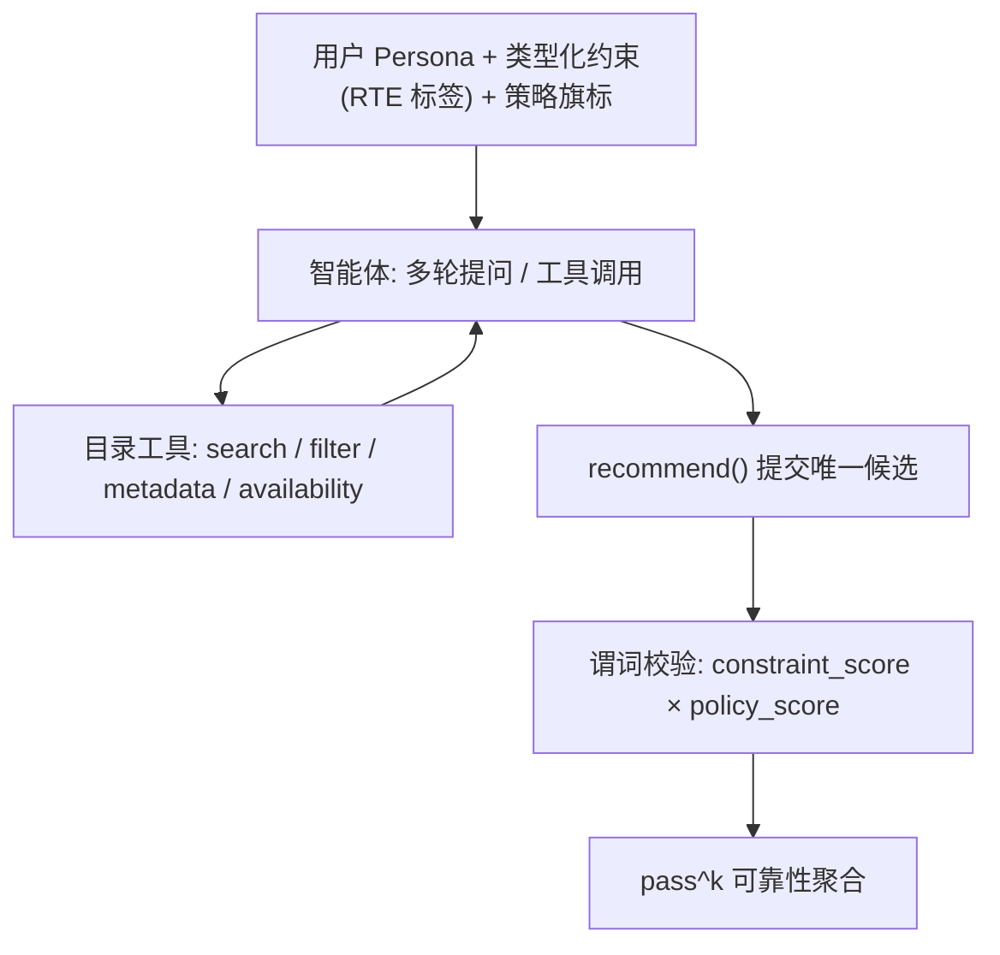

# $τ$-Rec: A Verifiable Benchmark for Agentic Recommender Systems (面向智能体推荐系统的可验证基准)

- **会议/期刊**: ACM RecSys 2026 (Reproducibility and Resource Track)
- **作者与机构**: Bharath Sivaram Narasimhan (Independent Researcher, Mountain View); Karthik R Narasimhan (Princeton University)
- **推荐链路定位**: 端到端生成式（多轮对话智能体，工具调用 + 单候选提交）
- **研究方向**: 对话推荐与智能体仿真 / 可信与工业评测基准
- **论文原文**: [https://arxiv.org/abs/2606.10156v3](https://arxiv.org/abs/2606.10156v3)
- **开源代码**: [https://github.com/nbharaths/tau-rec](https://github.com/nbharaths/tau-rec)

## TL;DR (1分钟核心速览)

现有对话推荐（CRS）评测要么依赖静态对话语料的 BLEU/Recall@k（易被记忆污染），要么依赖 LLM-as-a-judge（主观、昂贵、不可复现）。$τ$-Rec 把推荐建模为 tool–agent–user 三元组上的 POMDP，用**类型化目录谓词**做零 LLM 调用的确定性奖励，用 **reveal-tagged elicitation (RTE)** 控制约束在对话中如何浮现，并首次将 **pass^k** 可靠性指标引入推荐评测。在 60 个任务 × 4 次试验上评测 9 种配置，最强模型仅 pass^1≈57%、pass^4≈35%，隐藏约束任务 pass^1 骤降至 0.20，暴露智能体推荐的可靠性悬崖。

## Background & Motivation (背景与核心矛盾)

- **主流范式**: 推荐系统正从单轮排序管线转向 LLM 驱动的多轮智能体（InteRecAgent、RecMind、MACRec、AgentRecBench），智能体需规划、调工具、做多约束推理。
- **前人局限**: ①静态对话阵营（INSPIRED、DuRecDial、CRSLab）用 BLEU/Recall@k 对齐固定标注对话，测的是表面相似度而非任务完成，且易被训练污染；②LLM-as-judge 阵营（MT-Bench、UserSimCRS v2、CRS Arena）打分主观、非确定、跨轮不一致，Bernard & Balog 亦指出 CRS 指标与真实满意度仅弱相关。
- **核心洞察 (Key Insight)**: 推荐本质是**多轮对话下的约束优化问题**——用户完整约束集（含隐藏约束）不可观测，必须通过提问主动引出；而"能力型"指标（Recall@N、Hit@N）无法暴露智能体在重复试验下的**可靠性悬崖**。
- **本文切入点**: 用可验证的类型化谓词替代主观打分，用 RTE 标签封堵"首轮偏好全给"的作弊口子，用 pass^k 把"一致性"变成一等评测目标，并把策略合规（年龄门控、赞助披露、已看过滤、不可能请求时拒答）纳入评分。

## Method (核心方法设计)

### 1. 整体框架 (Overall Architecture)

$τ$-Rec 将交互建模为 TAU（tool–agent–user）三元组上的 POMDP：每轮智能体观测对话历史、已发起的工具调用结果与工具返回的目录元数据；用户完整约束集不可观测。动作空间为「自然语言发言 ∪ 目录工具调用（search/filter/metadata/availability）∪ 终止性 recommend 工具（提交唯一候选）」的并集，episode 在提交推荐或轮次预算耗尽时结束。奖励由目录谓词直接判定，全程零 LLM 调用、完全确定性可复现。

### 2. 关键设计拆解 (Key Designs)

1. **可验证奖励 (Verifiable Rewards)**：痛点是不再让 LLM 当裁判。成功由类型化谓词判定，如 `runtime <= 120`、`content_rating ∈ {PG-13, G}`；主奖励为两因子乘积
   $$\text{Reward} = \text{constraint\_score} \times \text{policy\_score},\quad \text{二者} \in [0,1]$$
   严格模式下要求每个约束维度与每条激活策略全部满足才算成功，另报部分得分以归因失败维度。因直接对目录求值，评测无需任何 LLM 调用，天然确定、可复现、零成本。

2. **Reveal-Tagged Elicitation (RTE)**：每条约束被打上 `volunteer`（开场主动说出）/ `on_ask`（被明确问及才说）/ `hidden`（永不明说，仅以拒绝违规推荐的方式体现）三档标签。这迫使智能体必须通过对话**引出**信息，而非首轮拿到完整偏好清单做单发模式匹配——正是许多 CRS 基准可被"一击命中"的漏洞所在。

3. **pass^k 可靠性指标与策略合规**：沿用 $τ$-bench，
   $$\text{pass}^k = \frac{1}{|T|}\sum_{t\in T}\frac{\binom{c_t}{k}}{\binom{n_t}{k}}$$
   其中 $c_t$ 为任务 $t$ 成功次数、$n_t$ 为试验次数；pass^1 测能力，$k>1$ 测一致性。策略合规由程序化审计 7 条策略：`recommend_tool`、`watch_history`、`availability`、`age_restricted`、`sponsored`、`transparency`（不可能任务须显式拒答）、`single_recommendation`。训练/推理侧无负采样概念，评测成本主要来自多轮工具调用（中位 5–30 次/任务）。

## Experimental Setup & Evaluation Protocol (实验设置与评估协议)

- **数据集与预处理**: 目录取自 TMDB 公共 REST API，仅取 2025–2026 年上映影片以保证**晚于所有主流 LLM 训练截止**（污染防御），经发现→富化→归一化三阶段，剔除任一必需字段缺失的记录，最终 **153 部电影**，字段含 genre、runtime、content_rating、cast/director、vote_average、分地区 streaming provider。

| 数据集 | #Users | #Items | #Interactions | 稀疏度/密度 | 特征/场景说明 |
| :--- | :---: | :---: | :---: | :---: | :--- |
| $τ$-Rec (Movie) | 60 任务(persona) | 153 | 60×4 trials | — | 类型化谓词目录；3×3 复杂度×揭示难度网格 |

- **数据划分与防穿越 (Splitting Strategy)**: 非传统划分；采用**后训练截止目录快照**（pinned date）防污染，任务约束可随目录刷新自动重校验可解性。任务分层：复杂度 simple(1–2 约束)/medium(3–4)/complex(5+)，共 20/24/16；揭示难度 volunteer 13 / mixed 32 / hidden 15，含 5 个**无有效推荐**任务测拒答。
- **排名评测协议 (Ranking Protocol)**: 非 Full-Ranking 也非 Sampled Ranking，而是**单候选提交 + 谓词全满足判定**（strict all-dimension success），辅以部分得分分解；每任务 4 次独立试验聚合 pass^k。
- **对比基线与超参设置**: 9 种配置覆盖 5 个模型家族——GPT-5.4（no/med thinking）、Claude Sonnet 4.6、Gemini 2.5 Flash、DeepSeek V4 Flash（no/high/max thinking）、Qwen3-32B、GPT-5 mini；用户模拟器固定 GPT-5 mini。智能体 temp=0（支持时），模拟器 temp=1.0，LiteLLM 统一调用；pass^4 的 95% bootstrap CI 为 ±0.10–0.13。

## Key Experimental Results (实验关键数据)

### 1. 主实验对比 (Main Results)

| 模型 | pass^1 | pass^2 | pass^4 | Constr. | Policy | avail.违规 | No-rec率 | Turns | Tools(中位) |
| :--- | :---: | :---: | :---: | :---: | :---: | :---: | :---: | :---: | :---: |
| GPT-5.4 (no thinking) | 0.471 | 0.358 | 0.283 | 0.496 | 0.908 | 0.075 | 0.308 | 0.73 | 10 |
| GPT-5.4 (med thinking) | 0.551 | 0.450 | 0.350 | 0.565 | 0.958 | 0.008 | 0.218 | 0.81 | 25 |
| Sonnet 4.6 | 0.537 | 0.433 | 0.350 | 0.579 | 0.896 | 0.092 | 0.196 | 1.18 | 16 |
| Gemini 2.5 Flash | 0.275 | 0.189 | 0.138 | 0.311 | 0.920 | 0.059 | 0.672 | 0.92 | 8 |
| DS V4 Flash (no thinking) | 0.546 | 0.433 | 0.333 | 0.583 | 0.921 | 0.067 | 0.221 | 1.47 | 28 |
| DS V4 Flash (high) | 0.560 | **0.461** | **0.383** | 0.586 | 0.937 | 0.000 | 0.230 | 1.70 | 29 |
| **DS V4 Flash (max)** | **0.571** | **0.461** | 0.350 | **0.596** | 0.942 | 0.000 | 0.229 | 1.76 | 30 |
| Qwen3-32B | 0.271 | 0.181 | 0.117 | 0.361 | 0.756 | **0.210** | 0.433 | 0.33 | 5 |
| GPT-5 mini | 0.417 | 0.333 | 0.250 | 0.429 | **0.963** | 0.021 | 0.446 | 0.96 | 19 |

### 2. 消融实验 (Ablation Study)

原文未做组件移除式消融，而以 **reveal 难度分层**作为 RTE 机制的"准消融"（表 3，pass^1）：

| 模型 | Volunteer (13) | Mixed (32) | Hidden (15) | Volunteer→Hidden 落差 |
| :--- | :---: | :---: | :---: | :---: |
| GPT-5.4 | 0.750 | 0.477 | 0.217 | −0.533 |
| GPT-5.4+T | **0.891** | 0.516 | 0.333 | −0.558 |
| Sonnet 4.6 | **0.923** | 0.523 | 0.233 | −0.690 |
| Gemini 2.5 Flash | 0.500 | 0.289 | 0.050 | −0.450 |
| DS V4 Flash | 0.846 | 0.586 | 0.200 | −0.646 |
| DS V4F+T(hi) | 0.827 | **0.609** | 0.222 | −0.605 |
| DS V4F+T(max) | 0.865 | 0.586 | **0.283** | −0.582 |
| Qwen3-32B | 0.481 | 0.281 | 0.067 | −0.414 |
| GPT-5 mini | 0.712 | 0.414 | 0.167 | −0.545 |

### 3. 关键实验发现 (Key Findings)

1. **可靠性悬崖是普遍现象而非个别模型缺陷**：最强配置 DS V4 Flash (max) 从 pass^1=0.571 跌至 pass^4=0.350（相对衰减 39%），GPT-5.4+T 从 0.551 跌至 0.350；说明"偶尔做对"与"稳定做对"之间存在系统性鸿沟，Recall@N 类指标完全无法察觉。
2. **信息揭示方式比模型能力更能决定成败**：同一 DS V4 Flash 在 volunteer 任务 pass^1=0.846，hidden 任务仅 0.200（4× 落差）；Sonnet 4.6 落差更达 0.923→0.233。这证明"已知偏好集上做约束满足"与"从拒绝信号中推断偏好"是两种截然不同的能力，后者是当前智能体的真正短板。
3. **失败呈两极分化：拒答者 vs 乱答者**。Gemini 2.5 Flash（No-rec 0.672）、GPT-5 mini（0.446）、Qwen3-32B（0.433）以极少工具调用（5–8 次）草率退出；Qwen3-32B 同时 availability 违规率高达 0.210，属"自信违规"。而平衡型模型（DS V4 Flash、GPT-5.4+T、Sonnet 4.6）投入 15–30 次工具调用并果断提交，取得最高约束分 0.57–0.60——**工具投入量与约束满足度正相关**。此外 thinking 模式收益呈次线性：DS V4 Flash 从 no-thinking 到 max thinking 仅 +0.025 pass^1，说明当前模型在此基准上受**能力约束**而非算力约束。

## Highlights, Limitations & Rating (亮点、对比与审稿评价)

- **与代表作对比 (vs. Prior Work)**: 相较 AgentRecBench（1 正/19 负池上的单轮 Hit@N，无多轮、无 pass^k、无策略、无新鲜目录），$τ$-Rec 是真正的多轮 TAU 闭环；相较 UserSimCRS v2（有模拟器但策略不在范围内、无 RTE），本文把策略合规与信息揭示控制做成一等目标；相较 MATCHA（有安全策略但为专有数据上的部署系统，97.9% 对抗防御率），本文是可复用基准。
- **可迁移亮点**: ①**RTE 三档标签**可直接移植到电商/内容推荐的对话评测，封堵"首轮偏好全给"的作弊路径；②**后训练截止目录快照 + 谓词自动重校验**是低成本、可长期维护的污染防御范式，任何 LLM 评测集都可借鉴。
- **审稿级局限批判**: ①目录仅 153 部电影、单一领域，虽作者辩称"规模对模型不透明以隔离推理能力"，但失败模式多样性受限，且 60 任务 × 4 试验导致 pass^4 的 CI 达 ±0.10–0.13，多个模型 CI 重叠难以区分优劣；②评测完全依赖 GPT-5 mini 单一模拟器，模拟器本身的偏差（如拒绝信号的表达方式）会系统性影响 hidden 任务得分，缺少模拟器敏感性分析；③策略合规以程序化审计为主，对"如何推荐"的语用层面（如披露话术是否自然）覆盖有限。
- **四维评分**: 创新性 ⭐⭐⭐⭐ | 实验扎实度 ⭐⭐⭐⭐ | 方法清晰度 ⭐⭐⭐⭐⭐ | 落地价值 ⭐⭐⭐⭐

