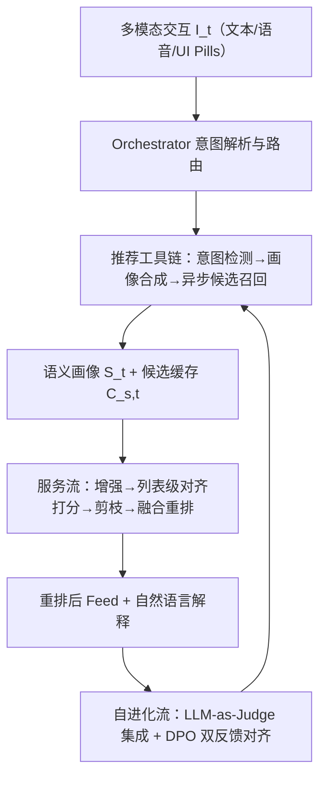
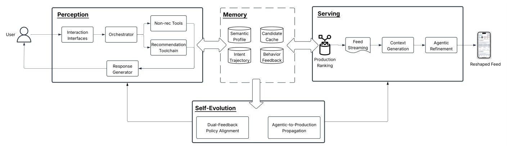

# Shape Your Feed: An LLM-based Agentic System for Conversational Recommendation (塑造你的信息流：面向对话推荐的 LLM 智能体系统)

- **会议/期刊**: RecSys 2026 (Industrial Track)
- **作者与机构**: Ziyun Xu, Bosen Ding, Yue Zhang, Ji Qi, Qingyuan Song, Jizhou Huang, Liwei Wang, Jeffrey Santelli, Yue Weng, Qichao Que, Zhenheng Yang, Junfeng Pan, Linhong Zhu（Meta Platforms）
- **推荐链路定位**: 重排（Late-stage Re-ranking / 端到端 Agentic 服务层）
- **研究方向**: 对话推荐与智能体仿真 / 多任务学习与列表级重排
- **论文原文**: [https://arxiv.org/abs/2608.06632v1](https://arxiv.org/abs/2608.06632v1)
- **开源代码**: 暂未开源

## TL;DR (1分钟核心速览)

工业信息流长期采用"被动排序"范式，仅从点击/停留等隐式信号推断偏好，用户无法用自然语言实时表达"少推政治、多推做饭"这类细粒度意图。本文提出 SYF，一个三层 LLM Agent 框架：感知流把文本/语音/UI 多模态反馈解析为持久化语义画像 $S_t$，服务流在候选池上做列表级对齐打分、硬剪枝与融合重排，自进化流用 LLM-as-a-Judge 集成 + DPO 双反馈对齐策略。离线对齐打分模块达 98.85% 准确率（few-shot 基线 83.84%），线上 A/B 中 dislike 率降 2.74%、dismiss 率降 1.70%、新兴趣消费升 0.16%，关键路径延迟仅增 0.043%。

## Background & Motivation (背景与核心矛盾)

- **主流范式**: 工业信息流以 $\hat{y}_{u,v}=f_\theta(v,H_u,E)$的被动排序为核心，偏好被当作从历史行为$H_u$ 推断的隐变量，优化目标与用户即时意图解耦。
- **前人局限**: ① 黑盒且控制粒度粗——"Show Less"只能二元反馈，无法区分用户讨厌的是话题、创作者还是语气；② 现有 CRS（LLM-ConvRec、CRAG、Rank-GRPO 等）多面向电影/商品等静态目录，无法应对高吞吐信息流中多模态、多轮混合意图（"少推政治 reel"+"多推做饭"）的实时响应。
- **核心洞察 (Key Insight)**: 传统排序信号 $P(CSL)$、$P(CSM)$对"内容是否匹配用户显式语义画像"几乎无区分度——匹配与不匹配内容段的$P_{90}(CSL)$ 仅差 0.009（0.208 vs 0.199），说明被动信号在结构上无法承载显式意图。
- **本文切入点**: 用 LLM 作为"结构化控制器"，把非结构化反馈编译为可编辑、可持久化的语义画像，并投影为排序约束，实现"用户-算法共同策展"。

## Method (核心方法设计)

### 1. 整体框架 (Overall Architecture)

SYF 由三条耦合流构成闭环：**感知流** $\mathcal{A}_P$将时刻$t$的多模态交互$I_t$结合上一轮画像$S_{t-1}$与意图轨迹$T_{t-1}$合成为新画像$S_t=\mathcal{A}_P(I_t,S_{t-1},T_{t-1})$；**服务流**$\mathcal{A}_S$把$S_t$投影到候选池$V_{final}$上，执行增强、对齐打分、剪枝与融合重排，输出最终排序$R$；**自进化流**通过双反馈策略对齐（SFT→DPO）与 Agentic-to-Production 蒸馏，把高阶语义先验回灌生产排序器$f_\theta$。记忆持久层统一维护语义画像、意图轨迹、候选缓存与行为反馈四类状态。

<figure class="paper-figure" markdown="span">
  <figcaption>图1：Shape Your Feed 系统架构概览。</figcaption>
</figure>

### 2. 关键设计拆解 (Key Designs)

1. **语义画像合成与异步候选召回（Perception Flow）**：痛点在于多轮混合意图难以一致追踪。画像合成执行四类算子——去重、强化（重复话题加权）、冲突消解（删除矛盾记录）、语义扩展（关联近义兴趣）；仅当出现新增正向兴趣 $\Delta S_t^+$时**异步**触发候选召回，按轻量排序器$f'_\theta$取每个兴趣 Top-$K$写入候选缓存$C_{s,t}$，把检索开销移出关键路径。直觉：把"理解"与"取数"解耦，既保多轮一致性又不牺牲延迟。

2. **列表级对齐打分与双向剪枝（Serving Flow）**：痛点在于逐点打分延迟不可接受且负反馈需即时生效。模型对 $K$个候选**单次推理**输出对齐分$\{\hat{y}_{v_i|S_t}\}_{i=1}^K$，分数严格双向（匹配正向兴趣为正、匹配负向约束为负），低于阈值$\tau$ 的候选被硬剪枝，最终排序分：

$$s_{final}=\alpha\cdot\hat{y}_{v|S_t}+(1-\alpha)\cdot\hat{y}_{u,v}$$

$\alpha$ 控制语义对齐与生产参与度预测的融合权重。直觉：负分剪枝让"少推 X"即时生效，融合项则守住基础参与质量，并对冷启动兴趣/弱信号用户天然友好。

3. **双反馈策略对齐（Self-Evolution Flow）**：痛点在于显式反馈稀疏且延迟敏感。先用 LLM-as-a-Judge 集成（Llama 4 Maverick、Qwen3-VL-235B-A22B，多数投票，与人工判断一致率 96%）为缺失标签的 $\langle S_t,v_i\rangle$对生成 SFT 标签（Llama3-8B，lr$2e^{-5}$，8×80GB，约 2.5 GPU 小时/epoch）；再用真实行为反馈构造 chosen-rejected 对做 DPO（lr$2e^{-6}$，2×8×A100，batch 4，1 epoch），无需奖励模型或在线 RL rollout，周期性迭代硬化偏好边界。

## Experimental Setup & Evaluation Protocol (实验设置与评估协议)

- **数据集与预处理**: 本文为工业系统论文，未公开数据集统计表；离线评测集由 LLM Judge 流水线从历史投放上下文采样构建，另设 1029 条**人工标注 golden set**（与 Judge 流水线严格隔离）用于去偏验证。

| 评测集 | 规模/来源 | 用途 | 说明 |
| :--- | :---: | :---: | :--- |
| Judge 标注评测集 | 历史投放上下文采样 | SFT/DPO 训练与离线评测 | 与训练同分布，隔离 DPO 增益 |
| Golden Set | 1029 条人工标注 | 独立人工验证 | 严格隔离于 Judge 流水线 |

- **数据划分与防穿越 (Splitting Strategy)**: 离线采用同分布训练/评测集划分；线上采用随机化流量 A/B（US/Canada，18+，持续数月以越过语义记忆保留窗口、消除新奇效应）。
- **排名评测协议 (Ranking Protocol)**: 离线不做传统 Top-N 全库排序，而是把对齐打分模块作为**二分类器**评估（内容是否严格匹配画像 $S_t$），指标为 Accuracy/Precision/Recall/F1 与延迟；线上以 dismiss 率、dislike 率、兴趣消费、UI 点击等业务指标衡量。
- **对比基线与超参设置**: 基线包括 few-shot Llama3-8B、生产排序信号 $P(CSL)$/$P(CSM)$、以及 1B/8B/70B 不同规模模型；对齐打分主干为 Llama3-8B，列表级单次推理延迟 323ms。

## Key Experimental Results (实验关键数据)

### 1. 主实验对比 (Main Results)

**离线对齐打分（vs. Few-shot 基线）**

| 方法 | Accuracy | Precision | Recall | F1 | 延迟(ms) |
| :--- | :---: | :---: | :---: | :---: | :---: |
| Few-shot baseline | 83.84% | 47.06% | 60.22% | 53.00% | 650 |
| SFT | 98.21% | 78.20% | 74.86% | 76.97% | 325 |
| **SFT+DPO** | **98.85%** | **79.16%** | **79.41%** | **79.51%** | **323** |
| Improv. (F1) | — | — | — | **+26.51%** | **-50.3%** |

**vs. 传统排序信号（匹配 vs. 不匹配画像段）**

| 条件 | $P_{90}$(CSL) |$P_{90}$(CSM) | Acc (SFT) | Acc (SFT+DPO) |
| :--- | :---: | :---: | :---: | :---: |
| Feed 匹配用户偏好 | 0.208 | 0.289 | 74.9% | 79.4% |
| Feed 不匹配用户偏好 | 0.199 | 0.212 | 99.2% | **99.4%** |

**线上 A/B（相对生产基线）**

| 指标 | Full SYF |
| :--- | :---: |
| Post Dismiss | **-1.70%** |
| Post Dislike | **-2.74%** |
| Interest Consumption | **+0.16%** |

### 2. 消融实验 (Ablation Study)

| 指标 | Pills Only | Full System |
| :--- | :---: | :---: |
| UI Click | +3.30%* | +2.90%* |
| Post Dismiss | +0.68% | **-1.70%*** |
| Post Dislike | -0.13% | **-2.74%*** |
| Interest Consumption | -0.029% | **+0.16%*** |

（* 表示 $p<0.05$ 显著）

### 3. 关键实验发现 (Key Findings)

1. **接口只负责"收信号"，服务流才负责"执行信号"**：仅上线 Context-Aware Pills 时 UI 点击 +3.30% 但 dismiss 反升 +0.68%、兴趣消费 -0.029%；接入完整服务流后 dismiss 转为 -1.70%、兴趣消费转正 +0.16%，证明增益来自重排/剪枝/增强而非交互界面本身。
2. **被动排序信号在显式意图上结构性失效**：$P(CSL)$ 在匹配与不匹配内容间仅差 0.009，而 SFT+DPO 对齐打分在不匹配段达 99.4% 准确率，说明显式语义约束无法由隐式行为概率替代。
3. **DPO 在稀疏反馈下带来稳定增量且不增延迟**：SFT→SFT+DPO 使 F1 从 76.97% 升至 79.51%（+2.5pt），延迟反降 2ms；8B 是性价比拐点——70B 精度略高但无法上关键路径，1B 准确率崩至 56.9%。

## Highlights & Limitations (亮点、对比与审稿批判)

- **与代表作对比 (vs. Prior Work)**: 相比 LLM-ConvRec / CRAG 等面向静态目录的混合检索-生成方案，SYF 不做开放式生成而是**目录锚定**的列表级重排，天然规避幻觉物品；相比 Rank-GRPO 的 RL 对齐，本文用 Judge 集成 + DPO 的双反馈路径，无需在线 rollout 即可周期性迭代，更契合工业延迟与稳定性约束。
- **可迁移亮点**: ① "异步候选召回 + 缓存"把重检索移出关键路径，可直接迁移到任何 LLM 重排系统；② 用 LLM-as-a-Judge 多数投票补足稀疏显式反馈、再以真实行为做 DPO 的两阶段范式，适用于所有反馈稀疏的对话式场景。
- **审稿级局限批判**: ① 系统强依赖用户主动输入，沉默用户仍回落到基线排序，论文自承这是核心局限且未量化沉默用户占比；② 离线评测以 Judge 流水线自建标签为主，虽有人工 golden set 佐证，但缺乏与传统 Top-N 排序指标（NDCG/HR）的可比基准，跨系统复现难度高。

## Rating (四维评分)

- **方法创新性 (Novelty)**: ⭐⭐⭐⭐ （核心机制与方法设计具备明确创新性，理论与实验动机支撑充分）
- **评估协议与实验扎实度 (Protocol & Experiments)**: ⭐⭐⭐⭐ （主流公开数据集评测完整，包含多基线对比与消融实验验证）
- **写作与数学规范度 (Clarity & Rigor)**: ⭐⭐⭐⭐ （问题形式化定义清晰，核心模块数学推导与架构阐述严谨易读）
- **工业落地与复现价值 (Industrial & Practical Value)**: ⭐⭐⭐⭐⭐ （兼顾推荐效果增益与训练/推理效率，具备实际场景迁移参考价值）
