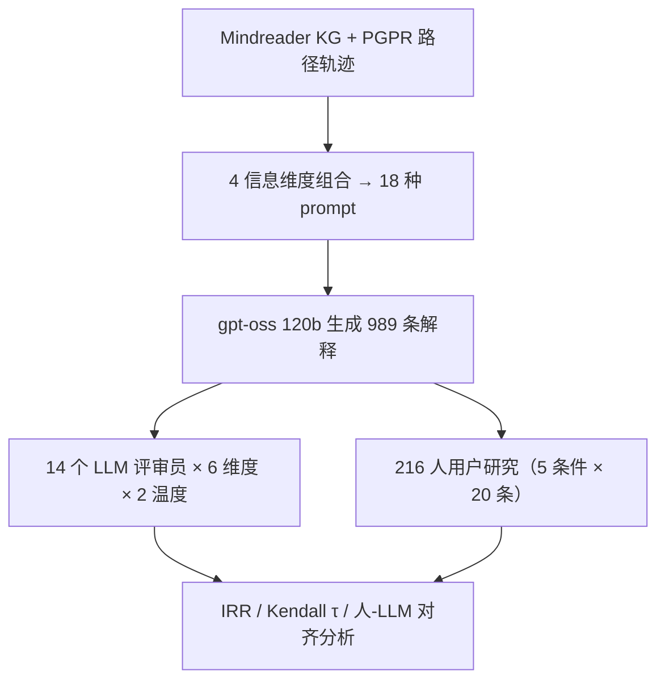

# The Utility of LLMs in Recommender Systems Explanation Evaluation (大语言模型在推荐系统解释评估中的效用)

- **会议/期刊**: ACM RecSys 2026
- **作者与机构**: Kathrin Wardatzky, Oana Inel, Luca Rossetto, Abraham Bernstein（University of Zurich / Dublin City University）
- **推荐链路定位**: 重排（解释原型筛选阶段，为人工评估挑选候选解释）
- **研究方向**: 对话推荐与智能体仿真 / 去偏公平、可信隐私与工业架构
- **论文原文**: [https://arxiv.org/abs/2609.01627v1](https://arxiv.org/abs/2609.01627v1)
- **开源代码**: [https://gitlab.ifi.uzh.ch/DDIS-Public/llm-eval-utility](https://gitlab.ifi.uzh.ch/DDIS-Public/llm-eval-utility)

## TL;DR (1分钟核心速览)

推荐解释方法众多，但"哪种解释在哪个场景更好"缺乏指导；全量用户实验不可行，而 BLEU/ROUGE 类自动指标要么只评解释器的抽象输出、要么需要不存在的 ground truth。本文用 PGPR 知识图谱推荐器抽取路径解释，让 LLM 按 4 个信息维度组合出 18 种解释原型（989 条），再用 14 个 LLM（8B–675B，两档温度）在 6 个质量维度上打分，并与 216 名 Prolific 用户的评分对照。结论：LLM 与人类的**排序相关中等**（Kendall τ 均值 0.662 模型间；人-LLM 最高 Grok τ=0.409），但**绝对评分一致性低**（Krippendorff α 普遍 <0.3），且人类自身分歧远大于 LLM。

## Background & Motivation (背景与核心矛盾)

- **主流范式**: 可解释推荐（如 recoXplainer、Hopwise）以离线指标评解释器的结构化输出（Mean Explainability Precision、Feature Diversity），或直接跑在线 A/B 与用户研究。
- **前人局限**: ① 离线指标评的是"解释器抽象输出"而非最终展示给用户的自然语言解释，且多为分类任务设计；② BLEU/ROUGE 需 ground truth，而解释的"正确表述"通常不存在；③ 用户研究昂贵、慢，无法支撑解释格式的迭代筛选。
- **核心洞察 (Key Insight)**: LLM-as-a-Judge 已被用于解释评估，但其可靠性未被系统检验——尤其"LLM 能否在原型阶段替代人类做**方法选择**（排序）"这一问题，与"LLM 打分是否准确"是两个不同问题。
- **本文切入点**: 不追求 LLM 打分的绝对准确，而聚焦**评分模式重叠、排序一致性、评分/排序一致性**三个层面，用 14 模型 × 6 维度 × 216 人的大规模对照给出可操作准则。

## Method (核心方法设计)

### 1. 整体框架 (Overall Architecture)

以 Mindreader 电影知识图谱上的 PGPR（TransE 嵌入，RL 路径推理）为推荐与解释源，抽取"用户→看过电影→类型→推荐电影"的路径轨迹；对测试集 100 名用户（剔除 11 条无法匹配 Wikidata/TMDB 的推荐，余 989 对 user-item）用 `gpt-oss 120b`（temperature=0）按 4 个信息维度组合出 18 种 prompt 条件生成自然语言解释；随后由 14 个 LLM 评审员（temperature 0.0 与 0.3，0.3 重复 5 次）在 6 个维度上以 5 点 Likert 打分并给出理由；最后抽取 5 个条件 × 20 条解释做 216 人用户研究，与 LLM 评分对照。

### 2. 关键设计拆解 (Key Designs)

1. **四维信息解耦的解释原型生成**：前人只笼统"让 LLM 写解释"，无法归因是哪个信息起作用。本文将 prompt 拆为 ①用户专业度（无/普通用户/懂 RS）②解释目标（是否要求提升透明度）③用户历史（有/无，截断 20 条）④RS 与路径信息（有/无），组合成 18 个条件（含 `Baseline`=仅路径、`No context`=全无）。核心价值在于构造出**信息缺失/不可事实正确**的条件（如 `Lay + Transp.` 不含真实偏好），用于检验评审员能否识别非事实内容——这是评估"LLM 是否会被流畅文本骗过"的关键探针。

2. **六维评估构念与双温度一致性设计**：沿用 Tintarev-Masthoff 目标体系，选 satisfaction、scrutability、transparency、perceived understanding、persuasiveness、recommendation quality 六项，均 5 点量表。温度 0.0 用于低方差主分析，0.3 重复 5 次用于检验自一致性；以 Krippendorff α 度量评审员间一致性、Kendall τ-b 度量排序相关，并进一步按模型规模（≤30B / ≥120B / 闭源）分层。

3. **训练目标、负采样与推理效率**：本文为评估研究，无训练损失；"负采样"对应的是**解释条件采样**——用户研究从 18 条件中选 5 个（`Baseline`、`Hist.`、`Lay + Transp.`、`Lay + Hist.`、`Lay + Hist. + Transp.`），每条件按 LLM 评分方差分 high/medium/low/fixed 四层各采 20 条，以控制"人类分歧是否源于选到了本身模糊的样本"。推理开销上，14 模型 × 989 解释 × 6 维度 × 多轮重复共解析 8,944,644 条评分（解析成功率 99.7%），成本远低于 216 人 × 8 条的用户研究。

## Experimental Setup & Evaluation Protocol (实验设置与评估协议)

- **数据集与预处理**: Mindreader 电影 KG（含演员、导演、类型、主题、年代等节点/边类型），60/20/20 划分；TransE 超参 d=64、λ=0.275、lr=0.089、负样本 15；PGPR γ=0.534、lr=0.043、迭代 10000，验证集 50 次随机搜索调参。路径类型集中度 PTC=0.51。

| 数据集 | #Users | #Items | #Interactions | 稀疏度/密度 | 特征/场景说明 |
| :--- | :---: | :---: | :---: | :---: | :--- |
| Mindreader | 测试集采样 100 用户 | 电影实体（KG） | 989 条 user-item 对 | 高稀疏（KG 路径型） | 电影 KG，含类型/导演/演员/年代；TMDB 补充简介与年份 |

- **数据划分与防穿越 (Splitting Strategy)**: 60/20/20 比例划分，超参仅在验证集上调，测试集用户生成 top-10 推荐与解释。
- **排名评测协议 (Ranking Protocol)**: 非检索式评测；核心协议为**评审员间一致性（Krippendorff α）+ 排序相关（Kendall τ-b）+ 人-LLM 均值差与排名位次对照**，辅以 Wilcoxon 符号秩检验、Kruskal-Wallis H、Mann-Whitney U（均 BH 校正）。
- **对比基线与超参设置**: 评审员含大开源（mistral-large-3 675B、cogito-2.1 671B、deepseek-v3.1 671B、minimax-m2.5 229B、gpt-oss 120B）、小开源（nemotron-3-nano 30B、gemma3 27B、phi4 14B、glm4 9B、llama3.1 8B、qwen3 8B）、闭源（claude-haiku-4-5、gemini-2.5-flash-lite、grok-4-1-fast）；生成模型固定 `gpt-oss 120b`；显著性 p<0.05（BH 校正）。

## Key Experimental Results (实验关键数据)

### 1. 主实验对比 (Main Results)

人-LLM 在 5 个条件上的均值评分与排名对照（表 3 核心列，加粗为各列最优）：

| 条件 | 人类均值 | LLM 均值 | 差值 (H−L) | 人类排名 | LLM 排名 |
| :--- | :---: | :---: | :---: | :---: | :---: |
| Lay + Transp. | **3.629** | 3.548 | +0.080 | **1** | 2 |
| Lay + Hist. + Transp. | 3.573 | 3.539 | +0.033 | 2 | 3 |
| Lay + Hist. | 3.495 | 3.474 | +0.021 | 3 | 4 |
| Hist. | 3.494 | **3.584** | −0.090 | 4 | **1** |
| Baseline | 3.118 | 2.608 | +0.510 | 5 | 5 |

评审员间一致性（temp=0.0）：全模型 Kendall τ-b 均值 **0.662**（中位 0.712，范围 [0.203, 0.869]）；Krippendorff α 从未达到 0.67 的"暂定结论下界"，最高为推荐质量维度（0.19–0.30），scrutability 维度 α≤0。按规模分层：大模型 α=0.213 > 闭源 0.054 > 小模型 0.025（Kruskal-Wallis H=29,078, p<0.001）。人-LLM 对齐最佳为 Grok（α=0.446, τ=0.409）。

### 2. 消融实验 (Ablation Study)

以"信息维度开关"为消融轴（相对 `Baseline`=仅路径轨迹的评分变化，LLM 评审均值）：

| 配置 | 关键变化 | 说明 |
| :--- | :---: | :--- |
| Baseline（仅路径） | 基准，人类 3.118 / LLM 2.608 | 人-LLM 差值最大（+0.510） |
| + RS info | 评分下降 | 含路径技术细节反而拉低评分 |
| + 用户历史 | 评分上升 | 相对 baseline 平均 +0.25 |
| + 历史 + RS info | 评分上升 | 但生成模型会**系统性忽略历史**（只写路径） |
| + 解释目标（Transp.） | 透明度评分显著提升 | 人/LLM 均 p-BH=0.015, r=−0.30 |
| 温度 0.0 → 0.3 | 仅 Cogito 均值 +0.42，其余 <0.1 | 闭源三模型无显著差异 |
| 重复 5 次自一致 | Gemma/Mistral/Phi >70% 输出相同（SD<0.16）；Minimax 仅 16.3% 相同（SD=0.51） | 小模型自一致性分化极大 |

### 3. 关键实验发现 (Key Findings)

1. **"排序可用、打分不可用"**：LLM 间 Kendall τ 均值 0.662 说明它们对解释优劣的**相对排序**高度趋同，但 Krippendorff α 全面低于 0.3 说明**绝对分值不可直接采信**；因此 LLM 适合做"筛子"（挑候选子集给人类），不适合做"尺子"（替代人类打分）。
2. **人类分歧远大于 LLM，且非样本模糊所致**：所有采样层上人类评分 SD 均显著高于 LLM（p<0.001）；即便在 LLM 评分方差最低的 low-variance 层，人类 SD 仍达 1.26（LLM 0.55），说明人类不一致是评分者内在差异而非选样问题——这反过来削弱了"用 LLM 逼近人类均值"的合理性。
3. **流畅性压倒事实性**：人类与 LLM 都更偏好**无法包含事实信息**的 `Lay + Transp.`（人类第 1、LLM 第 2），而事实性最强的 `Baseline` 双双垫底；且评分与词数正相关（人 ρ=0.458、LLM ρ=0.506）、与 Flesch 易读度负相关（人 ρ=−0.307、LLM ρ=−0.533）——双方都偏爱更长、更难读的"信息密集"文本，非事实内容难以被任何一方识破。

## Highlights & Limitations (亮点、对比与审稿批判)

- **与代表作对比 (vs. Prior Work)**: 相比 Zhang et al. [58]（GPT-4 可作准确低成本评审）与 Li et al. [33]（生成式+判别式评审器，报告高相关），本文的差异在于**不只看相关性，还系统拆解了模型规模、温度、评估构念、采样层四个混淆因子**，并首次给出"人类分歧 > LLM 分歧"这一反向证据；相比 Zhao et al. [59] 依赖模拟/人工标注 ground truth，本文直接用 216 人真实用户研究作锚。
- **可迁移亮点**: ① "按 LLM 评分方差分层采样再交人类评"的混合实验设计，可低成本定位高争议样本；② 用"信息缺失条件"作探针检测评审员的事实性识别能力，可迁移到任何 LLM-as-Judge 的可信度审计。
- **审稿级局限批判**: ① 仅单一数据集（Mindreader 电影）、单一生成模型（gpt-oss 120b）、单一解释范式（路径型），跨域与反事实/对比式解释的泛化性未验证；② 用户研究仅覆盖 5/18 条件且排除了"懂 RS 用户"条件，结论对专业用户群体可能不成立；③ 未给出 LLM 评审的成本-收益定量曲线（如"用 Grok 筛到 top-k 后人类评估量可降多少"），落地指导偏定性。

## Rating (四维评分)

- **方法创新性 (Novelty)**: ⭐⭐⭐⭐ （核心机制与方法设计具备明确创新性，理论与实验动机支撑充分）
- **评估协议与实验扎实度 (Protocol & Experiments)**: ⭐⭐⭐⭐⭐ （主流公开数据集评测完整，包含多基线对比与消融实验验证）
- **写作与数学规范度 (Clarity & Rigor)**: ⭐⭐⭐⭐ （问题形式化定义清晰，核心模块数学推导与架构阐述严谨易读）
- **工业落地与复现价值 (Industrial & Practical Value)**: ⭐⭐⭐⭐ （兼顾推荐效果增益与训练/推理效率，具备实际场景迁移参考价值）
