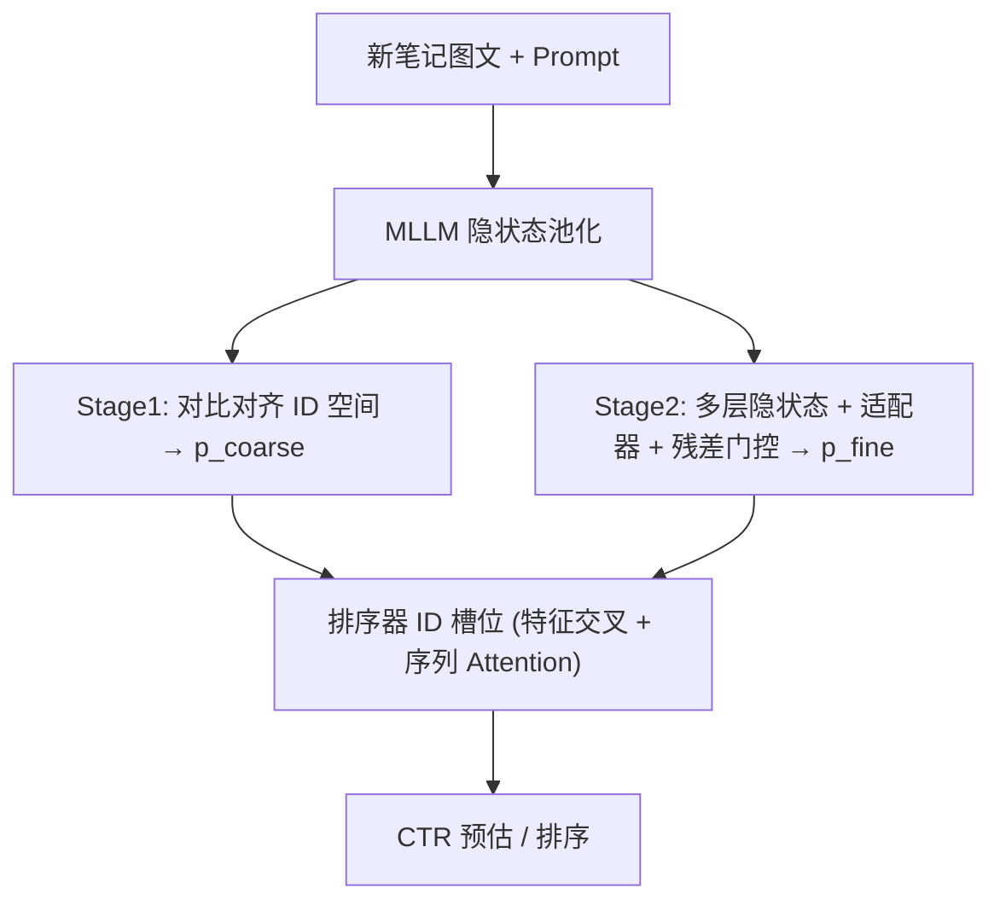

# IDProxy: CTR Prediction with Multimodal LLMs for Cold-Start Recommendation at Xiaohongshu (小红书基于多模态大模型的冷启动 CTR 预估代理嵌入系统)

- **会议/期刊**: RecSys 2026 (Industry Track, Oral)
- **作者与机构**: Yubin Zhang, Haiming Xu, Yanhua Huang, Li Lin, Yang Luo, Yao Hu (小红书) ; Guillaume Salha-Galvan (上海交大) ; Ruiyan Han, Feiyang Xiao (复旦)
- **推荐链路定位**: 精排 (CTR Ranking)
- **研究方向**: 冷启动与长尾推荐 / 多模态推荐
- **论文原文**: [https://arxiv.org/abs/2603.01590v2](https://arxiv.org/abs/2603.01590v2)
- **开源代码**: 暂未开源

## TL;DR (1分钟核心速览)

小红书内容流与广告精排高度依赖物品 ID 嵌入，新笔记零交互时 ID 嵌入近乎随机，冷启动严重。IDProxy 用多模态大模型 (InternVL) 从图文内容生成"代理 ID 嵌入"，先以对比学习粗对齐到线上 ID 嵌入分布，再以轻量多粒度适配器 + 残差门控把 MLLM 多层隐状态注入排序器的 ID 槽位做端到端 CTR 精调。离线 ΔAUC +0.14%，线上新笔记 AUC 提升 0.23%–0.32%（约为全局流量的 2 倍），内容流互动 +0.5%、广告 ADVV +1.93%，2025 年全量上线服务数亿日活。

## Background & Motivation (背景与核心矛盾)

- **主流范式**: 工业 CTR 精排以物品 ID 嵌入承载协同信号，冷启动物品靠多模态内容嵌入（NoteLLM2 式图文向量、CB2CF 式 MLP 映射）作为替代或补充特征。
- **前人局限**: 其一，基于行为共现（Swing 对、QARM/MOON）训练的多模态嵌入与 ID 嵌入存在显著分布差异（图 1 左 vs 右），作为"代理"信息不一致；其二，CB2CF/CLCRec 类直接映射在 MovieLens 这类簇状 ID 分布上有效，但工业 ID 嵌入呈不规则、非簇状分布（图 1 中 vs 右），冻结编码器 + 浅层 MLP 无法跨越异质空间。
- **核心洞察 (Key Insight)**: 两类方法都未复用排序器已成熟的特征交叉与序列建模结构，也未与 CTR 目标端到端联合优化；而 MLLM 中间层隐状态比末层输出携带更丰富、更可迁移的语义。
- **本文切入点**: 放弃"造一个更好的内容嵌入"，改为"造一个能直接塞进 ID 槽位的代理嵌入"——粗对齐拟合 ID 分布，细对齐继承排序器结构先验。

## Method (核心方法设计)

### 1. 整体框架 (Overall Architecture)

输入为新笔记的标题文本与封面图，经 Prompt 模板 `[BOS]<image><text>The compression word is:"[EMB]"[EOS]` 送入 MLLM，取 token 级隐状态做注意力池化得内容向量，MLP 投影 + L2 归一化后进入 Stage 1 对比对齐，拟合线上 ID 嵌入分布得到粗代理 $\mathbf{p}^{\text{coarse}}_i$；Stage 2 从 MLLM 多层隐状态中聚类选三层，经轻量适配器与残差门控融合为细代理 $\mathbf{p}^{\text{fine}}_i$，与用户嵌入、原始 ID 嵌入、上下文特征一同送入排序器，在 CTR 交叉熵下端到端训练（MLLM 冻结）。线上以"代理生成服务"实时写入存储，排序侧按 ID 检索复用。

<figure class="paper-figure" markdown="span">
  <figcaption>图 2：IDProxy 两阶段由粗到细对齐框架概览，应用于小红书的发现页（左）。</figcaption>
</figure>

### 2. 关键设计拆解 (Key Designs)

1. **Stage 1 代理对齐损失 (Proxy Alignment Loss)**：痛点是用 MLP 硬映射无法弥合内容与工业 ID 的不规则分布。做法是先对线上 ID 嵌入做频次阈值 $\tau$ 过滤与 L2 归一化（消除热度导致的模长偏置），再以 in-batch 负采样对比损失把内容代理拉向对应 ID：
$$\mathcal{L}_{\text{PAL}}=-\frac{1}{|\mathcal{B}|}\sum_{i\in\mathcal{B}}\log\frac{\exp(\tilde{\mathbf{h}}_i^\top \mathbf{e}_i/\tau_c)}{\sum_{j\in\mathcal{B}}\exp(\tilde{\mathbf{h}}_i^\top \mathbf{e}_j/\tau_c)}$$
直觉：让代理嵌入"落在 ID 空间里"而非"落在语义空间里"，从而可直接替换 $\mathbf{e}_i$ 而不破坏排序器输入分布。

2. **多粒度隐状态 + 残差门控适配器**：痛点是用末层单一向量会丢失层次语义，且细粒度信号与粗代理冗余。做法是对 MLLM 数十层隐状态做 k-means 聚成三组（浅/中/深），分别池化后拼接，经小 MLP 得 $\mathbf{p}^{\text{raw\_fine}}_i$，再用门控残差融合：
$$\mathbf{p}^{\text{fine}}_i = W_c\,\mathbf{p}^{\text{coarse}}_i + \mathbf{r}\odot \mathbf{p}^{\text{raw\_fine}}_i,\quad \mathbf{r}=\sigma(W_g[\mathbf{p}^{\text{coarse}}_i,\mathbf{p}^{\text{raw\_fine}}_i])$$
直觉：粗代理保底、细信号增量，门控自动抑制冗余维度，避免破坏已对齐的分布。

3. **结构复用式端到端训练与推理开销**：总损失即 CTR 交叉熵 $\mathcal{L}_{\text{CTR}}$，Stage 2 只更新适配器 $\tilde\phi, W_g, W_c$ 与排序器参数 $\theta$，MLLM 冻结。关键工程点是把 $\mathbf{p}^{\text{fine}}_i$ 直接注入排序器的**原子 ID 槽位**（而非作为普通拼接特征），使其继承目标 Attention 与 Cross 网络的训练好的结构先验——这正是 v4→v5 的增益来源。负采样沿用 CTR 日志天然负例，无额外负采样开销；适配器离线训练一次，线上仅做前向生成与查表。

## Experimental Setup & Evaluation Protocol (实验设置与评估协议)

- **数据集与预处理**: 采用小红书 2025 年历史点击日志（工业私有数据，未公开统计量）；ID 嵌入对齐目标经频次阈值 $\tau$ 过滤，仅保留更新次数足够的物品作为可靠对齐锚点。

| 数据集 | #Users | #Items | #Interactions | 稀疏度/密度 | 特征/场景说明 |
| :--- | :---: | :---: | :---: | :---: | :--- |
| 小红书点击日志 (2025) | 未披露 | 未披露 | 未披露 | 未披露 | 图文笔记 + 用户画像 + 行为序列；内容流与展示广告两场景 |

- **数据划分与防穿越 (Splitting Strategy)**: 论文未明确说明离线划分方式（工业日志按时间自然累积），线上以 5 日滚动窗口观测 AUC；新笔记定义为发布 24 小时内的帖子。
- **排名评测协议 (Ranking Protocol)**: 离线报告相对生产基线的 **ΔAUC**（非 Full-Ranking 列表指标），公司内部认定 ΔAUC ≥ 0.0010 为实际显著；线上为大规模用户随机分组 A/B，指标显著性水平 1%。
- **对比基线与超参设置**: 基线为小红书高度优化的生产 CTR 系统 Base（含复杂 ID 特征交叉与用户序列建模），以及 NoteLLM2 式多模态嵌入 (v1)、CB2CF 式冻结嵌入 + MLP 映射 (v2)。MLLM 用 InternVL，AdamW，学习率 $1\times10^{-4}$，batch size 512，温度 $\tau_c$ 未披露。

## Key Experimental Results (实验关键数据)

### 1. 主实验对比 (Main Results)

离线相对生产基线的 ΔAUC（表 1）与线上 5 日 AUC（表 2）：

| 模型变体 | ΔAUC (离线) |
| :--- | :---: |
| Base (生产基线) | 0 |
| Base + NoteLLM2-Like Embed (v1) | +0.015% |
| Base + Static Vector / MLP 映射 (v2) | +0.02% |
| Base + IDProxy Stage 1 (v3) | +0.05% |
| Base + IDProxy Stage 1+2，不复用结构 (v4) | +0.08% |
| **Base + IDProxy Stage 1+2 (v5)** | **+0.14%** |

| 线上 AUC | Day1 | Day2 | Day3 | Day4 | Day5 |
| :--- | :---: | :---: | :---: | :---: | :---: |
| 全局笔记 | +0.13% | +0.15% | +0.14% | +0.12% | +0.15% |
| **新笔记 (24h 内)** | **+0.24%** | **+0.32%** | **+0.23%** | **+0.27%** | **+0.31%** |

线上业务 A/B（表 3，均 1% 显著）：内容流 Time Spent +0.22%、Reads +0.39%、Engagements +0.5%；展示广告 Impression +1.28%、ADVV +1.93%、COST +1.73%、CTR +0.23%。

### 2. 消融实验 (Ablation Study)

| 配置 | ΔAUC | 说明 |
| :--- | :---: | :--- |
| w/o 内容代理 (Base) | 0 | 纯 ID 嵌入 |
| w/o 对齐，仅多模态向量 (v1) | +0.015% | 分布失配，增益微弱 |
| w/o MLLM，MLP 映射 (v2) | +0.02% | 浅层映射跨不过异质空间 |
| w/o Stage 2 (v3) | +0.05% | 仅粗对齐 |
| w/o 结构复用 (v4) | +0.08% | 端到端有效但未继承先验 |
| Full (v5) | **+0.14%** | 粗+细+结构复用 |

### 3. 关键实验发现 (Key Findings)

1. **结构复用是最大单点增量**：v4→v5 仅把细代理从"普通拼接特征"改为注入原子 ID 槽位，ΔAUC 从 +0.08% 跃至 +0.14%（+75% 相对增益），说明多模态信号的价值释放依赖继承 ID 分支已训练好的序列 Attention 与特征交叉先验，而非信号本身强度。
2. **冷启动增益约为全局的 2 倍**：线上新笔记 AUC 提升 0.23%–0.32%，全局仅 0.12%–0.15%，且 5 日内稳定不衰减，证明代理嵌入确实在无交互窗口内替代了失效的 ID 嵌入，而非仅带来全局噪声性提升。
3. **对齐方式决定上限**：v1/v2 两种"内容→协同"主流路线在工业 ID 分布上仅得 +0.015%/+0.02%，而显式拟合 ID 分布的 Stage 1 单独即达 +0.05%，验证了图 1 揭示的分布失配是冷启动代理失效的主因。

## Highlights, Limitations & Rating (亮点、对比与审稿评价)

- **与代表作对比 (vs. Prior Work)**: 相比 QARM/MOON 类行为共现对齐，本文不依赖人工设计的共现结构目标，而是直接回归线上 ID 分布；相比 CB2CF/CLCRec 的静态 MLP 映射，本文用 MLLM + 两阶段端到端精调，能适配工业 ID 的非簇状几何；相比 NoteLLM2 式纯内容向量，本文的代理可直接替换 ID 槽位，零改造接入生产管线。
- **可迁移亮点**: ①"代理嵌入注入原子 ID 槽位而非拼接"这一结构复用技巧，可迁移到任何 ID 主导的精排/召回模型做冷启动物品增强；②用 k-means 对 MLLM 层做浅/中/深分组池化，是低成本榨取多层隐状态的通用做法。
- **审稿级局限批判**: ①对齐目标仅用 in-batch 负采样对比损失，未系统比较最优传输或回归式分布匹配，负例质量对稀疏 ID 的几何刻画可能不足；②MLLM 全程冻结、以静态 ID 嵌入为目标，CTR 梯度无法回流内容编码器，长期存在"目标漂移"风险；③离线仅报 ΔAUC 且数据统计与超参大量因保密省略，复现性与列表级指标（NDCG/HR）缺失，工业结论的外部效度有限。
- **四维评分**: 创新性 ⭐⭐⭐⭐ | 实验扎实度 ⭐⭐⭐⭐ | 方法清晰度 ⭐⭐⭐⭐ | 落地价值 ⭐⭐⭐⭐⭐

