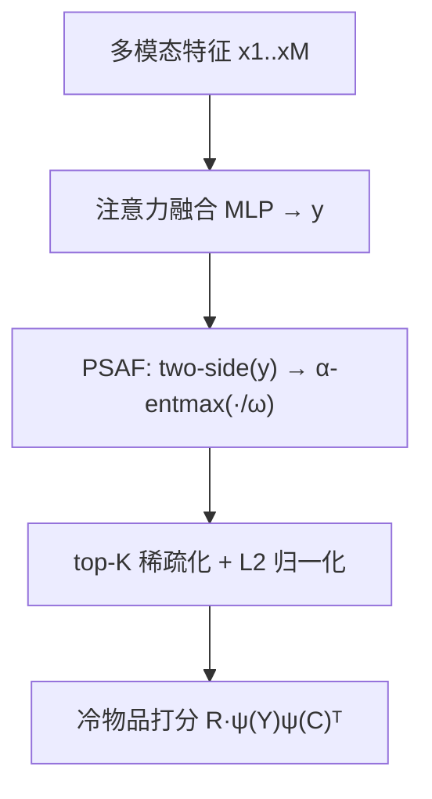

# Learning Sparse Representations of Multimodal Content for Enhanced Cold Item Recommendation (面向增强冷物品推荐的多模态内容稀疏表征学习)

- **会议/期刊**: RecSys 2026
- **作者与机构**: Gregor Meehan, Johan Pauwels (Queen Mary University of London)
- **推荐链路定位**: 召回（内容侧冷物品向量化与点积检索）
- **研究方向**: 冷启动与长尾推荐 / 多模态推荐
- **论文原文**: [https://arxiv.org/abs/2607.17184v2](https://arxiv.org/abs/2607.17184v2)
- **开源代码**: [https://github.com/gmeehan96/SparseColdStart](https://github.com/gmeehan96/SparseColdStart)

## TL;DR (1分钟核心速览)

针对严格冷物品（无任何交互）场景，现有内容冷启动范式（如 SEMCo）用稠密向量表征多模态内容，但稠密相似度在用户兴趣多样时噪声大、存储与检索成本高。本文把内容编码器输出改为 top-K 稀疏嵌入，并提出预稀疏激活函数（PSAF，基于 α-entmax + 双侧拼接）在稀疏化前诱导 item-item 相似度的"锐化 + 去噪"。在 4 个多模态数据集、20% 物品严格冷留出、Full-Ranking 协议下，冷 NDCG@20 相对最优稠密内容 LAE 提升 16.6%–75.5%，且存储成本更低。

## Background & Motivation (背景与核心矛盾)

- **主流范式**: 内容冷启动分两派——生成式（DropoutNet/GAR/GoRec/ALDI 用内容回归或蒸馏 CF 嵌入）与内容相似度派（SEMCo 把冷启动建模为 item-item 相似度，用浅层线性自编码器结构做对比训练，用户由交互物品嵌入均值表示）。
- **前人局限**: ① 生成式方法需为冷/热物品维护两套用户嵌入，存储翻倍，且继承热模型的 CF-内容错位偏差；② 均值用户表征在**多兴趣用户**上失效——无关历史物品会向预测分数注入大量噪声；③ 稠密嵌入在工业级目录下存储与低延迟检索代价高。
- **核心洞察 (Key Insight)**: 作者用案例研究（图 1）发现，对 item-item 相似度施加非线性 $\phi$ 可显著提升冷 NDCG，且**锐化（sharpening，放大高相似）与去噪（denoising，压制低/负相似）**是两个可分离的增益来源；二者本质都是降低相似度分布的熵（"spikiness"），这与线性注意力中 exp 核提升 attention 稀疏性的观察同源。
- **本文切入点**: 不做后处理 $\phi$（需物化全量相似度矩阵，工业不可行），而是把非线性搬到**嵌入侧**：用稀疏化本身做去噪，用预稀疏激活做锐化，从而保持单次点积推理。

## Method (核心方法设计)

### 1. 整体框架 (Overall Architecture)

沿用 SEMCo 的内容 LAE 骨架：多模态特征 $\mathbf{x}_1,\dots,\mathbf{x}_M$ 经注意力融合 MLP 得 $\mathbf{y}=f(\cdot)\in\mathbb{R}^d$；本文在 L2 归一化前插入 **PSAF → top-K 稀疏化** 两步，得到稀疏内容嵌入 $\psi(\mathbf{y})$。冷物品打分仍为 $\tilde{P}=R\cdot\psi(Y)\psi(C)^\top$，即用户向量 = 交互物品稀疏嵌入聚合，与冷物品稀疏嵌入做点积。训练目标完全不变（SEMCo 对比损失或 ELSA 重构损失），仅改表征管线，因此可直接套用到现有冷启动训练制度。

### 2. 关键设计拆解 (Key Designs)

1. **Top-K 稀疏化替代稠密嵌入（存储与去噪双收益）**：痛点是不相似物品的稠密点积非零、噪声累积且存储昂贵。做法是按绝对值保留 top-$k$ 维后归一化：
$$\text{top-}k(\mathbf{y}[i])=\mathbf{y}[i]\ \text{if}\ |\mathbf{y}[i]|\in\text{top-}k(|\mathbf{y}|),\ \text{else}\ 0$$
直觉：不相似稀疏向量的点积天然趋零，**去噪无需额外非线性**；同时 CSR 存储 + 倒排索引使 $k$ 非零向量点积仅 $O(k)$。训练中用指数剪枝（从全宽衰减到 32 活跃维）避免 dead latents。

2. **PSAF：α-entmax + 双侧拼接（锐化）**：稀疏化只去噪不锐化，而图 1 显示纯锐化（exp/softmax）也有效。作者借线性注意力"对 query/key 施加 exp 激活提升 spikiness"的思路，但稀疏嵌入活跃维极少、无法承载 exp 核近似所需容量，故改用可插值的 α-entmax：
$$\alpha\text{-entmax}(\mathbf{y})=\big[(\alpha-1)\mathbf{y}-\eta\mathbf{1}\big]_+^{\frac{1}{\alpha-1}}$$
$\alpha=1$ 退化为 softmax（全正、仅锐化），$\alpha=2$ 为 sparsemax（含置零、锐化+去噪）。因 α-entmax 会抹掉负神经元，先做反对称拼接 $\text{two-side}(\mathbf{y})=[\mathbf{y};-\mathbf{y}]$ 保留负信号（不增加稀疏化后参数量）。最终 $\psi(\mathbf{y})=\alpha\text{-entmax}(\text{two-side}(\mathbf{y})/\omega)$，$\omega$ 调节锐化强度。

3. **训练目标、负采样与推理效率**：损失沿用 SEMCo 的 batch 内对比目标（或 ELSA 的 MSE 重构），**未引入新损失、未使用显式负采样**。推理为单次稀疏点积，毫秒级；相比 ColdLLM 类方法（约 10 秒/冷物品）具数量级优势。PSAF 带来约 15%–20% 训练开销（H100 上 12.8s → 15.7s/epoch，显存 2.20 → 2.66 GB）。

## Experimental Setup & Evaluation Protocol (实验设置与评估协议)

- **数据集与预处理**:

| 数据集 | #Users | #Items | #Interactions | 密度 | 模态 (维度) |
| :--- | :---: | :---: | :---: | :---: | :--- |
| Clothing | 39,387 | 23,033 | 278,677 | 0.031% | Text (384) |
| Electronics | 192,403 | 63,001 | 1,689,188 | 0.014% | Image (4096), Text (384) |
| M4A-Onion | 8,807 | 43,886 | 1,510,034 | 0.391% | Audio (1024), Text (768) |
| Microlens | 98,129 | 17,228 | 705,174 | 0.042% | Image (1024), Text (1024), Video (768) |

- **数据划分与防穿越**: **冷启动划分**——随机选 20% 物品为冷物品，再 50-50 分验证/测试；其余热物品交互按 80-10-10 划分以训练监督 CF 模型。作者明确说明未用时间戳切分（冷物品场景下样本量不足）。
- **排名评测协议**: 冷留出集上计算 **Full-Ranking** 的 Recall@20 与 NDCG@20（$k=20$），5 次运行取均值；显著性用配对 t 检验（$p<0.05$，多数数据集 $p<0.005$）。
- **对比基线与超参**: 稠密基线含 5 个 SOTA（CLCRec、Heater、GAR、GoRec、ALDI，嵌入维 64，监督热模型为 FREEDOM）与稠密 SEMCo/ELSA；稀疏侧活跃维 32（与 64 维稠密存储等价，因需存 value+index），嵌入宽度 1024（双侧则 2048），隐藏维 384。

## Key Experimental Results (实验关键数据)

### 1. 主实验对比 (Main Results)

冷测试集 NDCG@20（R@20 见原文表 2；加粗为全体最优，下划线为组内最优）：

| 方法 | Clothing | Electronics | M4A-Onion | Microlens |
| :--- | :---: | :---: | :---: | :---: |
| ALDI | 0.0453 | 0.0130 | 0.0403 | 0.0445 |
| CLCRec | 0.0599 | 0.0138 | 0.0557 | 0.0401 |
| GAR | 0.0541 | 0.0148 | 0.0467 | 0.0487 |
| GoRec | 0.0638 | 0.0171 | 0.0316 | 0.0562 |
| Heater | 0.0561 | 0.0149 | 0.0557 | 0.0504 |
| 稠密 ELSA | 0.0705 | 0.0217 | 0.0762 | 0.0600 |
| 稠密 SEMCo-Sp | 0.0716 | 0.0218 | 0.0769 | 0.0591 |
| 稀疏 ELSA (无 PSAF) | 0.0822 | 0.0294 | 0.1049 | **0.0742** |
| 稀疏 SEMCo-Sp (无 PSAF) | 0.0824 | 0.0287 | 0.0944 | 0.0644 |
| 稀疏 SEMCo-Sp + Sparsemax PSAF | **0.0835** | **0.0302** | 0.1350 | 0.0633 |
| 稀疏 SEMCo-Sp + 1.5-Entmax PSAF | 0.0832 | 0.0285 | **0.1385** | 0.0557 |
| **Improv. (最优稀疏 vs 最优稠密 LAE)** | **+16.6%** | **+38.5%** | **+75.5%** | **+21.7%** |

### 2. 消融实验 (Ablation Study)

SEMCo 上 PSAF 消融（冷 NDCG@20）：

| PSAF 配置 | Clothing | Electronics | M4A-Onion | Microlens |
| :--- | :---: | :---: | :---: | :---: |
| 单侧 None（仅稀疏化） | 0.0763 | 0.0254 | 0.0944 | 0.0644 |
| 单侧 Sparsemax | 0.0819 | 0.0267 | 0.1224 | 0.0574 |
| 双侧 ReLU | 0.0797 | 0.0268 | 0.1014 | 0.0635 |
| 双侧 Softmax | 0.0778 | 0.0263 | 0.1135 | 0.0668 |
| 双侧 1.5-Entmax | 0.0832 | 0.0285 | **0.1385** | 0.0557 |
| 双侧 Sparsemax | **0.0835** | **0.0302** | 0.1350 | 0.0633 |

### 3. 关键实验发现 (Key Findings)

1. **稀疏化本身即贡献主要增益，PSAF 是二次增益**：Electronics 上仅稀疏化（无 PSAF）已把 NDCG@20 从 0.0218 提到 0.0287（+31.7%），叠加 Sparsemax PSAF 再升至 0.0302；M4A-Onion 上 PSAF 增益更显著（0.0944 → 0.1385，+46.7%），说明锐化在用户兴趣高度分散时价值最大。
2. **增益与用户兴趣多样性严格正相关**：按 KMeans 64 簇统计用户交互簇数（图 4/图 5），单兴趣用户上稀疏与稠密几乎持平，簇数 ≥2 后稀疏方法（尤其 SEMCo/Sparsemax）反超 1024 维稠密 SEMCo；各数据集总体增益幅度与兴趣数分布的右偏程度完全对应（M4A-Onion 偏度最高、增益最大）。
3. **存储-精度帕累托全面占优**：存储成本 64 的稀疏方法在全部 4 个数据集上即超过 1024 维稠密 SEMCo（16× 存储节省且精度更高）；存储 128 时相对 1024 维稠密提升 5.2%（Clothing）至 29.7%（M4A-Onion）。此外用户侧稀疏化到与物品相同活跃维几乎无损（图 8），可安全压缩。

## Highlights, Limitations & Rating (亮点、对比与审稿评价)

- **与代表作对比 (vs. Prior Work)**: 相比 GAR/GoRec/ALDI 等生成式方法，本文不生成 CF 嵌入、不需双套用户嵌入，规避了 CF-内容语义鸿沟；相比 SEMCo，本文不改损失只改表征管线，却同时拿到精度、存储、可解释性三重收益；相比 CF 稀疏嵌入工作（如 SLIM/ELSA 系），本文首次把稀疏表征迁移到**严格冷物品 + 多模态内容**场景。
- **可迁移亮点**: ① "把非线性从相似度侧搬到嵌入侧"以保住点积推理效率，这一 trick 可迁移到任何需要锐化相似度但受限于低延迟召回的模型；② 双侧拼接 + α-entmax 的负信号保留方案，可复用于其他 top-K 稀疏表征学习。
- **审稿级局限批判**: ① 未做时间戳切分，随机冷物品划分可能高估真实上线收益；② PSAF 在 ELSA（MSE 重构）上表现不稳定、在 Microlens（用户远多于物品、单兴趣为主）上反而掉点，说明超参 $\alpha,\omega$ 对数据分布敏感，缺少自适应选择机制；③ 训练开销增加 15%–20%，且未报告在线检索延迟的实测数据。
- **四维评分**: 创新性 ⭐⭐⭐⭐ | 实验扎实度 ⭐⭐⭐⭐ | 方法清晰度 ⭐⭐⭐⭐⭐ | 落地价值 ⭐⭐⭐⭐

