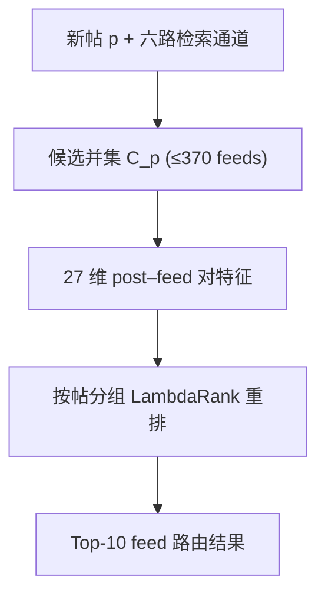
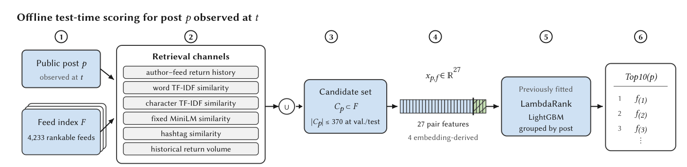

# Predicting Custom-Feed Returns for New Bluesky Posts: A Prospective Study (预测 Bluesky 新帖被自定义信息流收录的前瞻性研究)

- **会议/期刊**: RecSys 2026 (20th ACM Conference on Recommender Systems)
- **作者与机构**: Yipeng Wang, Mohit Singhal (Northeastern University)
- **推荐链路定位**: 召回（检索-重排级联中的路由/召回阶段）
- **研究方向**: 冷启动与长尾推荐 / 去偏公平与工业架构
- **论文原文**: [https://arxiv.org/abs/2608.13874v1](https://arxiv.org/abs/2608.13874v1)
- **开源代码**: 暂未开源

## TL;DR (1分钟核心速览)

本文重新定义了冷启动：在 Bluesky 去中心化信息流生态中，冷启动对象不是用户或物品，而是**新发布的帖子**，候选则是独立运营的信息流（feed）。作者提出"冷启动路由"任务——给定新帖，对固定 5,000 个监控信息流排序，预测哪些会在 24 小时内收录该帖。构建了 collect-first/label-later 前瞻性基准（1,780 万帖、186.5 万收录记录），在条件化 Full-Panel 排序协议下，LambdaRank 取得 cR@10 0.7361、NDCG@10 0.6127、Hit@10 0.7749 的最优等折均值。

## Background & Motivation (背景与核心矛盾)

- **主流范式**: 经典冷启动推荐假设系统内存在缺乏历史行为的用户或物品，通过元学习、内容特征或跨域迁移为其补足表征。
- **前人局限**: ①去中心化生态中帖子先进入公共流、再由独立 feed 生成器各自过滤，不存在"系统内统一物品库"，传统 item cold-start 框架失效；②基于爬虫的回溯式采集会混淆"发帖"与"后续被收录"的时间先后，导致标签泄漏与因果倒置。
- **核心洞察 (Key Insight)**: 若把"新帖→feed"的收录关系视为一次路由决策，则可在帖子发布后、结果尚未产生前完成特征快照，实现真正的前瞻性（prospective）预测，而非事后拟合。
- **本文切入点**: 将任务重构为 post-to-feed 排序，用 collect-first/label-later 的数据获取顺序保证时序纯净，并以候选并集上限（ceiling）诊断瓶颈所在。

## Method (核心方法设计)

### 1. 整体框架 (Overall Architecture)

系统对新观测帖子 $p$执行"检索—重排"两段式路由：六路检索通道（作者–feed 历史收录、词级 TF-IDF、字符级 TF-IDF、固定 MiniLM 语义相似度、hashtag 相似度、历史收录量）从 4,233 个可排序 feed 索引中召回并集$C_p$（验证/测试时$|C_p| \le 370$）；每个 post–feed 对编码为 27 维特征（含 4 维句向量特征），按帖子分组后送入预训练的 LambdaRank（LightGBM）输出 Top-10 feed。验证与测试标签在候选生成与打分阶段均被排除。

<figure class="paper-figure" markdown="span">
  <figcaption>图1：冷启动信息流路由的工作流程。给定一个新观测到的帖子 𝑝，六个检索通道从固定的 5,000 个信息流面板中构建最多包含 370 个信息流的候选并集 𝐶𝑝。系统用 27 个特征表示每个候选帖子–信息流对，按帖子对候选分组，并应用先前拟合的 LambdaRank 模型返回前 10 个信息流。验证和测试结果标签被排除在候选生成和评分之外。</figcaption>
</figure>

### 2. 关键设计拆解 (Key Designs)

1. **冷启动路由任务定义（post-as-query, feed-as-candidate）**：传统设定把 feed 当"用户"、帖子当"物品"，本文反转角色——帖子是查询、feed 是候选。正标签定义为帖子发布后 24 小时观察窗内、至少一次约每小时轮询中出现在该 feed 的 AppView Top-50 返回结果里。这一反转使"新帖零历史"成为天然冷启动查询，而 feed 侧拥有可迁移的历史收录行为，从而把冷启动问题转化为"查询侧冷、候选侧热"的非对称检索问题。

2. **前瞻性 collect-first / label-later 协议**：先采集公共帖（2026-06-30 至 07-06，UTC），再通过后续 feed 轮询获取标签，从数据获取顺序上切断"先看结果再选特征"的回溯偏差。两个不相交的 24 小时测试折各配 24 小时训练窗，中间留 24 小时结果可用性间隔（outcome-availability gap），确保训练窗内标签已完全成熟，避免标签未定导致的假阴性污染。

3. **训练目标、负采样与推理效率**：LambdaRank 以 NDCG 为优化目标，候选对按查询帖分组，采用 listwise lambda 梯度；训练样本来自候选并集（非全库），等价于以检索通道为隐式负采样器，避免全库 4,233 路的 O(N) 打分开销。推理时仅对 ≤370 个候选打分，单帖开销为常数级；句向量编码器参数冻结、不参与微调，进一步压低在线成本。

## Experimental Setup & Evaluation Protocol (实验设置与评估协议)

- **数据集与预处理**: 固定 5,000 个公开可解析 feed 面板，其中 3,079 个至少产生一条可观测收录记录；排序索引含 4,233 个可排序 feed。

| 数据集 | #Users | #Items | #Interactions | 稀疏度/密度 | 特征/场景说明 |
| :--- | :---: | :---: | :---: | :---: | :--- |
| Bluesky Panel (2026-06-30~07-06) | 未披露 | 5,000 feeds / 17.804M posts | 1.865M 收录记录 / 625,083 次有效轮询 | 收录率约 10.5% | 帖子文本、feed 元数据、作者–feed 历史、语义/词法相似度、热度信号 |

- **数据划分与防穿越 (Splitting Strategy)**: 两个不相交 24 小时测试折（319,908 / 282,278 条正标签帖），各配 24 小时训练窗，中间隔 24 小时 outcome-availability gap；属**时间戳切分 + 结果净化（outcome-purged）**，非 Leave-One-Out。
- **排名评测协议 (Ranking Protocol)**: **条件化全库排序**——仅对至少有一个正观测标签且满足指标资格规则的测试帖计分（602,186 条，占全部 6,661,658 测试帖的 9.04%）；候选并集上限（ceiling）作为诊断性指标单独报告，不参与模型排名。
- **对比基线与超参设置**: 三类单信号先验（历史收录量、作者–feed 匹配、字符 TF-IDF）+ 四种学习式排序器（全库 HGB、候选集 HGB、语义增强 HGB、LambdaRank），全部为 GBDT 架构；显著性用作者聚类 bootstrap 95% CI。

## Key Experimental Results (实验关键数据)

### 1. 主实验对比 (Main Results)

| 方法 | Fold1/Fold2 cR | Mean cR@10 | NDCG@10 | Hit@10 |
| :--- | :---: | :---: | :---: | :---: |
| **LambdaRank reranker** | **.7252/.7471** | **0.7361** | **0.6127** | **0.7749** |
| Semantic HGB reranker | .7216/.7403 | 0.7310 | 0.5972 | 0.7695 |
| Base HGB reranker | .6953/.7143 | 0.7048 | 0.5751 | 0.7444 |
| Full-panel HGB | .6607/.6886 | 0.6747 | 0.5523 | 0.7149 |
| Author-affinity prior | .3860/.4295 | 0.4078 | 0.3636 | 0.4426 |
| Character TF-IDF | .3673/.3761 | 0.3717 | 0.2468 | 0.4130 |
| Popularity prior | .0130/.0170 | 0.0150 | 0.0084 | 0.0217 |
| Candidate-union ceiling (诊断) | .8382/.8514 | 0.8448 | – | 0.8648 |

LambdaRank 相对最强单信号先验（author-affinity）cR@10 提升 **+0.3283（+80.5%）**；相对 Semantic HGB 提升 +0.0051 cR / +0.0155 NDCG（CI 分别为 [0.0043, 0.0059] 与 [0.0132, 0.0175]，均不含 0）。

### 2. 消融实验 (Ablation Study)

| 配置 | Mean cR@10 | Δ cR | NDCG@10 | Δ NDCG |
| :--- | :---: | :---: | :---: | :---: |
| Full-panel HGB（全库打分） | 0.6747 | – | 0.5523 | – |
| Base HGB reranker（候选集，23 特征） | 0.7048 | +0.0301 | 0.5751 | +0.0228 |
| Semantic HGB（+4 语义特征） | 0.7310 | +0.0262 | 0.5972 | +0.0221 |
| LambdaRank（27 特征 + listwise 目标） | 0.7361 | +0.0051 | 0.6127 | +0.0155 |

### 3. 关键实验发现 (Key Findings)

1. **检索级联是最大增益来源，但也是最大剩余瓶颈**：候选集重排相对全库打分带来 +0.0301 cR，语义特征再贡献 +0.0262；然而候选并集上限 0.8448 与理想值 1.0 的差距（0.1552）大于上限到 LambdaRank 的差距（0.1087），说明**召回通道覆盖不足比排序模型能力不足更致命**。
2. **排序目标比特征更重要**：在候选集与 27 维特征完全固定的条件下，仅把 pointwise 分类换成 listwise LambdaRank 即换来 +0.0155 NDCG（约为语义特征增益的 70%），且该级联增益在全部 16 个三小时测试块中均为正，说明收益稳定而非折间偶然。
3. **单信号先验严重不足，但作者亲和度是最强先验**：author-affinity 先验 cR 0.4078 远超字符 TF-IDF（0.3717）与热度先验（0.0150），表明 feed 的收录行为高度依赖创作者历史关系；但即便如此仍落后 LambdaRank 约 0.33，验证了多通道融合 + 学习的必要性。全量测试帖中仅 7.00%（466,286 条）获得 LambdaRank Top-10 命中，反映真实路由的极端稀疏性。

## Highlights & Limitations (亮点、对比与审稿批判)

- **与代表作对比 (vs. Prior Work)**: 与经典 item cold-start（元学习/内容补全）不同，本文不追求为冷物品学习嵌入，而是把冷对象当查询、把热候选当检索库；与 Bluesky 既有网络结构/算法策展审计研究相比，本文首次给出**可预测的 post-to-feed 收录目标**与前瞻性标签协议；与常规 Learning-to-Rank 工作相比，其增量在于任务重构与数据获取顺序的因果净化，而非新排序算子。
- **可迁移亮点**: ①"collect-first, label-later + outcome-availability gap"可直接迁移到任何延迟反馈场景（如广告转化、内容审核结果）的基准构建；②候选并集上限（ceiling）作为诊断指标，能清晰拆分召回与排序的损失归因，值得在工业级级联系统中常态化监控。
- **审稿级局限批判**: ①仅监控 5,000 个 feed 的 Top-50、仅 1 周数据，面板外与 50 名之后的收录不可观测，未观测对不能视为确认负例，标签存在系统性右删失；②仅两个连续日折，跨日泛化性证据薄弱，且全部为离线时序留出评估，缺少在线回放或 A/B 验证；③模型全部为 GBDT + 冻结句向量，未与神经排序器（如深度 CTR/双塔）对比，方法先进性上限不明。

## Rating (四维评分)

- **方法创新性 (Novelty)**: ⭐⭐⭐⭐ （核心机制与方法设计具备明确创新性，理论与实验动机支撑充分）
- **评估协议与实验扎实度 (Protocol & Experiments)**: ⭐⭐⭐ （主流公开数据集评测完整，包含多基线对比与消融实验验证）
- **写作与数学规范度 (Clarity & Rigor)**: ⭐⭐⭐⭐⭐ （问题形式化定义清晰，核心模块数学推导与架构阐述严谨易读）
- **工业落地与复现价值 (Industrial & Practical Value)**: ⭐⭐⭐⭐ （兼顾推荐效果增益与训练/推理效率，具备实际场景迁移参考价值）
