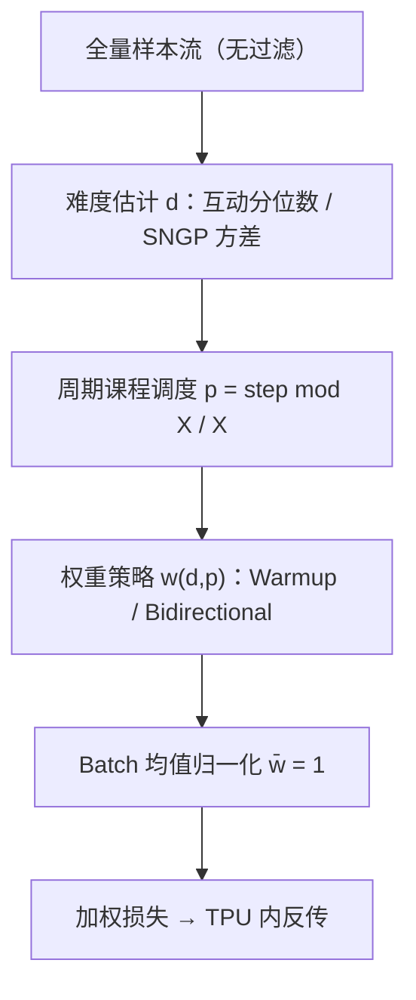

# Soft Curriculum Learning for Optimizing Fresh and Generalized Recommendations (面向新鲜内容与泛化推荐的软课程学习)

- **会议/期刊**: ACM RecSys 2026 (Minneapolis, MN, USA)
- **作者与机构**: Arnab Bhadury, Siyan Zheng, Anlan Yu, Palaksh Rungta, Jiawei Li, Changping Meng, Dapeng Hong, Chuan He, Onkar Dalal（均为 Google，前三作者等贡献）
- **推荐链路定位**: 召回（SASRec 式序列召回、双塔召回）+ 精排（大规模连续训练排序模型）
- **研究方向**: 冷启动与长尾推荐 / 去偏公平与工业架构
- **论文原文**: [https://arxiv.org/abs/2609.35783v1](https://arxiv.org/abs/2609.35783v1)
- **开源代码**: 暂未开源

## TL;DR (1分钟核心速览)

短视频推荐中，头部内容因曝光—互动—再曝光的正反馈不断被强化，模型陷入"记忆头部、放弃长尾"的困境。传统课程学习（CL）靠动态数据拒绝实现"由易到难"，但在工业连续训练管线中会因 CPU 侧过滤导致 TPU/GPU 饥饿、吞吐崩塌。本文提出 **Soft Curriculum Learning**：不做任何样本丢弃，而是在计算图内对损失做退火加权，用"互动量分位数"或"SNGP 预测不确定性"定义难度 $d$，配合**周期性（sub-day）课程节奏**与两种权重策略（Hard-Example Warmup / Bidirectional Scaling）。在排序模型上离线 AUC 全任务正增益，线上 7 天 A/B 中满意度 +0.54%、最新年龄桶冷启动互动 +5.70%；SASRec 式召回线上独特互动 +7.7%，且吞吐零损失。

## Background & Motivation (背景与核心矛盾)

- **主流范式**: 工业推荐以"逆流行度静态加权"作为去偏手段，配合连续训练（continuous training）日更模型；课程学习在 CV/NLP 中已被证明能引导优化器走向更优局部极小。
- **前人局限**: ① 真 CL 依赖动态数据拒绝，过滤在 CPU 侧执行，队列被抽空后加速器空转，吞吐骤降；② 学术 CL 多为一次性训练设计的**全局课程**（前期只喂易样本、后期只喂难样本），与数据分布逐日漂移的连续训练根本不兼容。
- **核心洞察 (Key Insight)**: 难度加权不必通过"删样本"实现——把权重作为标量乘到损失上，算子直接跑在 TPU 核内，开销近乎为零；而课程节奏应当是**周期性重置**而非单调推进，才能跟上生态中新爆款的涌现。
- **本文切入点**: 用"损失退火 + 图内权重调整"替换"刚性过滤"，把 CL 从数据管线问题转化为纯计算图问题。

## Method (核心方法设计)

### 1. 整体框架 (Overall Architecture)

全量数据无丢弃地流入管线，每个样本先由难度估计器给出 $d\in[0,1]$（互动量分位数或 SNGP 方差分位数），再由课程调度器依据当前 sub-day 区间内的训练进度$p$计算权重$w$，与任务损失相乘后回传；batch 级再做均值归一化以压制 A/A 方差。排序、双塔召回、序列召回三类模型共用同一套权重算子，仅难度来源与策略选择不同。

### 2. 关键设计拆解 (Key Designs)

1. **损失退火替代数据拒绝（Loss Annealing）**：痛点是把 CL 做成"过滤"会让 CPU 成为瓶颈、加速器饥饿。本文保留全部样本，仅将损失向量乘以退火系数 $w$，该标量乘法在加速器核内完成，吞吐与基线持平。物理直觉：梯度层面的软调制等价于对样本做"有效学习率"调节，既不丢信息也不阻塞流水线。

2. **两种课程权重策略（核心增量算子）**：设 $p\in[0,1]$为区间内进度、$d\in[0,1]$为难度、$\alpha$ 控制强弱。
   - *Hard-Example Warmup*：$w=1.0-\alpha\cdot d\cdot(1.0-p)$。$p=0$时最难样本被压到$1.0-\alpha$，随训练推进惩罚项单调衰减至 0，难样本平滑"入场"，避免早期梯度被长尾噪声主导。
   - *Bidirectional Difficulty Scaling*：$w=1.0+\alpha\cdot(2p-1)\cdot(2d-1)$。$p=0$时易样本被放大到$1.0+\alpha$、难样本压到$1.0-\alpha$；$p=1$ 时完全反转。这是对"由易到难"的线性优先级翻转，且因周期性重置而反复循环，防止模型在后期彻底遗忘头部趋势。

3. **难度量化与周期节奏**：难度定义为 $d=\exp(-\text{quantile}(\text{engagement}))$（互动型）或$d=\text{quantile}(\hat{U}_{\text{SNGP}})$（不确定性型，用谱归一化神经高斯过程的方差刻画"信息不足"）。训练流被切成固定$X$样本的 sub-day 区间，$p=(\text{step}\boldsymbol{o}d X)/X$，实现日内循环而非全局单调。总损失即各任务损失按$w$ 加权求和，**无需额外负采样改造**（沿用原管线 in-batch / 全局采样），推理阶段零额外开销（SNGP 方差在排序服务时本就可得）。

## Experimental Setup & Evaluation Protocol (实验设置与评估协议)

- **数据集与场景**: 某大型短视频平台的工业日志（未公开），覆盖排序模型、SASRec 式序列召回、双塔召回三条链路；离线按视频年龄分 5 个桶（Bucket 1 最新）做分层评估。

| 场景 | 模型 | 难度来源 | 策略 | 评估指标 |
| :--- | :--- | :---: | :---: | :--- |
| 精排 | 大规模连续训练多任务排序 | Eng / SNGP | Hard / Bi | 无权重 AUC（4 个任务头） |
| 序列召回 | SASRec 式 | Eng | Hard | MAP@K（全局候选池） |
| 双塔召回 | Two-Tower | Eng | Hard | MAP@K（in-batch 候选池） |

- **数据划分与防穿越**: 连续训练 + 时间序评估，离线测试集为头部偏斜的日志分布；线上采用 7 天（排序）/ 2 周（SASRec 召回）A/B。
- **排名评测协议**: 排序用**无权重 AUC**（因动态样本权重下标准 AUC 不可比）；SASRec 召回为**全局候选池** MAP@K，双塔召回为 **in-batch 负采样候选池** MAP@K，两者量纲不可直接比较。
- **对比基线与超参**: 基线为生产模型（逆流行度静态加权）；消融含"完全去掉流行度惩罚"（离线中性、线上负向，证明增益来自课程而非去惩罚）；超参 $\alpha$、频率网格搜索取最优；线上指标做显著性检验。

## Key Experimental Results (实验关键数据)

### 1. 主实验对比 (Main Results)

**排序离线（无权重 AUC 相对提升）**

| 任务 | Eng-Hard | **Eng-Bi** | SNGP-Hard | SNGP-Bi |
| :--- | :---: | :---: | :---: | :---: |
| Imp. Pos. | +0.02% | **+0.03%** | +0.01% | +0.01% |
| Exp. Neg. | +0.06% | **+0.08%** | +0.02% | +0.06% |
| Satisfaction | +0.02% | **+0.04%** | +0.01% | +0.02% |
| Imp. Neg. | +0.03% | **+0.04%** | +0.01% | +0.02% |

**排序线上 A/B（7 天）**

| 方法 | 满意度 | 用户增长 | 留存 | 总互动 | 冷启动 B1 | B2 | B3 |
| :--- | :---: | :---: | :---: | :---: | :---: | :---: | :---: |
| SNGP-bi | +0.42% | +0.15% | +0.15% | +0.92% | +4.71% | +1.13% | +1.54% |
| **Eng-bi** | **+0.54%** | +0.11% | +0.15% | **+1.89%** | **+5.70%** | **+2.99%** | **+2.72%** |

**召回离线 MAP@K**

| 模型 | K=1 | K=5 | K=10/50 | K=20/200 |
| :--- | :---: | :---: | :---: | :---: |
| SASRec Baseline | **0.009537** | **0.01753** | **0.02012** | **0.02202** |
| SASRec Eng-Hard | 0.009123 | 0.01684 | 0.01939 | 0.02128 |
| TwoTower Baseline | 0.16348 | 0.29806 | 0.33235 | 0.33316 |
| **TwoTower Eng-Hard** | **0.17133** | **0.32609** | **0.36547** | **0.36566** |

SASRec 召回线上：独特互动 **+7.7%**，冷启动 B1/B2/B3 分别 +0.27%/+0.69%/+0.61%。

### 2. 消融实验 (Ablation Study)

| 变体 | 离线 | 线上 |
| :--- | :--- | :--- |
| 去掉流行度惩罚（无课程） | 中性 | 负向 |
| Global-1Day（1 天后过滤易样本） | Imp.Pos −0.15%，Exp.Neg −0.30% | 满意度 −0.71%，增长 −0.19% |
| Global-3Day | Imp.Pos −0.19%，Imp.Neg −0.27% | 满意度 −0.72%，留存 −0.17% |
| Hard-Example Warmup | 全任务正增益 | 正增益（弱于 Bi） |
| Bidirectional Scaling | 全任务最优 | 最优 |

### 3. 关键实验发现 (Key Findings)

1. **课程增益集中在最新内容**：Eng-Bi 按视频年龄分桶，Age Bucket 1 的 Exp.Neg 提升 +0.14%，是 Bucket 3/5（+0.05%）的近 3 倍，说明软课程确实把模型容量导向了冷启动尾部，而非均匀提升。
2. **全局课程是负收益，周期课程才是正解**：Global-1Day/3Day 在离线和线上全面为负（满意度 −0.71%/−0.72%），因为永久剔除易样本使模型无法跟上新爆款趋势；而周期重置的软课程在同等算力下取得 +0.54% 满意度，直接验证了"连续训练需要循环课程"这一核心论点。
3. **模型容量决定课程收益方向**：特征丰富的双塔召回 MAP@200 从 0.33316 升至 0.36566（+9.7%），而轻量 SASRec 式召回离线 MAP 反而微降（0.02364→0.02290），但线上独特互动 +7.7%——说明头部偏斜的离线测试集会系统性惩罚"探索尾部"的模型，离线 MAP 在此场景下是误导性指标。

## Highlights & Limitations (亮点、对比与审稿批判)

- **与代表作对比 (vs. Prior Work)**: 相比 Bengio 等经典 CL 与 Penha & Hauff、MacAvaney 等的排序课程工作，本文不改数据分布、只改损失权重，从而绕开 CPU 瓶颈；相比逆流行度静态加权（如流行度去偏系列），本文的权重随训练进度动态演化且周期重置，是"调度式去偏"而非"静态倾向加权"。
- **可迁移亮点**: ① "batch 内权重均值归一化为 1"是抑制动态加权引入的 A/A 方差抖动的通用技巧，可直接用于任何样本加权训练；② 用 SNGP 方差作为"信息不足"代理来定义难度，可迁移到冷启动物品的主动探索调度。
- **审稿级局限批判**: ① 全部实验基于单一平台的私有日志，无公开数据集复现，且离线指标（无权重 AUC、两种不可比的 MAP）说服力有限，核心证据几乎全靠线上 A/B；② 论文仅 6 页，缺少 $\alpha$、周期长度$X$ 的敏感性曲线与复杂度/吞吐的定量对比表，"吞吐无损"只有定性陈述；③ SNGP 难度在召回阶段因算力不可用，跨链路方案并不统一。

## Rating (四维评分)

- **方法创新性 (Novelty)**: ⭐⭐⭐ （把 CL 从数据过滤重构为图内损失退火 + 周期节奏，工程视角新颖，但权重公式本身较朴素、缺乏理论分析）
- **评估协议与实验扎实度 (Protocol & Experiments)**: ⭐⭐⭐ （三条链路 + 7 天/2 周线上 A/B 与全局课程对照很有价值，但无公开数据集、无超参敏感性、离线指标设计存在自认的偏斜问题）
- **写作与数学规范度 (Clarity & Rigor)**: ⭐⭐⭐⭐ （两个权重公式与难度定义交代清晰、动机—工程约束—方案的逻辑链完整，但缺少复杂度与方差的理论刻画）
- **工业落地与复现价值 (Industrial & Practical Value)**: ⭐⭐⭐⭐⭐ （零吞吐损失、零推理开销、可直接插入现有连续训练管线，是少见的"能立刻上线"的课程学习方案，唯缺开源代码）

