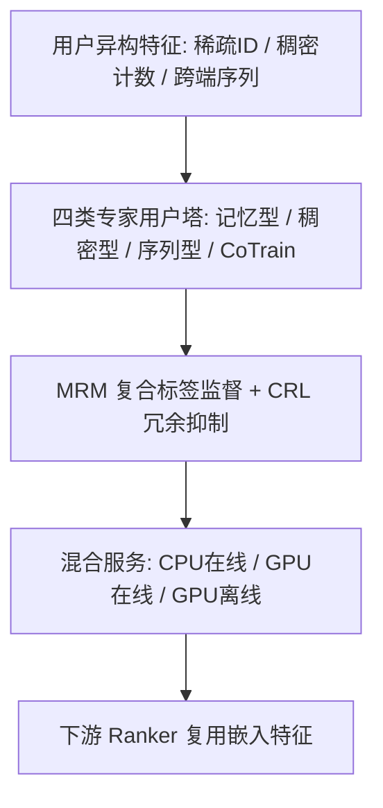
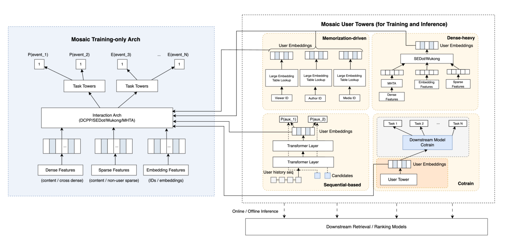

# Mosaic: A Fleet of User Embedding Specialists for Recommendation at Meta (Meta 用户嵌入专家舰队)

- **会议/期刊**: RecSys 2026
- **作者与机构**: John Zhiyuan Zheng, Xian Sun, Xiangyang Mou 等，Meta
- **推荐链路定位**: 召回（上游用户表征层，供召回/精排/完整性任务复用）
- **研究方向**: 协同过滤与双塔召回 / 工业架构与评测
- **论文原文**: [https://arxiv.org/abs/2607.24015v1](https://arxiv.org/abs/2607.24015v1)
- **开源代码**: 暂未开源

## TL;DR (1分钟核心速览)

工业界用户表征长期围绕"单一用户模型"或"共享骨干 + 任务适配"展开，但异构用户信号（稀疏 ID、稠密计数、行为序列、下游目标）统计结构差异巨大，共享容量必然互相挤压。Mosaic 提出**专家舰队**范式：四类架构异构的专家（记忆型 / 稠密型 / 序列型 / CoTrain）各自独立训练与部署，仅输出用户塔嵌入供下游复用；并用 MRM（跨任务笛卡尔积复合标签）与余弦冗余损失（CRL）压制专家间信息重叠，用免日志 CoEval 把评估周期压缩 3–5 倍。在 Meta 6 个线上 Surface 上，下游 Eval NE 相对下降 0.02%–0.33%，线上 Topline 提升 +0.10%~+0.28%。

## Background & Motivation (背景与核心矛盾)

- **主流范式**: 工业界普遍训练专用用户嵌入模型（双塔召回、行为聚类多向量、多兴趣路由、foundation-scale 用户侧模型、共享骨干 + 轻量专家），将异构特征压缩为紧凑向量供下游 ranker 复用。
- **前人局限一（容量耦合）**: 无论产出多少向量，用户侧仍由**单一架构或共享骨干**承载，稀疏记忆信号与稠密非线性信号被迫共享容量与优化路径，互相干扰。
- **前人局限二（迭代耦合）**: 单模型发布周期耦合所有信号族，任一改动都可能引发全局回归；且评估必须走"部署→特征落日志→下游重训"链路，迭代需数天。
- **核心洞察 (Key Insight)**: 不同用户信号族的**最优归纳偏置本质不同**（稀疏表偏好记忆、稠密计数偏好特征交叉、行为序列偏好时序注意力、下游目标偏好端到端梯度），因此"专家分工"应发生在**架构层**而非仅在门控层；同时作者观察到新专家加入后边际收益递减，根因是**表征子空间冗余**。
- **本文切入点**: 用异构专家舰队替代单一骨干，并用显式冗余抑制 + 免日志评估解决"舰队规模化"的两大伴生问题。

## Method (核心方法设计)

### 1. 整体框架 (Overall Architecture)

Mosaic 分三阶段闭环：**上游训练**时每个专家由「仅训练架构（吃非用户特征，受互动任务监督）+ 用户塔（吃稀疏 ID / 稠密计数 / 预训练嵌入）」组成，仅训练架构把多任务梯度回传用户塔，用户塔学习压缩为一个或多个用户向量；**推理**时只部署用户塔，按新鲜度需求走 CPU 在线、GPU 在线或 GPU 离线批量三条路径；**下游**将嵌入作为普通特征与既有用户/物品/上下文特征拼接消费，ranker 架构无需改动。新专家通过配置、二进制加载与灰度放量接入。

<figure class="paper-figure" markdown="span">
  <figcaption>图2：Mosaic 集群的模型架构，包括仅用于训练的架构（左）和四个用户塔专家系列（右）。为简洁起见，我们将所有嵌入指向一个仅用于训练的模块。实际中，每个 Mosaic 专家都有各自不同的仅用于训练的架构。</figcaption>
</figure>

### 2. 关键设计拆解 (Key Designs)

1. **专家舰队与信号-偏置匹配（Fleet of Specialists）**：痛点在于单一骨干共享容量。本文按信号族切分四类专家——记忆型用 TBE 融合查表 + HBM/DRAM/SSD 分层 + INT4 量化承载数百 GB 哈希表，交互网络刻意极简；稠密型以 MHTA / SEDot / Wukong 学习多时间窗计数交叉并输出多向量；序列型在 HSTU 上做三处改造：上下文 token 前缀、UIH token 交错（内容与元数据分占位置，序列有效长度由 $N$变为$C+2N$）、L1 自注意力 + L2 交叉注意力分层，并采用**随机长度训练**对齐线上截断分布；CoTrain 型在训练期额外挂一份目标下游 ranker 副本，与用户塔共享参数，把下游梯度端到端注入。直觉：归纳偏置与信号统计结构对齐后，小模型舰队在等算力下优于大通才模型。

2. **MRM 与余弦冗余损失（最大化增量知识）**：痛点在于新专家与旧专家收敛到相似子空间。MRM 先用 Spearman 秩相关刻画任务关系：

$$\rho_{ij}=\frac{\mathrm{cov}(\mathrm{rg}(y_i),\mathrm{rg}(y_j))}{\sigma_{\mathrm{rg}(y_i)}\cdot\sigma_{\mathrm{rg}(y_j)}}$$

再对高相关任务簇 $\mathcal{C}_g$做二元标签笛卡尔积，构造$2^m$类复合标签（如 like×comment 的$(1,1)$类刻画"既赞又评"的更强意图），连续任务先分桶再复合，$m\in\{2,3\}$。CRL 则直接施加正交约束：

$$\mathcal{L}_{\mathrm{red}}=\frac{1}{K}\sum_{k=1}^{K}\frac{\boldsymbol{e}^{(\mathrm{new})}\cdot\boldsymbol{e}_k^{(\mathrm{old})}}{\|\boldsymbol{e}^{(\mathrm{new})}\|\cdot\|\boldsymbol{e}_k^{(\mathrm{old})}\|}$$

直觉：边际损失只监督各任务的边缘分布，联合分布无显式信号；复合标签把联合结构变成监督目标，CRL 则把新嵌入推离已部署嵌入的张成空间。

3. **训练目标、负采样与推理效率**：总损失 $\mathcal{L}=\mathcal{L}_{\mathrm{main}}+\lambda\mathcal{L}_{\mathrm{red}}$，$\lambda$ 采用从零爬坡的 warm-up，保证主任务先收敛再施加正交惩罚。各专家沿用各自原有监督（互动任务 / 下游 ranker 目标），论文未引入新的负采样机制。推理侧通过 AOTI 编译 + 模型拆分降 GPU 用量 56%，叠加 2 小时 TTL 的 look-aside memcache 后累计降 **79%**，首屏延迟同时改善 0.14%。

## Experimental Setup & Evaluation Protocol (实验设置与评估协议)

- **数据集与场景**: 非公开工业数据，覆盖 6 个下游 Surface（Feed / 通知等），每个 ranker 有独立任务集，Task A 为最高优先级任务，B/C 为其他互动事件。

| 场景 | 任务数 | 评估指标 | 说明 |
| :--- | :---: | :---: | :--- |
| Surface 1–6 | 2–3 | Train/Eval ΔNE、FI | 与 ranker 共用同一 train/eval 划分 |
| 线上 A/B | Topline | 互动指标 | 多 Surface 独立实验 |

- **数据划分与防穿越**: 沿用各下游 ranker 自身的 train/eval 划分；序列专家在特征预处理阶段强制时间戳严格排序，防止因果掩码被乱序破坏。
- **排名评测协议**: 不涉及全库排序，采用**下游 NE（log-loss 类指标，越低越好）** 与 **FI 百分位**作为金标准离线指标；另设免日志代理指标 CoEval（冻结用户塔内联喂入下游 ranker，$\Delta\mathrm{NE}_{\mathrm{CoEval}}=\mathrm{NE}_{e_u}-\mathrm{NE}_{\mathrm{baseline}}$）与 User Tower Zero-Out。
- **对比基线与超参**: 基线为无 Mosaic 嵌入的下游 ranker 及单通才用户模型原型；序列专家以 512 序列长度为基线，扫描序列长度、MoE 专家数与嵌入维度；显著性以线上 A/B 统计显著为准。

## Key Experimental Results (实验关键数据)

### 1. 主实验对比 (Main Results)

| Surface | 任务 | Train ΔNE | Eval ΔNE |
| :--- | :---: | :---: | :---: |
| Surface 1 | Task A / B / C | −0.37% / −0.38% / −0.30% | **−0.21% / −0.30% / −0.16%** |
| Surface 2 | Task A / B / C | −0.03% / −0.04% / −0.07% | −0.03% / −0.05% / −0.02% |
| Surface 3 | Task A / B | −0.10% / −0.05% | −0.05% / **−0.21%** |
| Surface 4 | Task A / B / C | −0.27% / −0.31% / −0.31% | −0.13% / −0.21% / −0.16% |
| Surface 5 | Task A / B | −0.09% / −0.03% | −0.11% / −0.08% |
| Surface 6 | Task A / B | −0.05% / −0.21% | −0.09% / **−0.33%** |

线上 A/B Topline：Surface 1 **+0.10%**、Surface 2 **+0.15%**、Surface 3 **+0.28%**，全部统计显著。

### 2. 消融实验 (Ablation Study)

| 消融维度 | 配置 | Eval ΔNE | QPS |
| :--- | :--- | :---: | :---: |
| 专家族（Surface 1） | 记忆型（8 个嵌入） | −0.09% | – |
| | 稠密型（20 个嵌入） | **−0.22%** | – |
| | 序列型（6 个嵌入） | −0.12% | – |
| | CoTrain（3 个嵌入） | −0.15% | – |
| 序列长度 | 1024 / 2048（基线 512） | −0.21% / **−0.45%** | −18% / −33% |
| MoE | top-2/8, dim=128→512 | −0.07% → −0.14% | −8% → −21% |
| | top-4/8, dim=512 | −0.15% | −23% |
| 嵌入维度 | 256 / 256+warmup | −0.23% / −0.25% | −15% / −18% |

### 3. 关键实验发现 (Key Findings)

1. **稠密型专家是性价比之王**：仅 20 个嵌入即贡献 −0.22% NE，超过 8 个记忆型嵌入的 −0.09%，说明聚合计数上的非线性交叉比大规模查表更能提取可迁移的用户偏好；但记忆型在 FI 上可冲到全体 2 万+ 特征的 **前 0.01%**，二者互补而非替代。
2. **序列长度是序列专家的第一杠杆**：512→2048 带来 −0.45% NE（相对基线翻倍以上），代价是 QPS −33%；而 MoE 扩容（top-4/8, dim=512）仅 −0.15% 却已付出 −23% QPS，说明**加长历史比加宽容量更划算**，与"随机长度训练对齐线上截断"的设计形成闭环。
3. **冗余抑制是舰队可持续的前提**：作者明确指出新专家边际收益递减源于子空间重叠，MRM 复合标签被列为"最有效的独特知识蒸馏技术"，CRL 需配合 $\lambda$ warm-up 才能在不损主任务 NE 的前提下取得正交性——即"多样性"必须被显式优化，而非寄望于架构差异自然产生。

## Highlights & Limitations (亮点、对比与审稿批判)

- **与代表作对比 (vs. Prior Work)**: 相比 Pinterest 的行为聚类多向量与批刷新序列嵌入，Mosaic 的差异不在"产出几个向量"，而在**架构层异构 + 独立发布周期 + 独立服务策略**；相比 foundation + expert 的共享骨干范式，Mosaic 放弃共享骨干以换取故障隔离与信号专精，代价是失去跨专家参数共享；相比 HSTU 类序列推荐，本文把序列专家降格为舰队一员而非唯一用户模型。
- **可迁移亮点**: (1) **CoEval 免日志评估**——冻结用户塔内联喂入下游 ranker 副本，任何团队只要有下游模型 checkpoint 即可复用，把"部署+落日志+重训"数天链路压到半天级；(2) **MRM 复合标签**——用 Spearman 聚类 + 笛卡尔积把多任务联合分布变成显式监督，几乎零额外推理成本，可平移到任意多目标精排。
- **审稿级局限批判**: (1) **完全依赖非公开工业数据与线上 A/B**，无公开基准、无开源代码，ΔNE 量级（0.02%–0.33%）缺乏跨系统可比性，学术界难以复现或公平对比；(2) **舰队总体服务成本未量化**——论文只报告单专家 GPU 用量降 79%，但四类专家 + CoTrain 副本 + 离线批推理的总算力/存储开销、以及专家数量增长时的边际成本曲线均缺失，而这恰是"舰队 vs 通才"权衡的核心证据。

## Rating (四维评分)

- **方法创新性 (Novelty)**: ⭐⭐⭐⭐ （"异构专家舰队"是对单骨干范式的明确反向设计，MRM 复合标签与 CRL 组合有实用新意，但各组件单独看多为已知技术的工程重组）
- **评估协议与实验扎实度 (Protocol & Experiments)**: ⭐⭐⭐ （6 个 Surface 的离线 NE + 线上 A/B 覆盖充分且方向一致，但无公开数据集、无开源、无与外部 SOTA 的同协议对比，消融以专家族聚合为主）
- **写作与数学规范度 (Clarity & Rigor)**: ⭐⭐⭐⭐ （系统三阶段与四类专家职责划分清晰，MRM/CRL 公式简洁可落地；但部分关键设计如随机长度训练的采样分布、$\lambda$取值与$\tau$ 阈值均未给出具体数值）
- **工业落地与复现价值 (Industrial & Practical Value)**: ⭐⭐⭐⭐ （混合 CPU/GPU 服务栈、79% GPU 降本、3–5× 评估提速对大规模工业团队极具参考价值；但闭源与强内部依赖使外部复现门槛极高）

