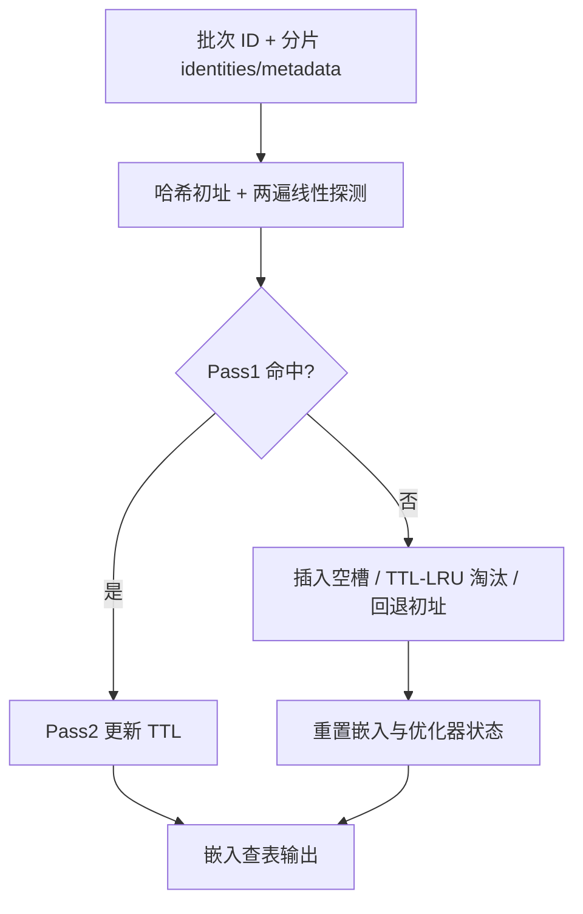

# Multi-Probe Zero Collision Hash (MPZCH): Mitigating Embedding Collisions and Enhancing Model Freshness in Large-Scale Recommenders (多探测零碰撞哈希：缓解大规模推荐中的嵌入碰撞并提升模型新鲜度)

- **会议/期刊**: RecSys 2026
- **作者与机构**: Ziliang Zhao, Bi Xue, Emma Lin 等（Meta Platforms 为主，含 OpenAI / Periodic Labs）
- **推荐链路定位**: 召回（HSTU 视频召回模型）+ 精排（Video Late-Stage Ranking）
- **研究方向**: 协同过滤与双塔召回 / 去偏公平、可信隐私与工业架构
- **论文原文**: [https://arxiv.org/abs/2602.17050v4](https://arxiv.org/abs/2602.17050v4)
- **开源代码**: 已随 TorchRec 开源（论文未给出独立仓库链接）

## TL;DR (1分钟核心速览)

大规模推荐中，哈希技巧把高基数 ID 压进固定嵌入表，必然产生碰撞：无关用户/物品共享同一向量，且新 ID 会"继承"过期 ID 的预训练权重（负迁移）。本文提出 MPZCH：以线性探测 + 身份张量 + 元数据张量实现"表容量略大于 ID 基数即零碰撞"，并配合 TTL/LRU 惰性淘汰与优化器状态重置，保证新特征从零学习。在 150M 用户 ID 上，表容量 1.33x、探测深度 256 时碰撞率从 Sigrid Hash 的 29.65% 降至 0；线上 30 亿 MAU 精排模型 17 个任务中 14 个 NE 提升（最高 0.38%），新视频曝光 +0.83%。

## Background & Motivation (背景与核心矛盾)

- **主流范式**: 工业界用 "hashing trick"（如 Meta 默认 `sigrid_hash`）把十亿级 ID 映射到固定行数的嵌入表，以内存换可扩展性；Monolith 用 Cuckoo Hashing 对高频 ID 保唯一槽位，TT-Rec/QR trick 用张量分解换"虚拟唯一"。
- **前人局限**: ① 碰撞率随 ID 基数增长无法归零——即使表容量达 ID 数 3 倍，Sigrid Hash 仍有约 15% 碰撞；② 哈希表无 ID 生命周期管理，新 ID 撞上过期槽位即继承无关语义，被迫先"遗忘噪声"再收敛，冷启动被显著拖慢。
- **核心洞察 (Key Insight)**: 碰撞不是统计误差而是"槽位归属不明"；只要显式记录每个槽位被哪个 ID 占用（身份张量）并允许探测溢出，配合主动淘汰过期 ID，就能在近线性内存开销下把碰撞压到零。
- **本文切入点**: 把开放寻址哈希（线性探测）做成 GPU 原生 CUDA kernel，用两遍扫描保证一致性，用 TTL/LRU 惰性淘汰 + 优化器重置切断"陈旧继承"。

## Method (核心方法设计)

### 1. 整体框架 (Overall Architecture)

MPZCH 与嵌入表**同分片共置**：每个分片额外维护 identities 张量（记录槽位占用 ID，初始 -1）与 metadata 张量（记录 TTL/时间戳）。训练时数据管线送入一批 ID，kernel 按哈希初址做线性探测：第一遍只读扫描判断 ID 是否已存在，第二遍执行更新/插入/淘汰/回退四类动作；淘汰时同步重置嵌入权重与优化器动量。发布时 identities 随模型冻结为只读，metadata 被丢弃以省体积；在线训练以分钟级稀疏 delta 发布，identities 与嵌入行严格同步更新。

### 2. 关键设计拆解 (Key Designs)

1. **两遍线性探测（Two-Pass Linear Probing）**：顺序探测若边扫边写，可能在新 ID 尚未扫到自身旧槽位时就抢先淘汰了更早的过期槽，造成同一 ID 重复存储。MPZCH 先只读扫描确认存在性，再第二遍执行动作，保证"已存在优先于新分配"。核心回退逻辑为：若探测 $P$步内既无命中也无空槽/可淘汰槽，则退回初址$h$并标记碰撞，即$\text{slot}=\begin{cases}\text{hit/empty/expired}, & \exists\, i<P \\ h, & \text{otherwise}\end{cases}$。直觉：把"发现"与"写入"解耦，用一次额外读换掉一致性 bug。
2. **TTL/LRU 惰性淘汰 + 优化器重置**：仅当新 ID 需要分配时才触发淘汰，扫描探测范围内第一个过期槽（metadata 低于当前时间戳）或最久未用槽。关键增量在于淘汰时**同时清零嵌入权重与动量**，使新 ID 从零学习，而非继承碰撞对象的预训练向量——这正是线上新鲜度提升的主因。支持按特征配置不同 TTL（如 Post ID 24h、Owner ID 72h）。
3. **训练目标、负采样与推理效率**：本文不改变推荐模型损失（沿用原模型如 HSTU 的排序/召回目标），MPZCH 只是嵌入索引层替换。无额外负采样设计；开销来自辅助张量存储与探测。HBM/CUDA 批处理下延迟稳定在 0.8–0.9 ms，且**对探测深度 $P$几乎不敏感**（$P=8$到$512$均约 0.9 ms），因此生产可直接取大$P$ 换零碰撞；非批处理 CPU/DRAM 高达 95–100 ms，凸显 GPU 加速必要性。

## Experimental Setup & Evaluation Protocol (实验设置与评估协议)

- **数据集与预处理**: 本文为工业系统论文，无公开学术数据集；离线碰撞率实验使用 **1.5 亿唯一用户 ID**，对比对象为 Meta 默认 `torcharrow.functional.sigrid_hash`。

| 场景 | #IDs | 表容量 | 稀疏度/密度 | 特征/场景说明 |
| :--- | :---: | :---: | :---: | :--- |
| 离线碰撞率 | 150M | 100M–500M | 容量比 0.67x–3.33x | 用户 ID 基数 vs 表行数 |
| 线上用户嵌入 | ~3B MAU | 4B 行 | 预留增长缓冲 | 视频后段精排模型，17 个预测任务 |
| 线上物品嵌入 | 视频/创作者 | 按 TTL 管理 | Post 24h / Owner 72h | HSTU 视频召回模型 |

- **数据划分与防穿越 (Splitting Strategy)**: 线上 A/B 测试，按用户随机分流；离线碰撞率为静态统计，无训练/测试划分。
- **排名评测协议 (Ranking Protocol)**: 不适用传统 Top-N 排序指标；采用线上 **Normalized Entropy (NE)** 衡量预测校准、**新视频曝光量**衡量分发、**同创作者嵌入余弦相似度**衡量语义一致性。
- **对比基线与超参设置**: 基线为 Sigrid Hash（生产默认）；关键超参为表容量比、`max_probe` $P\in\{8,\dots,512\}$、TTL 时长（24h/72h）；未报告显著性检验细节，仅称在成熟模型上"统计显著"。

## Key Experimental Results (实验关键数据)

### 1. 主实验对比 (Main Results)

离线碰撞率（150M ID，节选代表性配置）：

| 表容量 | 容量比 | Sigrid Hash | MPZCH ($P$=64) | MPZCH ($P$=256) | Improv. |
| :--- | :---: | :---: | :---: | :---: | :---: |
| 100M | 0.67x | 48.21% | 33.33% | 33.33% | 饱和于 1/3 |
| 150M | 1.00x | 36.79% | 4.12% | 2.04% | — |
| 200M | 1.33x | 29.65% | 0.03% | **0.00%** | 碰撞归零 |
| 300M | 2.00x | 21.31% | **0.00%** | 0.00% | 碰撞归零 |
| 500M | 3.33x | 13.61% | **0.00%** | 0.00% | 碰撞归零 |

线上用户嵌入 NE 提升（4B 行表，3B MAU）：

| 预测任务 | NE 提升 |
| :--- | :---: |
| Share | **0.38%** |
| VVD | 0.12% |
| VVP100 | 0.12% |
| Skip | 0.09% |

线上物品嵌入（HSTU 召回）：

| 指标 | 生产基线 | MPZCH | 相对提升 |
| :--- | :---: | :---: | :---: |
| 同创作者嵌入相似度（同日） | 0.66% | **0.91%** | **+38%** |
| 同创作者嵌入相似度（全时段） | 0.62% | **0.77%** | **+25%** |
| 48h 内新视频曝光 | — | — | **+0.83%** |

### 2. 消融实验 (Ablation Study)

原文未设标准消融表，以下为按机制拆解的对照（基于原文数据整理）：

| 配置 | 碰撞率 / 效果 | 说明 |
| :--- | :---: | :--- |
| Sigrid Hash（基线） | 29.65% @1.33x | 无生命周期管理 |
| MPZCH 仅探测、无淘汰 | 0.00% @1.33x | 零碰撞但表被过期 ID 占满 |
| MPZCH + TTL 淘汰、不重置优化器 | 未单独报告 | 仍存在陈旧继承 |
| MPZCH + TTL 淘汰 + 优化器重置 | 相似度 +38%、曝光 +0.83% | 完整方案 |
| MPZCH 换 LRU 淘汰 | 保留近期 ID | 备选策略，未给线上数字 |

### 3. 关键实验发现 (Key Findings)

1. **零碰撞的临界点是"容量略大于基数 + 足够探测深度"**：1.33x 容量配 $P=256$ 即达 0 碰撞，而 Sigrid Hash 在 3.33x 容量下仍有 13.61% 碰撞——说明哈希碰撞的根源是映射冲突而非容量不足，线性探测把冲突转化为可搜索的溢出。
2. **新鲜度收益主要来自优化器重置而非零碰撞本身**：同创作者嵌入相似度从 0.66% 升至 0.91%（+38%），且新视频曝光 +0.83%，作者明确指出"重置机制是 AB 测试新鲜度提升的首要驱动"。
3. **探测深度几乎免费**：$P$从 8 增至 512，HBM 批处理延迟稳定在 0.8–0.9 ms，因此生产可无代价取大$P$；但 CPU/DRAM 非批处理达 95–100 ms，部署必须走 GPU 原生路径。

## Highlights & Limitations (亮点、对比与审稿批判)

- **与代表作对比 (vs. Prior Work)**: 相比 Monolith 的 Cuckoo Hashing（内存随基数线性增长、仅保高频 ID 唯一），MPZCH 用辅助张量实现全量零碰撞且开销近线性；相比 TT-Rec/QR trick 用分解换"虚拟唯一"但增加推理重建延迟，MPZCH 保持查表 O(1) 且延迟不随 $P$ 增长；相比 Frequency-Based Double Hashing 只对 head 保唯一，MPZCH 对全量 ID 一视同仁。
- **可迁移亮点**: ① "身份张量 + 元数据张量"的槽位归属显式化思路可迁移到任何开放寻址结构（如 ANN 索引的槽位管理）；② 淘汰时重置优化器状态以切断负迁移，可推广到任何带生命周期管理的特征表（如实时特征缓存）。
- **审稿级局限批判**: ① 全部证据来自 Meta 内部线上 A/B，无公开数据集与可复现离线基准，NE 提升幅度（0.09%–0.38%）虽显著但缺乏方差/置信区间报告；② 零碰撞依赖"表容量 ≥ ID 基数"的前提，对无限增长的物品 ID 仍需淘汰兜底，此时碰撞率非零，论文未给出容量不足场景下的系统性退化曲线；③ 辅助张量带来额外显存与发布同步复杂度，稀疏 delta 发布的一致性保障细节偏工程描述、缺少故障注入验证。

## Rating (四维评分)

- **方法创新性 (Novelty)**: ⭐⭐⭐⭐ （线性探测本身不新，但"身份/元数据双张量 + 两遍扫描 + 优化器重置"的组合在工业嵌入表场景是扎实的增量创新，且有清晰的物理直觉）
- **评估协议与实验扎实度 (Protocol & Experiments)**: ⭐⭐⭐ （线上 3B MAU A/B 与 150M ID 碰撞率扫描有说服力，但缺公开数据集、缺显著性检验与容量不足场景的系统实验）
- **写作与数学规范度 (Clarity & Rigor)**: ⭐⭐⭐⭐ （算法伪代码与 kernel 执行示例清晰，公式克制；但部分机制仅文字描述、缺复杂度与显存开销的定量分析）
- **工业落地与复现价值 (Industrial & Practical Value)**: ⭐⭐⭐⭐⭐ （已随 TorchRec 开源、与 EmbeddingBagCollection 无缝集成、延迟不随探测深度退化，是可直接落地的系统级贡献）

