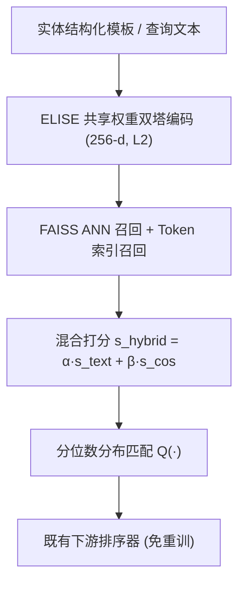
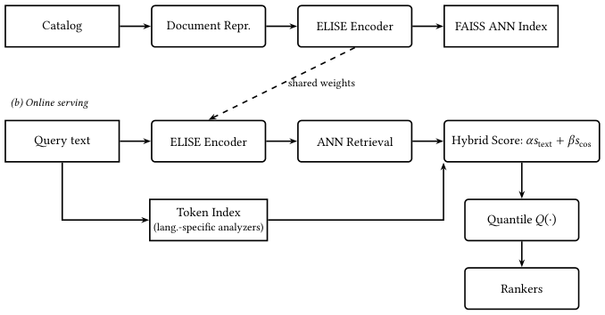

# Multilingual Semantic Retrieval for Apple Music Search (Apple Music 多语言语义检索)

- **会议/期刊**: RecSys 2026 (Industry Track)
- **作者与机构**: Vishalaksh Aggarwal, Kevin Sebastian, Vivek Kanojiya, Leo Le, Nick Tucey, Santosh Shankar (Apple)
- **推荐链路定位**: 召回（搜索召回，稠密+稀疏混合）
- **研究方向**: 协同过滤与双塔召回 / 冷启动与长尾推荐
- **论文原文**: [https://arxiv.org/abs/2607.10239v2](https://arxiv.org/abs/2607.10239v2)
- **开源代码**: 暂未开源

## TL;DR (1分钟核心速览)

Apple Music 搜索的失败主因是**召回失败而非排序失败**，且集中在拼写错误、音译、跨语言与功能型查询构成的尾部查询（占唯一查询 83%）。本文提出 ELISE：305M 参数 Siamese 双塔（GTE-multilingual-base 微调），采用课程式多目标训练（QI + QQ），并以**分位数分布匹配**将稠密余弦分与既有 token 索引分融合，从而**无需重训下游排序器**即可上线。离线 Hit@10 相对提升 69%，全球 A/B 中 CR 相对 +2.28%、无结果率降 86%，尾部查询 CR 相对 +7.93% 而头部仅 +0.14%（无回归）。

## Background & Motivation (背景与核心矛盾)

- **主流范式**: 现有系统为语言相关的 token 索引 + 下游排序器重打分，头部查询词面重叠高、效果良好。
- **前人局限**: ① 会话分析显示劣质结果中多数是**召回失败**，拼写/音译/跨语言导致零召回；② 尾部查询词面重叠极小，token 匹配天然失效，且多语言下同一实体有数十种表面形式。
- **核心洞察 (Key Insight)**: 语义召回的价值应集中在"难查询"上——若设计得当，它应提升尾部召回而**不扰动已被良好服务的头部查询**；同时下游排序器已对文本匹配分 $s_{\text{text}}$ 的分布完成校准，任何新信号若破坏该分布就会引发全局回归。
- **本文切入点**: 用多语双塔补召回，用**分数级校准（而非重训排序器）**接入成熟栈。

## Method (核心方法设计)

### 1. 整体框架 (Overall Architecture)

离线阶段将歌曲/专辑/艺人/歌单/电台等实体线性化为结构化文本模板，经 ELISE 编码为 256 维向量并写入 FAISS（OPQ128_256, IVF2048_HNSW32, PQ128），每数小时增量重建索引（变更检测跳过未变实体）。在线阶段查询经**共享权重**编码器走 ANN 召回，同时经语言相关分析器走既有 token 索引；两路候选先线性混合再经分位数映射 $Q(\cdot)$ 还原到原文本分分布，最后送入未改动的下游排序器。

<figure class="paper-figure" markdown="span">
  <figcaption>图1：系统架构。离线阶段（a）：目录实体由ELISE文本编码器编码，并索引到FAISS ANN存储中。在线阶段（b）：查询由同一共享权重编码器（虚线箭头）编码以进行ANN检索，同时被分词以用于现有稀疏索引；两组候选集通过混合评分和分位数校准𝑄(⋅)融合后送入排序器。</figcaption>
</figure>

### 2. 关键设计拆解 (Key Designs)

1. **结构化文档模板 + Top Queries 注入**：痛点是把元数据分字段独立编码会丢失实体整体语义，且用户真实表述与元数据词表存在鸿沟。做法是把实体类型、标题、艺人、流派、发行信息（时间戳转"published in the 70s"式自然语言）、流行度分桶（6 档自然语言等级）、歌词片段（首 $k$行 + 高频重复$m$行 + 末$x$ 行）与**历史高互动查询**拼成单串，查询侧加 `Query::` 前缀、文档侧加 `Document::` 前缀，使共享自注意力可按角色条件化。Top Queries 经编辑距离与 Jaccard 去重后保留，恰好覆盖"bib dillan"这类超阈值错拼与"robert allen zimmerman"这类世界知识联想——这是纯元数据无法提供的监督信号。

2. **课程式多目标训练（InfoNCE → Hardest Hinge）**：痛点是单一 InfoNCE 缺乏对易混对的边界锐化，而纯 hinge 课程对满足 margin 的负样本梯度为零、早期无法建立全局结构。总损失为 $\mathcal{L}=\lambda_{\text{QI}}\mathcal{L}_{\text{QI}}+\lambda_{\text{QQ}}\mathcal{L}_{\text{QQ}}$（$\lambda_{\text{QI}}=0.8,\lambda_{\text{QQ}}=0.2$）。第一阶段 QI 用对称 InfoNCE 与均匀采样目录负样本的复合损失$\mathcal{L}^{(1)}_{\text{QI}}=\tfrac{1}{2}(\mathcal{L}_{\text{sym}}+\mathcal{L}_{\text{neg}})$，$\tau=0.07$；其中 in-batch 负样本按查询日志频率出现，天然抑制热门物品过度推荐，均匀负样本则覆盖长尾。第二阶段（epoch 0.5，验证 MRR 平台期切换）改为批内最难负样本的 pairwise hinge：
$$\mathcal{L}_{\text{hinge}}=\frac{1}{B}\sum_{i=1}^{B}\max\!\big(0,\; m-s(q_i,d_i^{+})+\max_{j\neq i}s(q_i,d_j^{-})\big),\quad m=0.4$$
QQ 目标仅用对称 InfoNCE，把会话内"失败查询→成功改写"配对对齐，直接针对拼写失败模式。

3. **混合召回的两级校准（β 拟合 + 分位数匹配）**：痛点是 $s_{\text{cos}}\in[-1,1]$与$s_{\text{text}}$量纲分布迥异，直接作为新特征会迫使全部下游业务逻辑重训。先构造$s_{\text{hybrid}}=\alpha s_{\text{text}}+\beta s_{\text{cos}}$（$\alpha=1.0$），并指出仅用 NDCG@K 选$\beta$是欠定的（最优点附近平坦），故改用**拼写纠错对**$(q,q^{*})$做分数级拟合：$\beta^{*}=\arg\min_{\beta}\sum_{(q,q^{*})}\sum_{d}\ell\big(s_{\text{hybrid}}(q,d;\beta),\,s_{\text{text}}(q^{*},d)\big)$，$\ell$为 Huber 损失。随后用分段线性分位数映射把$s_{\text{hybrid}}$的经验 CDF 对齐到$s_{\text{text}}$ 的 CDF：
$$Q(s)=f_{p_i}+\frac{s-s_{p_i}}{s_{p_{i+1}}-s_{p_i}}\cdot(f_{p_{i+1}}-f_{p_i}),\quad s_{p_i}\le s\le s_{p_{i+1}}$$
该映射保序但重标定，使下游排序器"以为"看到的仍是原文本分——这是免重训上线的关键。

**训练细节与效率**：8×A100(40GB)、bf16、每卡 batch 64、lr $5\times10^{-5}$、1000 warmup 后恒定、单 epoch；文档 512 token / 查询 32 token；关闭 RoPE NTK scaling（序列远短于基座位置范围）。数据侧做 storefront 分位截断、实体类型截断、精确匹配查询降采样至 20%、20% 查询做同音合成错拼增强。稠密路径 p95 端到端延迟增量 < 55 ms。

## Experimental Setup & Evaluation Protocol (实验设置与评估协议)

- **数据集与预处理**: 训练数据为全球查询日志中的"查询→成功互动（播放/入库/转化）"对；无公开数据集统计表，评估使用 9 个留出集（7 个 LLM 生成查询 + 人工标注 ground truth、1 个日志错拼集、1 个受控编辑距离合成错拼集）。

| 评估集 | 类型 | 说明 |
| :--- | :---: | :--- |
| Similar Artists / Activities / Decades / Genre / Mixed Category / Moods | LLM 生成 + 人工标注 | 语义/功能型查询 |
| Natural-Language Navigational | LLM 生成 + 人工标注 | 自然语言导航查询 |
| Misspellings | 日志查询 + 人工标注 | 真实错拼 |
| Edit-Distance Misspellings | 合成 | 受控编辑距离错拼 |

- **数据划分与防穿越 (Splitting Strategy)**: 训练/验证/测试按查询日志切分，验证集用于早停点（epoch 0.5）与超参网格搜索，测试集为独立留出评估集；线上为 18 天全球 A/B。
- **排名评测协议 (Ranking Protocol)**: 离线主指标为 **Hit@10**（已知 ground-truth 物品是否进入 Top-10），理由是开放式音乐查询无法做穷尽相关性标注；生产质量用 **PL2B@10**（位置加权 L2，空位按"Unacceptable 与 Acceptable 之间"计分以惩罚少结果）。线上以 CR 与无结果率为准，双侧 t 检验，MDE 0.25% 相对变化，$\alpha=0.04$。
- **对比基线与超参设置**: 主基线为未微调的 GTE-multilingual-base（256-d）；骨干对比含 Qwen3-Embedding-0.6B 与 E5-multilingual-base；嵌入维度 256（利用 MRL 前缀有效性），相似度为 L2 归一化内积。

## Key Experimental Results (实验关键数据)

### 1. 主实验对比 (Main Results)

离线 Hit@10（基线 = 未微调 GTE-multilingual-base）：

| 评估集 | Baseline | ELISE | 相对提升 |
| :--- | :---: | :---: | :---: |
| Similar Artists | 0.02 | **0.25** | — |
| Activities | 0.54 | **0.69** | +28% |
| Decades | 0.49 | **0.71** | +45% |
| Genre | 0.59 | **0.81** | +37% |
| Mixed Category | 0.43 | **0.65** | +51% |
| Moods | 0.48 | **0.64** | +33% |
| Natural-Language Navigational | 0.30 | **0.85** | **+183%** |
| Misspellings | 0.42 | **0.79** | +88% |
| Edit-Distance Missp. | 0.26 | **0.53** | +104% |
| **Overall Average** | 0.39 | **0.66** | **+69%** |

线上全球 A/B（18 天，T1 = 文本分阈值过滤，T2 = 语义结果数量上限，最终上线 T2）：

| 指标 | 方案 | 相对变化 | 95% CI | p 值 |
| :--- | :---: | :---: | :---: | :---: |
| Conversion Rate | T1 | +0.81% | — | — |
| Conversion Rate | **T2** | **+2.28%** | [+2.19, +2.37]% | $<10^{-4}$ |
| No-Result Rate | T1 | −6.98% | — | — |
| No-Result Rate | **T2** | **−86.0%** | [−86.1, −85.8]% | $<10^{-4}$ |

按查询频次分桶的 CR 相对提升：

| 分桶 | 唯一查询占比 | 会话占比 | CR 相对提升 |
| :--- | :---: | :---: | :---: |
| Head | 0.6% | 39.8% | +0.14% |
| Mid | 16.7% | 29.9% | +0.89% |
| Tail | 82.8% | 30.2% | **+7.93%** |

### 2. 消融实验 (Ablation Study)

| 消融项 | 配置 | Hit@10 | Δ |
| :--- | :--- | :---: | :---: |
| 数据源（全量混合） | All sources | 0.36 | — |
| 数据源 | w/o LLM-generated pairs | 0.41 | +0.05 |
| 数据源 | w/o web co-occurrence | 0.38 | +0.02 |
| 数据源 | w/o failed-query–item pairs | 0.37 | +0.01 |
| 数据源 | w/o public playlists | 0.38 | +0.02 |
| 数据源 | w/o editorial playlists | 0.37 | +0.01 |
| 目标函数 | QI only | 0.54 | — |
| 目标函数 | QI + QQ | 0.56 | +0.02 |
| 目标函数 | QI + QQ + II | 0.56 | +0.02 |
| 骨干 | GTE-base 未微调 | 0.39 | — |
| 骨干 | Qwen3-Emb-0.6B 未微调 | 0.39 | — |
| 骨干 | E5-multilingual-base 微调 | 0.56 | — |
| 骨干 | **GTE-multilingual-base 微调** | **0.61** | **+0.05** |
| 损失 | 两阶段全 hinge | 0.64 | — |
| 损失 | 单阶段 InfoNCE | 0.64 | — |
| 损失 | **InfoNCE → hardest hinge（生产）** | **0.66** | **+0.02** |

### 3. 关键实验发现 (Key Findings)

1. **数据"少而纯"胜过"多而杂"**：移除任一补充数据源都使 Hit@10 上升（+0.01~+0.05），全部剥离后反而比全量混合高 +0.06。原因是 LLM 生成对、网页共现、歌单配对在**查询分布**（更长、更完整、探索型）与**标签保真度**（策展分组而非真实搜索互动）两个轴上同时偏离目标分布，而原始互动日志两轴同时匹配。
2. **增益精准落在尾部且头部零回归**：尾部查询 CR 相对 +7.93%，是中部（+0.89%）的约 9 倍、头部（+0.14%）的约 57 倍；同时无结果率降 86%、全部 storefront 均为正（+0.5%~+6.7%）。这验证了"语义召回补难查询、不扰动已良好服务查询"的设计假设，也是该方案能通过全球 A/B 的根本原因。
3. **骨干选择是最高杠杆决策，且课程式损失组合不可替代**：换骨干带来 +0.05，超过任何数据/损失/目标改动；而 InfoNCE 与 hardest-hinge 的两阶段组合（0.66）显著优于任一单阶段（均 0.64），说明"早期全负样本建全局结构 + 后期最难负样本锐化边界"存在互补性。此外 T1 的文本分阈值过滤把语义召回最有价值的零词面重叠结果全部滤掉，CR 提升仅为 T2 的约 1/2.8、无结果率改善仅为 1/12。

## Highlights & Limitations (亮点、对比与审稿批判)

- **与代表作对比 (vs. Prior Work)**: 与 CLAP/MuLan 等音频-文本跨模态检索不同，本文解决的是**结构化目录元数据上的文本语义搜索**，且明确指出音频融合在本场景回归 −0.03（查询以导航型为主）；与 M3-Embedding 等通用多语嵌入相比，本文的增量在于**领域微调 + 分数级校准接入**，而非更强的通用表征；与典型 hybrid retrieval 工作相比，本文用拼写纠错对拟合 $\beta$ 再做分位数匹配，把"分数校准"从启发式提升为有明确监督目标的拟合问题。
- **可迁移亮点**: ① **分位数分布匹配**是任何"新召回信号接入已校准排序器"场景的通用低成本方案，可完全避免重训；② 用**纠错对构造分数级监督**来定标融合权重，比用 NDCG 网格搜索更锐利、更可解释，可直接迁移到电商/应用商店搜索。
- **审稿级局限批判**: ① 离线评估依赖 LLM 生成查询 + 人工标注的 Hit@10，缺少穷尽相关性标注，且消融多为小规模（约 1/4 训练步）方向性结论，作者自承混合比例未充分扫描；② CJK storefront 增益最弱（日 +1.4%、中 +0.6%、韩 +0.5%），表意文字与音译约定未被有效覆盖；③ storefront 级截断只是粗粒度去偏，未处理同一市场内少数语种用户及流派/艺人流行度维度的公平性。

## Rating (四维评分)

- **方法创新性 (Novelty)**: ⭐⭐⭐ （双塔与课程学习均为成熟组件，真正新颖处是拼写纠错对驱动的 $\beta$ 拟合 + 分位数分布匹配这一"免重训接入"范式）
- **评估协议与实验扎实度 (Protocol & Experiments)**: ⭐⭐⭐⭐ （9 个留出集 + 非转化会话分类分析 + 18 天全球 A/B 与分桶归因完整，扣分在离线标注依赖 LLM 且消融规模偏小）
- **写作与数学规范度 (Clarity & Rigor)**: ⭐⭐⭐⭐ （公式简洁、动机—设计—验证链条清晰，负结果表格坦诚；但部分超参阈值仅以"分位数"描述未给具体数值）
- **工业落地与复现价值 (Industrial & Practical Value)**: ⭐⭐⭐⭐⭐ （真实全球部署、p95 延迟增量 < 55 ms、免重训排序器、无 storefront 回归，工业参考价值极高；可惜未开源）
