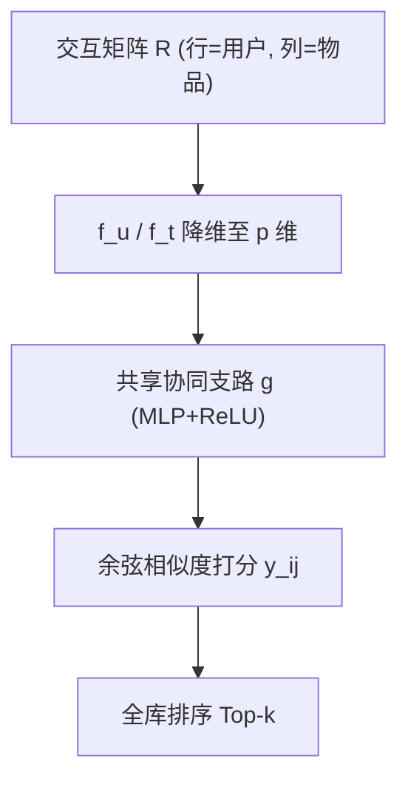
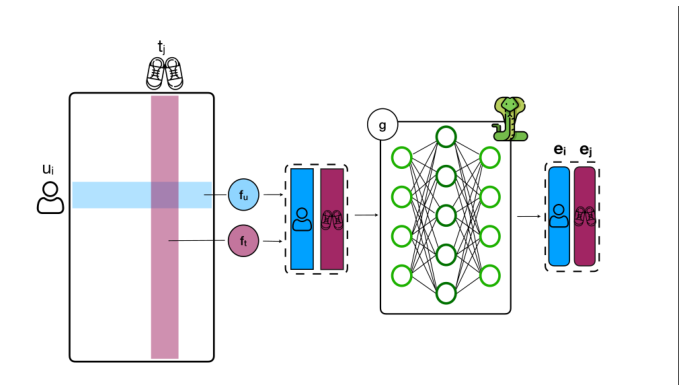

# Parameter-Efficient Single Collaborative Branch for Recommendation (参数高效的单协同支路推荐)

- **会议/期刊**: RecSys 2025 (Short Paper, 5 pages)
- **作者与机构**: Marta Moscati, Shah Nawaz, Markus Schedl (Johannes Kepler University Linz / LIT AI Lab)
- **推荐链路定位**: 召回（隐式反馈全库排序）
- **研究方向**: 协同过滤与双塔召回
- **论文原文**: [https://arxiv.org/abs/2508.03518v1](https://arxiv.org/abs/2508.03518v1)
- **开源代码**: [https://github.com/hcai-mms/cobrar](https://github.com/hcai-mms/cobrar)

## TL;DR (1分钟核心速览)

现代神经协同过滤几乎默认采用「用户塔 + 物品塔」双支路结构，参数量翻倍且两塔独立训练易造成表征空间错位。本文借鉴多模态表征学习中的单支路（single-branch）权重共享思想，提出 CoBraR：用户与物品共用同一个多层协同支路 $g$，仅保留两个轻量降维层$f_u, f_t$，使编码器参数量恰好减半。在 ML-1M / Amazon Baby / Amazon Music 三个 5-core 数据集、70/10/20 用户随机划分、全库排序协议下，CoBraR 的 NDCG@5 与双塔 DeepMF 持平或更优（ML-1M 0.2431 vs 0.2301），同时覆盖率最高提升至 82.8%、PopRSP 最低降至 0.7757。

## Background & Motivation (背景与核心矛盾)

- **主流范式**: 以 DeepMF 为代表的神经协同过滤将交互矩阵的行/列分别送入两个独立 MLP 塔，再以余弦相似度打分；多模态学习中的 SiBraR 虽引入单支路，但仍保留「用户单支路 + 物品单支路」两个编码器。
- **前人局限**: 其一，双塔结构使用户与物品表征由两套独立参数生成，正样本对在共享空间中的对齐完全依赖损失函数"拉扯"，缺乏结构层面的先验约束；其二，参数量随塔深线性翻倍，在物品规模大的电商场景部署成本高。
- **核心洞察 (Key Insight)**: 多模态领域已证明「同一语义实体的不同模态共享同一编码器」能天然拉近表征距离并压缩参数；用户与物品在协同过滤中恰是同一交互关系的两个"视角"，理应可被同一函数映射。
- **本文切入点**: 直接把用户塔与物品塔合并为唯一协同支路 $g$，用结构共享替代损失驱动的对齐，回答"单支路能否在纯协同数据上成立"（RQ1）与"减半参数是否损伤精度"（RQ2）。

## Method (核心方法设计)

### 1. 整体框架 (Overall Architecture)

CoBraR 的输入是二值交互矩阵 $R\in\mathbb{R}^{N\times M}$。用户$u_i$以行向量$R_{i*}\in\mathbb{R}^{M}$表示，经单层全连接$f_u$降维到$p$维；物品$t_j$以列向量$R_{*j}\in\mathbb{R}^{N}$表示，经$f_t$降维到同一$p$维。二者随后进入**同一个**多层协同支路$g$（若干全连接层 + ReLU），得到$\mathbf{e}_i=g(f_u(R_{i*}))$与$\mathbf{e}_j=g(f_t(R_{*j}))$，最终以余弦相似度$\hat{y}_{ij}=\cos(\mathbf{e}_i,\mathbf{e}_j)$ 打分。训练采用逐点交叉熵 + 负采样，推理时对每个用户全库降序排序并剔除已交互物品。

<figure class="paper-figure" markdown="span">
  <figcaption>图1：CoBraR 的架构。左侧模块表示用户–物品交互矩阵 𝑅∈R𝑁×𝑀。𝑓𝑢 和 𝑓𝑡 分别表示将 𝑅 的行和列降维为稠密向量的单层全连接线性层，𝑔 表示用户与物品之间共享的多层协同分支。对于每个用户–物品交互对 (𝑢𝑖,𝑡𝑗)，CoBraR 将推荐分数计算为用户嵌入与物品嵌入之间的余弦相似度，ˆ𝑦𝑖𝑗= cos (ei, ej)。</figcaption>
</figure>

### 2. 关键设计拆解 (Key Designs)

1. **单支路权重共享（Single Collaborative Branch）**：痛点是双塔各自学习导致正样本对对齐仅靠损失"硬拉"、参数翻倍。本文令用户与物品共用 $g$，即$\mathbf{e}_i=g(f_u(R_{i*})),\ \mathbf{e}_j=g(f_t(R_{*j}))$，仅保留两个形状不同的降维层以适配行/列维度差异。直觉上，共享映射把"用户视角"与"物品视角"强制投影到同一非线性流形，正样本对的距离由结构先验而非纯梯度驱动收缩，同时编码器参数从$2\sum_{i=1}^{L-1}d_i d_{i+1}$降为$\sum_{i=1}^{L-1}d_i d_{i+1}$，恰好减半。

2. **逐点交叉熵 + 负采样训练目标**：沿用 DeepMF 的打分聚合方式，对每个正样本对采样 $n_{neg}=5$ 个负物品，损失为
$$\mathcal{L}=-\ln\hat{y}_{ij}-\sum_{k=1}^{n_{neg}}\ln(1-\hat{y}_{ik}),$$
训练时对分数施加下阈值 $\mu$以稳定余弦输出的梯度。该目标与余弦打分天然匹配（分数落在$[0,1]$ 可解释为概率），无需额外归一化。

3. **推理与效率**：推理为对每个用户的全库打分排序，剔除 $R_{ij}=1$ 的物品；由于物品嵌入可离线预计算并缓存，在线仅需一次前向 + 余弦检索，参数量减半直接降低显存占用与冷启动加载成本。作者亦坦承未验证训练时长是否因小模型而增加。

## Experimental Setup & Evaluation Protocol (实验设置与评估协议)

- **数据集与预处理**（均经 `5-core` 过滤）：

| 数据集 | #Users | #Items | #Interactions | 场景说明 |
| :--- | :---: | :---: | :---: | :--- |
| ML-1M | 6,040 | 3,416 | 999,611 | 电影评分转隐式反馈 |
| Baby | 19,181 | 6,366 | 138,821 | Amazon 母婴电商 |
| Music | 5,082 | 2,338 | 30,623 | Amazon 音乐（最稀疏） |

- **数据划分与防穿越**: 用户级随机划分 70% / 10% / 20%（train/val/test），非时间切分，存在轻度未来信息泄漏风险。
- **排名评测协议**: 无偏 `Full-Ranking`（全库未交互物品排序），$k=5$；指标含 NDCG@5、ARP（平均推荐流行度）、PopRSP（流行度偏差，越低越好）、Coverage。
- **对比基线与超参**: BPR、DeepMF（双塔对照）、MultVAE、LightGCN；嵌入维度 $\{64,128\}$，学习率$\{10^{-6},10^{-7}\}$，batch 256，Adam +$L_2\in\{10^{-2},10^{-3}\}$，dropout$\{0.1,0.5,0.9\}$；浅层单隐层$\{2048,1024,512,256\}$与深层$[512,512,256,256]$两配置；用户级指标做配对$t$检验并经 Bonferroni 校正（$p<0.05$）。

## Key Experimental Results (实验关键数据)

### 1. 主实验对比 (Main Results)

| Model | ML-1M NDCG@5 | ML-1M Cov | ML-1M PopRSP | Baby NDCG@5 | Baby Cov | Music NDCG@5 | Music Cov | Music PopRSP |
| :--- | :---: | :---: | :---: | :---: | :---: | :---: | :---: | :---: |
| BPR | 0.2531 | 28.9% | 0.9882 | 0.0113 | 38.6% | 0.1044 | 0.8% | 0.8247 |
| DeepMF | 0.2301 | 32.0% | 0.9747 | 0.0156 | 1.9% | 0.0245 | 34.6% | 0.9875 |
| MultVAE | 0.2262 | 27.0% | 0.9889 | 0.0155 | 3.0% | 0.0973 | 55.1% | 0.9371 |
| LightGCN | **0.2726** | 28.0% | 0.9904 | **0.0252** | 51.0% | 0.0855 | 38.1% | 0.9570 |
| **CoBraR** | 0.2431 | **35.9%** | 0.9750 | 0.0124 | **82.8%** | 0.0397 | **82.6%** | **0.7757** |

（CoBraR 相对 DeepMF：ML-1M NDCG +5.65%，Music NDCG +62.0%，Baby NDCG −20.5%；覆盖率三数据集全面最优。）

### 2. 消融实验 (Ablation Study)

原文未设传统模块消融，核心对照为「单支路 vs 双支路」的等架构参数对比（ML-1M，固定嵌入 128，逐层配对）：

| 配置（隐层结构） | DeepMF 参数量 | CoBraR 参数量 | NDCG@5 对比结论 |
| :--- | :---: | :---: | :--- |
| 单隐层 256 / 512 / 1024 | $2\times$|$1\times$ | DeepMF 略优 |
| 单隐层 2048 | $2\times$|$1\times$ | **CoBraR 最优（0.2431）** |
| 深层 [512,512,256,256] | $2\times$|$1\times$ | 分布基本重合，无显著差异 |

### 3. 关键实验发现 (Key Findings)

1. **参数减半不损精度，且在大容量浅层配置下反超**：CoBraR 在 ML-1M 与 Music 上 NDCG@5 分别高出双塔 DeepMF 5.65% 与 62.0%，仅在 Baby 上下降 20.5%，说明共享支路在数据量充足时能提供有效的结构正则。
2. **覆盖率是最大赢家**：CoBraR 在 Baby 上覆盖率 82.8%（DeepMF 仅 1.9%）、Music 上 82.6%（DeepMF 34.6%），表明共享映射抑制了少数热门物品主导表征的塌缩现象，长尾曝光能力质变。
3. **精度与公平性的更好折中**：Music 上 PopRSP 降至 0.7757（DeepMF 0.9875），但 ML-1M 上仍略逊于 DeepMF（0.9750 vs 0.9747），说明去偏收益依赖数据稀疏度，稠密数据下共享支路的去偏优势被稀释。

## Highlights & Limitations (亮点、对比与审稿批判)

- **与代表作对比 (vs. Prior Work)**: 相较 DeepMF，CoBraR 以结构共享替代双塔独立编码，参数量严格减半；相较 SiBraR，本文首次把单支路从"每模态一支"推进到"用户物品共一支"，是纯协同数据上的新范式；相较 LightGCN，CoBraR 精度略低但覆盖率与去偏显著更优，定位互补而非替代。
- **可迁移亮点**: ①「共享编码器 + 独立轻量适配层」的范式可直接迁移到跨域推荐的双场景编码；②覆盖率/PopRSP 与 NDCG 联合报告的评测习惯值得在召回论文中推广。
- **审稿级局限批判**: ①仅基于 DeepMF 骨架验证，未测试 BPR 成对损失或 NeuMF 式聚合，结论泛化性受限；②用户级随机划分而非时间切分，存在未来交互泄漏，且未报告训练时长，参数减半的实际工程收益存疑。

## Rating (四维评分)

- **方法创新性 (Novelty)**: ⭐⭐⭐ （跨域借鉴单支路思想到纯协同过滤，思路简洁但理论分析仅停留在参数量计数，缺乏表征对齐的实证刻画）
- **评估协议与实验扎实度 (Protocol & Experiments)**: ⭐⭐⭐ （三数据集 + 全库排序 + Bonferroni 校正规范，但缺时间切分、缺传统消融、Baby 上性能退化未深入归因）
- **写作与数学规范度 (Clarity & Rigor)**: ⭐⭐⭐⭐ （5 页短文结构紧凑，公式与伪代码清晰，参数量推导明确，但 Algorithm 1 中负样本损失误写为 $\ln(1-\hat{y}_{ij})$ 属笔误）
- **工业落地与复现价值 (Industrial & Practical Value)**: ⭐⭐⭐⭐ （代码与预处理数据已开源、基于 Elliot 框架，参数量减半对显存敏感场景友好，但训练时长与线上延迟未验证）

