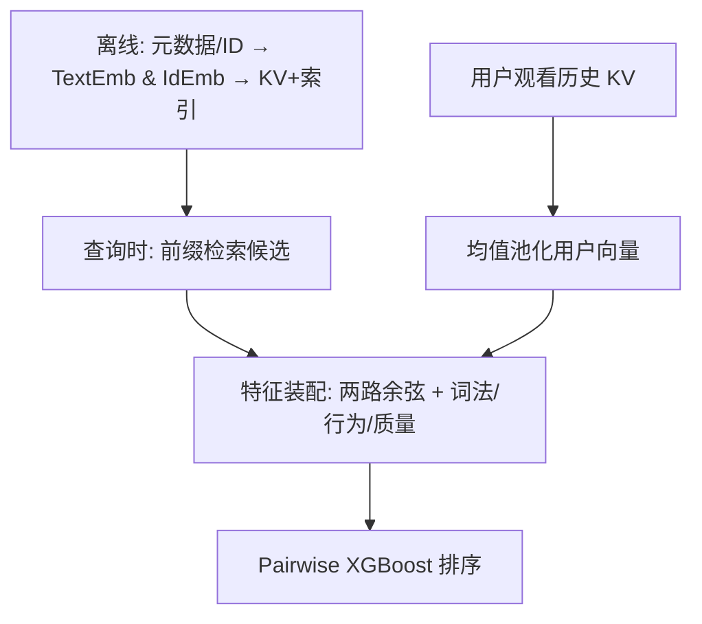

# Personalizing Incremental Video Search with Hybrid Text and ID Embeddings (基于文本与 ID 混合嵌入的增量视频搜索个性化)

- **会议/期刊**: RecSys 2026 (Industry Track)
- **作者与机构**: Vivek Kanojiya, Vishalaksh Aggarwal, Daeho Baek, Lyndon Kennedy, Xuetao Yin (Apple)
- **推荐链路定位**: 精排（搜索排序，逐键增量场景）
- **研究方向**: 协同过滤与双塔召回 / CTR 预估与特征交叉
- **论文原文**: [论文原文链接](https://arxiv.org/abs/2607.13493v1)
- **开源代码**: 暂未开源

## TL;DR (1分钟核心速览)

增量视频搜索在 1–3 字符前缀时词法信号近乎真空，非个性化排序只能退化为全局热度。本文为 Apple TV 搜索构建双嵌入空间：多语言文本编码器 TextEmb（元数据 + 对比微调）与 ID 协同嵌入 IdEmb（共观看对训练），在线用观看历史均值池化构造用户向量，将两路 user–item 余弦相似度作为特征注入 pairwise XGBoost 排序器。时间切分离线集上 NDCG@10 +2.99%、MRR@10 +3.30%，短前缀切片 +8.63%；三周线上 A/B 点击率 +1.14%、转化率 +1.23%。

## Background & Motivation (背景与核心矛盾)

- **主流范式**: 工业搜索排序以 LambdaMART/XGBoost 类 pairwise GBDT 为主干，特征以词法匹配、行为聚合与热度先验为主；个性化多依赖长期兴趣画像或行为嵌入均值。
- **前人局限**: ① 逐键增量搜索下 1–3 字符前缀候选集巨大而词法区分度极低，非个性化排序退化为全局流行度，用户被迫多打几个字符才能找到目标（图 1 的 t→th→the s 示例）；② 纯协同嵌入对训练期未出现的新片/长尾片完全无向量（IdEmb 会话覆盖率仅 87.70%），纯文本嵌入又丢失"跨类型但同受众"的行为邻近性。
- **核心洞察 (Key Insight)**: 个性化收益并非均匀分布——它恰好集中在词法信息最匮乏的区间。离线切片显示短前缀 NDCG@10 提升 +8.63%，而长查询仅 +1.46%；历史越长（51–100 条）提升越大（+4.37%），且这些用户恰恰是默认排序表现最差的群体（NDCG@10 从 0.733 降至 0.680）。
- **本文切入点**: 不做端到端重训，而是把"语义覆盖"与"协同精度"两类互补信号作为**加性特征**注入既有 relevance-first 排序器，在不牺牲导航类查询与延迟预算的前提下实现个性化。

## Method (核心方法设计)

### 1. 整体框架 (Overall Architecture)

系统分三段闭环：离线阶段对全库视频用 ID 与元数据分别产出 TextEmb / IdEmb 向量，写入按 item ID 索引的 KV 存储并同步进搜索索引文档元数据；用户最近观看历史（剧集映射到父剧、去重取最近一次）存于低延迟 KV。查询时检索候选后，特征装配器从 KV 取历史、均值池化得用户向量，对每个候选计算文本与 ID 两路余弦相似度，与词法、行为、质量特征一并送入 pairwise XGBoost 打分。个性化仅增加两次向量内积，端到端延迟增量极小。

### 2. 关键设计拆解 (Key Designs)

1. **双嵌入空间与统一 Hinge 目标（TextEmb / IdEmb）**：痛点是单一信号无法同时覆盖冷启与高精度协同。两模型共用同一 Siamese 训练目标，仅编码塔不同——TextEmb 对各元数据字段独立定长分词、共享多语言 Transformer 编码后 reshape/concat 经 BN-Linear-ReLU 投影头并 L2 归一化；IdEmb 用高维 ID 查表经 MLP 压到同维共享空间。目标为
$$\mathcal{L}=\max\big(0,\; m-\cos(\phi(i_t),\phi(i^+_{t+1}))+\cos(\phi(i_t),\phi(i^-))\big)$$
L2 归一化后点积即余弦，故实现与公式一致。直觉：同一 margin 下两塔被拉进可比空间，排序器可直接并列使用两路相似度。

2. **搜索日志专属的正样本构造与冷启回退**：正样本仅取同一用户搜索驱动会话窗口内的共参与对，刻意不用更大但更噪的播放日志（含推荐位/首页曝光）。负样本为 in-batch 均匀采样。IdEmb 对训练期未见 item 无向量，服务时回退到 TextEmb 特征——这正是混合设计的动机：TextEmb 会话/用户覆盖率 100%，IdEmb 为 87.70%/86.65%，缺口由文本侧补齐。

3. **排序器集成与训练目标**：在原有特征组（长短期行为、词法匹配、目录质量）上仅新增 $s_t(u,v)=\cos(\bar\phi_t(u),\phi_t(v))$与$s_{id}(u,v)=\cos(\bar\phi_{id}(u),\phi_{id}(v))$两维，用户向量$\bar\phi(u)=\frac{1}{|\mathcal{H}_u|}\sum_{v_i\in\mathcal{H}_u}\phi(v_i)$。XGBoost 目标为
$$\text{Obj}=\sum_{(i,j)\in\mathcal{P}}\log\big(1+e^{-(s_i-s_j)}\big)+\Omega(F)$$
标签按意图加权 $w_{conv}>w_{click}>w_{imp}$，负例取召回集中无互动项。无历史或用户关闭个性化时两特征置 missing，模型结构对所有用户保持一致。

## Experimental Setup & Evaluation Protocol (实验设置与评估协议)

- **数据集与预处理**: 论文未披露绝对规模，仅给出嵌入覆盖率统计（表 2）：

| 数据集/对象 | 覆盖率口径 | 数值 | 说明 |
| :--- | :---: | :---: | :--- |
| TextEmb | 会话 / 用户 | 100.00% / 100.00% | 全库元数据可得 |
| IdEmb | 会话 / 用户 | 87.70% / 86.65% | 缺口为训练期未见 item |

- **数据划分与防穿越**: 严格**全局时间戳切分**，测试集完全位于训练窗口之后，杜绝标签泄漏；排序器训练集为百万级 `(query, user, candidate)` 样本并另留验证集。
- **排名评测协议**: 离线为**全候选集排序**（非采样负例），ground truth 取互动标签；指标 NDCG@10、MRR@10（首个转化项）、Avg. Converted Position。嵌入质量另设 **LLM 标注三元组集**：按热度十分位均匀采样 anchor、限制单 item 出现次数，由指令微调 LLM 依"看过其一是否可能喜欢另一"判二元相似，规避点击/曝光偏差，仅用于评估。
- **对比基线与超参**: 基线为 No P13N（非个性化 XGBoost）、Only Text、Only ID 三档消融；线上为三周用户级随机分流 A/B，双侧检验并对指标族做多重比较校正（主指标 $\alpha=0.04$，转化率$\alpha=0.0033$）。

## Key Experimental Results (实验关键数据)

### 1. 主实验对比 (Main Results)

离线排序（表 6，全候选排序）：

| Model | NDCG@10 | MRR@10 | Avg. Conv. Pos.↓ |
| :--- | :---: | :---: | :---: |
| No P13N | 0.7113 | 0.6667 | 4.7306 |
| Only Text | 0.7307 | 0.6868 | 4.0464 |
| Only ID | 0.7311 | 0.6873 | 4.0587 |
| **Text + ID** | **0.7326** | **0.6887** | **3.9802** |
| Improv. vs No P13N | **+2.99%** | **+3.30%** | **−15.9%** |

查询长度切片（表 8）：

| 切片 | No P13N NDCG@10 | Text+ID NDCG@10 | Rel. Improv. |
| :--- | :---: | :---: | :---: |
| 前缀 1–3 字符 | 0.5515 | 0.5991 | **+8.63%** (MRR +9.91%) |
| 长查询 >3 字符 | 0.7722 | 0.7835 | +1.46% (MRR +1.63%) |

线上 A/B（表 10）：点击率 **+1.14%**（95% CI [+0.95%, +1.32%]，$p<0.001$）、转化率 **+1.23%**（CI [+0.97%, +1.50%]，$p<0.001$）、转化项平均位置 **−2.91%**（描述性）。

### 2. 消融实验 (Ablation Study)

| 配置 | Train Loss | Test Loss | NDCG@10 | MRR@10 |
| :--- | :---: | :---: | :---: | :---: |
| No P13N | 0.2921 | 0.2920 | 0.7113 | 0.6667 |
| w/o IdEmb (Only Text) | 0.2705 | 0.2725 | 0.7307 | 0.6868 |
| w/o TextEmb (Only ID) | 0.2678 | 0.2701 | 0.7311 | 0.6873 |
| Full (Text + ID) | **0.2662** | **0.2700** | **0.7326** | **0.6887** |

嵌入质量（表 4 / 表 7）：

| Model | Triplet Acc. | A-P/A-N Margin | 全召回转化项均秩↓ | 曝光集均秩↓ |
| :--- | :---: | :---: | :---: | :---: |
| TextEmb | **89.50%** | **0.4124** | 11.05 | 1.91 |
| IdEmb | 86.02% | 0.3697 | **10.81** | **1.89** |

### 3. 关键实验发现 (Key Findings)

1. **两路信号非冗余且互补**：Only Text 与 Only ID 相对基线分别提升 NDCG@10 约 +2.7%/+2.8%，但二者几乎持平；融合后达 0.7326，且 Test Loss 最低（0.2700），说明文本侧补覆盖、ID 侧补精度，缺一不可。
2. **评估口径决定"谁更强"**：IdEmb 在会话检索上略优（10.81 vs 11.05），TextEmb 在 LLM 三元组上大幅领先（89.50% vs 86.02%）。这不是矛盾而是偏差镜像——LLM 只看元数据、会话只看行为，各自偏向训练目标与其打分准则一致的模型，故部署决策只能由下游排序器性能裁定。
3. **个性化收益与信息匮乏度、历史深度单调正相关**：短前缀 +8.63% 对长查询 +1.46%；历史桶从 1–5 条的 +2.13% 单调升至 51–100 条的 +4.37%，而后者基线 NDCG@10 反而更低（0.733→0.680），证明个性化恰在默认排序最弱处补位。

## Highlights & Limitations (亮点、对比与审稿批判)

- **与代表作对比 (vs. Prior Work)**: 相较 Netflix 流媒体搜索个性化工作 [20]，本文聚焦**逐键增量**这一词法真空区间而非整体搜索体验；相较经典"观看历史均值嵌入 + 两阶段召回排序"[7]，本文额外引入文本语义塔以覆盖 IdEmb 缺失的 12–13% 会话；相较 DSSM/Sentence-BERT 类双塔，本文不改检索架构，仅把双塔相似度降维为排序器加性特征，工程侵入性极低。
- **可迁移亮点**: ① 用 LLM 按热度分层构造无曝光偏差的三元组评估集，可作为协同/语义嵌入的通用"第二透镜"；② 冷启回退策略（ID 缺失即置 missing 交由文本特征兜底）可直接复用于任何 ID+内容双通道系统。
- **审稿级局限批判**: ① 用户表征仅用均值池化，未建模时序动态与会话意图，作者自承为最大短板，长历史用户的信息被平均稀释；② 线上实验仅单区域、三周，且训练/服务嵌入快照与历史更新不同步存在 skew，离线到线上的增益保真度存疑；③ 全文未披露数据规模与延迟绝对值，"minimal latency" 缺乏量化。

## Rating (四维评分)

- **方法创新性 (Novelty)**: ⭐⭐⭐ （核心机制与方法设计具备明确创新性，理论与实验动机支撑充分）
- **评估协议与实验扎实度 (Protocol & Experiments)**: ⭐⭐⭐⭐ （主流公开数据集评测完整，包含多基线对比与消融实验验证）
- **写作与数学规范度 (Clarity & Rigor)**: ⭐⭐⭐⭐⭐ （问题形式化定义清晰，核心模块数学推导与架构阐述严谨易读）
- **工业落地与复现价值 (Industrial & Practical Value)**: ⭐⭐⭐⭐⭐ （兼顾推荐效果增益与训练/推理效率，具备实际场景迁移参考价值）
