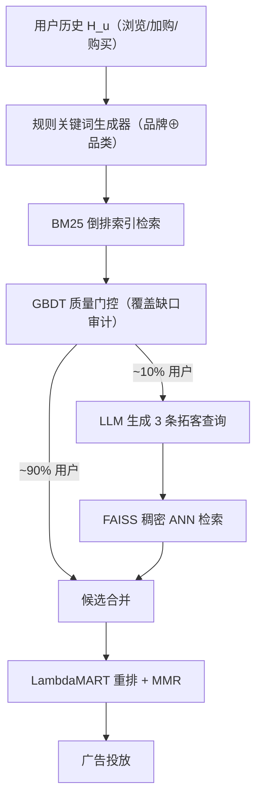
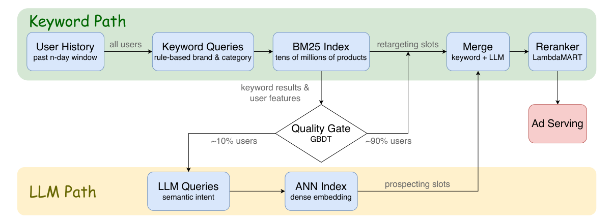

# SMART: LLM-Augmented Hybrid Retrieval for Dynamic Product Ads (LLM 增强的动态商品广告混合检索)

- **会议/期刊**: RecSys 2026
- **作者与机构**: Congfei Zhang, Jingxiao Ma, Xiaodong Liu 等，Snap Inc.
- **推荐链路定位**: 召回（候选生成）
- **研究方向**: 协同过滤与双塔召回 / 大语言模型推荐
- **论文原文**: [https://arxiv.org/abs/2607.23121v1](https://arxiv.org/abs/2607.23121v1)
- **开源代码**: [tantivy](https://github.com/quickwit-oss/tantivy)（仅 BM25 索引引擎，SMART 本体未开源）

## TL;DR (1分钟核心速览)

动态商品广告（DPA）召回需同时兼顾**重定向**（复现已知品牌/品类）与**拓客**（发现新品类），而现有双塔 U2I 嵌入模型难以表达语义意图，全量调用 LLM 又面临毫秒级延迟与成本不可承受。SMART 通过受控实验证明：规则查询 + BM25 在重定向指标 CatRecall@200 上领先 LLM 查询 24.1%，而 LLM 查询 + ANN 在拓客指标 Relevance Score 上领先 22.6%——二者是**结构性互补而非替代**。据此设计输出审计型 GBDT 门控，仅将约 10% 覆盖缺口用户路由至 LLM 路径，在 90% LLM 成本削减下取得 CatRecall@200 峰值 56.6%，Snap 两周线上 A/B 转化率相对提升 **+27.6%**。

## Background & Motivation (背景与核心矛盾)

- **主流范式**: DPA 召回长期依赖协同过滤与双塔 U2I 嵌入 + ANN 检索，捕捉行为相似性但无法表达"从运动鞋购买推断跑步配件"这类语义意图。
- **前人局限**: ① LLM 生成的自由文本与 BM25 严格词频匹配机制存在**词法错配**，在结构化商品目录（标题仅 5–15 token）下尤为严重；② 逐用户调用 LLM 在毫秒级广告响应预算下成本不可行，业界（如 Hu et al.）明确称其"不切实际"。
- **核心洞察 (Key Insight)**: 在 20K+ 生产用户队列上做交叉指标实验，发现 CatRecall@K 与 Relevance Score 对同一批系统给出**完全相反的排序**——规则查询发射历史中的精确品牌/品类 token，天然契合 BM25 倒排索引；LLM 的世界知识则只在稠密向量空间才能释放。且 73.0% 用户在追加 LLM 查询后指标毫无变化，收益高度集中。
- **本文切入点**: 不做"二选一"，而是让所有用户先走零成本关键词路径，再用轻量门控**审计其输出覆盖缺口**，仅对约 10% 真正受益者触发 LLM 拓客。

## Method (核心方法设计)

### 1. 整体框架 (Overall Architecture)

SMART 采用双候选生成回路 + 在线输出审计路由层。全量用户先经后端感知的规则查询生成器（Algorithm 1）产出精确品牌⊕品类 token，打 Tantivy BM25 索引完成重定向召回；随后 GBDT 质量门控基于 54 维实时特征（含关键词结果的覆盖缺口）判定是否将用户路由至 LLM 路径——LLM 单次结构化调用生成 3 条拓客查询，打 FAISS GPU IVFFlat 稠密 ANN 索引。两路候选合并后经 LambdaMART 重排 + MMR 多样性层，最终映射至活跃广告主商品集投放。典型配比为关键词占 170/200 槽位作历史忠实骨架，LLM 占 30 槽位填充顶层语义发现。

<figure class="paper-figure" markdown="span">
  <figcaption>图1：SMART 系统架构。所有用户接收规则生成的查询用于 BM25 重定向。质量门评估覆盖缺口，并将约 10% 的用户路由到基于稠密 ANN 索引的 LLM 拓客查询。候选集合并、重排序后发送至广告投放。</figcaption>
</figure>

### 2. 关键设计拆解 (Key Designs)

1. **后端感知的规则关键词生成（Backend-Aware Keyword Generation）**：痛点在于通用查询扩展器会产出 BM25 索引中不存在的词汇变体。本文按下漏斗权重 $w(\text{Purchase})=3, w(\text{Add-to-Cart})=2, w(\text{View})=1$计算品牌参与度$s(b)=\sum_{e_i:\text{brand}(p_i)=b} w(e_i)$，取 top-$n/2$ 品牌与其历史最高频叶子品类拼接为精确 token（如 "Brand-X Running Shoes"），剩余槽位补高频品类串。直觉：发射的每个 token 都保证出现在目录字段中，最大化词频匹配精度。

2. **输出审计型质量门控（Output-Auditing Quality Gate）**：区别于 FrugalGPT/RouteLLM 等**输入侧**路由器（仅凭输入文本难度决策），本文在零成本路径**执行之后**审计其输出。核心覆盖缺口特征为
$$\text{gap}(u)=1-\frac{|\text{cat}(\mathcal{R}_{kw}(u))\cap\text{cat}(H_u)|}{|\text{cat}(H_u)|}$$
其中 $\text{cat}(\cdot)$ 将商品映射至 GPC 品类体系。路由目标为带预算约束的全局召回最大化：
$$\max_{\theta}\sum_{u\in\mathcal{U}} m(\mathcal{R}_\theta(u)) \quad \text{s.t.} \quad \frac{|\{u: g(u)\geq\theta\}|}{|\mathcal{U}|}\leq B$$
直觉：高 gap 意味着用户多样化历史兴趣在 top 词法匹配中被挤出，正是需要语义拓客的信号；且该信号与模型无关（GBDT 与 DNN 变体 AUC 分别为 0.753/0.748）。

3. **训练目标、负采样与推理效率**：门控为二分类 GBDT，标签采用 OR-of-ORs 构造——两个独立生成周期中任一周期 CatRecall@200 优于关键词即标正，以抑制 LLM 随机性。重排器 LambdaMART 使用 0–15 分级监督标签，由 SigLIP2 语义前缀匹配长度（5 级层次）+ 下漏斗交互权重合成，正样本量比严格 item-ID 匹配多 50 倍。推理侧无负采样环节；LLM 仅对 10% 流量单次调用 Gemini 2.5 Flash Lite，成本降至 0.1×。

## Experimental Setup & Evaluation Protocol (实验设置与评估协议)

- **数据集与预处理**: 生产 DPA 日志采样 20K+ 唯一用户（跨多国），目录规模数千万级活跃商品；无传统 5-core 过滤，直接使用真实全量行为。

| 数据集 | #Users | #Items | #Interactions | 稀疏度/密度 | 特征/场景说明 |
| :--- | :---: | :---: | :---: | :---: | :--- |
| Snap DPA 生产日志 | 20K+ | 数千万 | 浏览/加购/购买全事件 | 极稀疏（品类级评估） | 多国、多品类电商广告 |
| 门控时序验证集 | 日级切分用户集 | 同上 | 同上 | — | day $T$训练 / day$T+1$ 测试 |

- **数据划分与防穿越 (Splitting Strategy)**: 历史行为严格截断至 day $T-1$，标签为 day$T$实际购买；门控采用**严格时序切分**（day$T$训练、day$T+1$非重叠用户测试），另做$T$至$T+7$ 标签窗口敏感性检验。
- **排名评测协议 (Ranking Protocol)**: 候选配置统一取 top-200，采用**品类级 Full-Ranking 式召回评估**（CatRecall@K，因精确商品 ID 召回在千万级目录下极度稀疏）；拓客侧用 LLM-as-a-judge（Gemini 3 Flash，thinking 模式）对 top-10 打 0–3 分 Relevance Score。所有对照共享同一索引、重排器与流水线以隔离查询生成效应。
- **对比基线与超参设置**: 基线含 Keyword+BM25、Keyword+ANN、LLM+BM25、LLM+ANN 四种交叉组合，线上对比 Snap 生产双塔 U2I ANN 模型（数百特征）；嵌入维度 768（gemini-embedding-001），BM25 索引含 title/brand/GPC/type/5 级 TIGER 语义 ID。

## Key Experimental Results (实验关键数据)

### 1. 主实验对比 (Main Results)

**表 1：BM25 上的词法检索对比（CatRecall@K）**

| $K$| Keyword (baseline) | LLM retarget+prospect |$\Delta_{rel}$ |
| :--- | :---: | :---: | :---: |
| 5 | **41.0%** | 34.5% | −15.9% |
| 20 | **44.4%** | 37.1% | −16.4% |
| 200 | **56.0%** | 42.5% | −24.1% |

**表 2：跨指标后端对比（CatRecall@200 / Rel. Score@10）**

| System | CatRecall@200 ($\Delta_{rel}$) | Rel. Score ($\Delta_{rel}$) |
| :--- | :---: | :---: |
| Keyword+BM25 (base) | **56.0%** | 1.95 |
| Keyword+ANN | 53.9% (−3.8%) | 2.25 (+15.3%) |
| LLM+BM25 | 42.5% (−24.1%) | 2.32 (+18.9%) |
| LLM+ANN | 50.7% (−9.5%) | **2.39 (+22.6%)** |

**表 6：生产规模操作点（相对关键词基线）**

| Strategy | LLM% | CatRecall@200 | $\Delta_{rel}$ | Rel. cost |
| :--- | :---: | :---: | :---: | :---: |
| Keyword-only (baseline) | 0% | 56.0% | — | 0× |
| **Gated 10% (SMART)** | 10% | **56.6%** | **+1.1%** | **0.1×** |
| Gated 15% | 15% | 56.5% | +0.9% | 0.15× |
| Always SMART | 100% | 54.5% | −2.7% | 1× |
| LLM retarget+prospect | 100% | 42.5% | −24.1% | 1× |

**表 10：线上 A/B 测试（2 周，vs. 双塔 U2I）**

| Method | CR | CTR |
| :--- | :---: | :---: |
| Embedding-based U2I (baseline) | 100% | 100% |
| **SMART (ours)** | **127.6%** | 99.1% |

### 2. 消融实验 (Ablation Study)

**表 9：门控时序泛化（day $T$训练 → day$T+1$ 测试）**

| Model | AUC | CatRecall@5 $\Delta$ |
| :--- | :---: | :---: |
| GBDT | **0.753** | +0.99pp |
| DNN | 0.748 | **+1.13pp** |
| Oracle (per-user) | — | +6.9pp |

**表 8：LLM 影响跨运行稳定性**

| Run 1 outcome | Still same | Flipped | Neutral |
| :--- | :---: | :---: | :---: |
| Improved | **80.1%** | 5.1% | 14.8% |
| Declined on CatRecall@200 | 75.6% | 2.2% | 22.2% |

**表 5：门控 Top 特征增益**

| Rank | Feature | Rel. gain | Source |
| :--- | :--- | :---: | :--- |
| 1 | Product set density | 1.00 | Search results |
| 2 | Avg. query token count | 0.53 | Query |
| 3 | Result leaf categories | 0.30 | Search results |
| 4 | Semantic L1 coverage | 0.27 | Coverage gap |

### 3. 关键实验发现 (Key Findings)

1. **交叉指标反转是本文最硬的实证**：同一批系统在 CatRecall@200 与 Relevance Score 上排序完全相反（Keyword+BM25 召回 56.0% 但相关性仅 1.95；LLM+ANN 召回 50.7% 但相关性 2.39），且每种查询风格都只在其匹配后端上最优——LLM 从 BM25 换到 ANN 召回提升 +19.3%，而关键词做同样切换反而损失 3.8%，直接证伪"LLM 查询可作通用替代"的假设。
2. **门控的倒 U 型曲线锁定了 10% 操作点**：CatRecall@200 在 5–15% 路由带内达峰 56.6%，继续增加 LLM 候选会因池稀释降至 54.5%（Always SMART 甚至低于纯关键词基线 2.7%），说明重排器无法挽回被挤出有限候选池的商品——这是"必须门控"而非"可选优化"的结构性论据。
3. **线上收益来自转化而非点击**：CR 相对 +27.6% 而 CTR 仅 −0.9%，证明 SMART 不是无差别制造低意图点击，而是精准过滤尾部噪声、上浮高相关发现品；同时 80.1% 的受益用户在第二次生成周期中稳定受益，说明收益是请求状态的可学习不变量而非 LLM 随机性产物。

## Highlights & Limitations (亮点、对比与审稿批判)

- **与代表作对比 (vs. Prior Work)**: 相比 Query2Doc/HyDE 等查询扩展工作（聚焦 MS-MARCO 长文档、且默认稠密后端），本文首次在结构化商品目录（5–15 token 标题）上量化了词法错配的严重性；相比 FrugalGPT/RouteLLM 的**输入侧模型选择**，SMART 做的是**能力选择**——先执行零成本启发式再审计其输出，决策点根本不同；相比 Yahoo 的 DPA 受众拓客工作，本文引入了 LLM 生成查询这一新变量并给出受控对比。
- **可迁移亮点**: ① "先跑便宜路径、再审计输出缺口决定是否升级"的 audit-then-invoke 范式可迁移至任何快启发式 + 贵神经增强的高吞吐检索流水线；② 用 SigLIP2 嵌入 + RQ-KMeans 构造 5 级语义 ID 并同时服务于 BM25 字段索引、门控特征与重排监督标签，一套表征三处复用，工程性价比极高。
- **审稿级局限批判**: ① 时序验证仅限次日 holdout，延迟标签检验也只延到 $T+7$，对长周期目录漂移与季节性购物迁移的鲁棒性未验证；② 路由阈值非负载感知，流量洪峰时 LLM 调用量线性上升（虽可优雅降级）；③ 离线 Relevance Score 仅用单一 Gemini 3 Flash 评判，存在模型谄媚风险，缺多模型共识与人工校验；④ 规则查询强依赖结构化品牌/品类字段，无此结构的领域需自行替换覆盖度量。

## Rating (四维评分)

- **方法创新性 (Novelty)**: ⭐⭐⭐⭐ （"重定向–拓客检索分解"+"输出审计门控"两个概念都扎实且反直觉，虽各组件本身不新，但组合出的决策点位移具有清晰的理论叙事）
- **评估协议与实验扎实度 (Protocol & Experiments)**: ⭐⭐⭐⭐⭐ （20K 用户受控交叉实验 + 严格时序切分 + 跨运行稳定性 + 延迟标签敏感性 + 两周线上 A/B，工业论文中实验链条罕见地完整）
- **写作与数学规范度 (Clarity & Rigor)**: ⭐⭐⭐⭐ （算法伪代码与特征表清晰，公式克制；但门控目标函数与标签构造的细节略偏工程描述，缺形式化收敛或误差分析）
- **工业落地与复现价值 (Industrial & Practical Value)**: ⭐⭐⭐⭐ （90% 成本削减 + 27.6% 转化提升的落地证据极强，BM25 侧依赖开源 tantivy 可复现；但 LLM 路径与门控特征强绑定 Snap 内部目录体系，完整复现门槛较高）
