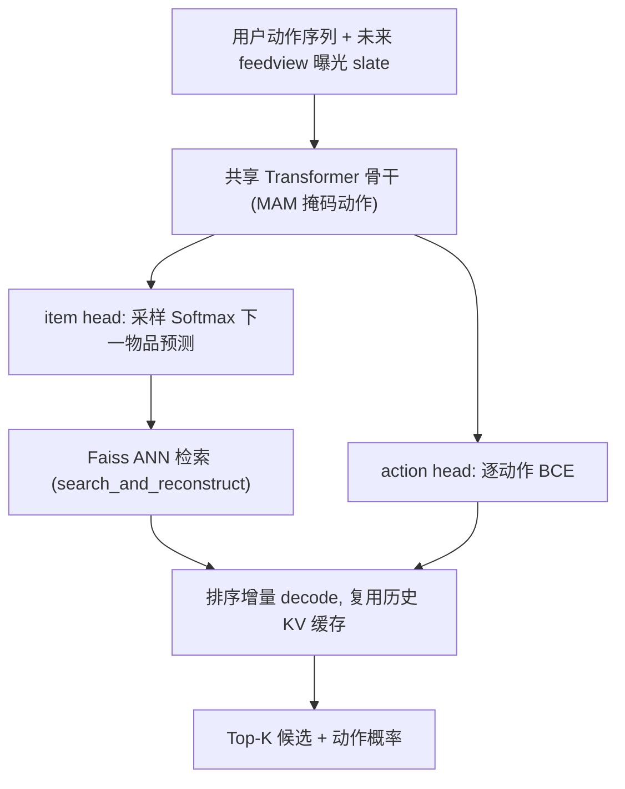
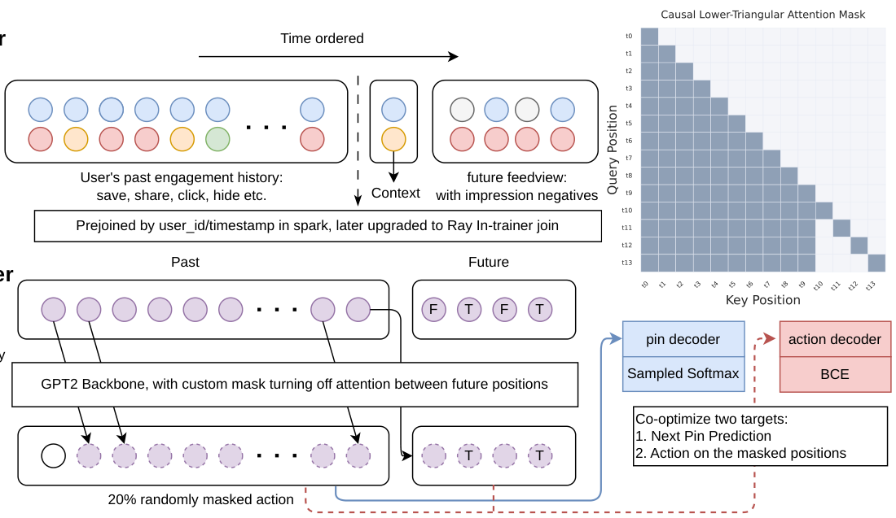

# UniPinRec: Unifying Generative Retrieval and Ranking at Pinterest Scale (Pinterest 规模下的生成式召回与排序全栈统一)

- **会议/期刊**: RecSys 2026
- **作者与机构**: Hanyu Li, Yi-Ping Hsu, Aditya Mantha, Prabhat Agarwal 等（Pinterest）
- **推荐链路定位**: 召回 + 粗排（L0+L1），端到端生成式检索骨干
- **研究方向**: 协同过滤与双塔召回 / 生成式推荐与离散语义 ID
- **论文原文**: [https://arxiv.org/abs/2606.00422v1](https://arxiv.org/abs/2606.00422v1)
- **开源代码**: 暂未开源

## TL;DR (1分钟核心速览)

工业推荐系统长期将召回与排序分训分服，二者却都在用大 Transformer 编码同一份用户行为序列，参数、算力与线上成本三重冗余。UniPinRec 提出**全栈统一**：同一输入格式、同一模型、单阶段联合训练、复用现有服务栈。核心是 Masked Action Modeling（MAM）在不拉长上下文的前提下注入排序监督、混合样本同时满足两目标、跨阶段 KV 缓存复用让排序只付 $O(nk)$ 增量成本。离线排序 Hit@3 较生产排序模型提升 14.7% 且召回 Recall@10 不降，线上端到端延迟降 11.1%、QPS 升 63.6%、互动提升约 +1%。

## Background & Motivation (背景与核心矛盾)

- **主流范式**: 多级漏斗（召回→排序→混排）各阶段独立训练，但骨干已统一收敛到 Transformer 序列模型（HSTU、PinRec、TransAct）。
- **前人局限**: ① HSTU 用交错（interleaved）动作 token 保证候选感知，导致上下文翻倍且召回/排序输入格式不兼容，只能分训；② OnePiece 做了统一多任务训练却只部署为单阶段模型；③ OneRec/OneRanker 端到端生成式替换整个漏斗，难以与既有候选源（关键词、趋势）组合，丧失分阶段运营与回滚能力。
- **核心洞察 (Key Insight)**: 排序前向的主要开销是用户历史自注意力的 $O(n^2)$，而召回已经算过一遍——若能把这份历史 KV 缓存跨阶段复用，排序就退化为一次$O(nk)$ 的 decode，统一模型才可能"零边际成本"地加上排序。
- **本文切入点**: 不引入新机制，而是组合 ANN 索引、cross-attention 排序、KV 缓存等成熟组件，做**可插拔（drop-in）**的全栈统一。

## Method (核心方法设计)

### 1. 整体框架 (Overall Architecture)

以生产召回模型 PinRec 为底座：物品经 Omnisage/CLIP/搜索嵌入投影为 $L_2$ 归一化向量，用户正向交互历史送入 causal decoder-only Transformer。训练时每个样本由**过去动作序列**拼接**未来 feedview 曝光 slate**（含曝光负样本）构成，同一前向同时计算下一物品预测损失与逐位置动作预测损失；推理时召回走自回归生成 + Faiss ANN 检索，排序节点仅对候选 token 做增量前向、attending 到召回写好的历史 KV 缓存，输出各动作类型概率。

<figure class="paper-figure" markdown="span">
  <figcaption>图2：UniPinRec的端到端流程：单一共享骨干网络在检索和排序目标上联合训练，然后作为两个Triton进程协同服务，跨阶段共享用户历史KV缓存。</figcaption>
</figure>

### 2. 关键设计拆解 (Key Designs)

1. **Masked Action Modeling (MAM)**：交错方案使序列长度翻倍且破坏召回输入兼容性。MAM 改为把动作 multi-hot 向量 $a_i$经线性层压成稠密嵌入，沿特征维与物品表示拼接后再投影；历史位置以概率$p_{\text{mask}}$独立掩码，候选位置恒掩码（推理时动作未知），掩码位替换为专用 `[MASK]` 类以区分"未知"与"无动作"。因果注意力保证无泄漏：$z_i=f_\theta(\tilde{\Phi}_i,\{\tilde{\Phi}_t\}_{t<i})$，且$m_i=0$时$\tilde{\Phi}_i \perp\!\!\!\perp a_i$。收益是序列长度不变、权重可全共享、随机掩码还带来去噪正则（迫使模型在动作缺失时依赖物品内容）。

2. **候选间屏蔽注意力 + 联合损失**：采用 M-FALCON 式掩码，候选位置可见全部历史但彼此不可见，注意力代价从 $O((n+k)^2)$降至$O(n^2+nk)$，并用 flex attention 编译为融合 CUDA kernel；同时保证每个候选得分与 batch 组成无关（无偏打分）。总损失为
$$\mathcal{L}=\mathcal{L}_{\text{item}}+\mathcal{L}_{\text{action}},\quad \mathcal{L}_{\text{action}}=\sum_{c=1}^{C}w_c\Big[\tfrac{1}{|\mathcal{M}_{\text{past}}|}\sum_{i\in\mathcal{M}_{\text{past}}}\ell_{\text{BCE}}(h_{\psi_c}(z_i),a_i^{(c)})+\tfrac{1}{k}\sum_{j=1}^{k}\ell_{\text{BCE}}(h_{\psi_c}(z'_j),a'^{(c)}_j)\Big]$$
其中 $\mathcal{L}_{\text{item}}$沿用带频率校正的采样 Softmax（count-min sketch 估计$Q(i_c)$，批内 + 随机负采样，免 hard negative 挖掘）。

3. **跨阶段 KV 缓存共享与数据基建**：召回与排序是两个独立 Triton 进程、独立 CUDA 上下文，朴素序列化 KV 会引入 GPU-Host-GPU 往返。做法是预分配形状 $[L,S,H,n,D]$ 的 GPU 内存池，召回启动时导出 CUDA IPC handle，排序进程映射同一物理显存，槽位轮转复用，排序仅把该请求历史 KV 拷入自身 decode cache。数据侧用 Ray in-trainer bucket join 按 user_id 哈希在训练时内存 join 动作表与曝光表，避免离线 fanout 与数据复制；曝光负样本下采样保留 10%，评估侧不下采样（随机回放，保持无偏分布）。

## Experimental Setup & Evaluation Protocol (实验设置与评估协议)

- **数据集与场景**: 生产 "Board More Ideas" feed 数据训练与离线评估；线上 A/B 覆盖 Board More Ideas 与 Notifications 两个百万级日活 surface。论文未披露用户/物品规模统计表。

| 数据集 | #Users | #Items | #Interactions | 稀疏度/密度 | 特征/场景说明 |
| :--- | :---: | :---: | :---: | :---: | :--- |
| BMI (offline) | 未披露 | 未披露 | 未披露 | 未披露 | Pin/Board/Query 多模态嵌入，12 层骨干 |
| BMI (online) | 百万级 DAU | — | — | — | L0 overfetch ~2× |
| Notification (online) | 百万级 DAU | — | — | — | L0 overfetch ~3× |

- **数据划分与防穿越**: 按时间顺序构造"过去动作序列 + 后续请求的 feedview slate"，候选位置动作恒掩码，因果掩码 + 候选间屏蔽杜绝未来信息泄漏。
- **排名评测协议**: 召回用 Recall@10（自回归生成的 query 嵌入在**全库 ANN** 中检索，命中未来 feedview 中真实交互目标）；排序用 save 头得分排序的 **Hit@3**（在曝光 slate 内排序，属采样/曝光集内排序而非全库）。
- **对比基线与超参**: TransAct V2 + DCNv2（生产排序）、HSTU（同有效序列长度的统一交错模型）、PinRec（生产召回）、PinRec finetuned（冻结 embedder 的顺序微调）、UniPinRec w/o item loss（仅排序消融）。骨干 12 层，$p_{\text{mask}}=0.2$，FP8 量化带来约 0.5% 离线指标损失。

## Key Experimental Results (实验关键数据)

### 1. 主实验对比 (Main Results)

| 策略 | Hit@3 ↑ | Recall@10 ↑ |
| :--- | :---: | :---: |
| TransAct V2 + DCNv2 | 0.088008 | N/A |
| HSTU | 0.097326 | 0.76161 |
| PinRec | N/A | 0.77486 |
| PinRec finetuned | 0.095869 | N/A |
| UniPinRec w/o item loss | 0.097345 | N/A |
| **UniPinRec (ours)** | **0.10096** | **0.77659** |
| Improv. (vs. 生产排序/召回) | **+14.7%** | **+0.2%** |

服务侧（L40S，$B=8,n=992,k=656,L=12$）：

| 配置 | 延迟 (ms) ↓ | 加速 ↑ |
| :--- | :---: | :---: |
| Prefill bf16/SDPA/compile | 25.72 | 1.00× |
| Decode bf16/flex/compile* | 8.57 | 3.00× |
| Decode fp8/flex/graph | **6.56** | **3.92×** |

线上 A/B（相对 PinRec 基线）：端到端延迟 **−11.1%**、QPS **+63.6%**（bf16 decode）；BMI surface saves **+0.95%**、站级 saves +0.08%；Push opens **+0.91%**（沉默用户 **+1.72%**）、通知面 saves **+3.84%**、WAU +0.09%。

### 2. 消融实验 (Ablation Study)

| 变体 | Hit@3 ↑ | 说明 |
| :--- | :---: | :--- |
| $p_{\text{mask}}=0.0$（无掩码） | 0.09923 | 仅靠拼接动作，无正则 |
| $p_{\text{mask}}=0.1$ | 0.10078 | — |
| **$p_{\text{mask}}=0.2$** | **0.10096** | 最优 |
| $p_{\text{mask}}=0.3$ | 0.10075 | 过度掩码，信号损失 |
| w/o item loss（仅排序） | 0.097345 | 去掉召回目标 |
| PinRec finetuned（冻结 embedder） | 0.095869 | 顺序微调 |

### 3. 关键实验发现 (Key Findings)

1. **联合训练反哺排序**：去掉召回目标的 w/o item loss 掉到 0.097345，比完整模型低约 3.6%，说明下一物品预测提供的稠密逐位置梯度确实提升了排序质量，而非仅"共享参数"。
2. **架构兼容 ≠ 联合优化**：PinRec finetuned 虽从强召回模型出发，却因冻结 embedder 只有 0.095869，低于从头联合训练的 0.10096——物品表示必须随双目标共同演化。
3. **KV 复用是效率命门**：prefill→decode 复用单项即带来约 2.4×，叠加 fp8（约 1.25×）与 flex attention（约 1.3×）后达 3.92×；三杠杆近似正交，是"加排序不加延迟"的物理基础。此外深度与序列长度两轴均未饱和，但序列长度呈二次成本，是延迟敏感场景的更硬瓶颈。

## Highlights & Limitations (亮点、对比与审稿批判)

- **与代表作对比 (vs. Prior Work)**: 相比 HSTU 的交错输入（上下文翻倍、只能分训）与 OnePiece 的"统一训练但单阶段部署"，本文首次把输入格式、模型、训练、服务四维一并统一；相比 OneRec/OneRanker 的"替换整个漏斗"，本文选择可插拔组合，保留既有候选源与分阶段 A/B 回滚能力。
- **可迁移亮点**: ① 用"特征维拼接 + 随机掩码"替代"序列维交错"来注入辅助监督，是任何序列骨干上零上下文膨胀的多任务技巧；② CUDA IPC 映射共享 GPU 内存池实现跨进程 KV 复用，可直接迁移到任何"重 prefill + 轻 decode"的两阶段服务。
- **审稿级局限批判**: ① 仅统一到 L1 粗排，L2 精排因分数校准、日志与运营工具依赖未纳入，"全栈"表述略宽；② 离线评估仅单一 surface、Hit@3 为曝光集内排序，缺少全库排序与多数据集泛化证据；③ FP8 需攒批满足 $[B*S,D]$ 维度约束，导致 QPS 升但延迟升（+6.7%），线上仍用 bf16，效率结论对部署细节较敏感。

## Rating (四维评分)

- **方法创新性 (Novelty)**: ⭐⭐⭐⭐ （MAM 以掩码替代交错是简洁有效的算子级改造，KV 跨进程复用属系统级巧思，但单点机制均非全新）
- **评估协议与实验扎实度 (Protocol & Experiments)**: ⭐⭐⭐⭐ （离线 + 双 surface 线上 A/B + 服务基准 + 掩码/缩放消融齐全，扣分在单数据集与曝光集内排序）
- **写作与数学规范度 (Clarity & Rigor)**: ⭐⭐⭐⭐ （损失与掩码无泄漏条件表述清晰，注意力复杂度分析到位，部分实现细节如槽位管理偏工程叙述）
- **工业落地与复现价值 (Industrial & Practical Value)**: ⭐⭐⭐⭐⭐ （真实生产部署、延迟降 11.1% 且 QPS 升 63.6%，drop-in 设计与增量上线路径极具借鉴价值，可惜未开源）
