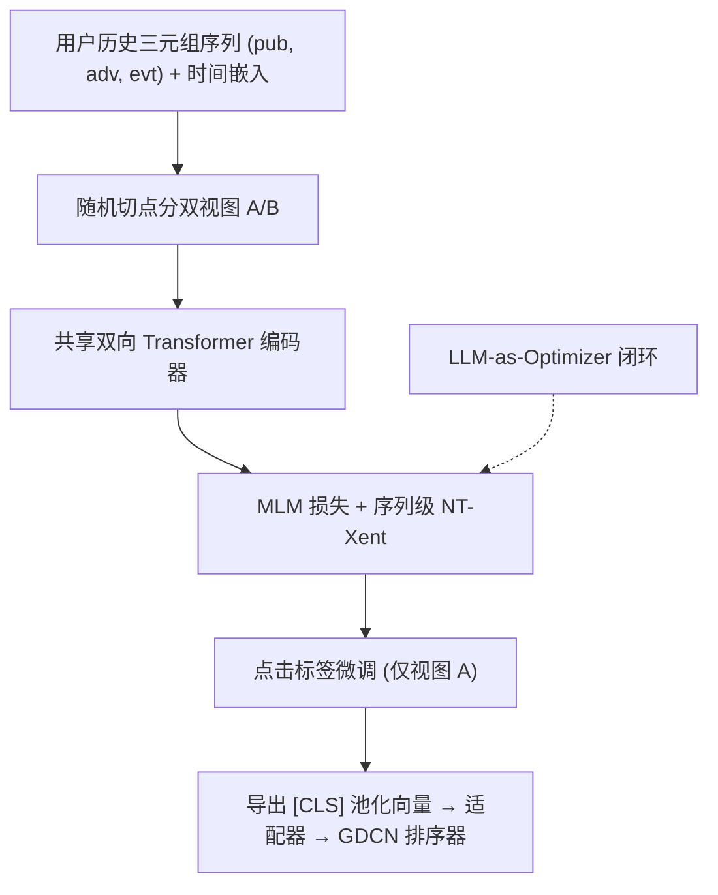
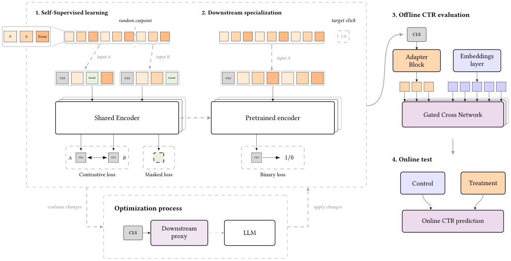

# Building a User Foundation Model for the Open Web (面向开放网络的用户基础模型)

- **会议/期刊**: RecSys 2026 (20th ACM Conference on Recommender Systems)
- **作者与机构**: Solal Vernier, Ivan Can Arisoy, Merwan Barlier, Blaž Škrlj（Teads，法国/斯洛文尼亚）
- **推荐链路定位**: 精排（CTR Ranker 特征增强）+ 出价胜率模型
- **研究方向**: CTR/CVR 预估与特征交叉 / 序列与会话推荐
- **论文原文**: [https://arxiv.org/abs/2607.28019v1](https://arxiv.org/abs/2607.28019v1)
- **开源代码**: 暂未开源

## TL;DR (1分钟核心速览)

开放网络 RTB 中用户身份碎片化、历史稀疏且短，工业模型长期只用聚合计数与近因分桶特征，序列结构完全未被利用。本文提出用户基础模型（UFM）：以 (publisher, advertiser, event) 三元组为 token，用 MLM + 时序不相交切分的 NT-Xent 对比目标预训练双向 Transformer，再在曝光级点击标签上微调，并将 [CLS] 池化向量经适配器注入生产 GDCN 排序器；同时用 LLM-in-the-loop NAS 在约 150 个代码级 lifter 上优化预训练管线。离线 RIG 相对 GDCN 提升 +1.354%，跨架构 DCN2 +0.894%、胜率模型 +1.197%；7 天线上 50/50 A/B 取得 +2.13% CTR、-1.13% eCPC（80% CI 均不含零）。

## Background & Motivation (背景与核心矛盾)

- **主流范式**: 电商/社交场景的用户基础模型（ShopperBERT、PinnerFormer、HLLM、ExFM）均建立在"登录账号 + 连续可恢复长历史"的稳定身份假设上，预训练-微调范式已被反复验证。
- **前人局限**: 开放网络 RTB 的身份是**碎片化且非持久**的——同一人跨设备/浏览器产生互不关联的记录；且历史可用性取决于用户隐私授权，大量流量**完全无历史**，有历史者也只是短而有界的近期会话窗口。因此工业实践退化为手工离散特征（发布商、广告商、设备、上下文、近因/频次分桶），序列的时序共现与行为轨迹在该表征空间内**不可表达**。
- **核心洞察 (Key Insight)**: 两个硬约束界定了问题——C1 亚毫秒级出价路径延迟（与既有排序器共享预算）、C2 稀疏历史（含零历史流量）。作者的关键观察是：若把预训练语料构造为 $N_u \ge 2$即可切分，则$\kappa_u=1$ 恒为合法切点，**自然生成"过去子序列长度为 1"的样本**，使编码器在预训练阶段就见过无历史 regime。
- **本文切入点**: 将序列自监督建模作为与"特征工程 / 排序器架构"**正交的第三条改进轴**，并把编码器部署为独立 DMP 服务以解耦延迟。

## Method (核心方法设计)

### 1. 整体框架 (Overall Architecture)

用户行为序列 $S_u=[e_1,\dots,e_{N_u}]$中每个事件为三元组$(pub_i, adv_i, evt_i)$，展开为$1+3N$个 token（含 [CLS]），截断至$L=49$。预训练阶段在随机切点$\kappa_u$处将序列分为时间不相交的过去视图$A_u$与未来视图$B_u$，共享编码器分别输出池化向量$c_A,c_B$，同时施加 MLM 与序列级 NT-Xent；微调阶段仅用$A_u^{(t)}$（曝光时刻前的全部历史）接 sigmoid 点击头做二分类，推理时丢弃点击头、仅导出$c$ 作为用户序列特征。该特征经两层以上非线性适配器拼接进 GDCN 嵌入层之后，交由未修改的 gated cross network 消费。整个预训练管线由 LLM 在代码级 lifter 目录上闭环搜索。

<figure class="paper-figure" markdown="span">
  <figcaption>图1：端到端流程。(1) 自监督预训练：在输入 token 序列中，每个三元组由 P（发布商特征）、A（广告主特征）和 Event（交互类型）组成。(2) 监督微调：同一编码器在曝光级点击标签上进行微调。虚线环表示 LLM-as-optimizer 搜索。(3) 离线 CTR 评估。(4) 在线测试：在生产环境中进行 50/50 用户级 A/B 测试。</figcaption>
</figure>

### 2. 关键设计拆解 (Key Designs)

1. **时序不相交切分的双视图对比（Temporally-Disjoint Contrastive）**：CL4SRec 用 crop/mask/reorder 增广、DuoRec 用 dropout 构造正例，二者都假设序列足够长且连续；开放网络序列短而断裂，增广会破坏本就稀薄的结构。本文改为在随机切点处做**时间前后切分**，正例即"同一用户的过去 vs. 未来"，负例为 batch 内其他用户的全部 $2(N-1)$ 个嵌入：

$$\ell^{A\to B}_i=-\log\frac{\exp(\mathrm{sim}(c^A_i,c^B_i)/\tau)}{\sum_{j\neq i}\left[\exp(\mathrm{sim}(c^A_i,c^A_j)/\tau)+\exp(\mathrm{sim}(c^A_i,c^B_j)/\tau)\right]}$$

直觉上，这迫使 [CLS] 摘要编码"行为将往何处演化"而非"序列被如何扰动"，与 RTB 中预测下一次曝光的点击目标天然对齐；$\tau=0.04$，batch$N=1024$。

2. **三元组 token 化 + 线性时间嵌入**：以交互三元组而非单物品为编码单元，是工业 CTR 曝光级结构的归纳偏置（同一物品在不同发布商/广告商下的语义不同）。时间侧采用 LinearTimeEmbedding，对延迟做对数缩放后逐维仿射：

$$e^{\text{time}}_{i,d}=\alpha_d\cdot\log(\Delta t_i/60+1)+\beta_d$$

其中 $\Delta t_i$为事件相对该子序列最近事件（$\Delta t=0$）的秒级延迟。对数缩放使近因信号在长尾间隔下不被淹没，逐维可学习$\alpha_d,\beta_d$ 让不同通道自适应不同时间尺度。

3. **训练目标、负采样与推理效率**：总损失为 $\mathcal{L}_{\text{pretrain}}=\mathcal{L}^A_{\text{MLM}}+\mathcal{L}^B_{\text{MLM}}+\mathcal{L}_{\text{NT-Xent}}$，MLM 掩码率$\rho=0.30$（高于 BERT 的 0.15，因词汇表仅含三类 ID、单 token 信息量低）。负采样为 **in-batch 免额外采样**。服务侧编码器独立部署于 DMP：交互近实时流入 KV 库（上限 16 事件、7 天 TTL），每次竞价取最近历史、微批（宽度 8、最大等待 1ms）推理，[CLS] 向量随标准竞价特征下发 DSP，全链路满足亚毫秒预算；opt-out 用户仅以当前竞价三元组构造序列，保证零历史下输出稳定。

## Experimental Setup & Evaluation Protocol (实验设置与评估协议)

- **数据集与预处理**: 论文未披露绝对规模，仅给出语料划分语义——预训练语料为单一无标签用户历史集；微调语料含前向时间切分的 train/validation 两个有标签 split；测试集为第三个前向时间 split，与任何训练窗口不相交。序列上限 16 事件（$L=49$），词汇表为训练语料中出现的发布商/广告商/交互类型 ID 加 [PAD]/[CLS]/[OOV]。

| 数据集 | #Users | #Items | #Interactions | 稀疏度/密度 | 特征/场景说明 |
| :--- | :---: | :---: | :---: | :---: | :--- |
| 预训练语料 | 未披露 | 未披露（pub/adv 词表） | 未披露 | 高稀疏、重尾长度 | 无标签浏览历史，三元组序列 |
| 微调语料 | 未披露 | 未披露 | 未披露 | 曝光级点击标签 | 前向时间切分 train/val |
| 测试集 | 未披露 | 未披露 | 未披露 | 同上 | 独立前向时间 split，与训练窗口不相交 |

- **数据划分与防穿越 (Splitting Strategy)**: **全局时间戳前向切分**（forward-in-time），预训练/微调/测试三段严格不重叠；微调实例的历史快照 $A_u^{(t)}$只含曝光时刻$t$ 之前的事件，杜绝标签穿越。
- **排名评测协议 (Ranking Protocol)**: 非排名式评测，采用**点击概率校准型指标 RIG**（相对信息增益，即相对常数基准预测器的 log-loss 相对下降）与 AUC；RIG 对概率校准敏感，比 AUC 更贴近出价场景。线上为 50/50 用户级 A/B（持久标识按哈希分流，opt-out 流量按竞价请求级随机）。
- **对比基线与超参设置**: 基线为无用户嵌入扩展的生产 GDCN 排序器；跨架构验证用 DCN2；跨任务验证用出价胜率模型。编码器嵌入维度经 NAS 定为 $d=48$（基线 16），8 注意力头，pre-norm，梯度裁剪，batch 1024，6 epoch。显著性以 80% 置信区间是否含零判定（工业内部标准）。

## Key Experimental Results (实验关键数据)

### 1. 主实验对比 (Main Results)

| 下游模型 | 预测任务 | 配置 | RIG 相对 GDCN | 说明 |
| :--- | :--- | :--- | :---: | :--- |
| GDCN | CTR | 无扩展（参照） | — | 生产基线 |
| GDCN | CTR | + UFM-Base | +1.065% | NAS 前编码器 |
| GDCN | CTR | **+ UFM-NAS** | **+1.354%** | 部署配置，最优 |
| DCN2 | CTR | + UFM-NAS | +0.894% | 跨架构迁移 |
| Win-rate model | 出价胜率 | + UFM-NAS | +1.197% | 跨任务迁移（仅点击微调） |

线上 7 天 A/B（相对差异，80% CI）：

| 指标 | Treatment − Control | 80% CI |
| :--- | :---: | :---: |
| CTR | **+2.13%** | [+1.55%, +3.17%] |
| eCPC | **-1.13%** | [-2.07%, -0.64%] |
| Visit rate | +2.37% | [+1.49%, +3.31%] |
| eCPV | -1.47% | [-2.59%, -0.48%] |

### 2. 消融实验 (Ablation Study)

| 配置 | 微调 Val AUC | 测试 AUC | 测试 RIG | Δ RIG |
| :--- | :---: | :---: | :---: | :---: |
| Baseline（NAS 前） | 0.7450 | 0.7160 | 0.0510 | — |
| **NAS-lifted** | **0.7491** | **0.7196** | **0.0547** | **+7.3%** |
| NAS-lifted 但跳过预训练 | 0.7396 | 0.7148 | 0.0467 | -14.6% |

预训练损失对比（独立全量重训）：

| 指标 | Baseline (10ep) | NAS-lifted (6ep) | Δ |
| :--- | :---: | :---: | :---: |
| 总损失 | 2.5566 | **1.9113** | -25.2% |
| MLM 损失（单视图） | 0.1847 | **0.1348** | -27.0% |
| 对比损失 | 2.1872 | **1.6417** | -24.9% |
| 训练时长 | 745.1 min | 764.4 min | +2.6% |

### 3. 关键实验发现 (Key Findings)

1. **预训练目标本身是增益主因，而非架构容量**：同一 NAS-lifted 架构去掉 MLM+NT-Xent 后测试 RIG 跌至 0.0467，不仅比 NAS-lifted 低 14.6%，甚至低于 NAS 前基线 0.0510——说明 +7.3% 的提升可归因于自监督阶段，而非更大的模型或搜索带来的超参红利。
2. **零历史流量同样受益，且增益随序列长度单调放大**：仅含当前事件三元组（长度 1，opt-out 主导）的分桶仍获 +0.99% RIG，长度 ≥2 的分桶达 +1.62%；图 3 显示 UFM-NAS 自 6 事件起显著拉开与 UFM-Base 的差距，验证了 $\kappa_u=1$ 切点设计对稀疏 regime 的有效暴露。
3. **表征跨架构、跨任务可迁移**：同一份仅用点击标签微调的嵌入，在 DCN2 上 +0.894%、在结构完全不同的出价胜率模型上 +1.197%，说明编码器捕获的是叠加于手工离散特征之上的**互补历史信号**，而非对某一排序器的过拟合。

## Highlights & Limitations (亮点、对比与审稿批判)

- **与代表作对比 (vs. Prior Work)**: 与 ShopperBERT/PinnerFormer/ExFM 的本质差异在于**放弃稳定身份假设**，是首个在开放网络分布上验证的用户基础模型；与最接近的 Abacus（展示广告、GRU 骨干、counting-aligned  pretext + Barlow Twins）相比，本文改用 NT-Xent + 时序不相交切分、以三元组为编码单元，并额外引入 LLM-in-the-loop 管线优化；与 CL4SRec/DuoRec 相比，正例构造从"扰动不变性"转为"时间演化可预测性"。
- **可迁移亮点**: (i) 用 $\kappa_u=1$ 强制构造单事件样本，是让序列模型在冷启动/无历史流量上不退化的低成本技巧，可直接移植到任何短会话场景；(ii) 将用户级嵌入解耦为独立 DMP 微批服务、与请求级排序器分离部署，是绕开端到端延迟耦合的通用工程范式。
- **审稿级局限批判**: (i) **搜索过程缺乏对照**——Table 1 度量的是 NAS-lifted vs. baseline，而非 LLM 提议 vs. 同目录下的随机搜索/爬山，作者自认无法排除"精选 lifter 目录本身"才是主要贡献，故仅定位为 existence proof；(ii) **单种子点估计 + winner's curse**——所有离线数字为单次训练，且架构是在 100 个含噪候选中取 argmax，缺少多种子重训来收紧置信区间；此外数据集规模、词表大小、延迟实测分位数均未披露，复现性受限。

## Rating (四维评分)

- **方法创新性 (Novelty)**: ⭐⭐⭐ （时序不相交切分对比与三元组 token 化属稳健的工程化增量，理论新颖度中等，胜在场景适配精准）
- **评估协议与实验扎实度 (Protocol & Experiments)**: ⭐⭐⭐⭐ （离线 RIG/AUC + 跨架构 + 跨任务 + 7 天线上 A/B 四层验证完整，扣分于单种子与缺搜索对照）
- **写作与数学规范度 (Clarity & Rigor)**: ⭐⭐⭐⭐ （RIG 定义、损失与时间嵌入公式交代清晰，局限章节坦诚；数据集统计与延迟实测缺失）
- **工业落地与复现价值 (Industrial & Practical Value)**: ⭐⭐⭐⭐⭐ （真实生产部署 + 亚毫秒约束下的 DMP/DSP 拓扑 + 线上显著增益，工业参考价值极高，可惜未开源）

