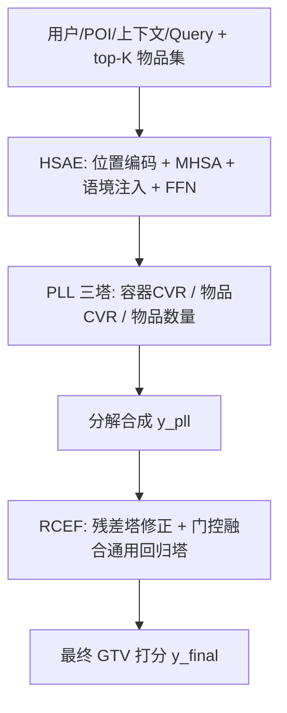
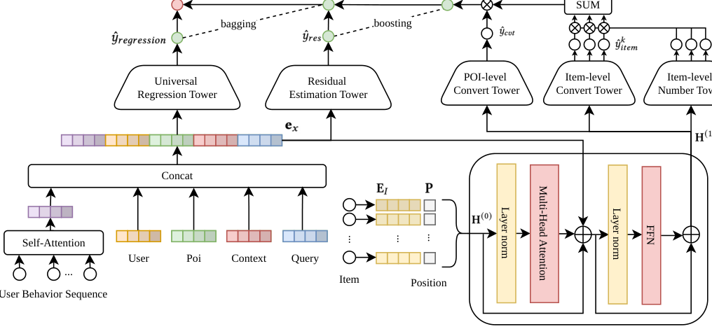

# Hierarchical GTV Estimation: Bridging the Gap between Container-Level Ranking and Item-Level Conversion (层级 GTV 预估：弥合容器级排序与物品级转化之间的鸿沟)

- **会议/期刊**: RecSys 2026 (20th ACM Conference on Recommender Systems)
- **作者与机构**: Zerong Lan, Fan Zhang, Chuang Chen, Tianchun Huang, Teng Zhang, Xingxing Wang — 美团 (Meituan)
- **推荐链路定位**: 精排（广告排序中的价值/成交额预估）
- **研究方向**: CTR/CVR 预估与特征交叉 / 多任务学习与列表级重排
- **论文原文**: [https://arxiv.org/abs/2610.32420v1](https://arxiv.org/abs/2610.32420v1)
- **开源代码**: 暂未开源

## TL;DR (1分钟核心速览)

直播电商与 O2O 平台采用"容器式"展示（直播间/门店卡片），排序发生在容器级、成交却发生在容器内物品级，形成**粒度错配**，直接回归容器 GTV 会遭遇标签高方差、物品级转化极度稀疏、物品集合动态异构三大难题。本文提出 HGE：用集合感知 Transformer 编码器（HSAE）建模动态物品集，用代理标签学习（PLL）把 GTV 分解为"容器转化概率 × Σ(物品购买概率 × 数量 × 单价)"，再用残差修正与集成融合（RCEF）兜住稀疏样本。在美团 712M 条工业日志上以严格 OOT 时间切分评估，XAUC 达 0.8158（+0.63pp），PCOC 0.9858 逼近理想值 1.0，线上 13 天 A/B 测试 RPS +1.42%（95% CI [+0.80%, +2.05%]）。

## Background & Motivation (背景与核心矛盾)

- **主流范式**: 广告价值预估普遍采用 point-wise 的 CTR/CVR 估计器配合确定性定价公式，把"广告价值 = 点击率 × 转化率 × 客单价"直接相乘。
- **前人局限**: ① 把容器当作"超级物品"取平均价或预测最热物品转化率，完全忽略容器内部结构，导致高潜力容器被系统性低估；② 容器级转化信号已远稀疏于点击，物品级转化更稀疏，直接建模物品级 GTV 几乎不可学。
- **核心矛盾**: 观测到的单次 GTV 高度随机——用户可能在高档门店只买了一个低价洗牙套餐而非预期的种植牙，用这种单次曝光 GTV 作 ground truth 会引入极端方差，训练时严重混淆模型。
- **核心洞察 (Key Insight)**: 用户决策本质是两阶段序贯过程（先选容器、再选物品），因此期望 GTV 可严格按全概率公式分解为"容器内发生任一转化的概率"乘以"给定转化下各物品的期望价值之和"，把一个大方差回归拆成多个良态子任务。
- **本文切入点**: 用层级概率分解替代直接回归，用集合感知编码器替代池化，用残差+集成融合兜住稀疏尾部。

## Method (核心方法设计)

### 1. 整体框架 (Overall Architecture)

输入特征 $x$ 包含用户 $x_u$、POI $x_p$、上下文 $x_c$、查询 $x_q$ 以及容器内 top-$K$ 展示物品集 $\mathcal{I}_p$，全部映射为稠密 embedding。物品集 $E_I \in \mathbb{R}^{K \times d_i}$ 加位置编码后送入 HSAE，先经多头自注意力学习物品间竞争关系，再在 MHSA 之后注入用户-POI-上下文拼接向量以调制竞争语境，输出上下文感知的物品表示 $H^{(1)}$。随后 PLL 用三个预测塔分别产出容器级转化概率、物品级购买概率与购买数量，按分解公式合成 $\hat{y}_{pll}$；RCEF 先加残差塔修正 top-$K$ 之外的订单偏差，再与通用回归塔（DIN+DCN）做逐样本门控加权融合，得到最终 $\hat{y}_{final}$。训练采用多任务联合损失，推理时单次前向即可完成打分。

<figure class="paper-figure" markdown="span">
  <figcaption>图2：HGE嵌入矩阵E𝐼∈R𝐾×𝑑的整体模型架构。为使模型能够感知这𝐾个条目的排序顺序和相关性，我们引入位置编码P∈R𝐾×𝑑。HSAE模块的输入表示记为H(0)，通过逐元素相加得到：</figcaption>
</figure>

### 2. 关键设计拆解 (Key Designs)

1. **HSAE 的"注意力后注入"语境策略**：痛点在于容器价值由内部动态异构物品集决定，sum/mean 池化丢失物品间竞争关系；而用户-POI-Query 语境若在 MHSA 之前注入会稀释物品间竞争信号，完全省略又无法刻画不同三元组下的竞争差异。本文的算子是先做自注意力、再拼接语境：

$$H' = \mathrm{LN}\big(\mathrm{concat}(H^{(0)} + \mathrm{MHSA}(H^{(0)}),\ e_x)\big),\quad H^{(1)} = \mathrm{LN}(H' + \mathrm{FFN}(H'))$$

直觉是先学稳健的基础物品表示，再用竞争语境做定向调制，两个目标兼得。

2. **PLL 的方差缩减分解**：直接回归零膨胀的 GTV 标签方差极大。本文按全概率公式分解：

$$\hat{y}_{pll} = \hat{y}_{cvt} \times \sum_{k=1}^{K}\big(\hat{y}^k_{item} \times \hat{y}^k_{qty} \times \mathrm{Price}_k\big)$$

其中 $\hat{y}_{cvt}=\sigma(\mathrm{MLP}_{global}([z_{poi}, e_x]))$，$z_{poi}=\mathrm{mean}(H^{(1)})$；物品级两塔共享 MLP 以保证参数效率，数量塔用 Softplus 强制为正。作者用全方差定律给出理论支撑：$\mathrm{Var}(N)=\mathbb{E}[\mathrm{Var}(N|cvt)]+\mathrm{Var}(\mathbb{E}[N|cvt])$，由于 $cvt$ 是伯努利变量且 90% 以上转化的购买数量集中在 ≤2，两项均远小于直接回归零膨胀计数目标。分解还让模型能区分"高价低概率"与"低价高概率"物品，避免单点回归的均值塌缩。

3. **RCEF 与训练目标**：物品级转化极稀疏，且并非所有店内订单都来自 top-$K$ 物品。RCEF 先用轻量残差塔 $\hat{y}_{res}=T_{res}(e_x)$ 修正局部偏差得 $\hat{y}_{deal}=\hat{y}_{pll}+\hat{y}_{res}$，再与通用回归塔输出加权融合 $\hat{y}_{final}=\alpha\hat{y}_{deal}+(1-\alpha)\hat{y}_{regression}$；关键工程细节是 $\alpha$ 并非固定标量，而是由以用户-POI-上下文为条件的轻量门控网络逐样本生成。总损失为 $\mathcal{L}_{total}=\mathcal{L}_{reg}+\lambda_1\mathcal{L}_{cvt}+\lambda_2\mathcal{L}_{item}+\lambda_3\mathcal{L}_{qty}$，回归项用 Huber（$\delta=1.0$），两个二分类项用 BCE，权重 $\lambda_1=0.3,\lambda_2=\lambda_3=0.03$。训练采用 0.3 比例的负采样平衡正负比，无需复杂难负样本挖掘。

## Experimental Setup & Evaluation Protocol (实验设置与评估协议)

- **数据集与预处理**: 美团广告系统日志，全量 712M 条记录，含 121M 用户、949K POI；测试集为按时间切分的最后 5%（29M 条、13M 用户、408K POI）。

| 数据集 | #Users | #Items (POI) | #Interactions | 稀疏度/密度 | 特征/场景说明 |
| :--- | :---: | :---: | :---: | :---: | :--- |
| Meituan 全量 | 121M | 949K | 712M | 极稀疏（容器-物品双层稀疏） | 用户/POI/上下文/Query + top-10 物品集 |
| Meituan 测试集 | 13M | 408K | 29M | 同上 | 按时间最后 5% 记录 |

- **数据划分与防穿越 (Splitting Strategy)**: 严格 **Out-of-Time (OOT) 全局时间戳切分**，最后 5% 按时间留作测试，其余 95%（683M 条）训练，杜绝 look-ahead bias。
- **排名评测协议 (Ranking Protocol)**: 主指标 **XAUC**（衡量预测 GTV 诱导排序与理想排序的一致率，即样本对级 sign 一致比例），辅以 **PCOC**（预测点击成交额与实际点击成交额的校准比，理想值 1.0）与 **MAE**（商家级连续值回归精度）。未采用采样排序，属全量样本对评估。
- **对比基线与超参设置**: 基线含 WLR（加权逻辑回归转回归）、DLRM（DIN+DCN 标准深度回归）、RankMixer（token-mixing 替代自注意力）、CREAD（连续值转多分类的校准框架）。Embedding 维度 8，HSAE 单层 Transformer、隐维 $d=256$，MLP 塔隐层 [1024, 512, 256] 配 Dice 激活，通用回归塔隐层 [128, 32]，Adam 学习率 $9\times10^{-4}$、batch 6000、训练 1 epoch，top-$K=10$。

## Key Experimental Results (实验关键数据)

### 1. 主实验对比 (Main Results)

| Method | XAUC↑ | PCOC | MAE↓ |
| :--- | :---: | :---: | :---: |
| WLR | 0.8043 | 0.7663 | 5.1453 |
| DLRM | 0.8051 | 0.7787 | 5.0453 |
| RankMixer | 0.8105 | 0.7528 | 5.1735 |
| CREAD | 0.8095 | 0.7921 | 5.0818 |
| **HGE (Ours)** | **0.8158** | **0.9858** | **4.9915** |
| Improv. (vs. best baseline) | +0.53pp (vs. RankMixer) / +0.63pp (vs. CREAD) | +19.37pp (vs. CREAD) | −1.07% (vs. DLRM) |

### 2. 消融实验 (Ablation Study)

| Variant | XAUC↑ | PCOC | MAE↓ |
| :--- | :---: | :---: | :---: |
| Full Model | **0.8158** | **0.9858** | **4.9915** |
| w/o HSAE | 0.8031 | 1.1012 | 5.2586 |
| w/o PLL | 0.7873 | 0.4180 | 6.9875 |
| w/o RCEF | 0.8146 | 0.9960 | 5.0130 |

### 3. 关键实验发现 (Key Findings)

1. **PLL 是绝对主力，贡献了绝大部分收益**：移除 PLL 后 XAUC 从 0.8158 暴跌至 0.7873（−2.85pp），MAE 从 4.99 恶化到 6.99（+40%），PCOC 从 0.9858 崩到 0.4180——说明直接回归高方差零膨胀 GTV 会让模型严重低估成交额，方差分解是校准能力的根本来源，而非锦上添花。
2. **HSAE 的价值主要体现在校准而非排序**：移除 HSAE 后 XAUC 仅降 1.27pp，但 PCOC 从 0.9858 恶化到 1.1012（偏离理想值 1.0 达 10%），MAE 上升 5.3%，证明集合感知建模对"估准绝对值"（商家 ROI 决策依赖的量）比"排对相对序"更关键，简单池化会系统性高估容器价值。
3. **RCEF 是低风险高确定性的收尾增益**：单独移除仅使 XAUC 降 0.12pp、MAE 升 0.4%，但结合其逐样本门控 $\alpha$ 的设计，说明在 PLL 已解决主矛盾后，残差塔主要承担 top-$K$ 之外长尾订单的偏差修正，属于"边际但稳定"的工程补丁；线上 +1.42% RPS（CI 不含零）则验证了离线 XAUC 与 PCOC 双指标提升能真实转化为收入。

## Highlights, Limitations & Rating (亮点、对比与审稿评价)

- **与代表作对比 (vs. Prior Work)**: 与 DLRM/DIN+DCN 这类把 GTV 当单一标量回归的范式相比，HGE 的本质区别是把"容器-物品"层级结构显式写进概率分解，而非让网络隐式学习；与 CREAD 这类把连续值转多分类以改善校准的做法相比，HGE 保留了回归的连续性且通过子任务约束输出域（概率 ∈[0,1]、数量 ∈ℝ⁺），PCOC 从 0.79 跃至 0.99 是量级差异；与 RankMixer 的 token-mixing 效率路线相比，HGE 证明在价值预估场景下"结构先验"比"架构效率"更值钱。
- **可迁移亮点**: ① "注意力后注入语境"的时序安排可直接迁移到任何"集合内竞争 + 全局语境调制"的场景（如购物车价值预估、套餐推荐）；② 用全方差定律论证分解合理性、并用逐样本门控替代固定融合权重，是稀疏多任务融合的通用工程范式。
- **审稿级局限批判**: ① 仅 5 页短文，实验只在美团单一工业数据集上完成，缺少公开数据集（如 RetailRocket、淘宝直播数据）复现，泛化性存疑；② PLL 依赖"top-$K$ 物品覆盖大部分订单"的假设，$K=10$ 与 0.3 负采样率、三个 $\lambda$ 权重均未做敏感性分析，且 RCEF 的残差塔与门控网络带来额外在线推理开销，论文未报告延迟数据。
- **四维评分**: 创新性 ⭐⭐⭐⭐ | 实验扎实度 ⭐⭐⭐⭐ | 方法清晰度 ⭐⭐⭐⭐⭐ | 落地价值 ⭐⭐⭐⭐⭐

