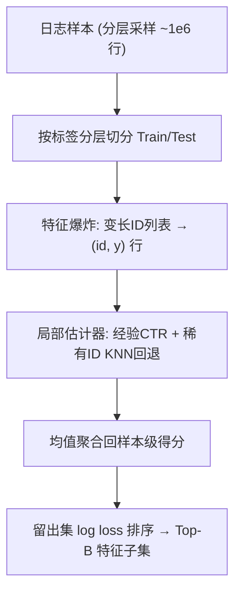
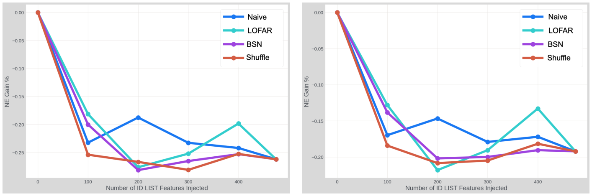

# LO-FAR: A Cost-Aware Local Filter for Sparse Feature Ranking in Industrial Ad Recommendation (面向工业广告推荐稀疏特征排序的成本感知局部过滤器)

- **会议/期刊**: RecSys 2026 (20th ACM Conference on Recommender Systems)
- **作者与机构**: Egemen Erbayat, Luis Duque, Sohini Roychowdhury, Mohammad Amin, Srihari Reddy (Meta Platforms, Inc.)
- **推荐链路定位**: 精排（特征工程/特征池治理阶段，非打分模型本身）
- **研究方向**: CTR/CVR 预估与特征交叉 / 工业架构与可信系统
- **论文原文**: [https://arxiv.org/abs/2607.20873v1](https://arxiv.org/abs/2607.20873v1)
- **开源代码**: 暂未开源

## TL;DR (1分钟核心速览)

工业广告精排中稀疏 ID-list 特征（每特征一张 embedding 表）占可训练参数 97% 以上，而特征池需随流量漂移与模型迭代**反复重排**。现有置换重要性（Shuffle）与 BSN 门控均需 GPU 反复全模型重训，单轮排序耗时数 GPU-天。本文提出 LO-FAR：将每个特征"爆炸"为 ID-标签对，用经验点击率 + 稀有 ID 的 KNN 回退拟合**逐特征独立**的轻量局部估计器，以留出集 log loss 排序。在 100 万+ 真实交互、475 个短 ID-list 特征上，约 2 CPU 小时完成排序，在 B=100–400 预算下 CTR/CVR 的 ΔNE 与 Shuffle/BSN 相当，同时确定性削减 40–75% 稀疏存储。

## Background & Motivation (背景与核心矛盾)

- **主流范式**: 工业精排（DLRM 家族）以稠密/二值/稀疏 ID-list 三路输入经 MLP 与 pairwise 点积融合；稀疏特征承载个性化信号主体，但每增一特征即新增词表管理、lookup 路径、监控契约与重训成本。
- **前人局限一（成本耦合）**: 置换重要性需逐特征/逐组重训全模型；BSN、OptEmbed、OptFS、AutoField 将选择嵌入端到端训练，排序成本与下游架构、超参、加速器可用性强耦合，特征池或模型一变即须重跑。
- **前人局限二（规模失配）**: 互信息等统计滤波面向低基数/中等稀疏场景；Wrapper 与元启发式仅在小特征池可保证精度，无法扩展到数百至数千个高基数 ID-list 特征。
- **核心洞察 (Key Insight)**: 工业场景下特征排序不是一次性离线研究，而是受算力预算与迭代节奏约束的**周期性系统决策**。作者给出递推成本分解 $C(m,B,R)=C_{\text{rank}}(m,R)+R\cdot[C_{\text{train}}(B)+C_{\text{store}}(B)+C_{\text{serve}}(B)]$，指出训练耦合方法虽降低后三项，却抬高$C_{\text{rank}}$；当刷新频率$R$大时，$C_{\text{rank}}$ 的节省会复利放大。
- **本文切入点**: 把"特征重要性估计"降维为"逐特征留出预测问题"，用 CPU 可并行的局部估计器做**一阶段粗筛**，把昂贵的交互感知方法留给边界样本。

## Method (核心方法设计)

### 1. 整体框架 (Overall Architecture)

LO-FAR 对候选池 $\mathcal{F}=\{f_1,\dots,f_p\}$中每个特征独立执行六阶段流水线：分层采样约$10^6$行 → 按标签分层切分训练/留出集 → **特征爆炸**（变长 ID 列表展开为"单 ID-标签"行，空列表填占位符$-1$）→ 拟合 ID 级局部估计器$s_j:\text{Vocab}(f_j)\to[0,1]$→ 将 ID 级分数均值聚合回样本级$\hat{y}_i^{(j)}$ → 在留出爆炸集上以 log loss 为主准则（AP/AUC 为辅助诊断）降序排名。全流程不调用下游 ranker，特征间天然可并行，输出排序列表直接供训练管线消费。

<figure class="paper-figure" markdown="span">
  <figcaption>图1：相对于未使用稀疏特征训练的纯稠密参考模型的下游NE增益（ΔNE）。每条曲线对应一种排序方法，横轴遍历保留特征预算𝐵。在实际特征预算下，LO-FAR与基于打乱的重要性方法及BSN相比仍具竞争力，同时所需排序计算量显著更少。</figcaption>
</figure>

### 2. 关键设计拆解 (Key Designs)

1. **逐特征独立局部估计器（打破重训耦合）**：痛点在于置换/门控方法必须在下游模型上下文中评估重要性。LO-FAR 仅用 $f_j$自身取值与标签$y$拟合 ID 级预测器：出现次数$\ge K$的 ID 直接取经验正率，稀有/未见 ID 回退到该特征词表内按频率加权 token 距离诱导的$K$近邻估计。直觉是：生产日志中高频 ID 主导经验信号，回退规则只影响长尾，故$K$ 在合理区间内对排序几乎不敏感。
2. **爆炸-聚合算子（把变长列表转为可统计对象）**：变长列表无法直接做 ID 级统计，故展开为 $\mathcal{D}^{(j)}_{\text{train,exp}}=\{(id^{(j)}_{i,t},y_i): t=1,\dots,k_i,\ i\in I_{\text{train}}\}$，再以均值聚合$\hat{y}_i^{(j)}=\frac{1}{k_i}\sum_{t=1}^{k_i}s_j(id^{(j)}_{i,t})$。均值/中位数/最大值在预实验中下游 NE 统计不可区分，选均值求稳定。
3. **复杂度与训练目标**：排序准则即留出集 log loss（等价于对 $s_j$的交叉熵最小化），无负采样、无梯度训练。总复杂度$\mathcal{O}(p\cdot n\cdot\ell\cdot\log(n\ell))$，对特征数$p$**线性**（对比交互感知方法的超线性），$w$个 CPU worker 下墙钟时间近似除以$w$，具备 embarrassingly parallel 结构。

## Experimental Setup & Evaluation Protocol (实验设置与评估协议)

- **数据集与预处理**: 单一生产级数据集，来自大型工业广告系统的扩展观测窗口日志，经标准生产质量与特征资格过滤后保留 **475 个短 ID-list 特征**（99 分位列表长度 < 5）。

| 数据集 | #Users | #Items | #Interactions | 稀疏度/密度 | 特征/场景说明 |
| :--- | :---: | :---: | :---: | :---: | :--- |
| Production Ad Logs | 未披露 | 未披露 | > 1,000,000 | 未披露 | 475 个短稀疏 ID-list 特征；CTR 与 CVR 双任务；稀疏表占参数 >97% |

- **数据划分与防穿越 (Splitting Strategy)**: 数据集切为训练子集与留出评估子集；训练子集用于拟合 LO-FAR 局部估计器并为每个方法/每个预算**从头重训**下游 ranker，留出子集仅用于端到端 NE 评估。LO-FAR 内部另做按标签分层的 train/test 切分以产生留出预测信号。
- **排名评测协议 (Ranking Protocol)**: 非传统 Top-N 排序评测，而是**预算约束下的端到端重训评测**——对每个方法 $m$与预算$B\in\{100,200,300,400\}$取 Top-$B$子集重训 ranker，报告相对纯稠密参考模型的$\Delta\text{NE}=(\text{NE}_{\text{method}}-\text{NE}_{\text{baseline}})/\text{NE}_{\text{baseline}}$，其中$\text{NE}=\frac{1}{N}\sum_i[y_i\log p_i+(1-y_i)\log(1-p_i)]/[\hat{p}\log\hat{p}+(1-\hat{p})\log(1-\hat{p})]$。Jaccard 相似度仅作诊断，**不作为成功准则**。
- **对比基线与超参设置**: 三类基线覆盖运营光谱——Naive（覆盖率启发式，$\mathcal{O}(p)$）、Shuffle-based permutation importance（需重复全模型评估/重校准）、BSN（$L_0$随机门控，交互感知上界）。采样规模$n\approx10^6$，$K$ 与聚合函数做敏感性分析；未报告显著性检验。

## Key Experimental Results (实验关键数据)

### 1. 主实验对比 (Main Results)

原文主结果为图 1 曲线（CTR/CVR 双任务 × 四档预算），未给逐点数值表。下表按原文文字结论整理定性对比，并补充表 2 的运营指标（原文明确数值）：

| 方法 | 交互感知 | 排序期需重训 | 硬件 | 排序周转 | 计算花费 | ΔNE 表现 (B=100–400) |
| :--- | :---: | :---: | :---: | :---: | :---: | :--- |
| Naive (Coverage) | 否 | 否 | CPU | 分钟级 | 极低 | 预算宽松时贴近 LO-FAR，**预算收紧时明显退化** |
| Shuffle Importance | 间接 | 是 | GPU | 数 GPU-天 | ≈ $4,000+ | 与 LO-FAR 相当 |
| BSN ($L_0$门控) | 是 | 是 | GPU | 数 GPU-天 | ≈$4,000+ | 与 LO-FAR 相当（交互感知上界） |
| **LO-FAR (本文)** | 否 | 否 | **CPU** | **~2 CPU-h** | **< $100** | **全预算区间具竞争力** |

存储侧为确定性收益：保留 $B\in\{100,200,300,400\}$ 分别对应移除约 79%/58%/37%/16% 稀疏表，实践有效区间为 **40–75% 稀疏存储削减**。

### 2. 消融实验 (Ablation Study)

原文未设标准消融表，但给出组件级敏感性结论，整理如下：

| 变更项 | 设置 | 对下游 NE 的影响 |
| :--- | :--- | :--- |
| 聚合函数 | Mean / Median / Max | 统计不可区分，选 Mean 求稳定 |
| 稀有 ID 回退邻居数 $K$| 合理区间内变动 | 边际影响；高频 ID 直接经验估计，$K$ 仅作用于长尾 |
| 采样规模 $n$|$\approx 10^6$ | 精度-周转折中点，非权宜之计 |
| 排序重叠（诊断） | LO-FAR vs BSN @ $N=300$ | Jaccard ≈ 60%，但下游 NE 仍相当 |

### 3. 关键实验发现 (Key Findings)

1. **排序分歧 ≠ 质量下降**：LO-FAR 与 BSN 在 $N=300$ 时 Jaccard 仅约 60%，但两者重训后 ΔNE 相当。说明在高维稀疏空间中存在多个规模相近、信号重叠的等价特征子集，**排序一致性不能作为端到端性能的代理指标**。
2. **最优性价比点在 $B=200$**：该预算下重训 ranker 保留全稀疏池 NE 增益的较大份额，同时移除超过一半稀疏 embedding 表；$B=100$适合服务内存/训练内存为硬约束，$B=300/400$ 适合存储非主导约束、追求最小扰动的场景。
3. **成本量级差是核心卖点**：LO-FAR 约 2 CPU 小时、花费 < $100，而 Shuffle 与 BSN 各需数 GPU-天、>$4,000；在刷新频率$R$高的工业节奏下，$C_{\text{rank}}$的差距会随$R$ 线性复利放大，且 CPU 任务可绕开加速器队列争用。

## Highlights & Limitations (亮点、对比与审稿批判)

- **与代表作对比 (vs. Prior Work)**: 与 Shuffle 置换重要性相比，LO-FAR 彻底移除排序期的下游模型调用与重校准；与 BSN/OptEmbed/OptFS 等训练耦合门控相比，LO-FAR 放弃交互感知能力换取线性复杂度与 CPU 可运维性；与互信息等经典滤波相比，LO-FAR 专门处理高基数变长 ID-list 的爆炸-聚合结构，而非低基数标量特征。
- **可迁移亮点**: (1) "爆炸-聚合 + 稀有键 KNN 回退"可直接迁移到任何变长 ID 序列特征（如行为序列、多值标签）的快速价值评估；(2) 把特征治理建模为含刷新频率 $R$ 的递推成本函数，这一评估视角可复用到 embedding 压缩、模型裁剪等周期性系统决策。
- **审稿级局限批判**: (1) **交互专属特征会被误杀**——仅通过与其他特征交叉才生效的特征在独立评分下得分偏低，作者明确承认需靠后续交互感知方法补救，但未量化该漏检率；(2) **实验证据偏弱**——单数据集、单系统、无显著性检验、主结果仅以曲线呈现而无逐点数值表，且长列表特征（99 分位 ≥ 5）与更长用户历史的适用性仅有"投稿后初步实验"的定性提及，泛化性存疑。

## Rating (四维评分)

- **方法创新性 (Novelty)**: ⭐⭐⭐ （核心是经典独立筛选思想在稀疏 ID-list 场景的工程化适配，算法新颖度有限，但"递推成本视角"的问题重构有洞察）
- **评估协议与实验扎实度 (Protocol & Experiments)**: ⭐⭐⭐ （端到端重训 + ΔNE 的评测协议贴合工业真实目标，但仅单数据集、无显著性检验、主结果缺数值表）
- **写作与数学规范度 (Clarity & Rigor)**: ⭐⭐⭐⭐ （成本分解、复杂度与适用范围边界表述清晰坦诚，公式简洁无冗余，但理论保证仅停留在复杂度层面）
- **工业落地与复现价值 (Industrial & Practical Value)**: ⭐⭐⭐⭐⭐ （CPU-only、逐特征并行、易缓存重试监控，2 CPU 小时 vs 数 GPU-天，落地价值极高；扣分项为未开源）
