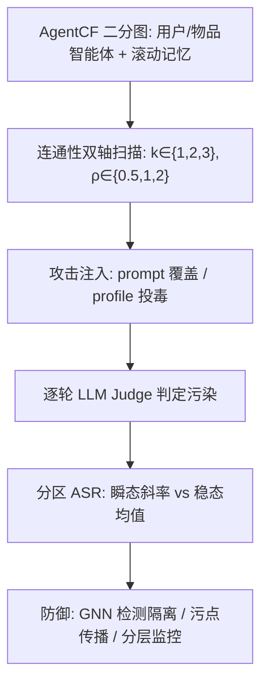
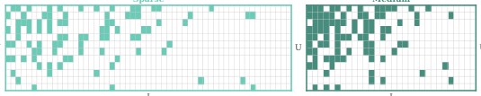

# Attacking and Defending Multi-Agent Collaborative Filtering Systems Through Connectivity (通过连通性攻击与防御多智能体协同过滤系统)

- **会议/期刊**: RecSys 2026
- **作者与机构**: Anjun Hu (University of Oxford)；Hanting Xie, Saranya Govindan, Jas Kandola, Kurt Cutajar (Amazon)
- **推荐链路定位**: 端到端生成式（LLM 智能体驱动的推荐仿真与安全评测）
- **研究方向**: 去偏公平、可信隐私与工业架构 / 对话推荐与智能体仿真
- **论文原文**: [https://arxiv.org/abs/2608.03272v1](https://arxiv.org/abs/2608.03272v1)
- **开源代码**: [https://github.com/anjunhu/ConnACF](https://github.com/anjunhu/ConnACF)

## TL;DR (1分钟核心速览)

多智能体协同过滤（如 AgentCF）让 LLM 驱动的用户/物品智能体通过自然语言交互演化偏好，但现有红队工作只在**固定系统配置**下测攻击，未回答"连通性如何调节脆弱性"。本文把 MAS 领域的 6 类攻击（CORBA/NetSafe/MAMA/MASLeak/TOMA/MASTER）与 4 类防御（G-Safeguard/BlindGuard/T-Guard/M-Guard）迁移到 AgentCF，沿**候选数 $k\in\{1,2,3\}$** 与**目录集中度$\rho\in\{0.5,1,2\}$** 两轴系统扫描。核心发现：两轴对用户/物品分区呈**非对称**调控，且瞬态斜率与稳态平台**解耦**（如 MAMA 在$k=2,3$稳态几乎相同，但$k=3$ 早期泄露更快）；G-Safeguard 可将用户侧 ASR 从 31.6% 压到 3.3%，而物品侧几乎无收益（56.6%→59.9%）。

## Background & Motivation (背景与核心矛盾)

- **主流范式**: LLM 智能体推荐已从单智能体接口走向多智能体架构（中心化 hub、mesh 点对点、混合式），AgentCF 是典型 bipartite mesh：用户与物品智能体直接互写记忆，每轮由 orchestrator 调度 $(u, i^+, i^-)$ 三元组。
- **前人局限**: (1) 现有 agentic RecSys 红队（CheatAgent、DrunkAgent、RecTextAttack）均在**单一固定拓扑**下验证，无法回答"扩大 $k$ 或提高目录重叠后攻击是否更致命"；(2) 通用 MAS 的拓扑-安全结论（如 NetSafe 的"低连通更安全"）来自角色同质、任务驱动的网络，与 CF 的**二分非对称结构**差异巨大，可迁移性未经验证。
- **核心洞察 (Key Insight)**: CF 的连通性有**双源**——推理期系统设计（每轮候选数 $k$，即用户决策带宽）与历史交互数据（目录集中度$\rho=n_U/n_I$，即用户间物品重叠度）。二者不是同一变量，且用户侧与物品侧的接触度分布天然不同（用户固定$k$ 度，物品度高度可变）。
- **本文切入点**: 构建统一评测 harness，把 $k$与$\rho$ 作为**独立实验变量**扫描，逐轮追踪用户/物品分区的 ASR，分离瞬态斜率与稳态均值。

## Method (核心方法设计)

### 1. 整体框架 (Overall Architecture)

在 AgentCF 之上搭建统一攻击/防御/度量面：每个智能体维护滚动 episodic memory（每轮 LLM 追加语义摘要），攻击者通过 system-prompt 覆盖或 profile/description 投毒注入 canary 概念或 PII；每轮由 LLM Judge（Claude Sonnet 4.5）比对非攻击者智能体当前记忆与原始状态，输出二值污染标签，按用户/物品分区分别统计 ASR。$k$通过改写任务形式实现（$k=1$二分类 like/dislike、$k=2$原版二选一、$k=3$三物品排序），$\rho$ 通过重采样 MovieLens-100K 的物品目录规模实现。

<figure class="paper-figure" markdown="span">
  <figcaption>图 2：（上）候选数量变体：图边颜色与指标图中使用的 𝑘=1/2/3 线颜色一致。（下）目录集中度变体：𝜌=0.5/1/2 分别对应用户间低/中/高重叠。</figcaption>
</figure>

### 2. 关键设计拆解 (Key Designs)

1. **双源连通性变量化（$k$与$\rho$解耦）**：痛点在于以往"拓扑"是单一图结构量，无法区分"系统让用户每轮看几个物品"与"历史数据让多少用户共享同一物品"。本文定义$k$为推理期配置（与数据无关），$\rho\equiv n_U/n_I$由重采样决定（固定$n_U=100$，$n_I\in\{200,100,50\}$）。物理直觉：$k$放大**单轮扇出**，$\rho$ 放大**单物品影响力**，二者作用于不同传播通道，故效应不可互换。

2. **瞬态/稳态双制度度量（F3 的量化基础）**：以往只报最终 ASR 一个标量，掩盖了"早期快 ≠ 最终高"。本文对每条曲线同时拟合初始瞬态斜率 $(U_{tr}, I_{tr})$与稳态均值$(U_{ss}, I_{ss})$。典型证据：MASLeak 的 IP 提取率满足$U^{tr}_{k=1}<U^{tr}_{k=2}<U^{tr}_{k=3}$，但稳态$k=2$反超$k=1$与$k=3$——因为一旦蠕虫触达足够多智能体，额外连通性的边际收益趋零，而$k=3$ 引入的噪声反而降低精度。

3. **恢复感知一阶连通性预测器（免仿真的风险排序）**：全量仿真昂贵，作者借用二分网络 SIS 流行病模型做两群体平均场近似，感染项为连通性驱动的暴露、恢复项为 LLM 对齐驱动的自纠正（接触介导、无免疫）：

$$\frac{d\rho_U}{dt}\approx\beta_U(1-\rho_U)\left[1-(1-\rho_I)^k\right]-\rho_U\left[(1-\rho_I)\cdot k\cdot\gamma+r\right]$$

冻结 $\rho_I$为种子攻击者比例$\alpha_I$ 得一阶稳态污染优势比：

$$R_U=\frac{1-(1-\alpha_I)^k}{(1-\alpha_I)\cdot k\cdot\gamma+r},\quad R_I=\frac{1-(1-\alpha_U)^{\rho k}}{(1-\alpha_U)\cdot\rho\cdot k\cdot\gamma+r}$$

其中物品每轮接触数为 $\rho k$而用户为$k$，这正是二分非对称的数学体现。$(\gamma,r)$ 按攻击与分区经验拟合以最大化 Spearman 相关；作者坦承跨目标/角色/制度的相关性不均，说明一阶近似过度简化。

4. **训练目标、负采样与推理效率**：本文无监督训练目标（非学习型推荐模型），核心开销在 LLM 推理：默认智能体 LLM 为 Qwen3-235B-A22B、Judge 为 Claude Sonnet 4.5，经 Amazon Bedrock 调用，硬件为单台 AWS g6.12xlarge（4×NVIDIA L4）。攻击者比例主实验固定 $(\alpha_U,\alpha_I)=(0.25,0.25)$，消融覆盖$\{0.10,0.25,0.50,0.75\}^2$。

## Experimental Setup & Evaluation Protocol (实验设置与评估协议)

- **数据集与预处理**: 仅 MovieLens-100K（AgentCF 原版基准，刻意保持单数据集以隔离连通性效应而非混淆域迁移）：

| 数据集 | #Users | #Items | #Interactions | 稀疏度/密度 | 特征/场景说明 |
| :--- | :---: | :---: | :---: | :---: | :--- |
| ML-100K ($\rho$=0.5) | 100 | 200 | 子采样 | 稀疏 | 低用户间物品重叠 |
| ML-100K ($\rho$=1) | 100 | 100 | 子采样 | 中 | AgentCF 规范设置 |
| ML-100K ($\rho$=2) | 100 | 50 | 子采样 | 密 | 高重叠，单物品影响力最大 |

- **数据划分与防穿越 (Splitting Strategy)**: 顺序交互仿真（sequential rating prediction），每轮用户对 $k$ 个物品执行 rate/choose/rank 并更新记忆；无传统 train/test 切分，评测由独立 evaluation query 触发。
- **排名评测协议 (Ranking Protocol)**: 非传统 Top-N 排序评测，而是**逐轮全量分区审计**——LLM Judge 对每个非攻击者智能体输出污染/清洁二值标签，ASR = 污染数 / 非攻击者总数，用户与物品分区**分开报告**，攻击者本身不计入分母。canary 与 PII 类攻击另用精确/嵌入匹配做确定性抽查校验 Judge。
- **对比基线与超参设置**: 攻击侧 6 个（CORBA、NetSafe、MAMA、MASLeak、TOMA、MASTER）+ 3 个 RecSys 原生攻击（CheatAgent、DrunkAgent、RecTextAttack）；防御侧 4 个（G-Safeguard、BlindGuard、T-Guard、M-Guard）。MACF 星型拓扑因引入结构性混淆且不支持提取类攻击，仅入代码库不入主图。跨 LLM 一致性在 Claude Haiku 4.5 / Sonnet 4.5 / Mixtral 8×7B / Llama 4 Maverick 17B 上复现。

## Key Experimental Results (实验关键数据)

### 1. 主实验对比 (Main Results)

原文以"连通性方向性"表格（Table 1）而非传统 SOTA 对比呈现，下表摘取代表性攻击/防御在 $k$与$\rho$ 增大时的效应方向（↗ 更高连通更有效、— 无显著差异、↕ 无一致序）：

| 方法 | 类别 | ↑$k$:$U_{tr}$| ↑$k$:$I_{tr}$| ↑$k$:$U_{ss}$| ↑$k$:$I_{ss}$| ↑$\rho$:$U_{ss}$| ↑$\rho$:$I_{ss}$ |
| :--- | :--- | :---: | :---: | :---: | :---: | :---: | :---: |
| CORBA | 传播 | ↗ | ↗ | ↗ | ↗ | ↕ | ↕ |
| NetSafe | 传播 | ↕ | ↕ | ↕ | ↗ | ↕ | ↗ |
| TOMA | 传播 | ↗ | ↗ | ↗ | ↗ | — | ↗ |
| MASTER | 传播 | ↗ | ↗ | ↕ | ↕ | ↕ | ↕ |
| MAMA | 提取 | ↗ | — | — | — | — | — |
| MASLeak | 提取 | ↗ | — | ↕ | — | — | — |
| G-Safeguard | 防御 | ↕ | ↕ | ↕ | ↗ | ↕ | ↗ |
| T-Guard | 防御 | ↗ | ↗ | ↗ | ↗ | ↕ | ↕ |

代表性绝对数值（G-Safeguard vs NetSafe，$k=2,\rho=1$）：用户侧 ASR **31.6% → 3.3%**（安全增益 28.3pp），物品侧 **56.6% → 59.9%**（负增益）；$k=3$时用户侧 30.3% → 5.3%、物品侧 75.0% → 50.0%。T-Guard vs TOMA 在$k=3$ 时用户侧 68.4% → 32.9%、物品侧 81.6% → 50.0%。

### 2. 消融实验 (Ablation Study)

| 消融维度 | 设置 | 关键观察 |
| :--- | :--- | :--- |
| 攻击者比例 $\alpha$| 10%/25%/50%/75% |$\alpha\uparrow$缩短瞬态期、抬高斜率并提前平台；用户侧对$\alpha$ 更敏感，物品侧变化平缓 |
| 攻击风格 | NetSafe / CheatAgent / DrunkAgent / RecTextAttack | 语义攻击（DrunkAgent）显著强于词法攻击（RecTextAttack），因记忆摘要步骤会"洗掉"词法扰动而保留语义注入 |
| 角色入口 | 用户侧入口 vs 物品侧入口 | 物品侧入口（DrunkAgent）可直接污染用户并回流物品；用户侧入口（CheatAgent）经物品两跳传播时在用户间扩散乏力 |
| LLM 骨干 | Haiku 4.5 / Sonnet 4.5 / Mixtral 8×7B / Llama 4 Maverick | 更新模型更难攻，归因于更强对齐与世界知识带来的反思式自纠正 |

### 3. 关键实验发现 (Key Findings)

1. **角色非对称是 CF 独有的一等公民**：G-Safeguard 在用户侧普遍有效（31.6%→3.3%），但在最稀疏配置（$\rho=0.5$或$k=1$）物品侧几乎零收益（56.6%→59.9%），根因是物品智能体接触度高度可变而用户度固定为$k$，GNN 检测器在度分布偏斜侧失效。
2. **瞬态快 ≠ 稳态高（F3）**：MAMA 的 PII 泄露在 $k=3$时早期斜率最高，但稳态$k=2$与$k=3$几乎持平且均显著高于$k=1$——连通性只加速早期暴露，不抬升$k\ge2$的平台；MASLeak 更出现稳态$k=2$反超$k=3$ 的精度反转。
3. **$\rho$对纯提取类攻击几乎无效**：MAMA 与 MASLeak 在所有$\rho$变体下差异可忽略，而传播类（NetSafe、TOMA）与防御类（BlindGuard、M-Guard）在$\rho\uparrow$ 时物品侧稳态 ASR 单调上升——说明"目录集中度"主要调控**扩散通道**而非**点对点提取通道**，风险排序必须按攻击目标分通道建模。

## Highlights & Limitations (亮点、对比与审稿批判)

- **与代表作对比 (vs. Prior Work)**: 相比 CheatAgent/DrunkAgent/RecTextAttack 等"固定配置验证脆弱性"的红队工作，本文首次把连通性提升为**自变量**并给出方向性图谱；相比 NetSafe 在角色同质 MAS 上"低连通更安全"的单调结论，本文证明 CF 中该结论在用户侧不成立（非单调），必须按分区与时间制度拆解。
- **可迁移亮点**: (1) "瞬态斜率 + 稳态均值"双制度报告可直接移植到任何 LLM 智能体推荐的安全评测；(2) 恢复感知一阶预测器 $R_U, R_I$ 提供了免全量仿真的配置风险预排序思路，适合工业侧上线前的拓扑选型。
- **审稿级局限批判**: (1) 仅 100 用户、单数据集单域，且调 $k$会与 prompt/排序任务结构共变、重采样$\rho$ 会改变物品度分布，观测效应处于耦合变化下，外推到幂律目录或大规模系统存疑；(2) 安全指标（ASR、泄露率）与推荐效用（HR@k、NDCG）完全脱钩，防御带来的效用损失未测；LLM Judge 未经人工标注校准（FP/FN 率、prompt 敏感性未报），且一阶预测器跨目标相关性不均，作者自认过度简化。

## Rating (四维评分)

- **方法创新性 (Novelty)**: ⭐⭐⭐⭐ （不提出新模型，但把"连通性"从单一图量拆为 $k$/$\rho$ 双源自变量并给出二分非对称的方向性图谱，问题重构本身具原创性）
- **评估协议与实验扎实度 (Protocol & Experiments)**: ⭐⭐⭐⭐ （6 攻 4 防 + 3 原生攻击 + 跨 4 个 LLM 骨干 + 攻击者比例网格，覆盖扎实；扣分在单数据集、无重复种子显著性检验、Judge 未人工校准）
- **写作与数学规范度 (Clarity & Rigor)**: ⭐⭐⭐⭐ （F1/F2/F3 三条跨方法规律提炼清晰，Table 1 方向性汇总高效；SIS 一阶近似推导简洁但作者自承过度简化，符号略密）
- **工业落地与复现价值 (Industrial & Practical Value)**: ⭐⭐⭐⭐ （代码与 conda 环境全开源，$R_U/R_I$ 预测器可做上线前拓扑风险预筛；但 LLM 推理成本高、仅 MovieLens 小规模，直接部署需扩规模验证）

