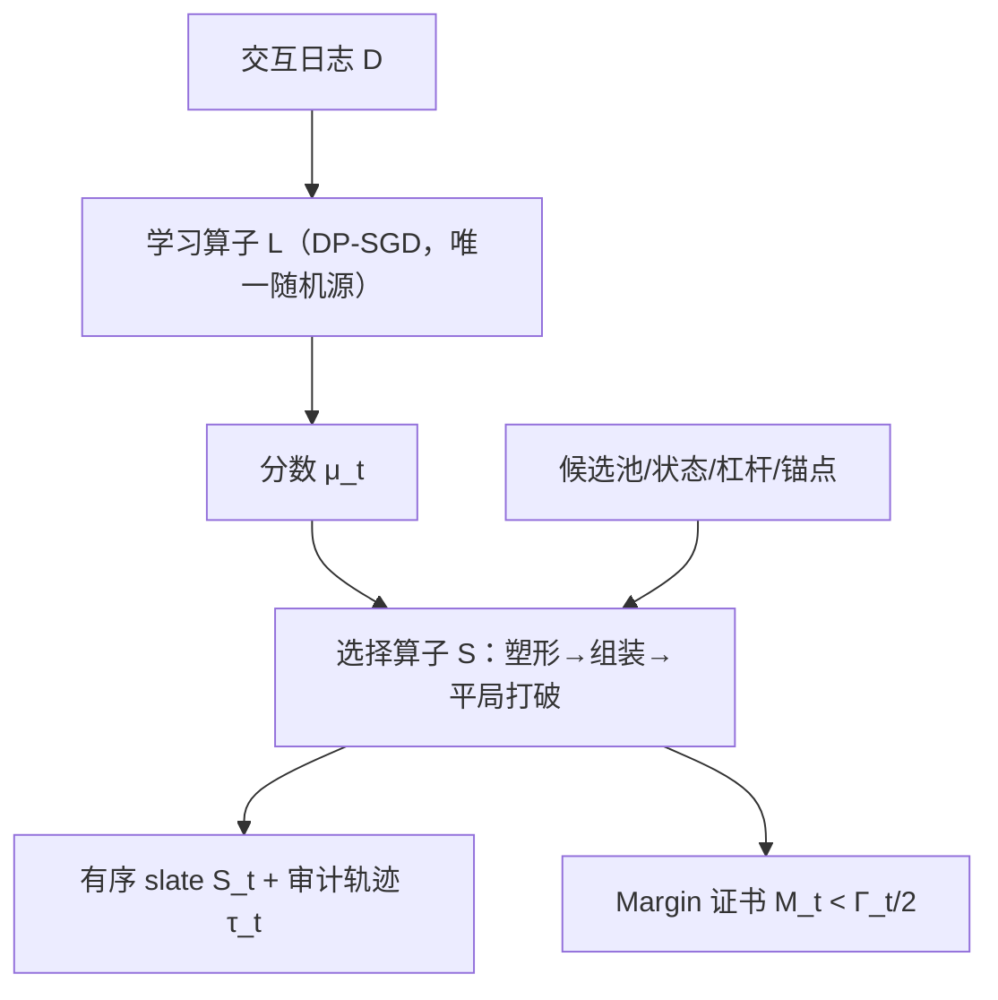
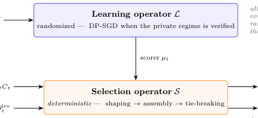

# Decoupled Learning and Selection in Slate Recommendation for Privacy and Stability Under Noisy Scores (噪声打分下的隐私与稳定性：列表推荐中学习与选择的解耦)

- **会议/期刊**: ACM RecSys 2026
- **作者与机构**: Sam Urmian, Mohammad Khalil (University of Bergen, SLATE); Qinyi Liu (City University of Macau)
- **推荐链路定位**: 重排 / 列表级选择（打分器之后的确定性 slate 组装层）
- **研究方向**: 去偏公平、可信隐私与工业架构 / 多任务学习与列表级重排
- **论文原文**: [https://arxiv.org/abs/2609.29453v1](https://arxiv.org/abs/2609.29453v1)
- **开源代码**: [https://github.com/mlgorithm/decoupled-slate-recommendation-recsys-2026](https://github.com/mlgorithm/decoupled-slate-recommendation-recsys-2026)

## TL;DR (1分钟核心速览)

工业列表推荐普遍是「模型打分 + 规则层选列表」两段式，但 DP、公平、校准等保证只覆盖打分器，规则层（去重、多样性、长度控制、审计日志）的隐私与稳定性无人负责。本文把流程形式化为随机学习算子 $\mathcal{L}$ + 确定性选择算子 $\mathcal{S}$，给出两条结论：(1) 隐私仅在选择器侧输入满足「公开/独立、前序 DP 输出、单独记账」契约时经后处理传递到完整链路与审计轨迹；(2) 提出可审计的 margin 证书 $M<\Gamma/2$ 保证有序 slate 不变。在 OULAD/EdNet/MovieLens-25M/Amazon 上，锚点权重 $w=0.75$ 使 Flip@K 相对无锚点下降 53–81%，固定 margin 实验拟合斜率 $-0.220$（95% CI $[-0.231,-0.210]$）逼近理论 $-1/4$。

## Background & Motivation (背景与核心矛盾)

- **主流范式**: 列表推荐 = 学习器打分 + 确定性重排/组装层（MMR 多样性、校准推荐、公平曝光重排、slate size 自适应），后者给定输入完全可复现。
- **前人局限**: ① DP 推荐、bandit 遗憾、公平/校准保证均针对学习器，规则层与审计日志被默认为「免费后处理」，但选择器实际还吃候选池、原始用户状态、相似度、锚点分数等非学习器输入，端到端隐私被悄悄破坏；② 打分噪声（DP 噪声、在线更新抖动）如何传导到最终有序列表缺乏可检验的判据，现有 rank-list sensitivity 只谈训练扰动而非选择时刻的充分条件。
- **核心洞察 (Key Insight)**: 把「哪些随机性属于学习器」与「哪些输入属于选择器」显式分离后，隐私变成后处理契约问题、稳定性变成决策 margin 问题，二者可独立审计、独立失效。
- **本文切入点**: 不造新打分器、不造新重排目标，而是给出「隐私作用域契约 + 可日志化的 margin 证书」这一结构性分析框架。

## Method (核心方法设计)

### 1. 整体框架 (Overall Architecture)

每轮策略接收候选池 $C_t$，学习算子 $\mathcal{L}$ 输出物品分数 $\mu_t$（私有场景下用 DP-SGD，是链路中唯一被分析的随机性来源），确定性选择算子 $\mathcal{S}$ 依次执行三阶段：**塑形**（分数 + 目标邻近度 + 探索奖励）→ **组装**（贪心相关性、多样性、新鲜度记忆、slate size $K_t$）→ **固定 item-ID 平局打破**，输出有序 slate $S_t$ 与审计轨迹 $\tau_t$。轨迹记录候选身份、杠杆参数、塑形分数、相似度、最终列表与平局规则，使决策可精确重放，并直接提供证书所需的 margin 与扰动包络量。隐私经后处理从 $\mathcal{L}$ 传到 $\mathcal{S}$ 及 $\tau_t$，但作用域由选择器侧每个非学习器输入的状态决定。

<figure class="paper-figure" markdown="span">
  <figcaption>图 1：本文研究的双算子分解。ℒ是学习器随机性的唯一来源；𝒮在给定输入下是确定性的。仅当非学习器输入满足第 4.1 节所述的可接受性或 DP 核算条件时，隐私才通过后处理传递到完整流程（包括审计轨迹）。</figcaption>
</figure>

### 2. 关键设计拆解 (Key Designs)

1. **隐私作用域契约（Privacy-Scope Contract）**：痛点是非学习器输入被默认视为「无害」。本文将选择器侧输入分为四类状态：(i) 公开或独立于 $D$；(ii) 前序 DP 输出或其确定性后处理；(iii) 单独 DP 记账的输出（预算需组合）；(iv) 显式条件化输入。仅 (i)–(iii) 支持端到端声明，(iv) 只能得到「以该输入为条件」的弱声明。若每用户最多贡献 $B$ 条受保护轮次记录，记录级 $(\varepsilon,\delta)$-DP 经群隐私提升为
$$\Big(B\varepsilon,\ \delta\sum_{j=0}^{B-1}e^{j\varepsilon}\Big)\text{-DP}.$$
直觉：确定性选择器本身不消耗预算，但会把「条件化」伪装成「端到端」，契约把这一漏洞显式化；非私有锚点可支撑稳定性分析，却必须被排除在 DP 声明之外。

2. **Margin 证书（Margin-Certified Selector Stability）**：痛点是分数扰动是否改变最终列表缺乏可检验判据。设贪心第 $q$ 步参考分数 $\mu^0$ 下选中 $i_q^0$，定义步内 margin 与全局 margin
$$\Gamma_q=F_{\mu^0_q}(i_q^0\mid S^0_{q-1})-\max_{j\neq i_q^0}F_{\mu^0_q}(j\mid S^0_{q-1}),\quad \Gamma=\min_q\Gamma_q,$$
若沿参考轨迹每个候选目标移动满足 $|F_\mu(i\mid S^0_{q-1})-F_{\mu^0}(i\mid S^0_{q-1})|\le M$ 且 $M<\Gamma/2$，则 $\mu$ 与 $\mu^0$ 产生相同有序 slate。直觉：每个候选最多移动 $M$，参考 gap 最多缩 $2M$，$\Gamma-2M>0$ 保证归纳每一步贪心选择不变。实现上用事后包络 $M_t=(1-\lambda_t)\|\mu-\mu^0\|_\infty$ 做日志不等式健全性检查。

3. **锚点混合的 Top-K 翻转界与训练/推理开销**：对原始 top-$K$，margin 退化为锚点 gap $\gamma$（原 top-$K$ 与其余候选的分差），成对噪声下翻转概率满足
$$P_{\text{flip}}\lesssim K(|C|-K)\exp\!\Big[-\frac{\gamma^2}{2(1-w)^2\tau^2}\Big],$$
独立坐标噪声下指数退化为 $-\gamma^2/[4(1-w)^2\sigma^2]$。锚点分数 $\mu^w_t(i)=w\mu^{\text{ALS}}_t(i)+(1-w)\mu^{\text{neural}}_t(i)$，$w$ 越大噪声自适应分数影响越小。训练侧无新增损失项（学习器可为任意 DP 打分器）；推理侧审计只需 $O(|C_t|)$ 标量字段与至多 $O(K_t|C_t|)$ 次相似度查询，证书监控仅存 $O(K_t)$ 个 margin，不引入新的排序 pass。

## Experimental Setup & Evaluation Protocol (实验设置与评估协议)

- **数据集与预处理**:

| 数据集 | #Users | #Items | #Interactions | 稀疏度/密度 | 特征/场景说明 |
| :--- | :---: | :---: | :---: | :---: | :--- |
| OULAD | 23,351 | 188 | 173,739 | 39.58 / 千对 | 教育，较稠密，闭环主场景 |
| EdNet | 296,701 | 11,555 | 23.4M | 6.82 / 千对 | 教育，稀疏长周期 |
| MovieLens-25M | — | — | — | — | 评分语料，$\ge 4$ 二值化，仅做原始排序稳定性 |
| Amazon Musical Instruments | — | — | — | — | 评论语料，同上 |

- **数据划分与防穿越 (Splitting Strategy)**: 闭环实验按用户划分（seed 42），候选池每轮生成一次并在各模式间复用，保证配对差异归因于学习器/选择器而非召回；会话 $T=20$ 轮（另有 $T=50$ 长周期变体）。
- **排名评测协议 (Ranking Protocol)**: 原始排序诊断采用全候选池 top-$K$（$|C|=100$，$K=10$），指标为 $\text{Flip}@K$ 与 $\text{Jaccard}@K$；闭环指标为每轮尝试数、物品级采纳、轮级正确率、固定 IRT 效用探针、目标值跳变、slate 重叠与 Kendall-$\tau$。固定 margin 实验每格 64 池 × 500 扰动 = 32,000 次试验。
- **对比基线与超参设置**: 基线含 Fixed、Greedy-Target、LinUCB、纯 ALS，以及 BKT/DKT/SAKT 三个教育状态追踪器（仅作打分器接口对照）；自适应打分器为双塔（96 隐藏 / 48 嵌入），ALS 为 32 维 5 epoch；锚点权重主实验 $w=0.75$，诊断扫描 $w\in\{0,0.5,0.75\}$；闭环比较为会话级配对 bootstrap 95% CI，sign-test $p$ 值仅作探索性描述、未做多重校正。

## Key Experimental Results (实验关键数据)

### 1. 主实验对比 (Main Results)

| 场景 / 指标 | 纯 ALS | Adaptive（无锚点） | Adaptive+ALS ($w=0.75$) | SCPO 变体 | Improv. |
| :--- | :---: | :---: | :---: | :---: | :---: |
| OULAD 轮级正确率 | 基线 | **+0.121** [0.105, 0.137] | — | — | +0.121 |
| OULAD 每轮尝试数 | 基线 | **+0.714** [0.650, 0.777] | — | — | +0.714 |
| OULAD 效用探针 ($\times10^{-3}$) | 基线 | **+14.824** [13.172, 16.350] | — | −1.339 vs Adaptive | 显著 |
| EdNet 每轮尝试数 | 基线 | **+0.140** [0.115, 0.168] | — | +1.498 vs Adaptive | 较小 |
| EdNet 效用探针 ($\times10^{-3}$) | 基线 | +0.032 [−1.062, 1.148] | — | — | 不显著 |
| OULAD Flip@K ($\sigma=0.10$) | 0.603 | — | **0.216** | — | −64.2% |
| MovieLens-25M Flip@K ($\sigma=0.20$) | 0.875 | — | **0.410** | — | −53.1% |
| Amazon MI Flip@K ($\sigma=0.20$) | 0.752 | — | **0.262** | — | −65.2% |
| 固定 margin 拟合斜率 | — | — | **−0.220** (CI [−0.231,−0.210], $R^2$=0.998) | 参考 −0.250 | 逼近理论 |
| 相关噪声拟合斜率 | — | — | **−0.506** ($R^2$=0.997) | 参考 −0.500 | 逼近理论 |

### 2. 消融实验 (Ablation Study)

| 配置 | 主要受影响指标 | 观察结果 |
| :--- | :--- | :--- |
| w/o 目标塑形 | 接受物品目标值、效用探针 | 变化最大，目标分布漂移 |
| w/o 探索项 | 每轮尝试数 | 尝试数下降最明显 |
| w/o 多样性 | 相邻 slate 重叠 | 重叠显著上升 |
| 固定 slate size | 物品级采纳 | 采纳率变化 |
| Adaptive-SCPO vs Adaptive | 效用探针 | OULAD −1.339×10⁻³ / EdNet +1.498×10⁻³，方向不一致 |
| 锚点 $w$: 0 → 0.75 | Flip@K | 三语料一致单调下降 |

### 3. 关键实验发现 (Key Findings)

1. **锚点加权是稳定性的主开关，而非效用开关**：$w=0.75$ 在三个语料、全部噪声尺度上把 Flip@K 压低 53–81%（如 OULAD $\sigma=0.10$ 从 0.603 到 0.216），但闭环效用变化在 OULAD 仅 0.005–0.007、EdNet 更小且方向混杂——作者明确只主张「分数噪声衰减」，不主张通用效用提升。
2. **证书实现健全但非独立证据**：OULAD 全部 320 个候选池 $\gamma$ 与 $\Gamma_t$ 为正（中位数 0.0577 / $7.33\times10^{-4}$），3,877 次事后扰动零违例；EdNet 8,000 次扰动同样零违例，但 $M_t$ 由已实现扰动算出，属健全性检查而非前瞻性概率保证。
3. **窗口强制选择器换来干净的漂移界，代价不统一**：SCPO 在非松弛轮上给出精确漂移包络 $|\bar d(A_{t+1})-\bar d(A_t)|\le\eta+2\Delta_{\max}+w_t+w_{t+1}$，软窗口 MMR 仅在 >98% 轮对上满足固定窗口事件；但 SCPO 在 OULAD 掉效用、EdNet 反升，说明「证书更干净」与「下游更好」不可互换。

## Highlights, Limitations & Rating (亮点、对比与审稿评价)

- **与代表作对比 (vs. Prior Work)**: 与 DP 推荐（DP-SGD 协同过滤等）相比，本文不改进学习器，而是补齐「私有打分器 → top-K/重排/审计日志」这段被默认免费的后处理；与 MMR/校准推荐/公平曝光重排相比，本文不优化重排目标，而是给重排层加隐私作用域与可审计稳定性判据；与 rank-list sensitivity、stability-based private top-K 相比，本文方向相反——把已私有的学习器经确定性选择器传播，且证书是选择时刻的日志量而非训练扰动界。
- **可迁移亮点**: ① 「margin + 扰动包络」证书可直接嵌入工业重排层做在线监控，只需 $O(K_t)$ 存储且复用选择阶段已算的量；② 锚点混合（固定非自适应打分器 + 自适应打分器凸组合）是抑制在线更新抖动的低成本手段，适合冷启动/探索流量。
- **审稿级局限批判**: ① 隐私侧实验未建立采样机制、$q$ 的分母与逐轮梯度聚合，标称 $\varepsilon\approx0.36/0.16/0.07$ 只能算配置压力测试，非经验证的 $(\varepsilon,\delta)$ 曲线，且未设用户贡献上限 $B$，无法给出用户级预算；② OULAD/EdNet 无曝光日志，参与度靠模拟器，闭环结论仅为趋势级；证书的零违例是事后健全性检查，且固定 margin 拟合的八格筛选规则未预注册，斜率虽显著偏离 $-1/4$ 但解释力有限。
- **四维评分**: 创新性 ⭐⭐⭐⭐ | 实验扎实度 ⭐⭐⭐ | 方法清晰度 ⭐⭐⭐⭐⭐ | 落地价值 ⭐⭐⭐⭐

