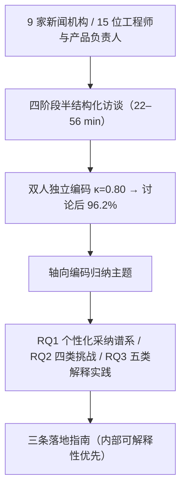

# Do We Care About Personalization and Explainability? An Interview Study with News Recommendation Engineers (我们真的在意个性化与可解释性吗？——一项面向新闻推荐工程师的访谈研究)

- **会议/期刊**: ACM RecSys 2026 (Main Track)
- **作者与机构**: Jasmin Kareem (UvA / JADS)、Siddharth Mehrotra (BITS Pilani)、Martijn C. Willemsen (JADS / TU/e)、Maarten de Rijke (UvA)
- **推荐链路定位**: 端到端工业新闻推荐系统（组织与工程实践层面，非算法层）
- **研究方向**: 去偏公平、可信隐私与工业架构 / 可解释推荐
- **论文原文**: [https://arxiv.org/abs/2609.21547v1](https://arxiv.org/abs/2609.21547v1)
- **开源代码**: 暂未开源

## TL;DR (1分钟核心速览)

本文是一篇**定性实证研究**而非算法论文：作者对 9 家新闻机构（公共广播、报纸/杂志、媒体集团、新闻聚合器）的 15 位工程师与产品负责人进行半结构化访谈，用主题分析（Cohen's κ=0.80，最终一致率 96.2%）回答三个问题——个性化采纳程度（RQ1）、工程团队面临的挑战（RQ2）、可解释性采纳程度（RQ3）。核心结论：9 家中 7 家做个性化但多为"算法+编辑规则"混合体，2 家主动放弃；**没有任何一家显式使用可解释性算法**，可解释性实践几乎全部退化为面向编辑部的内部仪表盘与手工调试。论文最终给出三条面向"可解释性-for-maintainers"的落地指南。

## Background & Motivation (背景与核心矛盾)

- **主流范式**: 新闻推荐（NRS）算法研究长期聚焦点击率/多样性等技术指标优化，可解释性研究则几乎全部以**终端读者**为对象（LIME/SHAP 后验解释、反事实解释、知识图谱路径推理等）。
- **前人局限**: ①既有可解释推荐工作默认"解释是给用户看的"，忽略了系统构建者（工程师）这一同样需要透明度的利益相关方，以及模型调试（debugging）、偏见检测等内部用例；②少量工程视角研究（如 Cools 对 BBC 的 22 人访谈）局限于**单一组织**，无法判断问题是组织特例还是行业系统性现象。
- **核心洞察 (Key Insight)**: 作者预判新闻推荐的特殊性在于"编辑价值"与"算法个性化"的结构性张力——新闻机构不是 YouTube/TikTok，编辑部对"公众此刻应该知道什么"拥有最终裁量权，因此个性化未必是刚需，可解释性也未必以读者为终点。
- **本文切入点**: 用**跨组织、跨国、跨公私部门**的访谈样本，把"可解释性能否解决工程师的真实痛点"作为总问题，从组织社会学视角反向审视 RecSys 社区的方法论假设。

## Method (核心方法设计)

### 1. 整体框架 (Overall Architecture)

研究设计为"招募—半结构化访谈—主题分析"三段式闭环。样本覆盖 9 家机构：公共广播（NOS、BBC）、报纸/杂志（LA Times、DER SPIEGEL）、媒体集团（JP Politiken、DPG Media、Schibsted）、新闻聚合器（Ground News、Cafeyn），团队规模按 ≤10 人（S/M）与 >10 人（L）分层。访谈通过邮件/LinkedIn 招募并采用滚雪球抽样，直至**主题饱和**；共 15 人（数据科学 4 人、产品 5 人、工程 6 人），单场 22–56 分钟，线上进行。问题分四阶段：暖场 → 个性化现状与内部沟通 → 部署痛点与调试经历 → 可解释性认知与使用。转录后在 MAXQDA 2024 中双人独立编码，再用轴向编码归纳主题。

### 2. 关键设计拆解 (Key Designs)

1. **个性化采纳的三级谱系（RQ1）**：作者没有用二值"有无个性化"，而是按访谈证据把机构排成 0–3 级谱系（0=无个性化，3=亲个性化）。7/9 家存在个性化，但实现形态高度异质：统一推荐引擎（P3）、按场景分治的多算法（D7）、内容基+协同过滤双通道（E8）、甚至外包"开箱即用"方案（D11）。反向案例同样关键：E9 曾上线个性化 6 个月后**主动下线**，理由是"与机构精神相悖"并担忧回音室；P10 明确"我们不是科技公司，不想收集大量个人数据"。这一谱系化处理使"个性化=进步"的隐含假设被证伪。
2. **四类工程挑战的归因（RQ2）**：作者将痛点归为 (a) 数据/后端/基础设施、(b) 资源与人力、(c) 与编辑部的沟通、(d) 推荐系统本身的问题。其中 (a) 是**跨机构普遍挑战**（8 人提及），GDPR 被 P3 直接指为"获取有益社会的好数据"的障碍；人力约束以 D7 的"四人数据科学团队、没有专家只有通才"最为典型；(c) 的典型冲突是 D5 描述的案例——某犹太教堂纵火新闻被内容推荐器自动关联到"大屠杀纪念日"文章，编辑部判定为不当关联。这一分类的价值在于把"算法问题"与"组织问题"显式分离。
3. **五类解释实践的重新分类（RQ3）**：作者刻意不预设"可解释性"定义，让受访者自述，结果归纳出内部两类（编辑部仪表盘、调试手段）与外部三类（明确不做、怀疑、未来开放）。内部实践包括：把模型分数归一化到 [0,1] 以便"其他 IT 同事看懂"（E6）、抽样用户手工核查（E8）、观察最近邻用户行为（E9）、用嵌入可视化区分体育类与其他类文章（E12）。外部解释的阻力则来自商业理性（D7："每年讨论两次，但无法形成差异化"）、风险担忧（E6："解释总是可能做得很糟"、E12："很容易被操纵"）与需求存疑（E4："上线第一年只有一个人来问过"）。

> 注：本文为定性研究，**无损失函数、无负采样、无推理开销**等算法层设计；其"训练目标"等价于主题分析的编码信度控制（κ=0.80 → 96.2%）。

## Experimental Setup & Evaluation Protocol (实验设置与评估协议)

- **样本与预处理**: 9 家机构、15 位受访者，按媒体类型与团队规模分层；机构与受访者均匿名化（D=数据科学、P=产品、E=工程）。

| 媒体类型 | 机构（团队规模） | 个性化水平 | 解释实践立场 |
| :--- | :--- | :---: | :--- |
| 公共广播 | NOS (S/M)、BBC (L) | 低–中 | 仪表盘 / 怀疑 |
| 报纸杂志 | LA Times (S/M)、DER SPIEGEL (L) | 中–高 | 未来开放 / 明确不做 |
| 媒体集团 | JP Politiken、DPG Media、Schibsted (均 S/M) | 高 | 仪表盘 + 调试为主 |
| 新闻聚合器 | Ground News、Cafeyn (均 S/M) | 低 | 怀疑 / 明确不做 |

- **"划分"与"评测协议"的类比**: 本研究不存在训练/测试划分；其效度控制体现为**主题饱和停止准则**（而非固定样本量）与**双人独立编码 + 分歧讨论**（81 个编码片段被重新裁定），并以跨组织矩阵（图 1）做三角验证。
- **对比基线**: 与 Cools (BBC 单组织 22 人)、Mitova et al. (10 家媒体组织动力)、Smets et al. (11 位从业者)、Bhatt et al. (跨域工程师可解释性用途)、Habiba et al. (14 位从业者) 等定性工作对照；无定量基线。

## Key Experimental Results (实验关键数据)

### 1. 主实验对比 (Main Results)

定性研究无指标表格，以下为**跨组织发现矩阵**（对应原文图 1，单元格为具有该特征的机构数）：

| 维度 | 类别 | 公共广播 | 报纸杂志 | 媒体集团 | 聚合器 |
| :--- | :--- | :---: | :---: | :---: | :---: |
| 个性化水平 | 0（无）/ 3（亲个性化） | 偏低 | 分化 | **偏高** | 偏低 |
| 挑战 | 数据/后端/基础设施 | ✓ | ✓ | ✓ | ✓ |
| 挑战 | 资源与人力 | — | — | ✓ | ✓ |
| 挑战 | 编辑部沟通 | ✓ | ✓ | ✓ | ✓ |
| 解释立场 | 仪表盘（内部） | ✓ | — | **全部** | — |
| 解释立场 | 明确不做（外部） | — | ✓ | — | ✓ |
| 解释立场 | 怀疑（外部） | ✓ | — | — | ✓ |
| 解释立场 | 未来开放 | ✓ | ✓ | ✓ | — |

### 2. 消融实验 (Ablation Study)

以"若移除某类解释实践，工程师还能否理解模型"作类比消融：

| 移除的实践 | 替代手段 | 后果（访谈证据） |
| :--- | :--- | :--- |
| 编辑部仪表盘 | 口头沟通 + 指标汇报 | 编辑无法验证"系统是否体现机构价值"（P15 反例：仪表盘使论证"非常有说服力"） |
| 分数归一化 | 直接看原始分数 | 非算法同事无法判断高低分（E6） |
| 嵌入可视化 | 纯人工抽查 | 难以定位"体育易分、其余混乱"的类别失衡（E12） |
| 全部内部解释 | 无 | 仅剩"上线一年一次用户问询"级别的反馈闭环（E4） |

### 3. 关键实验发现 (Key Findings)

1. **个性化不是普适最优解，且与公共属性强相关**：9 家中 7 家做个性化，但公共广播整体个性化水平最低——因其缺乏与订阅制私营机构对等的用户数据获取渠道；更反直觉的是私营机构内部亦高度分化（1 家聚合器与 1 家报纸杂志处于低端），说明"商业模式决定论"不成立，编辑价值与隐私立场同样是独立变量。
2. **可解释性在实践中被"降维"为内部可维护性工具**：**零家**机构显式使用可解释性算法，但 3 家建有编辑部仪表盘、多家依赖手工调试；媒体集团 100% 以"调试"视角理解推荐结果。这与 Bhatt et al. 的跨域结论一致，但本文进一步指出新闻场景的独特增量功能——**充当工程团队与编辑部之间的沟通媒介**（D5 的"不当配对"检测、P15 的价值合规举证）。
3. **外部解释的收益被普遍质疑，风险被普遍高估**：E4 的"一年仅一次问询"与 D7 的"无法形成商业差异化"构成需求侧否定证据；E6/E12 的"可能做得很糟/易被操纵"构成风险侧否定证据。二者叠加解释了为何即便对可解释性持开放态度的 4 家机构，也因"当前项目优先级"与"数据基础设施"而持续推迟。

## Highlights, Limitations & Rating (亮点、对比与审稿评价)

- **与代表作对比 (vs. Prior Work)**: 相较 Cools (BBC 单组织)，本文以 9 家跨国机构证明挑战是**系统性**而非组织特例；相较 Mitova et al. (聚焦采纳动力)，本文把张力落到可解释性决策这一具体出口；相较 Bhatt et al. (跨域工程师用途)，本文补充了新闻业特有的"编辑价值传导"功能。
- **可迁移亮点**: ①"内部可解释性优先"的产品策略——把解释预算投向编辑部仪表盘与业务规则可追溯性，而非读者端解释，对任何强编辑/强合规场景（金融、医疗内容）均可复用；②将业务规则与解释需求**同步设计**（规则触发即留痕），是一种低成本的可审计性工程模式。
- **审稿级局限批判**: ①样本仅覆盖欧洲与北美监管框架下的机构，且以技术视角为主，编辑、记者、读者与监管方视角缺失，跨区域外推性存疑；②15 人样本虽达主题饱和，但每家机构平均不足 2 人，机构内角色差异（如 D 与 E 的分歧）可能被聚合掩盖；③全文为自报告质性证据，缺少对仪表盘实际使用日志或调试工单的客观佐证，存在社会赞许性偏差风险。
- **四维评分**: 创新性 ⭐⭐⭐⭐ | 实验扎实度 ⭐⭐⭐⭐ | 方法清晰度 ⭐⭐⭐⭐⭐ | 落地价值 ⭐⭐⭐⭐

