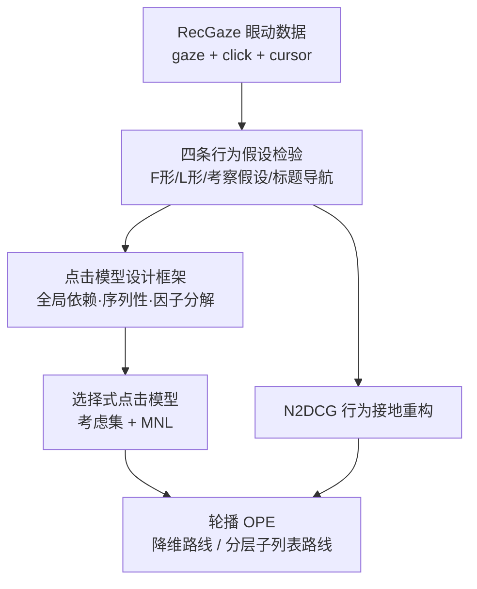

# From Click Modeling to Offline and Off-Policy Evaluation in Carousel Recommendation (从点击建模到轮播推荐的离线与离策略评估)

- **会议/期刊**: RecSys 2026 (Doctoral Symposium)
- **作者与机构**: Jingwei Kang (University of Amsterdam, IRLab；导师 Maarten de Rijke, Harrie Oosterhuis)
- **推荐链路定位**: 重排 / 评估（离线指标与 OPE）
- **研究方向**: 去偏公平与工业架构 / 多任务学习与列表级重排
- **论文原文**: [arXiv:2608.22022v1](https://arxiv.org/abs/2608.22022v1)
- **开源代码**: 暂未开源

## TL;DR (1分钟核心速览)

轮播界面同时呈现多条横向可滑动的排序列表，排序与二维版式强耦合，使"点击 = 考察 × 相关"这一经典假设失效，进而污染离线与离策略评估。本文（博士论文阶段性综述）以 RecGaze 眼动数据集（87 名被试、40 屏、3,477 条有效交互）实证推翻四条主流行为假设，提出以**可观测变量间数学关系**而非隐行为假设为第一性的点击模型设计框架，并给出基于离散选择（MNL）的轮播点击模型、N2DCG 的行为接地重构，以及两条轮播 OPE 路线。核心收益体现在行为拟合与版式比较预测的一致性上，而非传统排序指标提升。

## Background & Motivation (背景与核心矛盾)

- **主流范式**: 点击模型（CM/UBM/DCM/DBN 等）与离线指标（DCG/RBP/ERR）均建立在单列列表的"考察—相关"分解之上；轮播场景仅有 CCM 一个级联式点击模型与 N2DCG 一个二维折扣指标。
- **前人局限**: 其一，CCM 假设用户先浏览主题标题再进入条目，且考察后点击概率与位置无关；其二，N2DCG 的理想排序违反轮播的类别约束（同一行必须同主题），折扣函数直接继承单列搜索的位置假设。
- **核心洞察 (Key Insight)**: 眼动数据显示，轮播中**条件于考察的点击概率仍随行位置显著变化**（图 6 中同一列不同行的条件点击率从 4.68% 到 0.00% 不等），即考察后点击并非位置不变的相关性信号；同时首屏呈"双焦点 F 形"、翻页后呈镜像 F 形，点击后考察呈 L 形而非级联形。
- **本文切入点**: 既然行为假设在二维版式下普遍不成立，就把点击模型的设计基准从"隐行为假设"迁移到"可观测变量间的数学关系"，并据此重建指标与 OPE。

## Method (核心方法设计)

### 1. 整体框架 (Overall Architecture)

论文以两条 RQ 组织：RQ1 解释与建模轮播点击（RecGaze 数据集 → 行为实证 → 点击模型设计框架 → 选择式点击模型）；RQ2 从日志数据评估轮播策略（N2DCG 重构 → 轮播 OPE）。方法链条的关键是**依赖关系**：数据集支撑行为分析，行为分析同时约束选择模型与指标折扣函数，选择模型又为 OPE 的考虑集估计提供基础。

### 2. 关键设计拆解 (Key Designs)

1. **点击模型设计框架（ICTIR 2025）**：痛点在于传统模型把隐行为假设当作公理，假设一错则模型与指标同时失效。作者主张以观测变量间的数学关系为第一性，提炼出三个每个点击模型都必须（显式或隐式）做出的设计选择——**全局依赖 (global dependencies)、序列性 (sequentiality)、因子分解 (factorization)**，并用这三元组构建统一分类法，首次把单列、网格、轮播点击模型放进同一比较框架，再由此推导出一个新的轮播点击模型作为起点。其价值在于把"模型设计"从灵感驱动变为可枚举的设计空间搜索。

2. **选择式点击模型（进行中）**：痛点在于考察式模型无法表达"被点击与否取决于与谁同时被考虑"，也无法表达二维部分可见下的导航。模型改为两阶段：先由受物理约束的序列浏览过程生成考虑集 $C_k$（初始为页面加载时可见条目，仅能通过行内右滑、行间下滚或停止来扩张，禁止跳页跳行），再在考虑集内做多项 Logit 选择：

$$P(\text{click}_i \mid x)=\sum_{k:\,i\in C_k}P(C_k\mid x)\cdot\frac{\exp(u_i)}{\sum_{j\in C_k}\exp(u_j)}$$

其中 $u_i$为条目效用，$P(C_k\mid x)$ 为导航过程诱导的考虑集分布。物理直觉：MNL 的分母使点击概率随同集竞争品变化，天然刻画"上下文比较"效应；约束式扩张则保证考虑集与真实视口一致。难点在于考虑集构造与集合内选择的参数化，以及仅有最终点击可观测时的估计。

3. **N2DCG 重构与 OPE 规划**：针对原指标理想排序违反类别约束、折扣函数继承单列假设两点，重构后的指标在真实眼动数据上更贴合用户行为，也更能预测基于经验考察频率的模拟版式比较结果。OPE 侧提出两条路线：**(a) 降维路线**——用选择模型估计最可能的考虑集，把二维版式坍缩为单一有效排序，直接套用标准 slate 估计器；**(b) 分层路线**——保留二维结构，把版式表示为"子列表之列表"，将跨行与行内行为建模为两阶段过程。前者复用性强、后者保真度高，构成明确的精度—复杂度权衡。

## Experimental Setup & Evaluation Protocol (实验设置与评估协议)

- **数据集与预处理**: 本文为博士论文综述，核心实证资产是自建 RecGaze 数据集（SIGIR 2025），非传统交互日志：

| 数据集 | #Users | #Items | #Interactions | 稀疏度/密度 | 特征/场景说明 |
| :--- | :---: | :---: | :---: | :---: | :--- |
| RecGaze | 87 | 40 屏 × 10 行 × 15 部电影 | 3,477 有效交互 | 高稀疏（每被试约 40 次选择） | 眼动 + 点击 + 光标 + 选择后解释；三类任务：自由浏览 / 半自由浏览 / 直接搜索 |

- **数据划分与防穿越 (Splitting Strategy)**: 用户研究式采集，按被试与屏幕组织；聚合分析按页面（第 1/2/3 页）与位置 (行, 列) 分桶统计考察频率与条件点击频率，未采用 Leave-One-Out 或时间戳切分。
- **排名评测协议 (Ranking Protocol)**: 非 Full-Ranking 亦非 Sampled Ranking，而是**行为频率统计协议**——以位置级考察频率（%）与"给定考察的点击频率"（%）作为被解释量；指标侧以与眼动行为的拟合度、以及对模拟版式比较结果的一致性作为评价标准。
- **对比基线与超参设置**: 行为假设层面以单列搜索的 F 形/黄金三角、级联考察、考察假设、标题导航为对照假设；模型层面以 CCM 为唯一轮播基线；指标层面以原始 N2DCG 为基线。论文未报告嵌入维度、显著性检验等常规超参细节（阶段性工作）。

## Key Experimental Results (实验关键数据)

### 1. 主实验对比 (Main Results)

由于本文为博士论文立场陈述，未提供统一的主实验表；核心定量证据来自行为假设检验的位置统计（图 4–6）：

| 检验对象 | 传统假设预期 | RecGaze 实测 | 结论 |
| :--- | :--- | :--- | :--- |
| 首屏考察模式 | 单一 F 形/黄金三角 | 双焦点 F 形，两上角均有注意力峰 | 假设不成立 |
| 翻页后考察模式 | F 形延续 | 第 2、3 页呈**镜像 F 形**，无跨界面全局 F 形 | 假设不成立 |
| 点击后考察模式 | 级联/层次式 | **L 形**：被点击行上方各行 + 同行点击前条目高概率被考察 | 假设不成立 |
| 考察假设（条件点击率位置无关） | 同行不同列应相近 | 同列不同行差异巨大（如首列 4.68% vs 3.34%，部分位置为 0.00%） | 假设被否证 |
| 标题导航 | 先看标题再看条目 | 用户常先看条目，甚至完全不看标题 | 假设不成立 |

### 2. 消融实验 (Ablation Study)

论文未设传统消融；等价的结构性证据是"假设移除"分析，即逐条撤除既有模型/指标所依赖的行为假设后观察其解释力崩塌：

| 移除的假设 | 受影响对象 | 观测后果 |
| :--- | :--- | :--- |
| 全局 F 形考察 | 单列位置折扣函数 | 无法解释镜像 F 形与双焦点结构 |
| 级联式点击后考察 | CCM 的浏览路径 | 无法解释 L 形考察 |
| 考察假设（位置不变相关） | 所有 examination-based 点击模型 | 条件点击率仍随行位置变化，相关性信号被污染 |
| 标题优先导航 | CCM 的主题选择阶段 | 与真实浏览顺序不符 |
| 理想排序的类别约束（N2DCG） | N2DCG 归一化项 | 理想排序在轮播中不可达，归一化失真 |

### 3. 关键实验发现 (Key Findings)

1. **考察假设在二维版式下系统性失效**：同一列内不同行的条件点击频率跨度可达 4.68% 至 0.00%，说明位置不仅决定"是否被看"，还决定"看了之后如何被比较与选择"，因此任何把点击直接当相关性标签的离线评估都会引入结构性偏差。
2. **注意力是分页局部的而非全局的**：首屏双焦点、后续页镜像 F 形的模式意味着折扣函数必须**按页重置**，单列搜索中"越靠后折扣越大"的单调权重在轮播中不成立，这正是 N2DCG 重构的直接动因。
3. **导航受物理约束而非自由跳转**：L 形考察模式与"禁止跳页跳行"的约束一致，支持把考虑集建模为由右滑/下滚动作逐步扩张的集合，而非一次性可见的全列表——这也是选择式模型与分层 OPE 路线可行性的经验依据。

## Highlights & Limitations (亮点、对比与审稿批判)

- **与代表作对比 (vs. Prior Work)**: 相比 CCM（唯一轮播点击模型，级联式、假设标题优先），本文用眼动证据直接否证其行为前提；相比 N2DCG（唯一轮播指标，继承单列折扣且理想排序违反类别约束），本文的重构让指标与真实考察频率对齐；相比标准 slate OPE（假设整个列表同时可见），本文指出轮播是"多排序 + 部分可见"的新设定，需降维或分层改造。
- **可迁移亮点**: (1) "以可观测变量关系替代隐行为假设"的设计哲学可直接迁移到信息流、网格、对话式列表等非单列界面的点击建模；(2) 用眼动数据作为指标/模型的**外部效度校验器**，比单纯离线指标相关性检验更有说服力。
- **审稿级局限批判**: (1) 作为博士论文立场文，多数模块处于"进行中/在审/计划"状态，缺乏统一基准上的端到端定量对比与显著性检验，选择式模型的参数估计与可识别性尚未给出实证；(2) RecGaze 规模有限（87 人、40 屏、3,477 次交互）且为实验室电影选择任务，与工业轮播（短视频、电商、音乐）的版式密度、滑动成本与真实曝光策略差异较大，行为结论的外部推广性有待验证；OPE 两条路线的方差—偏差权衡亦尚无实验支撑。

## Rating (四维评分)

- **方法创新性 (Novelty)**: ⭐⭐⭐⭐ （以可观测变量关系重构点击模型设计公理、并用离散选择替代考察假设，思路新颖且有眼动证据支撑，但各模块尚处早期）
- **评估协议与实验扎实度 (Protocol & Experiments)**: ⭐⭐⭐ （RecGaze 数据采集规范、假设检验清晰，但缺乏统一基准上的主实验表、消融与显著性检验）
- **写作与数学规范度 (Clarity & Rigor)**: ⭐⭐⭐⭐ （RQ 与论文依赖关系图组织清晰，MNL 公式简洁到位；但部分模块仅有定性描述，缺复杂度与可识别性分析）
- **工业落地与复现价值 (Industrial & Practical Value)**: ⭐⭐⭐ （轮播是工业主流界面，问题定义极具落地价值；但暂无开源代码，OPE 方案未验证，短期难以直接部署）
