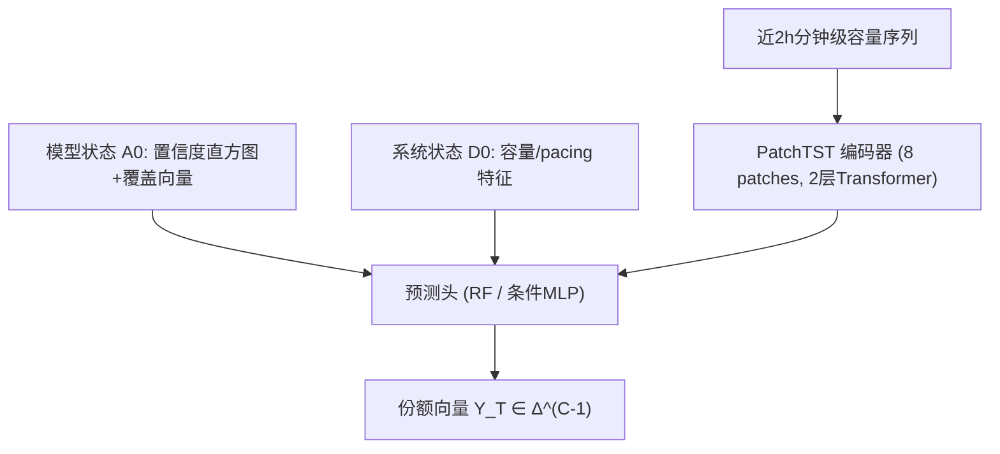

# Impression Share Prediction: An Offline Evaluation Task for Ranking Systems (曝光份额预测：排序系统的离线评估任务)

- **会议/期刊**: RecSys 2026
- **作者与机构**: Mohsen Malmir, Houssam Nassif, Danish Nasir Shaikh, Taher Rahgooy, Murat Ali Bayir (Meta Platforms, Inc.)
- **推荐链路定位**: 离线评估（服务于精排/多目标排序模型的 A/B 前置门控）
- **研究方向**: 去偏公平与工业架构 / 多任务学习与列表级重排
- **论文原文**: [https://arxiv.org/abs/2608.16872v1](https://arxiv.org/abs/2608.16872v1)
- **开源代码**: 暂未开源

## TL;DR (1分钟核心速览)

标准离线指标（NE/RIG/AUROC/GAUC）只衡量逐曝光预测精度，无法揭示候选模型上线后会把曝光量在 click/view 等目标桶之间如何重新分配——而这种再分配即使指标提升也可能损害下游效用。本文提出**曝光份额预测**这一离线评估任务：给定候选模型状态与当前系统状态，预测其未来 24h 在各目标桶上的归一化曝光份额向量。作者用结构因果模型证明该反事实效应可从观测数据识别（无需 IPW/平衡表征），并在 150 个模型、约 180 万分钟级快照上验证：已见模型上随机森林相对常数基线降低 L1 误差 48.6%；对未见模型的首小时（最接近真实 pre-entry 的区间），快照 RF 反而劣于基线（−20.5%），而 PatchTST 式编码器通过 2 小时拍卖动态 rollout 恢复至 +22.1%。

## Background & Motivation (背景与核心矛盾)

- **主流范式**: 排序模型离线评估依赖日志曝光上的预测精度指标（NE、RIG、AUROC、GAUC），作为 A/B 测试前的门控。
- **前人局限**: ① 这些指标是下游效用的代理，模型可在指标提升的同时把曝光从高转化目标桶挤向低转化桶，聚合效用反而下降；② 曝光分配由共享的 delivery capacity 与 pacing 控制器共同决定，是**系统级均衡结果**而非单模型属性，逐曝光精度完全无法刻画。
- **核心洞察 (Key Insight)**: 曝光份额预测本质是反事实问题——候选模型从未服务过真实流量，其置信度未被自身产生的数据塑造，pacing 也未对其适配。但模型属性由架构与训练决定、**不受系统状态反向影响**（DAG 中缺失 $D_t \to A^m_t$ 边），因此不存在后门路径，干预效应可直接从观测数据识别。
- **本文切入点**: 把"预测候选模型会诱导的曝光份额分布"形式化为从 $(A^m_0, D_0)$到$Y^m_T$ 的监督学习问题，用历史 A/B 数据训练，作为 reward-based 离线评估的**互补**而非替代。

## Method (核心方法设计)

### 1. 整体框架 (Overall Architecture)

系统同时运行多个排序模型，各自覆盖目标桶子集 $V_m$；并行 A/B 各臂共享同一 delivery capacity 池，这是臂间结构性耦合的来源。给定候选模型$m$在$t=0$的模型状态$A^m_0$（22 维置信度特征：20-bin 对数尺度预测分数直方图 + 均值 + 方差，外加覆盖向量$V_m \in \{0,1\}^C$）与系统状态$D_0$（每桶 5 维：总容量、已消耗、剩余、pacing 乘子、活跃 campaign 数），预测前向窗口$T=24$h 的份额向量$\hat{Y}^m_T \in \Delta^{C-1}$。为避免逐步预测中间状态$(A^m_t, D_t, Y^m_t)$带来的误差累积，直接学习$(A^m_0, D_0) \mapsto Y^m_T$ 的映射，中间动态由历史数据隐式吸收。

### 2. 关键设计拆解 (Key Designs)

1. **因果识别论证（SCM + 缺失边）**：痛点在于反事实不可观测。作者构造三变量时变 SCM：$A^m_t \to Y^m_t$（置信度决定竞价胜出，限于$V_m$）、$D_t \to Y^m_t$（容量与 pacing 约束资格）、$Y^m_t \to D_{t+1}$（曝光消耗共享容量）、$D_t \to D_{t+1}$、$A^m_t \to A^m_{t+1}$（架构固定导致状态自相关）。关键结构性质是**不存在$D_t \to A^m_t$ 边**，故
$$P(Y^m_t \mid do(A^m_t=a), D_t) = P(Y^m_t \mid A^m_t=a, D_t)$$
无需逆倾向加权、平衡表征或域对抗训练即可识别——这是全文最锋利的一步，把"反事实难估"降维成"普通监督回归"。

2. **编码器条件化架构（补首小时系统惯性）**：痛点在于 $t=0$快照的$D_0$仍编码着**前一个模型**的均衡态，快照特征无法反映系统正在发生的容量消耗趋势。作者用 PatchTST 式编码器摄入近 2 小时分钟级容量历史，切为 15 分钟 patch（8 个 token），经 2 层 Transformer（4 头，$d_{\text{model}}=64$，GELU）均值池化得系统状态向量$h_t \in \mathbb{R}^{64}$，再由条件 MLP 头映射$(h_t, A^m_0) \mapsto \hat{Y}^m_T$并 softmax 归一。把$A^m_0$作为**独立干预输入**与$h_t$解耦，使"固定$h_t$、替换模型状态、读出份额"的反事实查询成为可能。

3. **训练目标与推理开销**：编码器架构端到端以 KL 散度训练（AdamW）；RF 则逐分量独立回归后投影回单纯形（截负、重归一）。推理侧极轻：RF 为单次前向；Transformer 仅需 8 token 的短序列编码，分钟级快照即可驱动，适合作为 A/B 前置的批量门控。无负采样概念（回归任务）。

## Experimental Setup & Evaluation Protocol (实验设置与评估协议)

- **数据集与预处理**: 来自 Meta 生产系统约五周、150 个候选模型（跨多个模型家族）的分钟级拍卖统计与曝光份额快照，共约 180 万条。

| 数据集 | #Models | #Snapshots | 时间跨度 | 划分 | 场景说明 |
| :--- | :---: | :---: | :---: | :---: | :--- |
| 生产 A/B 日志 | 150 | ~1.8M | ~5 周 | 时间切分 23 训练 / 15 测试天 | 多目标桶、共享容量池 |

- **数据划分与防穿越 (Splitting Strategy)**: **全局时间戳切分**（固定 cutoff 分 23/15 天）。测试窗口内 103 个活跃模型中 20 个为训练期从未出现的新模型、83 个为已见模型，据此分别报告 seen / held-out 结果。
- **排名评测协议 (Ranking Protocol)**: 非检索式排序评测，而是**份额向量回归**。主指标 L1 距离 $\text{L1}(\hat{Y}^m_t, Y^m_t)=\sum_c |\hat{Y}^m_{t,c}-Y^m_{t,c}|$（越低越好）；辅指标为预测与观测份额向量的 Spearman 秩相关（越高越好）。所有方法报告**相对常数基线**（输出训练集均值份额向量）的相对提升。
- **对比基线与超参设置**: 基线为常数均值预测器；预测器为 RF（三组特征配置消融）与 PatchTST 条件编码器（8 patches、2 层、4 头、$d=64$）。held-out 实验按"首次出现后时长"分桶（0–1h 至 7d+），其中 0–1h 作为 pre-entry 的代理目标。

## Key Experimental Results (实验关键数据)

### 1. 主实验对比 (Main Results)

**已见模型（post-entry，24h 窗口，相对常数基线提升）**：

| 特征配置 | L1 提升 | Spearman 提升 |
| :--- | :---: | :---: |
| Constant Baseline | 0 | 0 |
| Capacity Only | +25.3% | +0.17% |
| Confidence + Coverage | +42.9% | +0.64% |
| **Capacity + Confidence + Coverage** | **+48.6%** | **+0.66%** |

**未见模型（held-out，按首次出现后时长分桶，L1 相对提升）**：

| 时长 | RF | Transformer |
| :--- | :---: | :---: |
| **0–1h（pre-entry 代理）** | **−20.5%** | **+22.1%** |
| 1–2h | +11.5% | +33.2% |
| 2–4h | +27.2% | +27.5% |
| 4–8h | +29.2% | +37.1% |
| 8–12h | +29.6% | +37.1% |
| 12–24h | +24.8% | +34.1% |
| 1–2d | +30.8% | +32.3% |
| 2–4d | +26.2% | +25.7% |
| 4–7d | +36.4% | +34.6% |
| 7d+ | **+37.9%** | +33.8% |

### 2. 消融实验 (Ablation Study)

| 配置 | L1 提升 | 说明 |
| :--- | :---: | :--- |
| w/o 全部特征（常数基线） | 0 | 参照 |
| w/o Confidence+Coverage（仅容量） | +25.3% | 系统状态单独贡献有限 |
| w/o Capacity（仅置信度+覆盖） | +42.9% | 模型状态是主信号 |
| Full（RF） | +48.6% | 两组互补 |
| Full（Transformer，0–1h） | +22.1% | 时序编码器在冷启动区间不可替代 |

### 3. 关键实验发现 (Key Findings)

1. **模型状态而非系统状态是份额的主预测因子**：仅置信度+覆盖特征即达 +42.9%，而仅容量特征只有 +25.3%，二者合并 +48.6%——说明"两个 AUROC 相同的模型可因分数分布不同而产生截然不同的曝光份额"，这正是传统精度指标的结构性盲区。
2. **离线-在线 gap 精确地住在首小时**：held-out 模型 0–1h 区间 RF 为 −20.5%，因为 $D_0$ 仍编码前序模型的均衡态、滚动置信度窗口尚未填满；Transformer 的 2h 容量 rollout 在此区间取得 +22.1%，相对 RF 形成 **42.6 个百分点的翻转**，且领先持续到 12h。
3. **系统适配完成后快照特征即足够**：2 天后 RF 反超（7d+ 达 +37.9% vs Transformer +33.8%），说明时序编码器的价值集中在系统尚未适应新模型的早期窗口，而非全程；Spearman 在所有分桶均 >0.98 饱和，桶间优先级排序由系统结构决定、几乎不随模型版本变化，故 L1 才是真正有区分度的指标。

## Highlights & Limitations (亮点、对比与审稿批判)

- **与代表作对比 (vs. Prior Work)**: 与无偏 LTR / 安全部署目标（Joachims 等、Gupta 等）相比，本文不追求逐曝光精度保真，而预测**曝光再分配**；与 off-policy evaluation（IPS/DR、拍卖仿真基准）相比，本文不假设平稳性与策略重叠、也不估 reward，而是估跨目标桶的分配向量；与 Zheng & Zhao 的算法适配偏差、Wang 等的曝光重分配观察相比，本文首次把该现象做成**可预测的离线任务**并给出识别性证明。
- **可迁移亮点**: ① "缺失反向边 $\Rightarrow$ 无需 IPW"的识别论证可迁移到任何"模型属性不受系统反馈影响"的评估场景（如召回模型换代的流量影响预估）；② 把候选模型状态作为条件头的独立干预输入、系统状态走时序编码器的解耦设计，是反事实查询的通用工程范式。
- **审稿级局限批判**: ① 所谓 pre-entry 实为 **early-entry 代理**——置信度特征取自候选模型最早在线服务的滚动窗口而非真正的离线评估 pass，与真实 pre-entry 存在分布差；② 直接预测 $Y^m_T$回避了$t=0 \to T$的中间状态传播，缺乏不确定性量化与误差累积分析；③ 仅单一工业系统、单一$T=24$h 与固定桶定义，跨平台泛化性与桶数$C$ 的敏感性未验证；④ 5 页短文，未报告方差/显著性检验与 RF 超参敏感性。

## Rating (四维评分)

- **方法创新性 (Novelty)**: ⭐⭐⭐⭐ （任务定义本身是主要贡献，SCM 缺失边识别论证干净利落，但预测器层面为 RF + PatchTST 的成熟组合）
- **评估协议与实验扎实度 (Protocol & Experiments)**: ⭐⭐⭐ （时间切分与 seen/held-out 双轨设计合理、分桶细致，但缺显著性检验、单系统单窗口、pre-entry 目标仅为代理）
- **写作与数学规范度 (Clarity & Rigor)**: ⭐⭐⭐⭐ （DAG 与识别等式表述严谨、特征维度交代清楚，5 页篇幅下公式与符号无冗余）
- **工业落地与复现价值 (Industrial & Practical Value)**: ⭐⭐⭐⭐ （直接面向 A/B 前置门控的真实痛点，推理仅需分钟级快照与 8-token 短序列，工程开销极低；但数据与代码未开源，复现受限）

