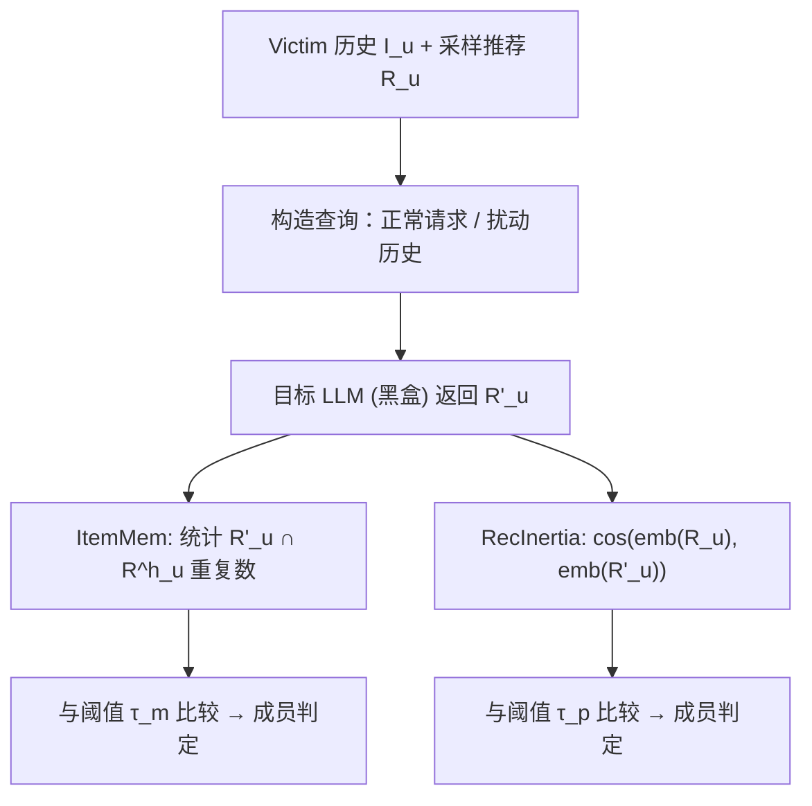

# Membership Inference Attacks on In-Context Examples in LLM-based Recommender Systems (面向 LLM 推荐系统上下文示例的成员推理攻击)

- **会议/期刊**: ACM RecSys 2026 (Main Track)
- **作者与机构**: Jiajie He, Min-chen Chen, Xintong Chen, Xinyang Fang, Yuechun Gu, Keke Chen (UMBC / Cincinnati / USC)
- **推荐链路定位**: 端到端生成式（ICL 推理期定制）
- **研究方向**: 去偏公平、可信隐私与工业架构 / 大语言模型推荐
- **论文原文**: [arXiv:2508.18665v6](https://arxiv.org/abs/2508.18665v6)
- **开源代码**: [anonymous.4open.science/r/goodluck2026](https://anonymous.4open.science/r/goodluck2026/README.md)

## TL;DR (1分钟核心速览)

ICL 式 LLM 推荐把用户真实交互历史直接写进系统提示（system prompt）作为 demonstrations，但此前无人研究这些"推理期注入"的隐私是否会被反推。本文首次定义该场景下的成员推理攻击（MIA），提出 **ItemMem**（利用 LLM 对 demonstration 中"历史→推荐"模式的复述倾向）与 **RecInertia**（利用成员用户对查询扰动的"推荐惯性"）两种黑盒攻击。在 6 个开源 LLM、MovieLens-1M / Amazon Book / Beauty 三数据集上，攻击优势（Advantage）最高接近 1.0，且现有 prompt sanitization 与 output filtering 防御整体失效。

## Background & Motivation (背景与核心矛盾)

- **主流范式**: ICL-RecSys 从服务商内部库检索 k 条用户 demonstration 拼入系统提示，无需重训即可适配冷启动、跨域与动态意图，Amazon/Google 已开始落地。
- **前人局限**: ① 传统 RecSys MIA（Item-Diff、DL-MIA 等）攻击的是**参数中编码的训练数据**，依赖 CF 相似度信号，而 ICL-RecSys 根本不做 CF 训练，相似度攻击直接失效；② 提示抽取（prompt extraction）把 prompt 当作静态秘密去重建，忽略推荐任务特有的"交互→推荐"结构，且易被 sanitization 防住。
- **核心洞察 (Key Insight)**: 作者观察到两个现象——(a) 若 victim 的 demonstration 在 prompt 中，模型输出会**重复**该 demonstration 里的推荐物品（图 2 中成员/非成员重复项分布显著分离）；(b) 成员用户的推荐对查询扰动表现出**惯性**，非成员则随扰动自适应改变。
- **本文切入点**: 把 MIA 从"重建 prompt"转为"探测推荐行为差异"，设计伪装成正常推荐请求的攻击，绕开提示抽取防御。

## Method (核心方法设计)

### 1. 整体框架 (Overall Architecture)

威胁模型为最严格黑盒：攻击者已知 victim 的历史交互 $I_u$ 与采样推荐 $R_u$，可访问目标 LLM 但无 tokenizer 与输出概率，仅可用开源 LLM 的通用词嵌入。攻击流程为：选定 victim → 构造正常推荐查询（ItemMem）或扰动历史查询（RecInertia）→ 观察输出 → 计算重复项数或推荐相似度 → 与阈值比较判定成员/非成员。评估时成员集与非成员集随机二分，每次从成员集抽若干 demonstration 入 prompt 并选 1 个成员样本、配 1 个非成员样本，重复 100 次构成平衡测试集。

### 2. 关键设计拆解 (Key Designs)

1. **ItemMem 攻击（利用模式记忆）**：痛点在于直接问"你见过用户 x 吗"会被 sanitization 拦截。本文改为发**完全正常的推荐请求**，假设模型学到 demonstration 中的 $I_u \to R^h_u$ 映射后会复述推荐物品。判定式为 $\mathbb{1}\big[\,|R'_u \cap R^h_u| > \tau_m \,\big]$，最优 $\tau_m \approx 6\text{–}10$。直觉：复述是 ICL 上下文学习的副产物，无法通过输入过滤识别为恶意查询。

2. **RecInertia 攻击（利用推荐惯性）**：对 victim 历史中随机选中的物品 $i_k$ 替换为全库最低相似物品 $i'_k = \arg\min_{j\in I}\mathrm{sim}(i_k, j)$，多次查询后比较推荐列表语义相似度 $\mathrm{Sim}(R_u, R'_u)=\mathrm{sim}(\mathrm{con}(R_u),\mathrm{con}(R'_u))$，以 $\tau_p \in [0.6, 0.85]$ 判定。直觉：成员用户的旧记忆在 prompt 中"锚定"了推荐，扰动难以撼动；非成员则被新上下文主导。有趣的是，**增加投毒物品数反而降低攻击效果**——过度扰动使模型转向依赖新上下文，印证"近期记忆覆盖旧记忆"。

3. **训练目标、负采样与推理效率**：本文是攻击研究，无训练损失；demo 推荐由 LightGCN（$d=64$、3 层、SGD lr=0.001、batch=256、负采样比 1:4、最多 30 epoch、5 轮早停）离线生成。攻击本身仅需 1 次（ItemMem）或数次（RecInertia）黑盒查询，开销极低，具备实际可利用性。

## Experimental Setup & Evaluation Protocol (实验设置与评估协议)

- **数据集与预处理**:

| 数据集 | #Users | #Items | #Interactions | 稀疏度/密度 | 特征/场景说明 |
| :--- | :---: | :---: | :---: | :---: | :--- |
| MovieLens-1M | 6.0K | 3.7K | 1.0M | 密度约 4.5% | 电影评分，稠密 |
| Amazon Book | 10.3M | 4.4M | 2.9M | 极稀疏 | 图书评论 |
| Amazon Beauty | 11.3M | 1.0M | 2.4M | 极稀疏 | 美妆评论 |

- **数据划分与防穿越**: 按用户时间戳排序，**留出最近 2 条交互**（最后一条测试、倒数第二条验证），其余为训练集；去重后按用户聚合为 (user, interactions) 记录。
- **排名评测协议**: 攻击评估采用**平衡成员/非成员对**（各 100 例），指标为攻击优势 $\mathrm{Adv}=2\times(\mathrm{Acc}-0.5)$ 与 **Log-scale ROC**（低 FPR 区 TPR，刻画最坏情况）。
- **对比基线与超参设置**: 基线为 Direct Inquiry（直接问 Yes/No）与 Similarity Attack（Sentence-Transformer 语义嵌入 + 余弦相似度，替代传统 CF 嵌入）；LLM 覆盖 Llama3:8b、Llama4:109b、Gemma3:4b、Mistral:7b、GPT-OSS:20b/120b，主表展示 Mistral、Llama4、GPT-OSS:120b；shots 范围 [1,10]。

## Key Experimental Results (实验关键数据)

### 1. 主实验对比 (Main Results)

无防御下各攻击最佳优势（Advantage，越高越强；数值为原文图 5 的近似读数）：

| 数据集 | 模型 | Similarity | Inquiry | ItemMem | RecInertia |
| :--- | :--- | :---: | :---: | :---: | :---: |
| Movie | Llama4 | ~0.10 | ~0.55 | ~0.62 | ~0.60 |
| Movie | Mistral | ~0.08 | ~0.70 | **~0.95** | **~0.97** |
| Movie | GPT-OSS:120b | ~0.12 | ~0.75 | **~0.98** | **~0.99** |
| Book | Mistral | ~0.05 | ~0.65 | **~0.90** | **~0.92** |
| Book | GPT-OSS:120b | ~0.08 | ~0.70 | **~0.95** | **~0.96** |
| Beauty | Mistral | ~0.06 | ~0.60 | **~0.88** | **~0.90** |
| Beauty | GPT-OSS:120b | ~0.10 | ~0.68 | **~0.93** | **~0.94** |

Log-scale ROC（Movie）：ItemMem 的 AUC 为 Mistral 0.985 / GPT-OSS-120b 1.000 / Llama4 0.703；RecInertia 为 0.999 / 0.978 / 0.759。

### 2. 消融实验 (Ablation Study)

以"防御开关"作为核心消融维度（Movie 数据集，Advantage 近似值）：

| 配置 | ItemMem (Mistral) | ItemMem (GPT-OSS) | RecInertia (Mistral) | RecInertia (GPT-OSS) |
| :--- | :---: | :---: | :---: | :---: |
| 无防御 | ~0.95 | ~0.98 | ~0.97 | ~0.99 |
| + 输入 sanitization | ~0.90 | ~0.95 | ~0.92 | ~0.96 |
| + 输出过滤 Agent | ~0.80 | ~0.88 | ~0.75 | ~0.85 |
| Inquiry + 输入防御 | — | — | — | — |

（Inquiry 基线在输入防御后优势从 ~0.70 骤降至接近 0，而两种新攻击仅小幅下降。）

### 3. 关键实验发现 (Key Findings)

1. **相似度攻击彻底失效，行为型攻击近乎完美**：Similarity 攻击在三数据集上 Advantage 均 < 0.12，成员/非成员相似度分布不可分（图 9）；而 ItemMem/RecInertia 在 GPT-OSS:120b 上达 0.93–0.99，说明 ICL-RecSys 的隐私信号存在于**行为模式**而非嵌入相似度。
2. **现有提示抽取防御不迁移**：输入 sanitization 几乎无法削弱两种新攻击（降幅 < 0.05），输出过滤仅在 Beauty 等少数场景有效；而同一防御能让 Inquiry 基线从 ~0.70 崩至 ~0，证明新攻击利用了防御未覆盖的推荐任务结构。
3. **攻击对 prompt 配置鲁棒但受投毒数反向影响**：ItemMem 在 1/5/10-shot 下均稳定有效；RecInertia 随 shot 数增加略有下降（小模型更明显，注意力被摊薄）；投毒物品数从 1 增至 5 时攻击优势**单调下降**，验证"过度扰动使模型转向新上下文"的假设。此外预训练记忆率仅 0.03%–0.22%（ML-1M），排除预训练数据污染对结论的干扰。

## Highlights, Limitations & Rating (亮点、对比与审稿评价)

- **与代表作对比 (vs. Prior Work)**: 相比 Item-Diff / DL-MIA 等传统 RecSys MIA，本文攻击对象从"参数编码的训练数据"转为"推理期 prompt 注入数据"，且不依赖 CF 嵌入；相比 prompt extraction，本文不重建 prompt 而是探测推荐行为差异，因而对 sanitization 免疫。
- **可迁移亮点**: ① "行为惯性"作为成员信号可迁移到任何 ICL 下游任务（如 ICL 分类、ICL 问答）的 MIA 设计；② 用"正常请求伪装"规避输入过滤的思路，对红队测试 LLM 应用隐私有直接参考价值。
- **审稿级局限批判**: ① 攻击依赖攻击者已知 victim 完整历史与采样推荐，现实中获取难度被低估；② 仅评估开源模型与离线 demo，未涉及商用 API 的速率限制、温度采样与 DP prompt 等更强防御；③ 阈值 $\tau_m,\tau_p$ 需验证集调优，跨模型/数据集的泛化稳定性论证偏弱。
- **四维评分**: 创新性 ⭐⭐⭐⭐ | 实验扎实度 ⭐⭐⭐⭐ | 方法清晰度 ⭐⭐⭐⭐⭐ | 落地价值 ⭐⭐⭐⭐

