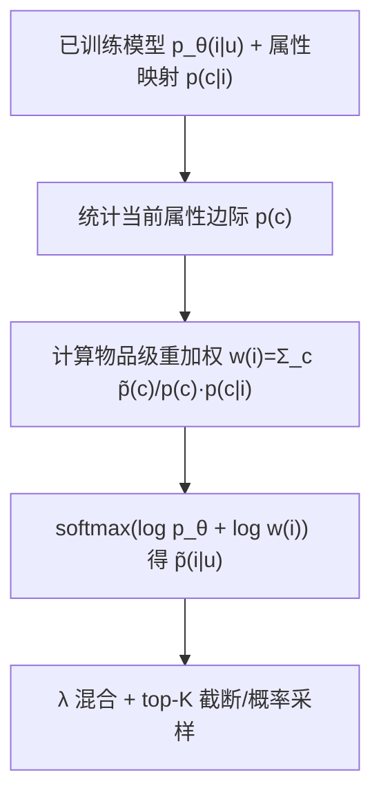

# Normative Alignment of Recommender Systems via Internal Label Shift (基于内部标签偏移的推荐系统规范对齐)

- **会议/期刊**: RecSys 2026 (Proc. RecSys '25)
- **作者与机构**: Johannes Kruse, Kasper Lindskow, Michael Riis Andersen, Ryotaro Shimizu, Julian McAuley, Pierre-Alexandre Mattei, Jes Frellsen (JP/Politikens、DTU、UCSD、Inria)
- **推荐链路定位**: 重排（后处理打分校正）
- **研究方向**: 去偏公平与工业架构 / 多任务学习与列表级重排
- **论文原文**: [https://arxiv.org/abs/2607.10915v1](https://arxiv.org/abs/2607.10915v1)
- **开源代码**: [https://github.com/johanneskruse/nails](https://github.com/johanneskruse/nails)

## TL;DR (1分钟核心速览)

现有校准工作几乎都是"用户中心"的（让推荐列表复现单个用户历史偏好），无法满足平台/编辑方的**全局规范目标**（如新闻类目配比）。NAILS 把"让全体用户的推荐属性边际分布等于目标 $\tilde{p}(c)$"重新表述为**层级分类中的内部标签偏移**：在属性层（而非物品叶层）做 Saerens 式先验校正，得到对每个物品的闭式重加权项，无需重训、无需贪心优化。在 EB-NeRD（1333 万曝光、155 候选/曝光）上，NAILS-stoch 将编辑分布 KL@10 从 3.802 降至 0.0033、均匀分布 KL@10 从 4.872 降至 0.0143，覆盖率保持 100%，AUC 基本无损甚至略升。

## Background & Motivation (背景与核心矛盾)

- **主流范式**: 推荐系统以参与度（AUC/CTR）为唯一目标优化，导致过滤气泡、多样性下降与长尾内容被压制；校准（calibration）方向主张让推荐列表的属性分布匹配某个目标分布。
- **前人局限**: ①CaliRec 等用户中心方法把目标设为"该用户历史偏好分布"，只解决个体层面的少数兴趣被淹没问题，**无法表达跨用户的全局规范目标**；②CaliRec 用贪心后处理逐条构造 top-$K$，推理开销随列表长度线性增长，且不保证全局边际对齐；③MIP/最小费用流等精确方法在大候选集上不可扩展。
- **核心洞察 (Key Insight)**: 若把 $p(c,i,u)=p(c|i)p_\theta(i|u)p(u)$ 视为"属性—物品"两层**层级分类**，则"改变属性边际"恰好是标签偏移（label shift）问题——只不过偏移发生在**内部节点**（属性）而非叶节点（物品）。Saerens 的闭式先验校正可直接搬过来。
- **本文切入点**: 在属性层施加先验比 $\tilde{p}(c)/p(c)$，聚合到物品得分上，一次性完成全用户、全候选的规范对齐，模型无关、免重训。

## Method (核心方法设计)

### 1. 整体框架 (Overall Architecture)

输入是已训练好的推荐模型 $p_\theta(i|u)$（本文用 NRMS）与物品→属性映射$p(c|i)$（单类别时为指示函数）。离线阶段统计模型当前属性边际$p(c)=\sum_{i,u}p(c|i)p_\theta(i|u)p(u)$与目标$\tilde{p}(c)$；在线阶段对每个候选物品计算重加权因子$w(i)=\sum_c \frac{\tilde{p}(c)}{p(c)}p(c|i)$，加到 log 概率上再过 softmax 得到对齐分布$\tilde{p}(i|u)$，最后用$\lambda$与原分布线性混合后取 top-$K$（确定性）或按概率采样（随机性）。全流程无梯度、无重训、无组合优化。

### 2. 关键设计拆解 (Key Designs)

1. **内部标签偏移的闭式重加权**：痛点是把全局属性目标硬塞进逐用户排序会破坏个性化。作者假设 $p(i,u|c)=\tilde{p}(i,u|c)$（属性内条件不变），推导出
$$\tilde{p}(i|u)=\frac{1}{Z(u)}\Big(\sum_{c\in\mathcal{C}}\frac{\tilde{p}(c)}{p(c)}p(c|i)\Big)p_\theta(i|u),\quad Z(u)=\sum_{i}\Big(\sum_{c}\frac{\tilde{p}(c)}{p(c)}p(c|i)\Big)p_\theta(i|u).$$
直觉：$Z(u)$是逐用户归一化，保证仍是合法分布；括号内因子只依赖物品属性，等价于"给被低估的类目整体抬分、被高估的类目整体压分"，而类目内部的物品相对次序完全由原模型决定——这正是"保留偏好、只改配比"的数学表达。实现上只需在 logits 上加$\log w(i)$再过 softmax，复杂度$O(|\mathcal{I}||\mathcal{C}|)$，与列表长度无关。

2. **$\lambda$混合与随机/确定两种解码**：$\tilde{p}_\lambda(i|u)=\lambda\tilde{p}(i|u)+(1-\lambda)p_\theta(i|u)$，$\lambda\in[0,1]$ 提供"规范强度"旋钮，便于业务方在 AUC 与对齐度之间调参。确定性解码（NAILS-det）取最高分，随机解码（NAILS-stoch）按对齐后概率采样——后者天然带来候选池 100% 覆盖率，把"对齐"与"探索/多样性"合并成一个算子。

3. **训练目标、负采样与推理效率**：本文**不引入新训练损失**，基座 NRMS 沿用原 BPR 式采样训练（负采样比 $K=4$、batch 32、Adam$10^{-4}$、$\ell_2=10^{-4}$、20% dropout、24 头注意力）。NAILS 是纯推理期插件，唯一"训练"是离线统计一次$p(c)$；相比 CaliRec 每次请求求解贪心序列，NAILS 只做一次向量化加权，工程上可视为零额外延迟。

## Experimental Setup & Evaluation Protocol (实验设置与评估协议)

- **数据集与预处理**: EB-NeRD 新闻推荐基准，8 个编辑类目（entertainment 23%、news 22%、crime 18%、sports 15%、misc 9%、lifestyle 7%、erotic 3%、opinion 3%）；剔除 auto 类目后每次曝光 **155 个候选**。

| 数据集 | #Users | #Items | #Interactions | 稀疏度/密度 | 特征/场景说明 |
| :--- | :---: | :---: | :---: | :---: | :--- |
| EB-NeRD (train) | >1M | >125K | 232,887 | 极稀疏 | 新闻曝光日志，Word2Vec 初始化 |
| EB-NeRD (valid) | — | — | 244,647 | — | 最后 24h 作 early stopping |
| EB-NeRD (test) | — | — | 13,336,710 | — | 排序评测；另 200,000 条 beyond-accuracy 样本评分布对齐 |

- **数据划分与防穿越 (Splitting Strategy)**: 按**全局时间戳切分**（训练/验证/测试按时间先后），验证集末尾 24 小时作 hold-out 早停，调参后合并 train+valid 重训，严格避免未来曝光泄漏。
- **排名评测协议 (Ranking Protocol)**: 排序用 **AUC**（隐藏测试集全候选打分）；对齐用**逐用户 KL@10**（推荐 top-10 类目分布 vs 目标分布，越低越好）与**覆盖率 COV@10**（全体用户推荐去重后占候选池比例）。注意 KL 是 per-user 平均后再聚合，与图 1 的全局聚合 KL 口径不同。
- **对比基线与超参设置**: 基座 NRMS；唯一对齐基线 CaliRec（含加性平滑，$\lambda\in[0,1]$同口径）。目标分布两种：**Editorial**（用户候选并集的类目频率，近似编辑意图）与 **Uniform**（各类目等权）。Optuna TPE 搜 25  trials，$\lambda$ 网格 0.0–0.99。

## Key Experimental Results (实验关键数据)

### 1. 主实验对比 (Main Results)

top-10 推荐下的 KL@10（↓）与 COV@10（%，↑），取各方法最优 $\lambda$：

| 方法 | 目标 | 最优 $\lambda$ | KL@10 ↓ | COV@10 ↑ | 相对基线 KL 降幅 |
| :--- | :--- | :---: | :---: | :---: | :---: |
| Baseline (NRMS, $\lambda$=0) | Editorial | 0.0 | 3.802 | 88.4 | — |
| CaliRec | Editorial | 0.5 | 0.496 | 85.2 | 87.0% |
| NAILS-det | Editorial | 0.7 | 0.527 | 83.9 | 86.1% |
| **NAILS-stoch** | Editorial | 0.7 | **0.0033** | **100** | **99.91%** |
| Baseline (NRMS, $\lambda$=0) | Uniform | 0.0 | 4.872 | 88.4 | — |
| CaliRec | Uniform | 0.99 | **0.028** | 77.4 | 99.43% |
| NAILS-det | Uniform | 0.3 | 0.066 | 85.8 | 98.65% |
| **NAILS-stoch** | Uniform | 0.99 | 0.0143 | **100** | **99.71%** |

排序侧（图 2，确定性方法）：Editorial 目标下 NAILS-det 与 CaliRec 的 AUC 均**高于**未对齐基线（NAILS 略优，峰值约 0.62 量级）；Uniform 目标下两者 AUC 均下降，体现"严格公平 vs 相关性"的硬权衡。

### 2. 消融实验 (Ablation Study)

以 $\lambda$ 扫描替代组件消融（核心组件即"重加权 + 混合 + 解码方式"）：

| 配置 | Editorial KL@10 | Editorial COV | Uniform KL@10 | Uniform COV |
| :--- | :---: | :---: | :---: | :---: |
| $\lambda=0$（无对齐） | 3.802 | 88.4 | 4.872 | 88.4 |
| NAILS-det $\lambda$=0.3 | 3.555 | 92.3 | 3.160 | 85.8 |
| NAILS-det $\lambda$=0.7 | 3.422 | 92.3 | 3.783 | 79.4 |
| NAILS-stoch $\lambda$=0.7 | 2.025 | 100 | 2.745 | 100 |
| NAILS-stoch $\lambda$=0.99 | 2.031 | 100 | 2.508 | 100 |
| 全候选池 NAILS ($\lambda$=0.99, @$|\mathcal{C}|$) | **0.0002** | — | **0.0003** | — |

### 3. 关键实验发现 (Key Findings)

1. **对齐几乎"免费"**：NAILS-stoch 在 Editorial 目标下把 KL@10 从 3.802 压到 0.0033（降 99.9%），同时覆盖率从 88.4% 升到 100%，说明概率采样解码把"分布对齐"与"长尾曝光"两个目标一次性解决，而 CaliRec 的覆盖率反而随 $\lambda$ 单调下滑（85.2%→77.4%）。
2. **目标分布决定成败**：Editorial 目标下对齐甚至**提升** AUC（候选列表本身由编辑筛选，对齐等于纠偏模型对热门类目的过度偏好）；Uniform 目标下 AUC 必然下降。这定量证明"规范目标设计"比"对齐算法"更关键，不能把公平当免费午餐。
3. **NAILS 是"软推"而非"硬拟合"**：在 top-10 截断下 NAILS-det 的 KL（0.527）略逊 CaliRec（0.496），但在全候选池上 KL 降至 0.0002——说明其校正作用在完整打分分布上精确成立，截断损失来自 top-$K$ 离散化，而非重加权公式本身。

## Highlights & Limitations (亮点、对比与审稿批判)

- **与代表作对比 (vs. Prior Work)**: 与 CaliRec（Steck）相比，NAILS 把"用户历史分布"换成"平台全局规范分布"，且用闭式重加权替代贪心序列构造，推理复杂度与列表长度解耦；与 Seymen 的 MIP、Abdollahpouri 的最小费用流相比，NAILS 不追求单次请求的精确最优，而是以"方向性偏移 + $\lambda$ 旋钮"换取可扩展性与模型无关性；与 LeapRec 的两阶段解耦训练相比，NAILS 完全不动训练管线，是纯推理插件。
- **可迁移亮点**: ①"内部标签偏移"这一视角可迁移到任何带层级标签（类目/话题/作者/地域）的推荐场景，只需一次离线边际统计；②概率采样解码同时充当对齐器与探索器，可直接用于冷启动与多样性扶持。
- **审稿级局限批判**: ①理论瑕疵——校正时固定 $p(u)$而理论上应变为$\tilde{p}(u)$，因此**不保证**严格达到$\tilde{p}(c)$，作者自认只是"近似方向性偏移"，缺少误差界分析；②实验仅单一数据集、单一基座（NRMS）、单一属性（类目），且 KL 为 per-user 平均，与图 1 全局聚合口径不一致，易误读；③未做线上 A/B 与长期效应（过滤气泡是否真被缓解）验证，$\lambda$ 的敏感性也仅以曲线呈现，缺少自动化选取策略。

## Rating (四维评分)

- **方法创新性 (Novelty)**: ⭐⭐⭐⭐ （把层级分类的内部标签偏移引入规范对齐，视角新颖且公式极简，但本质是 Saerens 校正的巧妙搬运，理论深度有限）
- **评估协议与实验扎实度 (Protocol & Experiments)**: ⭐⭐⭐ （时间切分与隐藏测试集规范，但仅一个数据集/一个基座/一个属性，缺显著性检验与线上验证）
- **写作与数学规范度 (Clarity & Rigor)**: ⭐⭐⭐⭐ （推导链条清晰、$Z(u)$归一化交代到位，但对$p(u)$ 固定假设的近似误差未给界）
- **工业落地与复现价值 (Industrial & Practical Value)**: ⭐⭐⭐⭐⭐ （免重训、$O(|\mathcal{I}||\mathcal{C}|)$、与列表长度无关，代码开源，新闻/内容平台可直接插拔上线）
