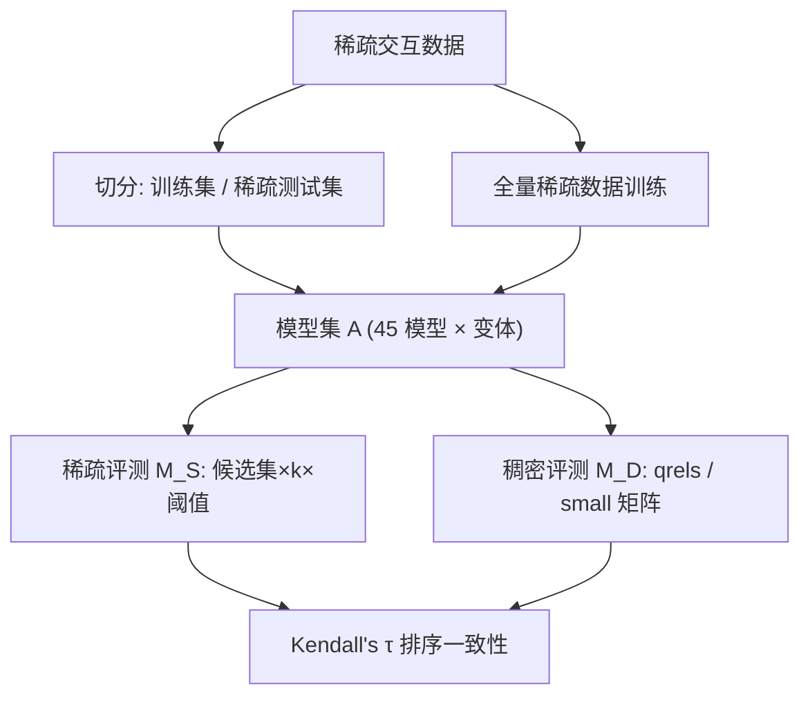
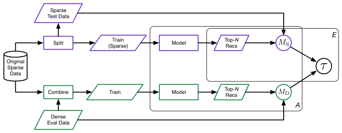

# On the Convergent Validity of Offline Evaluation Designs for Recommender Systems (论推荐系统离线评测设计的收敛效度)

- **会议/期刊**: ACM RecSys 2026 (Main Track)
- **作者与机构**: Sushobhan Parajuli, Samira Vaez Barenji, Michael D. Ekstrand（Drexel University 信息科学系）
- **推荐链路定位**: 评测方法论（贯穿召回/排序全链路的离线评估协议）
- **研究方向**: 去偏公平、可信隐私与工业架构 / 评测基准与效度理论
- **论文原文**: [https://arxiv.org/abs/2607.25097v1](https://arxiv.org/abs/2607.25097v1)
- **开源代码**: [Zenodo 归档](https://doi.org/10.5281/zenodo.21549024)

## TL;DR (1分钟核心速览)

本文质疑"稀疏日志离线评测能否反映真实用户偏好"这一根本前提，引入测量学中的**收敛效度 (Convergent Validity)** 概念：以通过受控曝光实验采集的**稠密真值反馈**为参照系，用 Kendall's τ 衡量 45 个模型在 97–123 种稀疏评测配置下的排序一致性。结果：MovieLens 上最高仅 τ=0.43（全候选集、k=100、r≥3.0），KuaiRec 上所有设计均为**负相关**（最差 τ=−0.57），即稀疏评测几乎反转了稠密排序。结论是**不存在普适最优的离线评测设计**，模型间差异可能更多由评测协议而非模型效能驱动。

## Background & Motivation (背景与核心矛盾)

- **主流范式**: 以历史交互日志做 train-test 切分、在留出集上算 NDCG/DCG 排序指标，是学术与工业的第一道筛选关卡。
- **前人局限**: ① 交互数据极端稀疏且 **MNAR**（缺失非随机，受曝光与用户行为共同决定），缺失项既不能当负例也不能当未知；② 既有工作（如 Krichene & Rendle 批评采样候选集有偏）只能证明"两种设计结果不同"，却**缺乏判断谁更正确的参照点**——差异本身不构成效度证据。
- **核心洞察 (Key Insight)**: 若把"稠密真值反馈"视为同一构念（模型效能）的高质量测量，则稀疏评测的有效性可被操作化为**两种测量对模型排序的一致性**；这正是心理测量学中的收敛效度。
- **本文切入点**: 用 MovieLens-32M 扩展版（51 名活跃用户的兴趣 qrels）与 KuaiRec small 矩阵（99.6% 密度）作为"昂贵但可信"的参照，系统扫描过滤阈值、候选集构造、列表长度、相关性阈值四类设计因子。

## Method (核心方法设计)

### 1. 整体框架 (Overall Architecture)

实验设计为**双轨对照**：稀疏轨将稀疏数据切分为训练/测试，训练模型并在留出集上评测得 $M_S$；稠密轨用**全部稀疏数据**训练同一批模型，但在稠密真值上评测得 $M_D$。对每个数据集 × 稠密目标 × 稀疏设计组合，计算两组模型排序的 Kendall's τ，并以 bootstrap 给出 95% 置信区间。核心逻辑是：$M_D$ 是"更接近真值"的测量，$M_S$ 与它的排序一致性即其效度上界。

<figure class="paper-figure" markdown="span">
  <figcaption>图1：单一数据集与稠密评估目标的实验设计示意图。𝑀S 和 𝑀D 分别为稀疏数据与稠密数据上的评估指标，平板符号表示对 𝐴models 与 𝐸sparse 评估设计的重复。</figcaption>
</figure>

### 2. 关键设计拆解 (Key Designs)

1. **稠密真值参照系（Reference Construct）**：痛点在于稀疏日志无"正确答案"，作者改用**受控曝光干预**采集的稠密反馈——MovieLens 扩展版按标准 IR pooling 汇集多算法推荐列表，由 51 名用户标注 0–7 兴趣度（折叠为 0–4）；KuaiRec small 矩阵则让 1,411 名用户曝光近全库视频。直觉：只有"用户被强制看过大量物品"的数据才能消除曝光偏差，构成效度锚点。

2. **四因子评测设计网格（Design Grid）**：稀疏侧系统变化 ① 候选集 $\mathcal{C}\in\{\text{Full}, U\text{-}1000, P\text{-}1000\}$（全库 / 均匀采样 1000 / 流行度加权采样 1000）；② 截断 $k\in\{10,20,100\}$；③ 相关性阈值（MovieLens $r\ge3.0, r\ge4.0$、Graded；KuaiRec $r\ge0.85, r\ge2.0$、Graded）；④ 隐式模型训练阈值（MovieLens 3 档、KuaiRec 4 档）。效度指标为：

$$\tau = \frac{2}{n(n-1)}\sum_{i<j}\operatorname{sgn}(M_S^{(i)}-M_S^{(j)})\operatorname{sgn}(M_D^{(i)}-M_D^{(j)})$$

   其中 $n$ 为模型配置数（97 或 123）。直觉：τ 对"整体排序是否被保留"敏感，比单点指标差更能刻画评测协议的系统性偏差。

3. **模型池与训练/推理开销**：45 个 LensKit 2026.1.0 模型（Popular、Bias、UserKNN/ItemKNN、ALS-MF、BiasedSVD、NMF、BPR、WARP、Logistic MF、fsSLIM），维度 $d\in\{32,64,128,256\}$，KNN 的 $k\in\{5,20\}$、$k_{\min}\in\{1,2,5\}$。本文**不涉及新训练目标或负采样策略**，全部沿用各模型原生损失；开销集中在 97×多设计组合的重复评测，属可离线批量完成的评测成本。

## Experimental Setup & Evaluation Protocol (实验设置与评估协议)

- **数据集与预处理**:

| 数据集 | #Users | #Items | #Interactions | 稀疏度/密度 | 特征/场景说明 |
| :--- | :---: | :---: | :---: | :---: | :--- |
| MovieLens-32M (稀疏) | 200,948 | — | ~31.7M | 极稀疏 | 0.5–5.0 显式评分 |
| MovieLens 扩展 qrels (稠密) | 51 | 池化候选 | 池化标注 | 稠密 | 0–4 兴趣度，IR pooling |
| KuaiRec big (稀疏) | 7,176 | 10,728 | — | 16.3% | 观看比例 watch ratio |
| KuaiRec small (稠密) | 1,411 | 3,327 | — | 99.6% | 受控曝光全库观看 |

- **数据划分与防穿越**: MovieLens 采用**固定时间戳切分**（训练交互全部早于测试交互，防穿越）；KuaiRec 矩阵无时序，采用 **5 折交叉验证**，每折每用户留出 5 条交互。
- **排名评测协议**: 稀疏侧为 **Full-Ranking（全库未交互排序）** 与两种 1000 候选采样排序（U-1000 均匀、P-1000 流行度加权）；稠密侧在 qrels/small 矩阵上做全候选排序。指标为 NDCG@k 与 DCG@k，$k\in\{10,20,100\}$（稠密侧取 $k\in\{10,100\}$）。
- **对比基线与超参**: 无外部 SOTA 对比，比较对象是**评测设计本身**；模型池覆盖 45 模型 × 变体，显著性以 bootstrap 95% CI 是否跨零判断。

## Key Experimental Results (实验关键数据)

### 1. 主实验对比 (Main Results)

MovieLens 上 Kendall's τ（稀疏 vs. 稠密，节选代表性设计；稠密目标 Very Interested）：

| 候选集 | 稀疏 k | 阈值 | τ vs. Dense@10 | τ vs. Dense@100 |
| :--- | :---: | :---: | :---: | :---: |
| Full | 10 | r≥3.0 | 0.21 | 0.38 |
| Full | 100 | r≥3.0 | 0.26 | **0.43** |
| U-1000 | 100 | r≥3.0 | 0.23 | 0.36 |
| P-1000 | 20 | r≥3.0 | **0.29** | 0.19 |
| P-1000 | 100 | r≥3.0 | 0.29 | 0.18 |
| Full | 100 | Graded | 0.23 | 0.40 |

KuaiRec 上同一分析（稠密目标 Watched 2×）：

| 候选集 | 稀疏 k | 阈值 | τ vs. Dense@10 | τ vs. Dense@100 |
| :--- | :---: | :---: | :---: | :---: |
| Full | 20 | r≥2.0 | **−0.24** | −0.27 |
| Full | 20 | r≥0.85 | −0.47 | −0.50 |
| U-1000 | 20 | r≥2.0 | −0.21 | −0.23 |
| P-1000 | 20 | r≥2.0 | −0.19 | −0.21 |
| Full | 100 | Graded | −0.53 | −0.56 |

### 2. 消融实验 (Ablation Study)

本文以"设计因子开关"替代组件消融，下表为各因子对 τ 的影响幅度（MovieLens，稠密目标 Very Interested@100）：

| 设计变体 (w/o 或 替换) | τ | Δ vs. 最优 |
| :--- | :---: | :---: |
| Full 候选集（最优） | **0.43** | — |
| → 替换为 U-1000 | 0.36 | −0.07 |
| → 替换为 P-1000 | 0.18 | −0.25 |
| → 阈值改 r≥4.0 | 0.38 | −0.05 |
| → 阈值改 Graded | 0.40 | −0.03 |
| → 稀疏 k 由 100 降至 10 | 0.38 | −0.05 |

### 3. 关键实验发现 (Key Findings)

1. **候选集是 MovieLens 上的一阶因子，且方向随稠密目标长度反转**：对 Dense@10，P-1000 最优（τ=0.29 vs. Full 0.26）；对 Dense@100，Full 最优（τ=0.43）而 P-1000 崩至 0.18。说明流行度加权采样只"讨好"短列表目标，长列表下反而引入系统性偏差。
2. **稀疏评测擅长"长列表召回"而非"头部精准"**：同一 Full 设计从 Dense@10 的 τ=0.26 升至 Dense@100 的 τ=0.43，暗示稀疏日志能判断"相关物品是否出现在长列表中"，却难以判断"谁把最相关物品排在最前"。
3. **KuaiRec 上评测协议彻底失效，且显式模型被系统性误杀**：所有设计 τ<0，Graded 目标最差达 −0.57；稠密 Top-1 的 BiasedSVD-d64（NDCG@10=0.323）在最优相关稀疏设计下仅排第 40 位，而在任一稀疏设计下最好也只到第 23 位——模型排名几乎由评测协议决定。

## Highlights, Limitations & Rating (亮点、对比与审稿评价)

- **与代表作对比 (vs. Prior Work)**: 相比 Krichene & Rendle 以"全库评测"为金标准批评采样偏差，本文用**独立采集的稠密真值**作更强参照，因而能指出"全库评测本身也未必正确"；相比 Cañamares & Castells 的 target-set 最小/最大分析，本文把候选集、阈值、k 纳入统一网格并给出跨数据集反例；相比 Ihemelandu & Ekstrand 的模拟研究，本文提供真实用户标注的实证证据。
- **可迁移亮点**: ① "稠密真值锚点 + Kendall's τ"可作为任何新评测协议（如 LLM 评审、生成式评测）的效度检验模板；② 报告结果时应同时给出多组候选集/阈值下的 τ 稳定性，而非单一配置的指标排名。
- **审稿级局限批判**: ① 稠密真值样本极小（MovieLens 仅 51 用户、KuaiRec 1,411 用户），τ 的置信区间宽达 ±0.15，部分结论（如 U-1000 vs. P-1000 的差异）CI 重叠难以定论；② MovieLens 扩展版经 pooling 与 k-core 过滤，流行度偏置可能人为抬高稀疏-稠密重叠，作者亦承认未隔离该效应；③ KuaiRec 无时序、用交叉验证，与真实推荐场景偏离，负相关结论的可外推性存疑。
- **四维评分**: 创新性 ⭐⭐⭐⭐ | 实验扎实度 ⭐⭐⭐ | 方法清晰度 ⭐⭐⭐⭐⭐ | 落地价值 ⭐⭐⭐⭐

