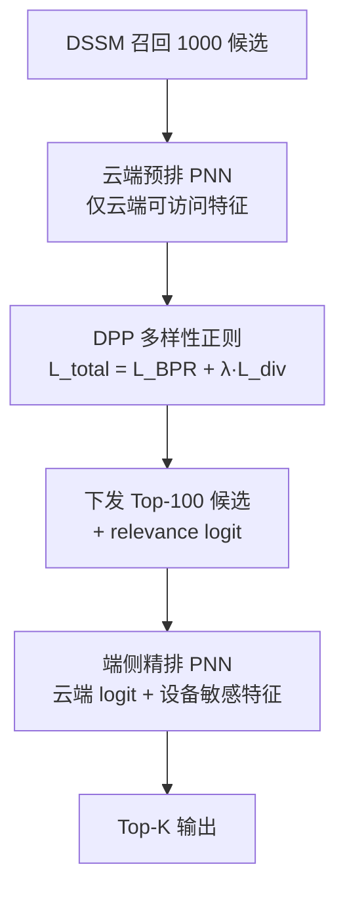
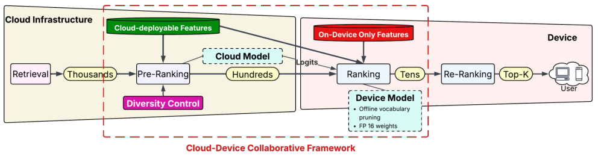

# PriCoRec: A Privacy-Aware Cloud–Device Collaborative Framework for Ad Recommendation under Feature Constraints (特征约束下隐私感知的云–端协同广告推荐框架)

- **会议/期刊**: RecSys 2026 (5 pages, short paper)
- **作者与机构**: Dairui Liu, Zhongyi Lu, Jitao Lu, Ruihai Dong 等（University College Dublin × Huawei Ireland Research Center）
- **推荐链路定位**: 预排（云侧）+ 精排（端侧），重排不在范围内
- **研究方向**: 去偏公平、可信隐私与工业架构 / CTR 预估与特征交叉
- **论文原文**: [https://arxiv.org/abs/2608.14429v1](https://arxiv.org/abs/2608.14429v1)
- **开源代码**: [https://github.com/Ruixinhua/PriCoRec-RecSys2026](https://github.com/Ruixinhua/PriCoRec-RecSys2026)

## TL;DR (1分钟核心速览)

隐私法规禁止云端处理年龄、性别等敏感特征，而纯云端级联推荐又离不开这些特征。PriCoRec 把预排留在云端（仅用云端可访问特征），把精排下沉到设备端（本地融合敏感特征），并用 DPP 启发的多样性正则补偿云端特征缺失导致的候选同质化，用云端 logit 作为端侧辅助特征实现"大模型指导小模型"。在 OpenMCC / TaobaoAd / Ali-CCP 三个工业数据集上，端侧精排 gAUC 分别达 79.76 / 86.93 / 73.30，R@10 相对最强基线提升 2.50 / 4.36 / 3.13 个点，TaobaoAd 全链路时延 10.32 ms 反低于纯云端 11.62 ms。

## Background & Motivation (背景与核心矛盾)

- **主流范式**: 工业广告采用"召回 → 预排 → 精排 → 重排"四级级联，全部计算在云端完成，仅将最终结果回传设备；CTR 模型依赖年龄、性别等高阶特征交叉。
- **前人局限**: 联邦学习（FedCAR/FedCIA）与差分隐私（DP-SGD）虽能保护数据，但前者要求云端可触达梯度/模型、通信与基础设施开销大，后者以显著精度损失换取隐私；二者均未真正解决"敏感特征根本不能上云"这一硬约束。
- **核心洞察 (Key Insight)**: 特征天然可分为**云端可访问**（物品特征、请求上下文）与**仅设备可见**（用户画像、细粒度行为）两组；把精排搬到端侧即可本地消费敏感特征，但云端预排因特征受限会产出**同质化候选集**，端侧又受算力/功耗限制无法承载大模型——这是"朴素拆分"失效的两个根因。
- **本文切入点**: 用多样性正则修复云端候选质量，用云端 logit 蒸馏替代端侧大模型，从而在隐私约束下同时保住效果与效率。

## Method (核心方法设计)

### 1. 整体框架 (Overall Architecture)

输入为 DSSM 召回的 1000 个候选；云端预排（PNN backbone，32 维 embedding、3 层）仅用云端可访问特征将候选压缩至 100 个，同时输出每个候选的 relevance logit 与特征一并下发；端侧精排（PNN，4 维 embedding、2 层）将云端 logit 作为辅助特征，与本地敏感特征拼接后对 100 个候选重排输出 Top-K。训练上云端损失为 BPR 排序损失加多样性正则，端侧通过云端 logit 蒸馏获得大模型知识而不增加推理开销。

<figure class="paper-figure" markdown="span">
  <figcaption>图1：PriCoRec 在四阶段推荐流程中的云–端协同。</figcaption>
</figure>

### 2. 关键设计拆解 (Key Designs)

1. **DPP 启发的多样性正则（修复云端候选同质化）**：云端特征受限时预排倾向收敛到相似高分物品，导致点击物品被挤出 Top-100。作者对用户 $u$的$n$个候选构造相似度核矩阵，元素为$S_{ij}=\frac{1+\langle\tilde{I}_i,\tilde{I}_j\rangle}{2}$（$\tilde{I}$为预排 embedding 层输出的 L2 归一化物品向量），并以 log-determinant 作为多样性损失$L_{div}=-\log\det(S_{R_u})$。几何直觉是：行列式等于矩阵行向量张成的平行多面体体积，物品越不相似、体积越大、损失越小，从而在保持相关性的同时惩罚冗余。总损失为$L_{total}=L_{base}+\lambda L_{div}$，$\lambda\in[10^{-5},10^{-2}]$在验证集上调优（OpenMCC 取$10^{-3}$，另两个取$10^{-2}$）。
2. **云端引导的端侧轻量排序（用蒸馏替代复制）**：端侧算力有限，无法复现云端大模型。PriCoRec 不要求端侧拟合云端参数，而是把云端预排对每个候选输出的 relevance logit 当作**辅助输入特征**，与云端可访问特征、设备敏感特征一起送入 4 维 embedding 的浅层 PNN。这样端侧只需学习"如何在云端判断基础上用敏感特征做修正"，容量需求大幅下降；配合离线词表重映射（压缩 embedding 表行数）与 FP16 存储进一步压缩模型体积。
3. **训练目标、负采样与推理效率**：云端采用 BPR pairwise 损失，每用户 1 正 4 负随机下采样（1:4），该协议在所有预排 backbone 上统一使用；端侧沿用 PNN 的 CTR 损失并以上述 logit 为输入。推理时云端预排与端侧精排串行，端侧仅 0.51–0.77 ms，模型体积可在 7.7–29.4 MB 间按设备预算配置。

## Experimental Setup & Evaluation Protocol (实验设置与评估协议)

- **数据集与预处理**: 三个大规模工业数据集，特征按统一分类法映射为云端可访问 / 仅设备两组：

| 数据集 | #Users | #Items | #Interactions | #Clicks | 云端特征数 | 设备特征数 |
| :--- | :---: | :---: | :---: | :---: | :---: | :---: |
| OpenMCC | 5,865,593 | 381,345 | 9,672,681 | 563,753 | 22 | 5 |
| TaobaoAd | 1,083,798 | 806,874 | 23,341,680 | 1,291,950 | 11 | 8 |
| Ali-CCP | 356,908 | 3,168,707 | 42,738,779 | 2,083,130 | 14 | 9 |

- **数据划分与防穿越 (Splitting Strategy)**: 优先采用官方 train/valid/test 划分；无预定义验证集的数据集将测试集随机对半切为验证/测试（50%/50%）。
- **排名评测协议 (Ranking Protocol)**: 评估完整级联——DSSM 召回 1000 → 云端预排保留 100 → 端侧重排。指标为 user-grouped AUC (gAUC)、Recall@K、nDCG@K、RR；其中 R@100 衡量点击物品能否进入端侧候选集，是预排阶段的关键指标。
- **对比基线与超参设置**: 基线含 Popularity、PNN、DP-SGD、DualRec、FedCAR、FedCIA，全部适配同一特征约束。云端 PNN 为 32 维 embedding + 3 层，端侧为 4 维 + 2 层；训练负采样 1:4 随机下采样；超参在验证集上选取。

## Key Experimental Results (实验关键数据)

### 1. 主实验对比 (Main Results)

**表 2 云端预排（仅云端可访问特征，%）**

| Method | OpenMCC gAUC | OpenMCC R@100 | TaobaoAd gAUC | TaobaoAd R@100 | Ali-CCP gAUC | Ali-CCP R@100 |
| :--- | :---: | :---: | :---: | :---: | :---: | :---: |
| Popularity | – | 35.82 | – | 23.12 | – | 25.95 |
| PNN | 79.95 | 49.44 | 88.69 | 67.30 | 72.40 | 46.86 |
| DP-SGD | 80.06 | 49.72 | 89.25 | 67.85 | 72.51 | 46.91 |
| DualRec | 79.99 | 49.10 | 88.47 | 66.74 | 72.10 | 46.78 |
| FedCAR | 79.59 | 49.61 | 88.66 | 67.65 | 72.82 | 46.56 |
| FedCIA | 79.70 | 49.82 | 88.59 | 67.47 | 72.93 | 46.92 |
| **PriCoRec** | **80.29** | **50.41** | **89.36** | **68.29** | **73.69** | **47.72** |
| Improv.% | +0.29 | +1.18 | +0.12 | +0.65 | +1.04 | +1.71 |

**表 3 端侧精排（Top-100 云端候选，%）**

| Method | OpenMCC gAUC | OpenMCC R@10 | OpenMCC N@10 | TaobaoAd gAUC | TaobaoAd R@10 | TaobaoAd N@10 | Ali-CCP gAUC | Ali-CCP R@10 | Ali-CCP N@10 |
| :--- | :---: | :---: | :---: | :---: | :---: | :---: | :---: | :---: | :---: |
| PNN | 78.44 | 10.72 | 5.58 | 83.31 | 15.24 | 8.19 | 71.39 | 20.26 | 11.60 |
| DP-SGD | 77.99 | 11.37 | 7.11 | 85.41 | 17.38 | 9.37 | 71.46 | 20.97 | 11.61 |
| DualRec | 77.86 | 10.66 | 6.51 | 85.32 | 16.53 | 8.72 | 71.26 | 20.22 | 11.35 |
| FedCAR | 77.71 | 10.17 | 6.19 | 85.73 | 16.99 | 8.81 | 71.08 | 20.46 | 11.16 |
| FedCIA | 77.57 | 10.85 | 6.94 | 85.50 | 16.16 | 8.38 | 71.68 | 20.76 | 12.26 |
| **PriCoRec** | **79.76** | **13.87** | **8.12** | **86.93** | **21.74** | **11.60** | **73.30** | **24.10** | **16.02** |
| Improv.% | +2.27 | +22.0 | +14.2 | +1.40 | +25.1 | +23.8 | +2.26 | +14.9 | +30.7 |

### 2. 消融实验 (Ablation Study)

原文未提供标准逐组件消融表，以下依据正文描述与表 2/3 的对照关系整理关键组件的边际贡献：

| 配置 | 云端 R@100 (OpenMCC) | 端侧 R@10 (OpenMCC) | 端侧 R@10 (TaobaoAd) | 说明 |
| :--- | :---: | :---: | :---: | :--- |
| 纯云端 PNN（无拆分） | 49.44 | 10.72 | 15.24 | 无隐私隔离，作为参照 |
| 拆分 + 无多样性正则 | ≈49.4–49.8 | ≈11.4 | ≈17.4 | 对应 DP-SGD/FedCIA 类拆分效果 |
| 拆分 + 多样性正则（完整 PriCoRec） | **50.41** | **13.87** | **21.74** | 云端候选质量与端侧排序同步提升 |

### 3. 关键实验发现 (Key Findings)

1. **多样性正则的收益是"传导式"的**：云端 R@100 仅提升 0.59–0.97 个点（49.82→50.41、67.85→68.29、46.92→47.72），但端侧 R@10 却跃升 2.50–4.36 个点，说明候选集覆盖度的微小改善在端侧被敏感特征放大，验证了"云端瓶颈决定端侧上限"的级联假设。
2. **$\lambda$是相关性–多样性权衡而非单调旋钮**：小非零值（$10^{-3}$–$10^{-2}$）取得最佳 R@100，更强正则会进一步提升 Diversity@100 但损害召回，因此必须按数据集在验证集上调参，不能简单置零或取最大。
3. **拆分不必然增加时延**：TaobaoAd 上云–端全链路 10.32 ms（9.81 + 0.51）反而低于纯云端 11.62 ms，OpenMCC 上 5.08 ms 略高于 4.86 ms，说明端侧承担精排可卸载云端负载；同时模型体积 7.7 MB→29.4 MB 对应 R@1 从 4.51 升至 7.51，给出明确的端侧资源配置曲线。

## Highlights & Limitations (亮点、对比与审稿批判)

- **与代表作对比 (vs. Prior Work)**: 与 DP-SGD 相比，PriCoRec 不做梯度扰动、无精度换隐私的折损；与 FedCAR/FedCIA 相比，它不要求云端触达模型更新，而是从架构上物理隔离敏感特征，隐私保证更强、通信开销为零；与文献 [22] 的性能驱动云–端方案相比，本文的核心目标函数是"特征隔离下的效果保持"而非单纯加速。
- **可迁移亮点**: (1) 把上游模型的输出 logit 作为下游轻量模型的输入特征，是一种零推理开销的跨端蒸馏范式，可迁移到任何"大模型离线、小模型在线"的级联场景；(2) 用 log-det 核矩阵正则直接优化候选列表的多样性，可复用于召回/预排阶段的覆盖率优化与长尾扶持。
- **审稿级局限批判**: (1) 隐私保证仅为"架构级隔离"，未给出形式化隐私预算或成员推断攻击下的量化评估，端侧 logit 下发本身可能泄露云端信息；(2) 实验仅在公开数据集上离线复现，缺少真实设备功耗/内存实测与线上 A/B，且未与完整纯云端大模型做效果上限对比，5 页短文亦缺少逐组件消融与显著性检验。

## Rating (四维评分)

- **方法创新性 (Novelty)**: ⭐⭐⭐ （云–端特征切分思路直观，DPP 正则与 logit 蒸馏均为成熟技术的组合式迁移，胜在问题定义清晰而非机制原创）
- **评估协议与实验扎实度 (Protocol & Experiments)**: ⭐⭐⭐ （三工业数据集 + 完整四级级联评估较可信，但缺逐组件消融、显著性检验与线上验证）
- **写作与数学规范度 (Clarity & Rigor)**: ⭐⭐⭐⭐ （5 页内公式与符号定义紧凑清晰，log-det 多样性的几何解释到位，复杂度分析略欠）
- **工业落地与复现价值 (Industrial & Practical Value)**: ⭐⭐⭐⭐ （代码已开源，时延与模型体积均有实测数据，端侧 7.7 MB 起的配置曲线对部署极具参考价值）
