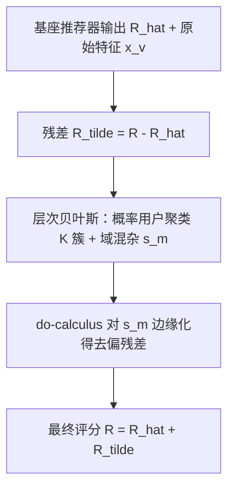
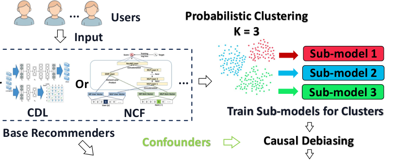

# Probabilistic Residual Learning for Online Recommendations (在线推荐的概率残差学习)

- **会议/期刊**: RecSys 2026
- **作者与机构**: Wenyuan Wang, Yusong Zhao, Zihao Xu, Hengyi Wang, Qi Xu, Zhigang Hua, Yan Xie, Yi Wang, Zihao Zhao, Bo Long, Chengzhi Mao, Shuang Yang, Hengguan Huang, Hao Wang（Rutgers University / Meta / University of Copenhagen / UIUC）
- **推荐链路定位**: 精排（对已有基座打分做残差校正）
- **研究方向**: 去偏公平与工业架构 / 冷启动与长尾推荐
- **论文原文**: [https://arxiv.org/abs/2607.20863v1](https://arxiv.org/abs/2607.20863v1)
- **开源代码**: 暂未开源

## TL;DR (1分钟核心速览)

深度推荐器是黑盒且难以系统性增强，跨域冷启动下更因域特异混杂（曝光/流行度）而性能骤降。本文提出 PRL：把最终评分拆为 $R=\hat{R}+\tilde{R}$，固定基座 $\hat{R}$，用层次贝叶斯模型对残差 $\tilde{R}$ 做概率用户聚类 + 域级混杂 $s_m$ 建模，推理时以 do-calculus 对 $s_m$ 边缘化得到去偏残差。即插即用于 CDL/DLRM/NCF/PerK/LightGCN，在 XMRec 冷启动划分上 Recall@20 最高从 0.1098 提升至 0.2750（+150%），CDL 基座上更从 0.0143 升至 0.1091（约 7.6 倍）。

## Background & Motivation (背景与核心矛盾)

- **主流范式**: 跨域推荐多依赖源域与目标域**共享用户或物品**做知识迁移（如 PerK 的个性化 top-K 迁移），或以域内内容特征（CDL）缓解冷启动。
- **前人局限**: ① 现实中用户/物品常完全不相交（如不同国家的市场），共享实体假设失效；② 域特异混杂（国家、上映年份）诱导虚假相关（如"宝莱坞电影与板球装备共现"），模型学到的是捷径而非真实偏好；③ 现有因果去偏（PDA、DICE）在单一 SCM 内工作，**忽略潜在用户簇**，无法做簇级定向增强。
- **核心洞察 (Key Insight)**: 基座模型已捕获大部分主信号，剩余误差 $\tilde{R}=R-\hat{R}$ 才是可被"低维结构 + 去偏"高效刻画的增量；且残差在不同用户簇上分布异质，适合混合模型建模。
- **本文切入点**: 将跨域适配重述为**对固定基座的即插即用概率残差校正问题**，用层次贝叶斯 + do-calculus 同时解决"簇异质"与"域混杂"。

## Method (核心方法设计)

### 1. 整体框架 (Overall Architecture)

训练阶段：给定任意基座推荐器，先算其预测 $\hat{R}_{ij}$ 与残差 $\tilde{R}_{ij}=R_{ij}-\hat{R}_{ij}$；随后联合优化一个层次贝叶斯生成模型——域级混杂 $s_m$ 同时影响用户隐向量 $u_i$、物品隐向量 $v_j$ 与残差；用户按 $u_i$ 的概率后验被划入 $K$ 个高斯簇，每簇共享一套 $(\mu_k,\Sigma_k)$ 与残差子模型。推理阶段：对新用户-物品对，先由式 24 推断簇 $\pi_i$，再用该簇子模型对 $s_m$ 做 do-calculus 边缘化得到去偏残差，最后 $R=\hat{R}+\tilde{R}$ 输出。全流程用 ELBO 的 E-Step/M-Step 交替求解，基座参数全程冻结。

<figure class="paper-figure" markdown="span">
  <figcaption>图1：PRL 概览。训练时，PRL 对固定基础推荐器的残差建模，对用户进行概率聚类，并学习各簇特定的校正模型。推理时，它使用推断出的簇预测经混杂调整的残差，并将其加到基础预测上。</figcaption>
</figure>

### 2. 关键设计拆解 (Key Designs)

1. **概率用户聚类（Product-of-Gaussians 物品先验 + GMM 式用户先验）**：痛点是用单一全局残差模型无法适配异质用户群。物品先验融合内容估计与域条件估计：$p(v_j|x_j^v,s_m)=\mathrm{PoG}(f_v(x_j^v),W_v s_m,\Lambda_v^{-1}I,\lambda_v^{-1}I)$，其闭式为 $\mu_{pog}=\frac{\Lambda_v f_v(x_j^v)+\lambda_v W_v s_m}{\Lambda_v+\lambda_v}$；用户先验 $u_i\sim\mathcal{N}(\mu_{\pi_i}+W_u s_m,\Sigma_{\pi_i})$，簇后验按 GMM 责任度计算 $q(\pi_i=k)\propto\mathcal{N}(u_i;\mu_k+W_u s_{m_i},\Sigma_k)$。直觉：内容信号与域信号按精度加权融合，簇均值让同簇用户互相正则，天然形成可解释分群。

2. **do-calculus 混杂去偏**：痛点是直接条件于 $s_m$ 会过拟合域捷径。PRL 对 $(u_i,v_j)$ 做干预，切断 $s\to(u,v)$ 的边，按簇子模型对域做贝叶斯模型平均：
$$p^{(k)}(\tilde{R}_{ij}\mid do(u_i),do(v_j))=\sum_{m=1}^{M}p^{(k)}(\tilde{R}_{ij}\mid u_i,v_j,s_m)\,p(s_m)$$
直觉：边缘化等价于"抹掉域身份、只保留跨域稳定的用户-物品交互信号"，从而把曝光/流行度偏差从残差中剥离。

3. **训练目标、负采样与推理效率**：总目标为 ELBO，分解为四项——用户 KL（拉向簇心）、残差似然 $-\frac{\lambda_{\tilde R}}{2}(\tilde{R}_{ij}-u_i^\top v_j-w_R^\top s_m)^2$、物品 KL（拉向 PoG 先验）、簇 KL。$\mu_k,\Sigma_k$ 有闭式更新（式 20–21），$W_u,W_v,w_R$ 亦有闭式解（式 25–27），仅 $f_v(\cdot)$ 用梯度上升。**无负采样**（评分回归范式）；推理时式 22 只用到该用户已评分物品，开销随交互数而非全库规模增长，适合在线服务。

## Experimental Setup & Evaluation Protocol (实验设置与评估协议)

- **数据集与预处理**:

| 数据集 | #Users | #Items | #Interactions | 稀疏度/密度 | 特征/场景说明 |
| :--- | :---: | :---: | :---: | :---: | :--- |
| XMRec | 18 个市场 | 16 品类 | 52.5M | 极稀疏 | 过滤交互 <3 的用户；物品描述为内容特征；产品生产国为混杂 $s_m$ |
| MovieLens | 6,034 | 3,705 | — | 稀疏 | 过滤评分 <5 或无 >3 分者；标题+剧情为特征；归一化上映年份为 $s_m$ |

- **数据划分与防穿越 (Splitting Strategy)**: **跨域冷启动划分**。XMRec 三组：{法,意,印}→{日,墨}、{墨,西,印}→{日,德}、{德,意,日}→{美,印}；MovieLens 两组按年龄段：{1,18,35,45,50,56}→25 与 25→其余。测试域用户训练集中**仅保留 1 条评分**，构成极端冷启动。
- **排名评测协议 (Ranking Protocol)**: Top-20 排序，指标 Recall@20 / Precision@20 / F1@20 / MAP@20 / NDCG@20，对全体用户取平均；未明确说明是否为 Full-Ranking 全库排序（原文指标定义置于附录）。
- **对比基线与超参设置**: 五类基座兼基线——CDL、DLRM、PerK、NCF、LightGCN，逐一与"基座 + PRL"配对比较；簇数 $K=3$；显著性检验标准原文未明确给出。

## Key Experimental Results (实验关键数据)

### 1. 主实验对比 (Main Results)

XMRec 第二组划分（Mexico, Spain, India → Japan, Germany）最具代表性：

| Method | Recall@20 | F1@20 | MAP@20 | NDCG@20 | Precision@20 |
| :--- | :---: | :---: | :---: | :---: | :---: |
| CDL | 0.1127 | 0.0135 | 0.0301 | 0.0086 | 0.0072 |
| DLRM | 0.0756 | 0.0093 | 0.0085 | 0.0041 | 0.0049 |
| PerK | 0.1443 | 0.0177 | 0.0601 | 0.0143 | 0.0094 |
| NCF | 0.0096 | 0.0012 | 0.0022 | 0.0007 | 0.0007 |
| LightGCN | 0.0165 | 0.0022 | 0.0061 | 0.0016 | 0.0012 |
| **PRL (CDL)** | **0.1761** | **0.0230** | **0.0593** | **0.0163** | **0.0123** |
| **PRL (DLRM)** | **0.2017** | **0.0246** | **0.0545** | **0.0156** | **0.0131** |
| **PRL (PerK)** | **0.2750** | **0.0335** | **0.1086** | **0.0263** | **0.0179** |
| **PRL (NCF)** | **0.1558** | **0.0202** | **0.0280** | **0.0107** | **0.0108** |
| **PRL (LightGCN)** | **0.1064** | **0.0138** | **0.0278** | **0.0087** | **0.0077** |

第一组划分上 CDL 由 0.0143 → 0.1091（Recall@20，约 7.6×），PerK 由 0.1098 → 0.1635（+48.9%）。MovieLens 上增益明显收窄：DLRM 0.0714 → 0.0716、PerK 0.0682 → 0.0690（Recall@20 近乎持平），而 NCF 0.0050 → 0.0240、LightGCN 0.0081 → 0.0249 仍有数倍提升。

### 2. 消融实验 (Ablation Study)

XMRec 第一组划分，对比"去因果"与"完整 PRL"：

| Base | 变体 | Recall@20 | MAP@20 | NDCG@20 |
| :--- | :--- | :---: | :---: | :---: |
| CDL | Base / w/o Causality / Full | 0.0143 / 0.1058 / **0.1091** | 0.0028 / 0.0333 / **0.0463** | 0.0009 / 0.0088 / **0.0108** |
| DLRM | Base / w/o Causality / Full | 0.0044 / 0.0232 / **0.0295** | 0.0004 / 0.0039 / **0.0048** | 0.0002 / 0.0014 / **0.0018** |
| PerK | Base / w/o Causality / Full | 0.1098 / 0.1376 / **0.1635** | 0.0512 / 0.0558 / **0.0637** | 0.0112 / 0.0129 / **0.0151** |
| NCF | Base / w/o Causality / Full | 0.0131 / 0.1056 / **0.1137** | 0.0026 / 0.0235 / **0.0309** | 0.0008 / 0.0074 / **0.0090** |
| LightGCN | Base / w/o Causality / Full | 0.0182 / 0.0940 / **0.1003** | 0.0050 / 0.0289 / **0.0316** | 0.0014 / 0.0076 / **0.0084** |

### 3. 关键实验发现 (Key Findings)

1. **聚类贡献远大于因果去偏，但二者互补**：以 CDL 为例，仅加聚类（w/o Causality）即把 Recall@20 从 0.0143 拉到 0.1058，而完整 PRL 再提升至 0.1091；但 MAP@20 上因果项贡献显著（0.0333 → 0.0463，+39%），说明去偏主要改善排序质量而非召回广度。
2. **混杂信号强度决定收益上限**：XMRec 上 PRL 普遍带来 1.5–7.6 倍 Recall 提升，而 MovieLens 上 DLRM/PerK 几乎零增益——因为"上映年份"作为混杂远弱于"国家市场"，印证了方法收益与域混杂强度正相关。
3. **去偏可量化**：案例研究中，CDL 基座对"Camera & Photo"品类的国家间推荐偏置比为 1.75×（印度 6.46% vs 意大利 3.70%），PRL 后降至 1.14×（3.59% vs 3.14%），**国家特异偏置下降 38.5%**；t-SNE 显示五种基座下用户隐向量均清晰分为 3 簇，且簇 1 对 4–5 个特定物品呈显著偏好。

## Highlights, Limitations & Rating (亮点、对比与审稿评价)

- **与代表作对比 (vs. Prior Work)**: 相较 PerK 等依赖共享用户/物品的跨域迁移，PRL 不要求实体重叠，且把基座当黑盒；相较 PDA/DICE 等 SCM 去偏方法，PRL 首次在因果图内引入**用户簇隐变量**，实现簇级定向校正；相较 CDL 类内容冷启动方法，PRL 是叠加式增强而非替换。
- **可迁移亮点**: ① "冻结基座 + 学残差"的即插即用范式可直接用于线上已有精排模型的低成本迭代；② 用域索引嵌入 $s_m$ 做 VDI 近似混杂，工程上易实现且相似域会自发聚拢。
- **审稿级局限批判**: ① 评测协议未明确 Full-Ranking 还是采样排序，且指标绝对值极低（NDCG@20 多在 0.01 量级），结论稳健性存疑；② 簇数 $K=3$ 为固定超参，缺少 $K$ 敏感性分析；③ 每簇一套子模型 + 逐域边缘化，域数 $M$ 增大时推理成本线性上升，论文未给出在线延迟实测。
- **四维评分**: 创新性 ⭐⭐⭐⭐ | 实验扎实度 ⭐⭐⭐ | 方法清晰度 ⭐⭐⭐⭐ | 落地价值 ⭐⭐⭐⭐

