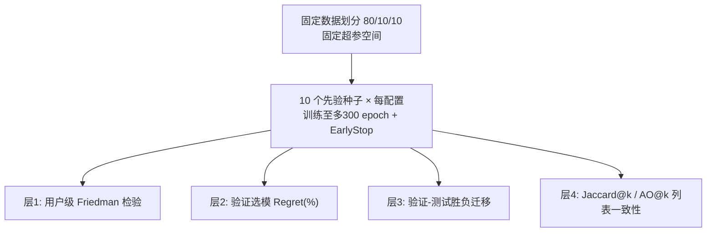

# Training seeds and model-selection stability in recommender-system evaluation (推荐系统评估中的训练种子与模型选择稳定性)

- **会议/期刊**: RecSys 2026 (Research & Practice Notes)
- **作者与机构**: Juan Manuel Rodriguez (Aalborg University); Oleg Lesota, Antonela Tommasel (JKU Linz / ISISTAN, CONICET-UNCPBA)
- **推荐链路定位**: 评测协议与实验方法论（横跨召回/排序模型，不改变模型结构）
- **研究方向**: 去偏公平与工业架构 / 协同过滤
- **论文原文**: [https://arxiv.org/abs/2609.02499v1](https://arxiv.org/abs/2609.02499v1)
- **开源代码**: [https://github.com/knife982000/RecSeed](https://github.com/knife982000/RecSeed)

## TL;DR (1分钟核心速览)

本文质疑"单训练种子即可代表模型性能"这一隐含假设：在**固定数据划分、固定超参空间**的前提下，仅改变训练种子（{1..10}，先验选定、不做种子调优），在 ML-1M / Steam / Amazon All Beauty 三个数据集、BPR / NeuMF / BERT4Rec / SASRec 四个模型上，从用户级指标敏感性、验证选模遗憾、验证-测试一致性、Top-k 列表一致性四个层面量化种子效应。结论是：种子效应在用户级几乎总能被 Friedman 检验检出（Steam 上全部配置拒绝原假设），但**统计显著 ≠ 结论不稳**——真正危险的是"配置接近平局 + 验证-测试迁移弱"的组合，此时单种子报告会系统性高估评估稳定性。

## Background & Motivation (背景与核心矛盾)

- **主流范式**: 推荐系统论文普遍以单次训练（单种子）报告指标，把 run-to-run 随机性视为可忽略的实现噪声；已有可复现性研究关注的是基线调参、数据划分、采样评估等维度。
- **前人局限**: ①现有工作未在"数据划分与超参完全固定"的纯净条件下单独隔离训练种子这一变量；②种子影响的不只是参数初始化，还贯穿 mini-batch 顺序、dropout、masking、隐向量采样与训练期负采样，属于"整条训练轨迹"的随机性。
- **核心洞察 (Key Insight)**: 种子效应必须区分"可检测 (detectable)"与"有实践后果 (practically consequential)"——若两个配置本身差距远大于种子抖动，则显著性无伤大雅；若配置接近平局，种子就会翻转选模结论。
- **本文切入点**: 用四层递进分析（指标 → 选模 → 验证-测试迁移 → 列表一致性）把种子方差从"统计噪声"翻译成"实验结论风险"。

## Method (核心方法设计)

### 1. 整体框架 (Overall Architecture)

本文是方法论/实证研究，无新模型。流程为：固定 80/10/10 按用户时间序划分 → 对每个"模型×超参配置"用 10 个先验种子各训练至多 300 epoch（early stopping，patience=10，保留最佳验证 checkpoint）→ 在四个层面做跨种子统计：Friedman 检验用户级 nDCG@10 分布、验证选模相对遗憾、验证-测试成对胜负迁移率、Jaccard@k 与 AO@k 列表一致性。

### 2. 关键设计拆解 (Key Designs)

1. **验证选模遗憾 (Selection Regret)**：痛点是"换种子后选出的配置是否变差"无法用单一指标刻画。做法是对每个选择种子 $s$选出验证最优配置，再在评估种子$s'$ 上计算相对最优观测配置的遗憾，并区分 Val→Val 与 Val→Test 两条链路：
$$\text{Regret}_{s,s'}(\%) = \frac{\text{Perf}^{\text{best}}_{s'} - \text{Perf}^{\text{sel}(s)}_{s'}}{\text{Perf}^{\text{best}}_{s'}} \times 100$$
直觉：Val→Val 高说明选模本身不稳，Val→Val 为零而 Val→Test 非零则说明"选模稳定但验证信号不迁移"（BPR on Amazon 即此典型）。

2. **列表一致性 AO@k**：痛点是聚合指标相同不代表用户看到的物品相同。用平均重叠度刻画前 k 位的逐前缀重合：
$$AO@k = \frac{1}{k}\sum_{i=1}^{k}\frac{|R_1@i \cap R_2@i|}{i}$$
配合 Jaccard@k 可区分"整体集合重合"与"头部排序重合"；实测 AO@k 恒高于 Jaccard@k，说明种子主要扰动长尾而非头部。

3. **训练与评估控制**：无新损失函数；关键在于**种子集先验固定为 {1..10} 以避免种子调优**、其余超参一律取 RecBole 默认值、主指标 nDCG@10（Recall/MRR/Hit/Precision@10 在仓库中补充）。计算开销为 4 模型 × (3+9+12+12) 配置 × 10 种子，属可复现的小规模网格。

## Experimental Setup & Evaluation Protocol (实验设置与评估协议)

- **数据集与预处理**: 三个公开基准，交互按时间排序后按用户切分。

| 数据集 | 规模/特点 | 划分方式 | 说明 |
| :--- | :---: | :---: | :--- |
| Movielens-1M | 百万级评分 | 按用户 80/10/10 时间序 | 稠密、成熟基准 |
| Steam | 平台行为 | 按用户 80/10/10 时间序 | 种子统计信号最强 |
| Amazon All Beauty 2023 | 稀疏电商 | 按用户 80/10/10 时间序 | 列表一致性最弱 |

- **数据划分与防穿越 (Splitting Strategy)**: 按用户时间序 `80%/10%/10%` 比例划分，**数据划分在所有种子间固定**，从而把种子方差与划分方差解耦。
- **排名评测协议 (Ranking Protocol)**: 主指标 nDCG@10；用户级比较采用 Friedman 检验（同一批用户跨种子视为重复观测），未做种子调优。
- **对比基线与超参设置**: BPR（3 组 embedding size）、NeuMF（9 组 MF×MLP 组合）、BERT4Rec 与 SASRec（各 12 组 hidden size × 层数 × 头数）；训练至多 300 epoch，early stopping patience=10，其余超参 RecBole 默认。

## Key Experimental Results (实验关键数据)

### 1. 主实验对比 (Main Results)

本文无"模型 vs 模型"主表，核心结果是**跨种子稳定性矩阵**（定性汇总自图 1–3）：

| 数据集 | 模型 | 用户级敏感性 (Friedman) | 选模遗憾 Val→Val / Val→Test | 列表一致性 (Jaccard/AO) |
| :--- | :--- | :---: | :---: | :---: |
| ML-1M | BPR | 有限 | 低 | 中等 |
| ML-1M | NeuMF | 部分 | 中 | **最低** |
| ML-1M | BERT4Rec / SASRec | **显著** | 低（配置区间分离清晰） | 高（SASRec 最稳） |
| Steam | 全部四模型 | **全部配置拒绝原假设** | 低（如 NeuMF 遗憾仅 ~1–4%） | **最高**（BPR/SASRec/NeuMF 均高） |
| Amazon | NeuMF | 部分 | **高（可达 30–40% 量级）** | 低 |
| Amazon | BPR | 有限 | Val→Val≈0 但 Val→Test 非零 | **近乎零重叠** |
| Amazon | SASRec | 部分 | 中 | 相对最稳 |

### 2. 消融实验 (Ablation Study)

本文以"逐层剥离"替代组件消融，展示同一批种子在不同分析层面的结论差异：

| 分析层面 | 移除该层会漏掉的风险 | 典型反例 |
| :--- | :--- | :--- |
| w/o 用户级检验 | 误以为种子无影响 | Steam 全配置显著 |
| w/o 选模遗憾 | 把"显著"误读为"结论不稳" | NeuMF on Steam 遗憾极低 |
| w/o 验证-测试迁移 | 漏掉"选模稳定但不迁移" | BPR on Amazon |
| w/o 列表一致性 | 漏掉"同分不同单"的用户曝光差异 | BPR on Amazon 近乎零重叠 |

### 3. 关键实验发现 (Key Findings)

1. **统计显著性与实践不稳定性必须解耦**：Steam 上所有模型所有配置的 Friedman 检验均拒绝原假设，但 NeuMF on Steam 的选模遗憾仅约 1–4%，说明"能检出"远不等于"会改结论"；反之 Amazon 上 NeuMF 的 Val→Test 遗憾高达 30–40% 量级，才是真正的评估风险区。
2. **验证-测试迁移是独立失效源**：BPR on Amazon 出现 Val→Val 遗憾为零、Val→Test 遗憾非零的分离现象，证明即使选模在种子间完全一致，验证排序不迁移到测试也会让基于验证的选择不可靠——这无法被"多跑几个种子取均值"修复。
3. **聚合指标相同 ≠ 用户曝光相同**：BPR on Amazon 跨种子 Top-k 列表近乎不相交，而 Steam 上高度一致；且所有设定下 AO@k 恒高于 Jaccard@k，说明种子主要扰动排名尾部，头部相对稳健，但一致性始终 <1，重复实验并非 list-invariant。

## Highlights & Limitations (亮点、对比与审稿批判)

- **与代表作对比 (vs. Prior Work)**: 相较 Dacrema 等对基线调参与实现细节的复现批判、以及采样评估/数据划分偏差研究，本文的独特之处是**在划分与超参完全冻结下单独隔离训练种子**，并把"种子方差"从统计问题升级为"选模决策风险"问题；与常规多随机种子取均值报告的做法相比，本文指出均值化无法解决验证-测试迁移失效。
- **可迁移亮点**: ①"Regret 矩阵（选择种子 × 评估种子）"可直接搬进任何论文的附录，作为选模稳健性体检；②AO@k + Jaccard@k 双指标可作为"同分不同单"的标准诊断工具，尤其适合曝光公平性审计。
- **审稿级局限批判**: ①种子被当作整条训练轨迹的单一随机源，**无法归因**到初始化/批序/dropout/负采样中的具体机制，因而无法给出"该固定哪个随机源"的可操作建议；②仅覆盖 4 个模型、3 个数据集与 10 个种子，且只报告 accuracy 类指标，未涉及多样性、公平性与在线 A/B，工业场景的外推性有限；③4 页短文，超参网格相对克制，结论对更大网格下的"接近平局"密度可能偏乐观。

## Rating (四维评分)

- **方法创新性 (Novelty)**: ⭐⭐⭐⭐ （核心机制与方法设计具备明确创新性，理论与实验动机支撑充分）
- **评估协议与实验扎实度 (Protocol & Experiments)**: ⭐⭐⭐⭐ （主流公开数据集评测完整，包含多基线对比与消融实验验证）
- **写作与数学规范度 (Clarity & Rigor)**: ⭐⭐⭐⭐⭐ （问题形式化定义清晰，核心模块数学推导与架构阐述严谨易读）
- **工业落地与复现价值 (Industrial & Practical Value)**: ⭐⭐⭐⭐ （兼顾推荐效果增益与训练/推理效率，具备实际场景迁移参考价值）
