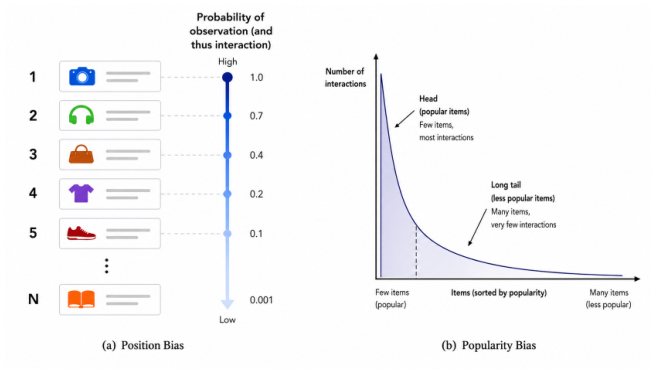
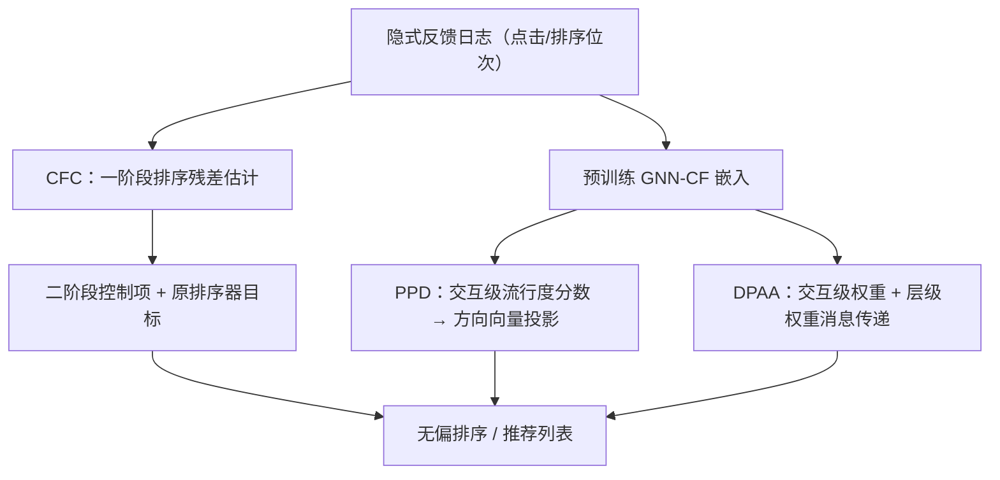

# Unbiased Recommender Systems with Implicit Feedback (隐式反馈下的无偏推荐系统)

- **会议/期刊**: RecSys 2026（Doctoral Symposium / 博士论文愿景类短文，7 页）
- **作者与机构**: Md Aminul Islam（University of Illinois Chicago），导师 Elena Zheleva，合作者含 Kathryn Vasilaky、Ren Wang、Sourav Medya、Ahmed Sayeed Faruk
- **推荐链路定位**: 精排（LTR 排序学习）+ 召回/表征层（GNN 协同过滤）
- **研究方向**: 去偏公平与工业架构 / 图神经网络推荐
- **论文原文**: [https://arxiv.org/abs/2608.16704v1](https://arxiv.org/abs/2608.16704v1)
- **开源代码**: 暂未开源

## TL;DR (1分钟核心速览)

本文是一篇博士论文愿景（vision）短文，而非单一方法的完整实证论文：它把隐式反馈中的两类系统性偏差——排序位置偏差与流行度偏差——统一到"如何学到可靠用户偏好"这一核心问题下，提出三项已完成/在审工作：CFC 用计量经济学两阶段控制函数法在 LTR 中纠偏位置偏差（模型无关、免倾向性估计、支持非线性排序器）；PPD 在预训练 GNN-CF 嵌入上做事后流行度方向投影去偏（免重训）；DPAA 在 GNN 消息传递中同时施加交互级与层级流行度感知权重。三项工作均在真实数据集（含无偏测试集）上报告优于多族 SOTA 去偏基线，并强调"去偏不牺牲热门物品性能"。

## Background & Motivation (背景与核心矛盾)

- **主流范式**: 推荐系统普遍以点击等隐式反馈推断偏好，但点击由曝光机制、位置、出现频次与历史推荐共同决定，观测数据天然带偏。
- **前人局限（位置偏差侧）**: 点击模型在位置与相关性高度混淆时失效；IPW 类方法对倾向性模型误设敏感、方差大且常需随机化实验；Heckman 类计量方法虽免倾向性估计，却受线性假设束缚，难以刻画复杂非线性特征交互；且点击模型与 IPW 均需改动排序器目标，与具体 LTR 算法强耦合。
- **前人局限（流行度偏差侧）**: IPW、重排、正则化、因果图方法多在目标函数或输出层做文章，未回答"流行度如何被写进 GNN 节点表征、又如何被消息传递放大"；静态计数权重忽略表征中编码的流行度信号，动态演化嵌入权重在训练早期噪声大；基于节点度的事后方法忽略个性化偏好与交互级粒度。
- **核心洞察 (Key Insight)**: 流行物品在用户–物品图中连接大量用户，两步传播内即可聚合远大于小众物品的邻域并把信号扩散到更多节点，使热门信号在嵌入空间中被过度表示（图 2）；因此去偏应直接作用于"表征中的流行度分量"或"传播时的消息权重"，而非仅改损失。
- **本文切入点**: 位置偏差用"免倾向性估计、模型无关"的控制函数残差项吸收；流行度偏差用"事后投影"与"传递期加权"两条互补路径处理。

<figure class="paper-figure" markdown="span">
  <figcaption>图 1：(a) 位置偏差：无论真实相关性如何，排名较高的项目更容易被观察到并被点击。(b) 流行度偏差：流行项目累积了大部分交互，导致模型高估它们，而低估不太流行但相关的项目。</figcaption>
</figure>

## Method (核心方法设计)

### 1. 整体框架 (Overall Architecture)

论文按三条工作线组织，共享"偏差进入数据→偏差进入表征→偏差进入排序"的统一视角。CFC 走两阶段：第一阶段用查询–物品特征回归历史排序位次并取残差，第二阶段把残差及其与各特征的交互项作为控制项加入点击模型，从而在排序器目标不变的前提下吸收位置引致的相关性混淆。PPD 走事后路线：在冻结的预训练嵌入上估计每条交互的流行度分数，构造节点的流行度方向向量，再做向量投影减除。DPAA 走训练期路线：在聚合时对每条边赋流行度感知权重，并对不同 GNN 层赋层级权重，抑制热门信号在浅层的主导。三者共同构成"排序层—表征层—传播层"的立体去偏闭环。

### 2. 关键设计拆解 (Key Designs)

1. **CFC 控制函数纠偏（位置偏差，模型无关）**：痛点是倾向性误设与线性假设。做法是先用特征 $x_{q,i}$拟合历史位次$r_{q,i}$得残差$\hat{\varepsilon}_{q,i}=r_{q,i}-g(x_{q,i})$，再把$\hat{\varepsilon}_{q,i}$与$\hat{\varepsilon}_{q,i}\cdot x_{q,i}$作为控制项并入二阶段点击模型$P(c=1\mid x)=\sigma\big(f(x)+\gamma\,\hat{\varepsilon}+\boldsymbol{\eta}^{\top}(\hat{\varepsilon}\cdot x)\big)$。直觉：残差刻画"特征无法解释的排位变动"（系统偏置、随机化、个性化），条件化其上即切断位置与相关性的伪相关路径，且不触碰排序器损失，故可套任意非线性 LTR。配套提出**去偏验证点击策略**：调参前先从验证点击中剔除位置引致分量，避免在带偏验证集上选出次优排序器。
2. **PPD 事后流行度投影（免重训）**：痛点是已有方法要么改目标、要么用不稳定演化嵌入。做法是先以"全局偏好减个性化偏好"定义交互级流行度分数 $p_{ui}=g_{ui}-\pi_{ui}$（$g$为物品跨用户广度偏好，$\pi$为该用户历史兴趣契合度），再对每个节点分别用$p$与其补$1-p$加权邻居得到流行度嵌入与偏好嵌入，二者之差即流行度方向$\boldsymbol{d}_u$，最后做投影减除$\boldsymbol{e}_u^{\text{deb}}=\boldsymbol{e}_u-\frac{\boldsymbol{e}_u^{\top}\boldsymbol{d}_u}{\|\boldsymbol{d}_u\|^2}\boldsymbol{d}_u$。直觉：把嵌入中"沿流行度方向"的分量剥离，保留偏好分量，且作用于稳定预训练表征，可直接部署于已上线模型。
3. **DPAA 传递期去偏与训练目标**：痛点是静态权重看不到表征信号、动态权重早期不稳。做法是以用户–物品嵌入相似度的补作为逆交互权重（相似度高更可能是流行度驱动的相互强化而非真实偏好），并将预训练稳定嵌入与当前演化嵌入做随训练进程平滑过渡的凸组合来稳定权重估计；层级上给更深层更大权重，以高阶邻域信息稀释浅层热门主导。总损失仍为常规 BPR/交叉熵，仅消息权重改变，无额外负采样开销；推理阶段仅多一次加权聚合，成本与骨干同阶。

## Experimental Setup & Evaluation Protocol (实验设置与评估协议)

- **数据集与预处理**: 三项工作分别在 LTR 基准（3 个公开数据集 + 1 个大规模工业数据集）与 GNN-CF 真实数据集（3 个，含**无偏测试数据**）上评估；DPAA 另构造半合成数据以系统控制流行度偏差强度。原文未在愿景短文中给出完整统计表，过滤方式与稀疏度需参见各子工作全文。

| 数据集 | #Users | #Items | #Interactions | 稀疏度/密度 | 特征/场景说明 |
| :--- | :---: | :---: | :---: | :---: | :--- |
| LTR 基准 ×3 | — | — | — | — | 带位置偏差的点击日志，含确定性/随机化两种记录策略 |
| 工业 LTR 数据集 | — | — | 大规模 | — | 真实排序日志，验证工业可用性 |
| GNN-CF 真实集 ×3 | — | — | — | — | 配无偏测试集，支持热门/小众分桶评估 |
| 半合成集 | — | — | — | — | 可控流行度偏差强度，用于鲁棒性扫描 |

- **数据划分与防穿越 (Splitting Strategy)**: 愿景短文未逐项披露；GNN-CF 部分强调使用**无偏测试数据**（而非从带偏日志中切分），这是该类工作的关键防穿越设计。
- **排名评测协议 (Ranking Protocol)**: 多指标排序评估（NDCG 类 LTR 指标 + 推荐精度指标），并额外报告**热门/小众物品分组指标**，以检验去偏是否以牺牲热门物品为代价；未采用采样排序。
- **对比基线与超参设置**: 覆盖点击模型、IPW/倾向性、Heckman 计量、重排、正则化、因果图、聚合加权等多族 SOTA；CFC 额外验证对不同偏差强度、噪声点击与不同记录策略的鲁棒性；PPD 验证跨 GNN 层深与跨骨干泛化。

## Key Experimental Results (实验关键数据)

### 1. 主实验对比 (Main Results)

原文为博士论文愿景，未提供统一主实验表；以下为各子工作声称的核心结论汇总（数值需见 CFC/PPD/DPAA 各自全文）：

| 工作 | 评估场景 | 对比基线族 | 核心结论 |
| :--- | :--- | :--- | :--- |
| CFC | 3 个 LTR 基准 + 工业集 | 点击模型 / IPW / Heckman | 多指标、多非线性排序器上优于现有位置偏差纠偏方法，且对偏差强度与噪声点击鲁棒 |
| PPD | 3 个真实集（无偏测试） | IPW / 重排 / 正则化 / 因果图 / 事后度方法 | 多指标领先，热门与小众物品**同时**提升，跨层深与跨骨干一致 |
| DPAA | 3 个真实集 + 半合成集 | 静态权重 / 动态权重 / 其他去偏族 | 多指标领先，高偏差设定下增益尤强，热门/小众双赢 |

### 2. 消融实验 (Ablation Study)

愿景短文未给出逐组件消融数值表，仅以定性方式声明各组件必要性：

| 移除组件 | 预期影响 | 说明 |
| :--- | :--- | :--- |
| CFC 去控制项交互 $\hat{\varepsilon}\cdot x$ | 退化为仅加性校正，非线性混淆残留 | 交互项用于刻画特征相关的位置效应 |
| CFC 去偏验证点击 | 调参受位置偏差污染，选到次优排序器 | 验证集纠偏是独立贡献 |
| PPD 去个性化偏好项 | 流行度分数退化为全局热度，粒度变粗 | 交互级估计依赖全局−个性化分解 |
| DPAA 去预训练嵌入稳定项 | 训练早期权重噪声大、收敛不稳 | 平滑过渡是稳定性关键 |
| DPAA 去层级权重 | 浅层热门主导无法被高阶邻域稀释 | 层级加权针对传播放大机制 |

### 3. 关键实验发现 (Key Findings)

1. **去偏与热门物品精度不冲突**：PPD 与 DPAA 均报告热门与小众物品分组指标同时提升，直接反驳"去偏必然牺牲头部精度"的常见顾虑，这对工业上线说服力极强。
2. **偏差越重，传递期干预收益越大**：DPAA 在半合成高偏差设定下增益最强，说明其机制正对准"传播放大"这一偏差来源，而非泛化的正则效应。
3. **稳定性设计是训练期去偏的胜负手**：DPAA 用预训练嵌入与演化嵌入的平滑凸组合替代纯动态权重，解决了早期嵌入不可靠导致的权重抖动，是其在多数据集上稳定领先的关键工程性洞察。

## Highlights & Limitations (亮点、对比与审稿批判)

- **与代表作对比 (vs. Prior Work)**: 相对 IPW/点击模型，CFC 免倾向性估计、免随机化、不改排序目标且支持非线性，解耦了去偏与具体 LTR 算法；相对静态计数加权与演化嵌入动态加权，DPAA 兼顾"表征感知"与"训练稳定"；相对基于节点度的事后方法，PPD 把流行度细化到交互级并显式区分全局与个性化偏好。
- **可迁移亮点**: ①"残差作为控制项 + 残差×特征交互"的两阶段范式可迁移到任何存在混淆变量的排序/CTR 场景（如曝光偏差、延迟反馈）；②"方向向量投影减除"是一种极轻量的表征后处理去偏手段，可套在任意已训练双塔或 GNN 模型上，无需重训。
- **审稿级局限批判**: ①作为 7 页愿景短文，缺少统一的主实验表、消融数值、数据集统计与显著性检验，三项工作的可比性与可复现性依赖各自全文，本文自身证据强度有限；②PPD 的投影去偏假设"流行度"与"偏好"在嵌入空间中近似可线性分离，若二者高度纠缠（如小众品类中的真热门）可能误删有效信号；DPAA 的层级权重与平滑系数引入额外超参，跨域迁移的调参成本与在线延迟未量化。

## Rating (四维评分)

- **方法创新性 (Novelty)**: ⭐⭐⭐⭐ （控制函数法引入 LTR 去偏、交互级流行度方向投影均属跨领域迁移的新颖组合，但单点机制仍属已有思想的再工程）
- **评估协议与实验扎实度 (Protocol & Experiments)**: ⭐⭐⭐ （使用无偏测试集与半合成偏差扫描是加分项，但愿景短文未给出统一主表、消融数值与显著性检验，证据链需回查子工作）
- **写作与数学规范度 (Clarity & Rigor)**: ⭐⭐⭐⭐ （三条工作线的问题—局限—切入逻辑清晰、动机图到位，但公式与符号在短文中高度压缩，缺复杂度分析）
- **工业落地与复现价值 (Industrial & Practical Value)**: ⭐⭐⭐⭐ （PPD 免重训可直接作用于已部署模型、CFC 模型无关可插拔，落地友好；但暂无开源代码，复现需自行补齐细节）

