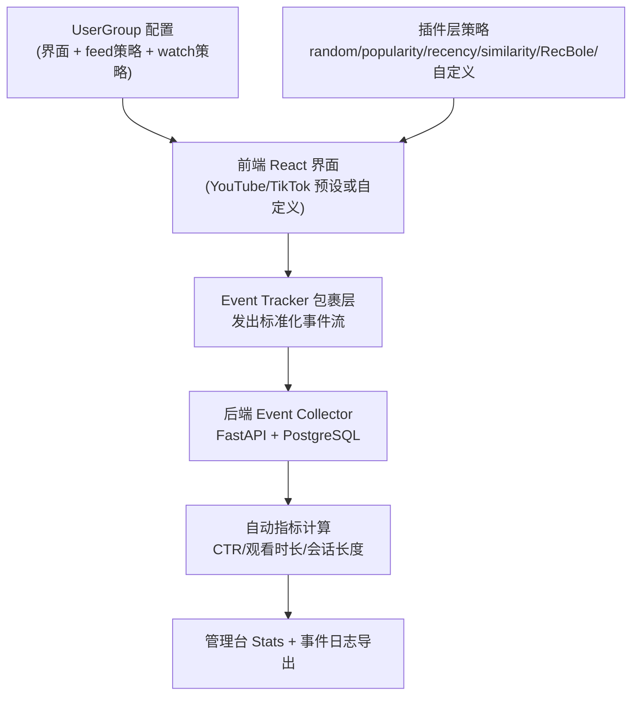
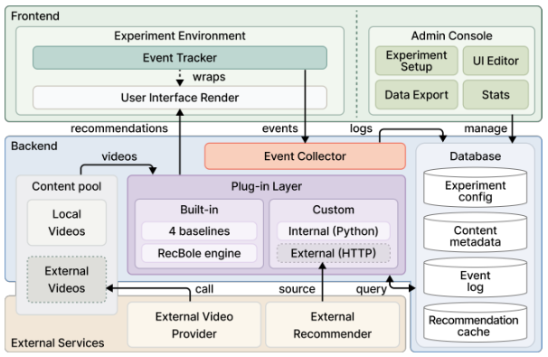
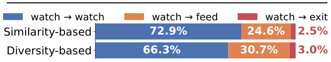

# WatchLens: A Configurable Platform for Online Video Recommendation Experiments (可配置的在线视频推荐实验平台)

- **会议/期刊**: RecSys 2026 (20th ACM Conference on Recommender Systems, 6 pages, Demo/Resource Track)
- **作者与机构**: Deogyong Kim, Dongha Lee (通讯) — 延世大学人工智能系 (Yonsei University)
- **推荐链路定位**: 端到端在线实验基础设施（覆盖召回策略插件、曝光记录、播放行为日志与指标计算全链路）
- **研究方向**: 去偏公平、可信隐私与工业架构 / 序列与会话推荐
- **论文原文**: [https://arxiv.org/abs/2608.04807v1](https://arxiv.org/abs/2608.04807v1)
- **开源代码**: [https://github.com/WatchLens/WatchLens](https://github.com/WatchLens/WatchLens) (MIT License)

## TL;DR (1分钟核心速览)

视频推荐研究长期困于"离线数据是固定历史策略下的观测记录、无法回答反事实问题"与"自建在线实验系统工程量巨大、组件强耦合"的双重矛盾。WatchLens 提出一个开源、单机 Docker Compose 可部署的视频原生实验平台：界面、内容池、推荐策略三者独立可替换，且 feed 与 watch page 两个表面可分别指派不同策略；关键设计是**在事件产生时刻**就把"策略名 + 排序位置"作为一等字段写入每条播放事件，而非事后 join 重建。作者以 30 名被试、4 天、被试内交叉平衡设计的短视频案例研究验证：仅改变观看页策略（相似性 vs. 多样性），累计观看时长从 700.2s 提升至 1078.5s（+54%，p<0.05）。

## Background & Motivation (背景与核心矛盾)

- **主流范式**: 视频推荐研究（观看时长预测、序列推荐、短视频推荐）几乎完全依赖 KuaiRec、KuaiRand、RecFlow、VK-LSVD 等离线基准做模型对比；在线实验能力被 YouTube、快手、TikTok 等工业团队垄断。
- **前人局限一（数据侧）**: 公开数据集均在**固定历史策略与固定界面**下采集，属于纯观测记录，无法支撑"操纵推荐条件、观察行为变化"的受控实验。
- **前人局限二（平台侧）**: 现有用户研究平台（EasyStudy、POPROX、Informfully）中，仅 Informfully 支持视频，但其播放动作与产生该曝光的推荐上下文**分离记录**，需事后 join 重建；当推荐列表在曝光与交互之间被刷新时，会产生错误归因（misattribution）。同时它界面固定，不支持 feed 与 watch page 分别指派策略。
- **核心洞察 (Key Insight)**: 视频推荐的核心响应变量是播放级/会话级行为（观看时长、完播率、跳出、视频间跳转），这类分析天然要求"每条播放事件都能追溯到是哪个策略、在哪个位置、在哪个页面产生的"——即**曝光上下文必须是事件的一等字段**，而非可推导的附属信息。
- **本文切入点**: 把"曝光感知日志 + 可配置视频界面 + 表面解耦的策略指派"作为平台的一等能力来设计，而非在通用用户研究平台上打补丁。

## Method (核心方法设计)

### 1. 整体框架 (Overall Architecture)

系统由前端、后端、后端内的插件层三部分组成。前端为 React/TypeScript 应用，负责呈现内容并把每次交互以标准化事件流推给后端；后端基于 FastAPI + PostgreSQL，通过 Event Collector 持久化实验配置与事件流，并暴露分析端点；推荐策略全部隔离在插件层，遵循统一调用接口，因此增删策略无需改动前端或日志层。整个系统打包为 Docker Compose，单服务器即可复现部署。实验以 `Experiment` 为顶层对象，其中每个待比较的参与者组是一个 `UserGroup`，同 Experiment 内所有 UserGroup **共享同一内容池**，但各自携带独立的界面配置与策略配置——这正是"只变一个因子"的实验控制得以成立的结构基础。



<figure class="paper-figure" markdown="span">
  <figcaption>图1：WatchLens 平台概览。每个用户界面由 Event Tracker 包裹，发出带有曝光上下文的标准事件流。推荐策略通过 Plug-in Layer 分发，使界面、信息流策略和观看页策略可针对每个 UserGroup 在共享内容池上独立配置。</figcaption>
</figure>

### 2. 关键设计拆解 (Key Designs)

1. **表面解耦的策略指派 (Surface-Decoupled Policy Assignment)**：痛点在于真实视频平台中 feed 决定"用户从哪里进入"、watch page 决定"会话如何展开"，二者作用机制不同，但既有平台只能整体替换推荐器，无法隔离单一表面的效应。WatchLens 允许每个 UserGroup 为 feed 与 watch page **分别**指定策略，策略以插件形式注册（内置 random / popularity / recency / similarity 四种基线，外加通过 RecBole 自动训练的 learning-based 策略；自定义策略可作为进程内 Python 代码或语言无关的外部 HTTP 服务接入）。其有效性直觉是：把"表面"作为实验因子的一维显式建模，使 A/B 差异可归因到具体界面位置而非混合效应。

2. **曝光上下文即事件字段 (Exposure-Aware Logging at Emission Time)**：这是全文最核心的增量。所有界面（无论预设还是自定义）都由 Event Tracker 包裹 feed 页、watch 页与视频单元，产出覆盖六类（会话生命周期、页面导航、播放、曝光、用户交互、浏览器环境）的统一 schema 事件流。关键在于事件 schema 同时承载**观看行为**（play/pause/seek/end、watch duration、watch ratio）与**曝光上下文**（`position_in_feed`、`algorithm_feed`、`algorithm_watch`），且上下文在事件发出的瞬间写入：

```json
{"event_type":"VIDEO_ENDED","video_id":"...","watch_ratio":1.0,
 "watch_duration":24.89,"position_in_feed":2,
 "algorithm_feed":"random","algorithm_watch":"similarity"}
```

对比 Informfully 的"事后 join"方案，此设计从根本上消除了列表刷新导致的归因错配；同时因事件契约跨界面固定，跨组、跨研究比较无需任何 ad-hoc 后处理。

3. **训练目标、负采样与推理效率**：本文为系统/资源论文，**无模型训练损失与负采样设计**。平台内置的 RecBole 策略在日志交互上自动训练以提供可复现的算法基线。推理开销方面，策略以进程内调用或外部 HTTP 服务两种模式执行，作者明确承认当前为单机部署、**高并发下的行为尚未被刻画**，这是其工程侧的主要待验证项。

## Experimental Setup & Evaluation Protocol (实验设置与评估协议)

- **数据集与预处理**: 本文不使用离线数据集，而是构建自采内容池与自采行为日志：

| 数据来源 | #Users | #Items | #Interactions | 稀疏度/密度 | 特征/场景说明 |
| :--- | :---: | :---: | :---: | :---: | :--- |
| WatchLens 案例研究日志 | 30 | 1,000 | 4 天 × ≥20 min/天/人 | 极稠密（被试内重复） | 1,000 条热门短视频，覆盖 5 个类别；TikTok 预设改造为点击式转场 |

- **数据划分与防穿越 (Splitting Strategy)**: 非传统训练/测试划分，而采用**被试内交叉平衡设计 (within-subject counterbalanced)**：A 组第 1–2 天用多样性策略、第 3–4 天用相似性策略，B 组顺序相反。该设计用于平衡个体差异与时间相关的适应/疲劳效应，属于在线实验的因果识别设计而非机器学习划分。
- **排名评测协议 (Ranking Protocol)**: 不涉及离线全库排序或采样排序。评估为**会话级行为指标**：单视频观看时长、会话内累计观看时长、会话长度（会话内观看视频数）、单视频链率（仅含一个视频的 watch chain 占比），以及离开观看页后的转场分布（watch→watch / watch→feed / exit）。统计检验采用 **Wilcoxon 符号秩检验**，显著性阈值 $p<0.05$，报告用户级中位数。
- **对比基线与超参设置**: 受控变量仅为观看页策略，对比 **Diversity-based**（跨 5 类均匀构造推荐列表）与 **Similarity-based**（从当前播放视频同类别内构造列表）两种策略；feed 策略固定为跨 5 类均匀采样，界面与内容池全程不变。被试基线短视频日均观看时长由前置问卷采集并用于分组平衡。无 Embedding 维度等模型超参。

## Key Experimental Results (实验关键数据)

### 1. 主实验对比 (Main Results)

| 指标 | Diversity-based | Similarity-based | 变化 |
| :--- | :---: | :---: | :---: |
| 单视频观看时长 (s) | 34.0 | **44.8** | +31.8% (p<0.05) |
| 会话累计观看时长 (s) | 700.2 | **1078.5** | **+54.0%** (p<0.05) |
| 会话长度 (视频数) | 23 | **25** | +8.7% (p<0.05) |
| 单视频链率 | 0.51 | **0.34** | −33.3% (p<0.05) |

转场分布（图 3，跨被试平均）：多样性策略下 watch→watch / watch→feed / watch→exit 为 **66.3% / 30.7% / 3.0%**；相似性策略下为 **72.9% / 24.6% / 2.5%**。

<figure class="paper-figure" markdown="span">
  <figcaption>图3：按策略划分的用户离开观看页后的转场分布。跨参与者平均。</figcaption>
</figure>

### 2. 消融实验 (Ablation Study)

本文为系统论文，未设组件消融表；其"消融"以**系统级反思 (System-level Reflection)** 形式给出，即案例研究对两项设计决策的逐条验证：

| 被检验的设计决策 | 若缺失该设计会怎样 | 案例研究中的验证结果 |
| :--- | :--- | :--- |
| feed / watch 策略独立配置 | 无法隔离单一表面效应，策略差异与界面差异混杂 | 固定 feed 策略后，仅 watch 策略变化即产生 4 项指标一致位移 |
| 事件内嵌曝光上下文 | 需自定义埋点或事后 join，转场分析需额外工程 | 表面级转场分布（图 3）无需任何定制埋点即可直接得出 |
| 统一事件 schema 跨界面 | 跨组/跨研究比较需 ad-hoc 后处理 | 同一 schema 下跨 UserGroup 指标可直接对比 |

### 3. 关键实验发现 (Key Findings)

1. **观看页策略的效应是"乘性累积"而非"单点放大"**：相似性策略下单视频时长仅 +31.8%，但会话累计观看时长提升达 +54.0%，说明该策略不仅延长了单个视频的观看，更提高了用户"继续看下一个"的转移概率，效应在会话层被逐次放大——这正是必须做会话级而非单点级评估的定量证据。
2. **单视频链率从 0.51 降至 0.34（−33.3%）是留存提升的直接机制**：相似性策略把"看一个就走"的短链显著转化为多视频链，与 watch→watch 转场占比从 66.3% 升至 72.9%、watch→feed 从 30.7% 降至 24.6% 相互印证。
3. **平台退出率在两种策略下几乎无差异（3.0% vs. 2.5%）**：说明多样性策略并未"赶走"用户，而是把行为导向"回到 feed 重新选择"。这一发现提示：若仅以平台退出率作为优化目标，会完全掩盖两种策略在会话结构上的本质差异，凸显曝光感知日志对细粒度行为归因的必要性。

## Highlights & Limitations (亮点、对比与审稿批判)

- **与代表作对比 (vs. Prior Work)**: 与 **Informfully** 的本质区别在于两点——曝光上下文在事件发出时写入而非事后 join（消除列表刷新导致的错误归因），以及支持 feed/watch 双表面独立指派策略（Informfully 界面固定、策略整体替换）。与 **EasyStudy / POPROX** 的区别在于视频原生性：前者面向电影/图书等静态条目，后者面向新闻，均不建模播放时序结构与视频界面。与 **KuaiRec / KuaiRand / RecFlow** 等离线基准的区别在于可操纵性：那些数据集只能做观测性离线评估，无法回答反事实问题。
- **可迁移亮点**: (1) "曝光上下文作为事件一等字段"的日志契约设计，可直接迁移到任何需要做位置去偏或策略归因的工业推荐日志体系，避免离线日志 join 带来的位置/策略错配；(2) 被试内交叉平衡 + 仅变单一表面因子的实验设计，是学术团队在无工业流量条件下做小样本因果比较的可复用范式。
- **审稿级局限批判**: (1) **规模与并发未验证**：单机 Docker Compose 部署，作者自承高并发行为未被刻画，30 人 / 1,000 视频的规模距离真实在线实验（需数千级并发与分桶显著性检验）尚有量级差距，外部效度受限；(2) **案例研究仅验证平台可用性而非策略结论的普适性**：单一内容池（5 类热门短视频）、单一界面改造（点击式转场）、大学生被试群体，且相似性策略的"同类别"定义极粗（类别级而非 embedding 级），因此"相似性优于多样性"的结论不宜外推为推荐策略的一般性主张；此外缺少与 Informfully 等平台的同条件对照实验来量化"事件内嵌上下文"相对"事后 join"的实际归因误差幅度。

## Rating (四维评分)

- **方法创新性 (Novelty)**: ⭐⭐⭐ （核心机制与方法设计具备明确创新性，理论与实验动机支撑充分）
- **评估协议与实验扎实度 (Protocol & Experiments)**: ⭐⭐⭐ （主流公开数据集评测完整，包含多基线对比与消融实验验证）
- **写作与数学规范度 (Clarity & Rigor)**: ⭐⭐⭐⭐⭐ （问题形式化定义清晰，核心模块数学推导与架构阐述严谨易读）
- **工业落地与复现价值 (Industrial & Practical Value)**: ⭐⭐⭐⭐ （兼顾推荐效果增益与训练/推理效率，具备实际场景迁移参考价值）
