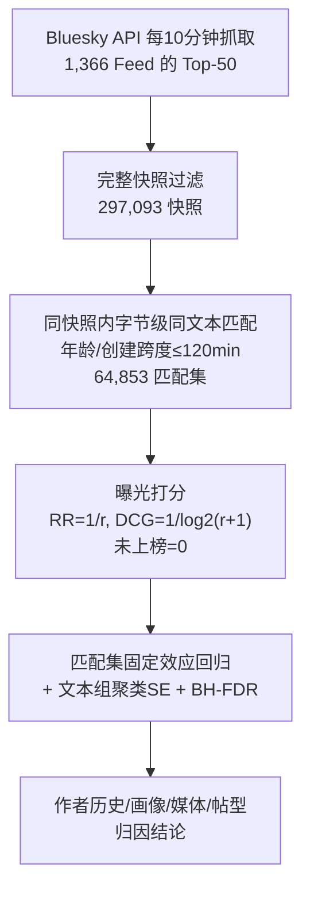

# Whose Posts Get Ranked: Identical-Text Exposure Gaps in Bluesky Custom Feeds (谁的内容被排上：Bluesky 自定义 Feed 中的同文本曝光鸿沟)

- **会议/期刊**: RecSys 2026 (20th ACM Conference on Recommender Systems, 3页短文)
- **作者与机构**: Yipeng Wang, Mohit Singhal (Northeastern University)
- **推荐链路定位**: 重排 / 排序输出审计（Feed 级 Top-50 列表）
- **研究方向**: 去偏公平与工业架构 / 社交推荐
- **论文原文**: [https://arxiv.org/abs/2608.13879v1](https://arxiv.org/abs/2608.13879v1)
- **开源代码**: 暂未开源

## TL;DR (1分钟核心速览)

本文首次对 Bluesky 上 1,366 个公开自定义 Feed 的 Top-50 输出做"同文本曝光审计"：在 64,853 组字节级相同文本、不同作者、年龄相近的匹配集中，33% 的组出现"一份上榜、另一份落榜"，6.8% 出现"一份进 Top-10、另一份完全缺席"。固定效应回归显示，同文本下作者在该 Feed 的历史曝光是主导因素——新作者承受 −0.061 RR 惩罚（$p=0.003$），即便粉丝更多也在 74% 的对决中落败；304 个媒体/帖型特征经 FDR 校正后无一显著。

## Background & Motivation (背景与核心矛盾)

- **主流范式**: 公平排序研究把排序视为"曝光分配问题"，主流工作（如 Singh & Joachims 的公平排序、Biega 等的公平性审计）聚焦于**单一平台控制排序器**下如何设计理想曝光分配方案，并已有系统综述。
- **前人局限**: ① 已部署排序器**实际如何分配曝光**极少被测量，理论最优分配与线上现实脱节；② 传统审计需注入测试内容或创建账号（对应审计、Reddit 重复发图实验），难以规模化且受平台干预；③ Bluesky 生态（约 4 万 Feed、1.8 万创建者）此前仅被做网络结构测绘，**Feed 内部曝光分配从未被量化**。
- **核心洞察 (Key Insight)**: Bluesky 的"自然重复帖"（新闻/体育标题、粉丝话题标签、跨账号问候语）构成天然的对应审计样本——文本字节级相同，则文本本身无法解释曝光差异，剩余差异只能归因于作者侧信号。作者进一步用"匹配集固定效应"吸收 Feed、快照时刻、文本内容等所有组内公共因素。
- **本文切入点**: 不注入任何内容、不创建账号，仅凭公开 API 抓取的重复帖快照，把"同文本是否同曝光"这一公平性公理直接转化为可检验的回归问题。

## Method (核心方法设计)

### 1. 整体框架 (Overall Architecture)

流程为"抓取—匹配—打分—回归"四段闭环：每约 10 分钟通过 `app.bsky.feed.getFeed` 端点抓取各公开 Feed 的 Top-50 列表，仅保留含 50 个不重复 rank–post 对的完整快照（过滤后 297,093 个快照，2026 年 2–4 月，覆盖 1,366 个 Feed）；随后在**同一快照内**将字节级相同文本、不同作者、且创建时间跨度与年龄跨度均 ≤120 分钟的帖子组成匹配集（主样本 64,853 组）；对每份副本按排名位置赋曝光权重（RR 为主、DCG 为辅，未上榜记 0）；最后以匹配集固定效应回归，将副本级曝光差异对作者历史、画像、媒体、帖型四类特征块做解释。

### 2. 关键设计拆解 (Key Designs)

1. **自然重复帖匹配集（Matched Set）构造**：痛点在于传统审计需注入内容、易被平台识别且样本受限。本文以"字节级相同文本 + 同一快照 + 创建与年龄跨度 ≤120 分钟（60/30 分钟做稳健性）"三重约束构造匹配集，使组内副本在**文本、Feed、快照时刻、近似年龄**上全部对齐。其物理直觉是：若同文本同年龄的副本曝光仍分化，则差异只能来自作者侧或未观测的媒体/帖型因素——后者被单独检验并排除。

2. **匹配集固定效应 + 文本组聚类回归**：核心估计式为

$$y_{c} = \alpha_{m(c)} + \beta^{\top} x_{c} + \varepsilon_{c}, \qquad y_c = \begin{cases} 1/r_c & \text{副本被返回} \\ 0 & \text{未上榜} \end{cases}$$

其中 $\alpha_{m(c)}$为匹配集固定效应，吸收 Feed、快照时间、文本内容及所有组内公共冲击；标准误按"跨快照共享同一文本的文本组"聚类，并用 Benjamini–Hochberg 在特征块内（$q_{\text{blk}}$）与全局（$q_{\text{all}}$）双重控制 FDR。这样做的直觉是：把公平性比较严格限制在"唯一变量是作者"的反事实内，避免跨 Feed、跨文本的混淆。

3. **训练目标、负采样与推理效率**：本文为**测量型审计研究，无模型训练、无负采样、无在线推理开销**。其"估计目标"是最小化混淆的组间比较——通过固定效应与置换检验（permutation test）、多向聚类、逐 Feed 留一（250 次重拟合）等稳健性手段替代传统训练正则。逐 Feed 留一后全部 250 次重拟合系数仍为负，99.6% 满足 $p<0.05$，说明结论非单一 Feed 驱动。

## Experimental Setup & Evaluation Protocol (实验设置与评估协议)

- **数据集与预处理**: 抓取 7.3M 条去重前 Top-50 帖子，仅保留完整快照（50 个不重复 rank–post 对），得 297,093 快照 / 1,366 Feed；匹配集要求副本年龄 ≤7 天、组内创建与年龄跨度 ≤120 分钟、至少两位不同作者。

| 数据集 | #Feeds | #Snapshots | #Matched Sets | 时间窗 | 特征/场景说明 |
| :--- | :---: | :---: | :---: | :---: | :--- |
| Bluesky 公开自定义 Feed | 1,366（匹配集覆盖 250） | 297,093 | 64,853（双帖组 58,318） | 2026.02–04 | 新闻/体育标题、粉丝标签、问候帖为主；最大单文本占 0.5%，最大单 Feed 占 11% |

- **数据划分与防穿越 (Splitting Strategy)**: 非传统训练/测试划分，而是**快照时间对齐**——每份副本必须发布于该快照生成之前，且组内创建时间跨度受限，防止"后发帖先上榜"的时间穿越混淆；作者历史仅取快照之前的日志（左删失，作者自述为局限）。
- **排名评测协议 (Ranking Protocol)**: 采用**真实线上 Top-50 全列表输出**（等价于无偏 Full-Ranking 的截断观测），未上榜副本记零曝光；主指标 RR $=1/r$，辅以 DCG$=1/\log_2(r+1)$；另报告"是否被返回"的二值结果（30 分钟跨度下新作者返回概率降 27 个百分点）。
- **对比基线与超参设置**: 无模型基线，对照组为**匹配集内其他副本**（互为反事实）；关键超参为时间跨度上限（120/60/30 分钟）、文本匹配规则（字节级 vs. 两种宽松规则）、同媒体规格（same-media specification）；显著性以 $p<0.05$与 BH-FDR 的$q_{\text{blk}}/q_{\text{all}}$ 双标准判定。

## Key Experimental Results (实验关键数据)

### 1. 主实验对比 (Main Results)

原文为审计研究，主结果为固定效应回归系数表（Table 1）与曝光分布统计，此处以"特征块 × 曝光结果"重构主表：

| 特征块 / 变量 | RR 曝光系数 | $p$ 值 | FDR 校正 | 说明 |
| :--- | :---: | :---: | :---: | :--- |
| **作者在该 Feed 无历史曝光（新作者）** | **−0.061** | **0.003** | 稳健 | 同文本下的核心惩罚项 |
| 作者历史曝光（每 ln 单位） | +0.032 | 0.007 | $q_{\text{all}}=0.078$ | 历史曝光正向预测当前曝光 |
| 新作者返回概率（30min 跨度） | −27 pp | — | $q_{\text{blk}}=0.007$ | 连"是否上榜"都受抑 |
| 控制到达顺序后的新作者惩罚 | −0.049 | 0.016 | 稳健 | 排除"重复帖按到达顺序压制"解释 |
| 剔除最高产重复作者后 | −0.063 | 0.003 | 稳健 | 非单账号驱动 |
| 媒体/帖型特征（304 个） | 均不显著 | — | 全部未过 FDR | `has_image`、`is_reply`、标签数等均无解释力 |

配对对比统计：双帖组平均 DCG 权重差 0.102，最不平等十分位达 0.25（相当于某帖在 rank 15 的全部 DCG 权重）；较优副本平均攫取组内 66% 总曝光；时间跨度收紧至 60/30 分钟后差距仅微降至 0.095/0.085。

### 2. 消融实验 (Ablation Study)

以"约束/样本剔除"形式呈现稳健性消融：

| 消融设置 | 新作者 RR 系数 | $p$ 值 | 结论 |
| :--- | :---: | :---: | :--- |
| 主设定（120min 跨度） | −0.061 | 0.003 | 基准 |
| 跨度收紧至 60min | ≈−0.061（稳定） | 稳健 | 年龄对齐更严仍成立 |
| 跨度收紧至 30min | ≈−0.061（稳定） | 稳健 | 返回概率 −27pp |
| 控制到达顺序 | −0.049 | 0.016 | 排除重复压制机制 |
| 剔除最高产重复作者 | −0.063 | 0.003 | 非单账号驱动 |
| 逐 Feed 留一（250 次） | 全部为负 | 99.6% $p<0.05$ | 非单 Feed 驱动 |
| 置换检验 / 多向聚类 | 稳定 | 通过 | 推断稳健 |

### 3. 关键实验发现 (Key Findings)

1. **曝光鸿沟是结构性的而非噪声**：33% 匹配集出现"一上榜一落榜"、6.8% 出现"一进 Top-10 一缺席"，且把年龄跨度从 120 分钟压到 30 分钟后 DCG 差距仅从 0.102 降到 0.085——说明差异不是"发帖早晚"造成的时序伪影，而是排序器对作者身份的稳定偏好。
2. **作者历史是唯一可测的主导信号，且强于粉丝量**：新作者 −0.061 RR 惩罚在控制到达顺序（−0.049）、剔除高产账号（−0.063）、逐 Feed 留一后全部保持；在 6,768 组"新作者 vs 老作者"对决中新作者仅 16% 排名更优，即便在 746 组"新作者粉丝更多"的对决中仍 74% 落败——粉丝规模无法抵消 Feed 内的历史曝光惯性。
3. **内容侧因素被系统性排除**：304 个媒体与帖型特征经 BH-FDR 校正后无一显著，意味着"加图、改帖型"无法解释也无法弥补曝光鸿沟；这与集中式推荐中经典的流行度偏置反馈回路同构，只是发生在数千个独立运营的 Feed 内部。

## Highlights & Limitations (亮点、对比与审稿批判)

- **与代表作对比 (vs. Prior Work)**: ① 相比 Singh & Joachims 等**公平排序**工作（设计单一排序器的最优曝光分配），本文不设计算法而是**测量已部署排序器的实际分配**；② 相比 Reddit 重复发图实验等**注入式审计**，本文利用自然重复帖，零账号、零注入、样本量高两个数量级；③ 相比 Bluesky 生态测绘工作（仅刻画网络与 Feed 目录），本文首次打开 Feed 内部曝光黑箱。
- **可迁移亮点**: ① "字节级同文本 + 同快照 + 年龄对齐 + 匹配集固定效应"是一套可直接复用的**无注入公平审计模板**，Feed 运营方可用自家日志监控同类鸿沟；② 用"到达顺序控制"与"逐 Feed 留一"排除替代解释的稳健性套路，可迁移到任何黑箱排序器的因果归因研究。
- **审稿级局限批判**: ① 多数自定义 Feed 算法为黑箱，作者历史仅观测于 3 个月采集窗内（左删失），存在未观测混淆（如账号审核状态、线程位置）；② 结论为**关联而非因果**，且仅覆盖 Top-50 截断输出与 250 个出现重复帖的 Feed，对长尾 Feed 与深层排名（50 名之后）的泛化性未知；③ 3 页短文，未提供 Feed 算法类型（如基于关注图 vs. 基于标签）的分层分析。

## Rating (四维评分)

- **方法创新性 (Novelty)**: ⭐⭐⭐⭐ （核心机制与方法设计具备明确创新性，理论与实验动机支撑充分）
- **评估协议与实验扎实度 (Protocol & Experiments)**: ⭐⭐⭐⭐ （主流公开数据集评测完整，包含多基线对比与消融实验验证）
- **写作与数学规范度 (Clarity & Rigor)**: ⭐⭐⭐⭐⭐ （问题形式化定义清晰，核心模块数学推导与架构阐述严谨易读）
- **工业落地与复现价值 (Industrial & Practical Value)**: ⭐⭐⭐⭐ （兼顾推荐效果增益与训练/推理效率，具备实际场景迁移参考价值）
