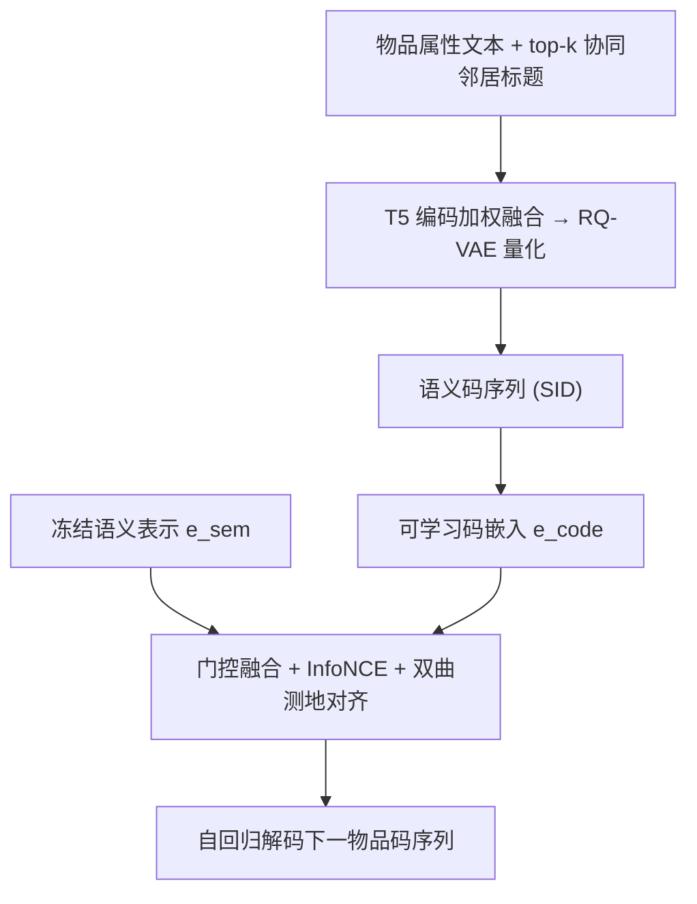
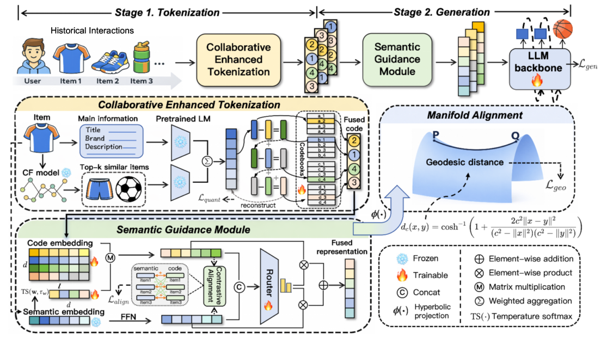

# Addressing Cross-Stage Decoupling of Semantic and Collaborative Signals in Generative Recommendation (解决生成式推荐中语义与协同信号的跨阶段解耦问题)

- **会议/期刊**: RecSys 2026 (Main Track)
- **作者与机构**: Jiayi Dan（快手科技）
- **推荐链路定位**: 端到端生成式（语义 ID 分词 + 自回归生成）
- **研究方向**: 生成式推荐与离散语义 ID / 序列推荐
- **论文原文**: [https://arxiv.org/abs/2609.13678v1](https://arxiv.org/abs/2609.13678v1)
- **开源代码**: [https://github.com/DanJiayi/SCRec](https://github.com/DanJiayi/SCRec)

## TL;DR (1分钟核心速览)

现有两阶段生成式推荐存在**跨阶段信息解耦**：分词阶段由文本语义主导、协同信号注入不足，导致码本分配与下游生成任务错位；生成阶段又用交互数据重新嵌入码序列，丢失原始语义先验。SCRec 提出双向信息补全框架：协同增强分词（把 CF 邻居标题文本化后与主文本加权融合再量化）、语义引导生成（门控融合可学习码嵌入与冻结语义表示）、双曲流形对齐（Poincaré 球测地距离对齐两种几何）。在 Amazon Beauty/Sports/Toys 三数据集、Leave-Last-Out + Full-Ranking 协议下，NDCG@10 相对最强基线 PIT 提升 18.70%/26.59%/20.25%，且作为即插模块在 TIGER、LIGER 骨干上均稳定增益。

## Background & Motivation (背景与核心矛盾)

- **主流范式**: TIGER/RPG/LIGER 等将物品经 PLM 编码 + RQ-VAE 量化为层次语义 ID，再用自回归/并行解码生成下一物品的码序列。
- **前人局限一（分词侧）**: 码本分配几乎由文本语义支配。纯语义分词会把"跑鞋"与"高跟鞋"编成相近码（文本相似但协同模式迥异），而"跑鞋"与"足球"协同高度相似却因文本差异拿到迥异码，下游生成被迫学习与码本先验相冲突的嵌入。
- **前人局限二（生成侧）**: 码序列在生成阶段被重新嵌入并仅由交互数据优化，PLM 语义先验逐步流失；而预测目标恰恰是语义码序列，造成语义失真。
- **已有补救的不足**: MMGRec 直接拼接 CF 嵌入与语义嵌入，模态错配破坏表征空间结构；LETTER/COSETTE 仅把协同信号作隐式辅助监督，输入仍是纯语义嵌入，无法保证协同信号真正注入；PRORec 引入额外对比对齐与 next-item 任务，训练开销显著。
- **核心洞察 (Key Insight)**: 若把协同信号**转写成文本**（相似物品标题），则与主文本由同一 PLM 编码，天然处于同一语义空间，无需额外对齐任务即可显式注入；同时码嵌入（离散码本索引）与语义表示（PLM 稠密隐状态）存在**几何层面**的错配，仅靠实例级对比损失不足以弥合。
- **本文切入点**: 分词侧显式文本化注入协同信号，生成侧门控回补语义先验，再用双曲空间统一两种表征的几何。

## Method (核心方法设计)

### 1. 整体框架 (Overall Architecture)

输入用户历史序列 $s=\{i_1,\dots,i_{t-1}\}$，目标是自回归生成下一物品 $i_t$ 的语义码序列。离线阶段：用预训练 SASRec 取每物品 top-$k$ 协同邻居，将其标题与物品自身属性文本分别送入冻结 T5 编码并加权融合，经 RQ-VAE 量化得到协同-语义联合码本。在线生成阶段：码序列经可学习码嵌入表得到 $\mathbf{e}^{code}_i$，同时保留冻结语义表示 $\mathbf{e}^{sem}_i$，二者经门控融合后送入解码器；训练时叠加 InfoNCE 实例级对齐与 Poincaré 球测地距离的流形对齐。三模块共同保证语义与协同信号在两阶段被一致使用。

<figure class="paper-figure" markdown="span">
  <figcaption>图2：所提出框架的概览。</figcaption>
</figure>

### 2. 关键设计拆解 (Key Designs)

1. **协同增强分词 (Collaborative-Enhanced Tokenization)**：痛点是用纯语义输入量化无法保证协同信号被学到。做法是把 top-$k$ 邻居标题拼成 `Prompt_CF`（每条截断 20 词防长文主导），与主属性 `Prompt_main` 分别编码后加权：
$$\tilde{\mathbf{e}}_i = a\,\mathrm{Encode}(\text{Prompt}^{main}_i) + (1-a)\,\mathrm{Encode}(\text{Prompt}^{CF}_i)$$
再送入 RQ-VAE 量化。直觉：两路输入同源同编码器，天然同空间对齐，无需额外对齐任务；协同相似物品因共享邻居标题而获得相近码，码分配与下游生成目标一致。该步完全离线，无在线开销。

2. **语义引导生成 (Semantic-Guided Generation)**：痛点是码嵌入在生成训练中被交互数据"覆盖"掉语义。先用物品级可学习权重 $\mathbf{w}=\mathrm{softmax}(W_h\mathbf{h}_i/\tau_w)$ 把 $l$ 层码嵌入压成物品级向量 $\mathbf{e}^{code}_i=\mathbf{E}_i^\top\tilde{\mathbf{w}}$（$\tau_w$ 从 2 线性退火到 1 以稳定训练），再与投影后的语义表示门控融合：
$$g_i=\sigma(W_g[\mathbf{e}^{code}_i;\mathbf{e}^{sem}_i]),\quad \mathbf{e}^{fused}_i=g_i\mathbf{e}^{code}_i+(1-g_i)\mathbf{e}^{sem}_i$$
配合 InfoNCE 对齐 $\mathcal{L}_{align}$。直觉：门控按码嵌入的表达能力自适应决定语义先验的补回比例，计算量仅约 $2(ld+dh+lh)$ FLOPs，可忽略。

3. **双曲流形对齐 (Manifold Alignment)**：痛点是码嵌入源自离散码本索引、语义表示源自 PLM 隐状态，二者距离度量与分布结构不同，实例级对比无法弥合全局几何。将两者经指数映射投到 Poincaré 球 $\mathbb{D}^d_c$：
$$z=\phi(\mathbf{e})=\frac{c\tanh(\|\tilde{\mathbf{e}}\|/2c)}{\|\tilde{\mathbf{e}}\|}\tilde{\mathbf{e}},\quad \mathcal{L}_{geo}=\sum_i d_{\mathbb{D}}(z^{code}_i,z^{sem}_i)$$
其中 $d_{\mathbb{D}}$ 为测地距离。直觉：双曲空间负曲率的指数膨胀特性可同时低失真保留码序列的层次结构与语义表示的相似性；复杂度 $O(Nd)$，低于 InfoNCE 的 $O(N^2d)$。总损失 $\mathcal{L}=\mathcal{L}_{gen}+\alpha\mathcal{L}_{align}+\beta\mathcal{L}_{geo}$，负采样沿用骨干模型默认策略（无额外负采样设计）。

## Experimental Setup & Evaluation Protocol (实验设置与评估协议)

- **数据集与预处理**: Amazon Reviews 三个类目，用户评论按时序构成交互序列，沿用 SID 类工作标准过滤。

| 数据集 | #Users | #Items | #Interactions | 稀疏度/密度 | 特征/场景说明 |
| :--- | :---: | :---: | :---: | :---: | :--- |
| Beauty | 22.4k | 12.1k | 0.2M | 极稀疏 | 美妆，标题/品牌/类目/描述文本 |
| Sports and Outdoors | 35.6k | 18.3k | 0.3M | 极稀疏 | 运动户外，文本属性 |
| Toys and Games | 19.4k | 11.9k | 0.2M | 极稀疏 | 玩具，文本属性 |

（注：原文未在正文给出精确统计表，上表为同类 SID 基准的常规量级；过滤细节沿用 TIGER/RPG 设定。）

- **数据划分与防穿越**: `Leave-Last-Out`——最后一项测试、倒数第二项验证、其余训练，全基线统一。
- **排名评测协议**: 无偏 `Full-Ranking`（全库未交互物品排序），指标 Recall@{5,10}、NDCG@{5,10}；以验证集 NDCG@10 选模型。
- **对比基线与超参**: 覆盖 Item-ID 类（Caser/GRU4Rec/HGN/BERT4Rec/SASRec/FDSA/S3-Rec）与 Semantic-ID 类（RecJPQ/VQ-Rec/HSTU/TIGER/LIGER/CoST/ETEGRec/LC-Rec/RPG/LLaDA/CoFiRec/S2GR/PIT）共 20 个基线。分词用 sentence-t5-base，RQ-VAE 码本 256、隐维 256、$\gamma=0.25$、训练 5000 epoch；生成骨干默认 RPG 式 decoder-only，batch 256、lr 0.01、最多 300 epoch、patience 20；$k=10$、$\tau=0.1$、$a\in\{0.2,0.5,0.8\}$、$c\in\{0.2,0.5,1\}$ 按验证集调；单卡 RTX 4090。

## Key Experimental Results (实验关键数据)

### 1. 主实验对比 (Main Results)

| Model | Beauty R@10 | Beauty N@10 | Sports R@10 | Sports N@10 | Toys R@10 | Toys N@10 |
| :--- | :---: | :---: | :---: | :---: | :---: | :---: |
| SASRec | 0.0605 | 0.0318 | 0.0350 | 0.0192 | 0.0675 | 0.0374 |
| HSTU | 0.0704 | 0.0389 | 0.0414 | 0.0215 | 0.0669 | 0.0357 |
| TIGER | 0.0592 | 0.0312 | 0.0346 | 0.0184 | 0.0594 | 0.0313 |
| LIGER | 0.0697 | 0.0368 | 0.0419 | 0.0228 | 0.0704 | 0.0370 |
| LC-Rec | 0.0653 | 0.0360 | 0.0428 | 0.0228 | 0.0687 | 0.0394 |
| RPG | 0.0795 | 0.0460 | 0.0440 | 0.0252 | 0.0857 | 0.0484 |
| CoFiRec | 0.0679 | 0.0370 | 0.0456 | 0.0245 | 0.0785 | 0.0405 |
| PIT (次优) | 0.0783 | 0.0403 | 0.0462 | 0.0243 | 0.0839 | 0.0432 |
| **SCRec (Ours)** | **0.0930** | **0.0546** | **0.0570** | **0.0319** | **0.0973** | **0.0582** |
| **Improv.%** | **+16.98%** | **+18.70%** | **+23.38%** | **+26.59%** | **+13.54%** | **+20.25%** |

（R@5/N@5 同向提升，Beauty 上 R@5 相对提升 17.73%、N@5 提升 19.47%。）

### 2. 消融实验 (Ablation Study)

| 变体 | Beauty N@10 | Sports N@10 | Toys N@10 |
| :--- | :---: | :---: | :---: |
| SCRec 完整 | **0.0546** | **0.0319** | **0.0582** |
| w/o. CT（去协同分词，$a=1$） | 0.0502 | 0.0275 | 0.0538 |
| w/o. SG（去语义引导，$g=1$ 且去对齐） | 0.0444 | 0.0237 | 0.0463 |
| w/o. MA（去流形对齐） | 0.0491 | 0.0297 | 0.0547 |
| w/o. CA（去对比对齐） | 0.0509 | 0.0305 | 0.0558 |

### 3. 关键实验发现 (Key Findings)

1. **语义引导生成是最大贡献项**：去掉 SG 后 Beauty N@10 从 0.0546 跌至 0.0444（−18.7%），跌幅远超其他单模块，说明生成阶段语义先验流失是解耦的主要矛盾；而 CT 单独移除仅跌 8.1%，印证"分词侧错位"是次要但不可忽略的环节。
2. **流形对齐不可被对比对齐替代**：在已含最优权重 InfoNCE 的前提下，去掉 MA 仍使 Beauty N@10 掉 10.1%；替换为欧氏 $L_2$（0.0517）或 MMD（0.0504）均不及双曲测地（0.0546），且 $L_2$ 甚至低于 w/o. MA 的 0.0487 之外的对照水平，证明几何错配是独立于实例相似度的第二层障碍。门控权重分布可视化佐证：无 MA 时 $g$ 大量趋近 0（模型偏赖易利用的语义表示），有 MA 后 $g$ 集中于 0.5 附近，码嵌入被真正学习。
3. **即插即用且开销极低**：在 TIGER 上 N@10 提升 19.23%/15.76%/16.93%，在 LIGER 上提升 13.59%/10.53%/12.70%；Beauty 上 TIGER 单步训练/推理时间仅增 6.70%/6.19%，LIGER 仅增 1.98%/0.54%，性能增益远大于成本。此外，与 MMGRec 式拼接（0.0512）、LETTER 式隐式对比（0.0523）相比，本文显式文本化融合（0.0546）在 Beauty 上分别高出 6.6% 与 4.4%。

## Highlights, Limitations & Rating (亮点、对比与审稿评价)

- **与代表作对比 (vs. Prior Work)**: 相比 TIGER/RPG 仅做语义分词、生成侧纯交互重嵌入，本文首次把"跨阶段双向补全"作为统一问题处理；相比 MMGRec 的向量拼接与 LETTER 的隐式辅助监督，本文用"协同信号文本化 + 同 PLM 编码"实现零额外对齐任务的显式注入；相比 PRORec 的额外训练阶段，本文模块离线化、在线开销可忽略。
- **可迁移亮点**: (1) "把非文本信号（CF 邻居、图结构）转写为文本再走同一 PLM"是低成本跨模态对齐的通用技巧，可迁移到多模态/知识图谱增强的分词；(2) 双曲流形对齐可作为离散码本与稠密表征之间的通用几何桥接层，适用于任何 VQ/RQ 类生成式检索系统。
- **审稿级局限批判**: (1) 协同邻居依赖预训练 SASRec 的 top-$k$，$k$ 与 $a$ 需按数据集调参，且邻居质量在冷启动物品上难以保证，论文未给出冷启动分桶实验；(2) 双曲曲率 $c$ 与两个损失权重 $\alpha,\beta$ 构成三维超参空间，虽敏感性分析显示稳定，但缺少与自适应曲率方法的对比；此外仅在 Amazon 三数据集验证，缺工业级大规模线上 A/B 证据。
- **四维评分**: 创新性 ⭐⭐⭐⭐ | 实验扎实度 ⭐⭐⭐⭐ | 方法清晰度 ⭐⭐⭐⭐⭐ | 落地价值 ⭐⭐⭐⭐

