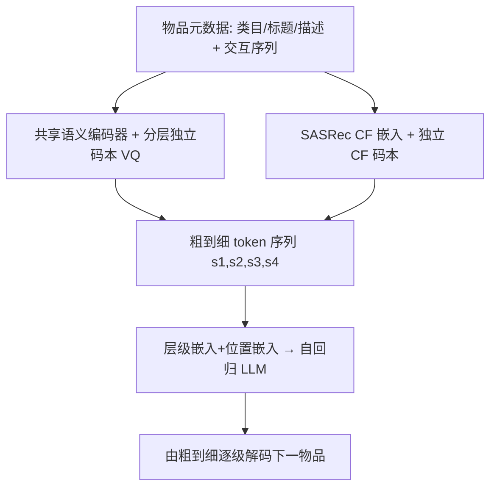

# CoFiRec: Coarse-to-Fine Tokenization for Generative Recommendation (面向生成式推荐的由粗到细语义分词)

- **会议/期刊**: RecSys 2026
- **作者与机构**: Tianxin Wei, Xuying Ning, Xuxing Chen, Ruizhong Qiu, Yupeng Hou, Yan Xie, Shuang Yang, Zhigang Hua, Jingrui He（UIUC / Meta / UCSD）
- **推荐链路定位**: 端到端生成式（Tokenization + 自回归生成）
- **研究方向**: 生成式推荐与离散语义ID / 序列推荐
- **论文原文**: [https://arxiv.org/abs/2511.22707v2](https://arxiv.org/abs/2511.22707v2)
- **开源代码**: [https://github.com/YennNing/CoFiRec](https://github.com/YennNing/CoFiRec)

## TL;DR (1分钟核心速览)

现有生成式推荐（TIGER/RQ-VAE 系）把 ID、类目、标题、描述压进**单一嵌入**再做残差量化，抹平了物品固有的语义层级，也与用户"先逛大类、再挑具体款"的偏好收敛过程错位。CoFiRec 把物品拆成 `类目→标题→描述→CF` 四个语义层，每层用**独立码本**量化并保留结构顺序，让 LLM 按由粗到细的顺序自回归解码。在 Instruments/Yelp/Beauty 三个基准、Leave-One-Out + 全库排序协议下，平均超越最强基线约 6.4%（Beauty R@10 0.0679 vs. SemID 0.0597），冷启动物品上相对 TIGER 提升 10.0%。

## Background & Motivation (背景与核心矛盾)

- **主流范式**: 生成式推荐把下一物品预测改写为离散 token 序列的自回归生成，代表作为 RQ-VAE 残差量化（TIGER）、文本 ID（IDGenRec）、人工 taxonomy（SemID）。
- **前人局限**: ① 所有异构属性在量化前被**压平进同一隐空间**，残差量化只带来"隐式"层级，缺乏语义粒度与可解释性；② SemID 的层级是人工定义、不可学习，跨数据集判别力弱；③ 扁平 token 序列在 beam search 早期缺乏中间语义线索，正确物品易被过早剪枝。
- **核心洞察 (Key Insight)**: 物品元数据天然是多尺度的（大类→型号→系列→单品），这与用户在网上逐步收敛偏好的过程同构；把这一结构显式写进 token 序列，等价于给解码器提供了逐级收窄的搜索约束。
- **本文切入点**: 用"分层独立量化 + 由粗到细解码"替代"压平后残差量化"，并把协同过滤信号放在最细粒度层做消歧。

## Method (核心方法设计)

### 1. 整体框架 (Overall Architecture)

两阶段流水线。**第一阶段**：为每个物品构建 $K=4$ 级语义层级 $[x^{(1)},\dots,x^{(K)}]$（类目/标题/描述/CF），前三级文本经预训练 LLaMA-7B 取嵌入后过**共享** MLP 语义编码器，各自用独立码本量化；第四级从预训练 SASRec 取 CF 嵌入，过**独立** CF 编码器与码本量化。**第二阶段**：把用户历史中每个物品展开为 4 个 token，注入 token-ID、层级、位置三类嵌入后送入 T5/LLaMA 自回归骨干，按粗到细顺序逐 token 生成下一物品，推理时 beam size=20。

### 2. 关键设计拆解 (Key Designs)

1. **分层独立量化 (CoFiRec Tokenizer)**：痛点是压平嵌入让不同粒度语义互相污染、码本碰撞严重。做法是每级独立编码 + 独立码本最近邻量化 $s_i^{(k)} = \arg\min_j \|h_i^{(k)} - c_j^{(k)}\|^2$，前三级共享编解码器以保持跨层一致，CF 层单独一套。直觉：粗层只需区分大类（码本 256 够用），细层需区分同款近似物品（码本 512 更优），容量按粒度分配后碰撞率从 RQ-VAE 的 0.0027/0.0410/0.0009 降到 0.0001/0.0002/0.0002，**低一个数量级以上**。

2. **由粗到细自回归解码 + 层级/位置嵌入**：痛点是扁平 token 序列不区分 token 的语义角色。生成概率改写为 $P(s^{(K)},\dots,s^{(1)}\mid H_u)=\prod_{k=1}^{K}P(s^{(k)}\mid s^{(<k)},H_u)$，输入嵌入为 $e_t^{(k)}=E_{id}(s^{(k)}_{i_t})+E_{level}(k)+E_{pos}(t)$。CF token 置于末位，使其在已知粗层意图的条件下做用户级消歧。作者进一步给出 Proposition 1：在每级正确率 $p>1/V$ 时，层级解码的期望不相似度 $\mathbb{E}_{hier}[d]=K-\sum_{k=1}^{K}p^k$ 严格小于独立解码的 $\mathbb{E}_{indep}[d]$，即结构先验把错误"局部化"在深层而非整条序列。

3. **训练目标、负采样与推理效率**：Tokenizer 用重构损失 + commitment 损失 $\mathcal{L}_{Tokenizer}=\mathcal{L}_{Recon}+\mathcal{L}_{Commit}$（$\mu=0.25$，直通估计器）；下游用**免负采样**的层级 softmax 生成损失 $\mathcal{L}_{Rank}=-\sum_{k}\log\frac{\exp(\phi(s^{(k)})/\tau)}{\sum_{v\in\mathcal{V}_k}\exp(\phi(v)/\tau)}$，$\tau=1$，每级词表内全量归一化。推理开销与 TIGER 基本持平（生成 0.0943s/step vs. 0.0998s/step，显存 <4GB）。

## Experimental Setup & Evaluation Protocol (实验设置与评估协议)

- **数据集与预处理**: 均按 `5-core` 过滤，并剔除元数据完全缺失的物品（无法构建层级）：

| 数据集 | #Users | #Items | #Interactions | 平均序列长 | 特征/场景说明 |
| :--- | :---: | :---: | :---: | :---: | :--- |
| Instruments | 24,772 | 9,922 | 206,153 | 8.32 | Amazon 乐器评论，含类目/标题/描述 |
| Yelp | 30,431 | 20,033 | 316,354 | 10.40 | 本地商户评论 |
| Beauty | 22,363 | 12,101 | 198,502 | 8.88 | Amazon 美妆评论 |

- **数据划分与防穿越**: `Leave-One-Out`（最后一条测试、倒数第二条验证、其余训练），历史截断至最近 20 项，按时间排序。
- **排名评测协议**: 遵循 TIGER 的**全库排序**（对全部未交互物品打分排序），报告 Recall@{5,10} 与 NDCG@{5,10}；生成模型统一 beam size=20，取验证集最优 checkpoint。
- **对比基线与超参**: ID-based（MF、BERT4Rec、LightGCN、SASRec）与生成式（BigRec、SemID、CID、LETTER、TIGER、IDGenRec）共 10 个基线；语义嵌入取自 LLaMA-7B，CF 编码器 SASRec（$d=768$），码本大小在 {256,512,1024} 中搜索，学习率 {3e-4~6e-4}，提升显著性 $p\ll0.05$。

## Key Experimental Results (实验关键数据)

### 1. 主实验对比 (Main Results)

| 数据集 | 指标 | SASRec | TIGER | LETTER | SemID | IDGenRec | **CoFiRec** | Improv. |
| :--- | :---: | :---: | :---: | :---: | :---: | :---: | :---: | :---: |
| Instruments | R@10 | 0.0947 | 0.1035 | 0.0982 | 0.0964 | 0.0999 | **0.1118** | +8.0% |
| Instruments | N@10 | 0.0690 | 0.0782 | 0.0760 | 0.0730 | 0.0785 | **0.0820** | +4.5% |
| Yelp | R@10 | 0.0296 | 0.0270 | 0.0259 | 0.0324 | 0.0323 | **0.0395** | +21.9% |
| Yelp | N@10 | 0.0152 | 0.0173 | 0.0147 | 0.0170 | 0.0195 | **0.0208** | +6.7% |
| Beauty | R@10 | 0.0588 | 0.0353 | 0.0427 | 0.0584 | 0.0550 | **0.0679** | +13.7% |
| Beauty | N@10 | 0.0313 | 0.0283 | 0.0213 | 0.0335 | 0.0311 | **0.0370** | +10.4% |

（Improv. 相对该行最强基线；原文报告全数据集平均提升 7.27%，正文另述相对最佳基线 6.4%。）

### 2. 消融实验 (Ablation Study, Instruments)

| 变体 | R@5 | R@10 | N@5 | N@10 |
| :--- | :---: | :---: | :---: | :---: |
| Reverse Indices（层级倒序） | 0.0859 | 0.1047 | 0.0724 | 0.0785 |
| Random Indices（随机打乱） | 0.0834 | 0.0991 | 0.0725 | 0.0775 |
| w/o $E_{level}$ & $E_{pos}$ | 0.0885 | 0.1072 | **0.0753** | 0.0813 |
| w/o $e_i^{cf}$（CF 层换成语义层） | 0.0870 | 0.1082 | 0.0740 | 0.0808 |
| VAR w/ Text（池化构层级） | 0.0675 | 0.0798 | 0.0599 | 0.0639 |
| **CoFiRec** | **0.0897** | **0.1118** | 0.0752 | **0.0820** |

### 3. 关键实验发现 (Key Findings)

1. **顺序即信息**：把层级倒序或随机打乱后 R@10 从 0.1118 掉到 0.1047/0.0991（随机最差），说明收益并非来自"多 token"本身，而是来自粗→细的条件依赖；这与 Proposition 1 的期望不相似度分析一致。
2. **CF 层不可替代**：末位 CF token 换成语义 token 后 R@10 降至 0.1082，证明文本语义相近的物品必须靠协同共现信号在最后一层消歧；同时层级嵌入/位置嵌入移除后 N@5 反而略升（0.0753 vs. 0.0752），提示结构嵌入主要改善排序头部之外的召回而非头部精度。
3. **冷启动与骨干鲁棒性是最大增量**：冷启动物品（频次最低 2%）上 CoFiRec 相对 TIGER 提升 10.0%（R@10 0.0943 vs. 0.0801），远高于热启的 4.7%；换 LLaMA-1B/3B 骨干时 TIGER 的 R@5 崩到 0.0202/0.0242，CoFiRec 稳定在 0.0403，说明结构化 token 对解码器规模不敏感。

## Highlights, Limitations & Rating (亮点、对比与审稿评价)

- **与代表作对比 (vs. Prior Work)**: 与 TIGER 的本质区别是"残差量化产生隐式层级"vs."元数据显式分层 + 独立码本"，前者靠追加 token 解决碰撞、易语义漂移，后者从源头把碰撞率降一个数量级；与 SemID 的区别是层级**可学习**而非人工 taxonomy；与视觉域 VAR 的区别是处理离散文本语义而非连续 latent map，池化式构层级（VAR w/ Text）在此任务上直接失效（R@10 仅 0.0798）。
- **可迁移亮点**: ① "按语义粒度分配码本容量"（粗层 256、细层 512）可直接用于任何 RQ-VAE 类 tokenizer 的容量调参；② 用 GPT-4o 从纯标题/描述自动构建 4 级层级（AHC）即可逼近全元数据效果，为元数据缺失场景提供低成本兜底。
- **审稿级局限批判**: ① Tokenizer 与生成器**两阶段分离训练**，码本空间未与下游生成目标联合对齐，作者亦在 Future Work 中承认；② 层级依赖 `category/title/description` 三字段，缺失时需 IE 或 LLM 补全，且层级数 $K$ 固定为 4、码本配置对性能敏感（Large 配置反而下降）；③ 仅在 2 万级公开数据集验证，无工业级线上 A/B 与延迟数据。
- **四维评分**: 创新性 ⭐⭐⭐⭐ | 实验扎实度 ⭐⭐⭐⭐ | 方法清晰度 ⭐⭐⭐⭐⭐ | 落地价值 ⭐⭐⭐⭐

